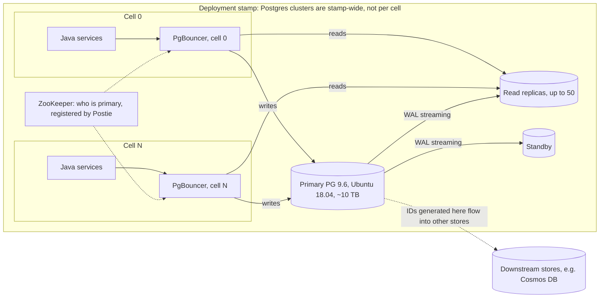
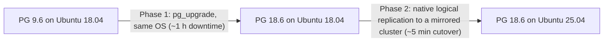

# Technical Retrospective: PostgreSQL 9.6 → 18.6 and Ubuntu 18.04 → 25.04 Upgrade

> **Format:** 45-minute interactive discussion with a Senior Engineer. Treat it like onboarding a new teammate onto the project: whiteboard, code and trade-offs, not slides.
> **Goal:** show the project at every level, from why it existed down to `pg_upgrade` flags, replication slots and cutover steps, and defend each decision when asked "what if you'd done it differently?"
>
> **Evidence rule:** everything here comes from your story bank, Connect notes and your answers. Items marked **[confirm]** are gaps or my inferences. Verify them before the interview, and don't present them as fact until you have. PostgreSQL and Ubuntu behavior described as background (collation, logical replication limits, version changes) is public, documented behavior.

---

## 0. Run Plan (45 minutes)

| Time | Segment | What's on the whiteboard |
|---|---|---|
| 0–4 min | Context, **why it was critical**, why now (§1, §1.1) | Nothing yet. Say it in plain words. End on "this was the gate to Teams integration." |
| 4–6 min | Requirements and constraints (§2) | A short list: downtime budget, no data loss, rollback, ~40 clusters, 15 teams |
| 6–12 min | Starting architecture (§3) | **Diagram 1:** one cluster: primary, standby, up to 50 replicas, pooler, services |
| 12–25 min | The core design: two phases and why (§4–§6) | **Diagram 2:** Phase 1 `pg_upgrade` on the same OS, Phase 2 logical replication to a new OS |
| 25–33 min | Roadblocks (§8). **Lead with §8.9**, the executive ask for a no-outage test: it's your strongest leadership story | **Diagram 3:** the cutover sequence, and where sequences broke |
| 33–38 min | Results, impact and lessons (§9–§10) | The chain: upgrade → CVEs cleared → Teams integration; plus the metrics |
| 38–45 min | Interviewer's "what if" probes (§11) | Whatever they ask for |

**Steer, don't lecture.** After each segment, pause: "Want me to go deeper on the replication side or on the rollout?" The interviewer will drive into the details. Your job is to make every box on the whiteboard something you can explain two levels down.

---

## Fact Sheet (memorize)

| Fact | Value |
|---|---|
| PostgreSQL | 9.6 → **18.6** |
| OS | Ubuntu **18.04 → 25.04** **[confirm target: 25.04 is a non-LTS interim release, see §11 Q9]** |
| Scope | **~40 production clusters** across every deployment stamp, plus LAB and STAGE |
| SLA clusters | **7**, upgraded **in parallel** by an ADO pipeline |
| Data size | **~10 TB per cluster** |
| Largest topology | **1 primary + 1 standby + 50 read replicas** |
| People | Led **10–15 engineers**; **15 service teams** (~150 engineers) had to certify |
| Phase 1 downtime | **~1 hour per cluster**, as a **write outage**: Engage stayed readable (§5.4) |
| Phase 2 cutover | **~5 minutes** (OS move via logical replication) |
| Outcome | **Critical CVEs cleared** and Trust requirements met → **unblocked Viva Engage's integration with Microsoft Teams**; incidents involving **replication lag, kernel panics and I/O saturation down 40%**; replication lag eliminated; faster indexing; Infrastructure team owns the tooling today |

---

## 1. Context: Why This Project Existed

**Opening (≈60 seconds, say it out loud):**

"Viva Engage's data tier ran on about 40 PostgreSQL 9.6 clusters on Ubuntu 18.04 VMs in Azure. Each holds about 10 TB, and the largest has a primary, a standby and 50 read replicas. PostgreSQL 9.6 has been end-of-life since November 2021, there were open critical CVEs, and Microsoft's Trust requirements weren't met. That blocked Viva Engage from integrating with Microsoft Teams, which has strict security requirements, and with other M365 surfaces like Copilot. So we had to move every cluster forward two ways: the database engine nine major versions, and the operating system underneath it. We had to do it without losing data, with a bounded downtime budget, and with 15 service teams that all depend on these clusters able to sign off that their service still worked. I owned it end to end and led 10 to 15 engineers through it."

### 1.1 Why it was critical to the organization

This wasn't routine maintenance. Four pressures met on the same clusters:

| Pressure | What was at stake | Why waiting made it worse |
|---|---|---|
| **Security** | Open critical CVEs on PostgreSQL 9.6 and Ubuntu 18.04 | 9.6 has been end-of-life since November 2021, so new vulnerabilities would never get community patches. Every month added exposure that couldn't be fixed in place. |
| **Compliance** | Microsoft's Trust requirements unmet | Every Viva Engage service sits on these clusters, so a single non-compliant data tier fails the whole product's review |
| **Business growth** | **Integration with Microsoft Teams** and other M365 surfaces (Copilot) | Teams has strict security requirements for anything integrated into it. Viva Engage couldn't ship into Teams while its database carried open critical CVEs on an unsupported version. **The upgrade was on the critical path of the product strategy, not beside it.** |
| **Reliability** | Recurring incidents involving replication lag, kernel panics and I/O saturation | Those incident classes were tied to the old engine and kernel, so they would keep recurring on 9.6 and 18.04 |

And everything depended on it: all 15 Viva Engage service teams (~150 engineers) ran on these clusters, so a bad upgrade risked customer-visible downtime and refunds across the whole product. That's why it needed a careful design, not just a version bump.

**One line to use:** "Clearing these CVEs wasn't the goal in itself. It was the gate that let Viva Engage integrate with Microsoft Teams."

### 1.2 My role: what I owned, built and delegated

I owned the project end to end, from design and runbook through cross-org alignment and execution, and I led 10 to 15 engineers.

| Workstream | Owner | What it covered |
|---|---|---|
| Upgrade design, runbook and go/no-go criteria | **Me** | Two-phase design, the production runbook, rollback rule, options analysis |
| Cross-org alignment | **Me** | Status and options posts to the org, the RFC review with principal engineers, decision-first executive updates |
| Infra tooling compatibility | **Me** + [confirm] | Modified infra tools to work with the new PostgreSQL version (feature-flagged) |
| PostgreSQL VM image | **Me** + [confirm] | Trimmed unnecessary packages from the storage image |
| Automation | **Me** (built with AI) | The ADO pipeline that upgraded the 7 SLA clusters in parallel |
| Service certification | **Amruta Khadye**, coached by me | Scenario spreadsheet, team deadlines, staging tests, tracking |
| Customer messaging | PM (banner text); **me** (banner template code) | The specific maintenance banner with the time in it |
| OS / Ubuntu move | [confirm] | Mirrored clusters, logical replication, cutover |

**[confirm: the owner and headcount for each workstream.]** When you're asked "what did *you* do?", answer from the **Me** rows. When you're asked "how did you scale?", answer from the delegated rows.

### 1.3 Stakeholder map

| Stakeholder | What they needed | How I engaged |
|---|---|---|
| Engage leadership team and the executive sponsor | Confidence, a go/no-go decision, customer impact in business terms | Decision-first updates (§8.7), written options, a named reviewer list (§8.9) |
| Infra leadership and peers | Safe execution and an operable runbook | Runbook review, and reviewers of the options analysis |
| Principal engineers on the service side | Data integrity: no split brain, no corrupted IDs | RFC review; accepted their critique of my first option (§8.9) |
| 15 backend service teams (~150 engineers) | What to test, by when, and what mitigations to put in place | Scenario spreadsheet with deadlines, the certification rule (§7) |
| Product managers | Customer messaging | Banner text |
| Front-end team | Busy with feature work | I built the banner template myself (§8.8) |
| YES team | The LAB environment | Upgraded LAB together |
| Trust and Security | CVEs cleared, Trust requirements met | The upgrade itself, which unblocked Teams (§9.3) |
| Azure | Capacity and quota | Procured capacity; the minimum-node decision when provisioning failed (§8.4) |

In the interview, use **roles**, not names.

### 1.4 Timeline

| When | Milestone |
|---|---|
| [confirm start] | Project kickoff, design and runbook |
| By May 7, 2025 | LAB upgraded, with **every service team validating compatibility**; STAGE upgraded |
| May 7, 2025 | I posted the status and production plan to the org (**seen by 173 people**), including options for the executive's no-outage test request |
| May 8–9, 2025 | RFC review with infra and service principal engineers; decision: no safe dry-run without a write outage (§8.9) |
| May 14, 2025 | Deadline for service teams' scenario sheets and mitigations |
| May 16, 2025 | Staging write-outage test |
| May 27, 2025 | Cell 0 EU dry-run formally ruled out (real customer traffic in the cell) |
| [confirm dates] | PROD: non-SLA cohort, then the 7 SLA clusters in parallel |
| [confirm date] | OS move (Ubuntu); goal was all environments by Q2 2026 |

> **Version consistency check:** your May 2025 thread says **PostgreSQL 16**, but this doc says **18.6**. Pick the true story and say it the same way every time. If production landed on 16 and later moved to 18.6, say "9.6 → 16, then 18.6". **[confirm]**


**Why it was hard, in one breath:** a 9-major-version database jump, a cross-OS move with a known index-corruption trap, 10 TB per cluster, 50-replica fan-out, ~40 clusters, and 15 teams whose code had version-specific assumptions baked in.

---

## 2. Requirements and Constraints

**Functional**
1. Every production cluster runs PostgreSQL 18.6 on the new Ubuntu release, in every deployment stamp.
2. Every dependent Java and infrastructure service works against both versions during the rollout, because clusters upgrade on different days.
3. Customers are told exactly when maintenance happens (a specific banner with the time, not a generic outage banner).

**Non-functional**

| Requirement | Target | Why it shaped the design |
|---|---|---|
| Data loss | **Zero** | Rules out anything that can't prove the target matches the source |
| Downtime | ~1 hour per cluster for the engine upgrade, minutes for the OS move | Rules out dump/restore of 10 TB, and in-place OS upgrade + full `REINDEX` |
| Rollback | A tested path back at every irreversible step | `pg_upgrade --link` and cutovers are one-way unless you design a way back |
| Index correctness | No silent corruption | The glibc collation change (§4.2) |
| Blast radius | SLA clusters last, after a bake period | Non-SLA cohort first, then the SLA cohort |
| Certification | Each of the 15 teams signs off in the window | Teams couldn't prove "everything works", so the bar became core SLA scenarios (§7) |

**Constraints I didn't control:** Azure VM capacity and APIs, the Trust deadline, weekend-only maintenance windows, and service teams' own test coverage.

---

## 3. Starting Architecture (Diagram 1)

Draw one cluster first, then say "times ~40, across deployment stamps".



What to say about each box:
- **Primary:** takes all writes. WAL (write-ahead log) records every change.
- **Standby:** a physical replica kept ready for failover.
- **50 read replicas:** the workload is read-heavy, so reads fan out. Each replica runs a `walreceiver` process that connects to a `walsender` on the primary over the libpq **streaming replication protocol** (TCP) and replays WAL byte for byte. Physical replication means a replica is a block-for-block copy of the primary. That's important for both phases: a physical replica must run the **same major version** and, in practice, the **same glibc collation** as its source.
- **Stamps, cells and networks:** a deployment stamp is an independent production environment. It contains cells, and customer networks (tenants) live in cells. The **Postgres clusters are stamp-wide**: one cluster serves every cell in the stamp, with a single writable primary.
- **PgBouncer per cell:** each cell's services connect through that cell's PgBouncer, which routes writes to the primary and reads to the replicas.
- **ZooKeeper + Postie:** ZooKeeper holds which node is the current primary, and Postie is the component that registers it. **[confirm Postie's exact role and how PgBouncer picks up a primary change.]**
- **IDs leave Postgres:** IDs generated in Postgres propagate into other stores such as Cosmos DB. That's why a split brain here isn't a local problem: corrupted IDs spread across the system (§8.9).
- **VMs** come from the storage **image factory** (a baked PostgreSQL + Ubuntu image). As part of this work, I trimmed unnecessary packages from that image.

**Pain points on 9.6 / 18.04** (the reason for the 40% incident drop): replication lag, kernel panics, I/O saturation.

---

## 4. The Core Design: Two Phases, and Why in That Order (Diagram 2)



### 4.1 Options I considered

| Option | Why it's attractive | Why I rejected it |
|---|---|---|
| `pg_dump` / `pg_restore` | Simple; produces a clean cluster with fresh indexes | 10 TB per cluster means many hours of downtime per cluster, times ~40 |
| In-place OS upgrade (`do-release-upgrade`) + `pg_upgrade` | No new hardware | The glibc 2.28 collation change silently corrupts text indexes (§4.2). Fixing it means `REINDEX` of every text index on 10 TB, which is hours of degraded or blocked service. |
| Physical streaming replica on the new OS, then fail over | Short cutover | Physical replication copies index pages as-is, so it carries the **same** collation corruption onto the new OS |
| One hop: third-party logical replication (e.g. `pglogical`) from 9.6 straight to 18.6 on the new OS | Single cutover | 9.6 has no **native** logical replication. It would mean an extension on every production primary, its own operational risk, and a support path outside core PostgreSQL. **[confirm whether you evaluated it]** |
| **Chosen: Phase 1 `pg_upgrade` on the same OS, then Phase 2 native logical replication to a new-OS cluster** | Each phase uses core PostgreSQL tooling, and each risk is isolated | Two windows instead of one, and logical replication's limits (DDL, sequences) to manage |

**The order is forced:** native logical replication only exists from PostgreSQL 10, so the engine had to move first. Doing that first step on the **same OS** means `pg_upgrade` reuses data files whose collation still matches the glibc they were built with. Then logical replication moves the data to the new OS, and it rebuilds every index on the target using the target's glibc.

### 4.2 The collation trap (expect a probe here)

- PostgreSQL delegates text sorting to the OS C library (glibc) for libc-based collations such as `en_US.UTF-8`.
- **glibc 2.28** changed sort order for many locales. Ubuntu 18.04 ships glibc 2.27, and every later release ships ≥ 2.28.
- A B-tree index is a **persisted sort order**. If the data files move to a host where the comparison function orders strings differently, the index is still there but now "wrong". Lookups can miss rows that exist, and unique constraints can admit duplicates. Nothing errors, so it's **silent**.
- Anything that reuses the physical files carries the problem over: an in-place OS upgrade, a physical replica on the new OS, or `pg_upgrade` run across OSes.
- **Logical replication avoids it**, because the subscriber receives **rows** and builds its own indexes with its own glibc.
- **[confirm: database locale/collation. If it were `C`, the issue wouldn't apply, so know your answer.]**

### 4.3 Decision log: the calls that shaped the project

| # | Decision | Alternatives | Who pushed back, and how it was settled | Section |
|---|---|---|---|---|
| 1 | Two phases: `pg_upgrade` on the same OS, then logical replication to the new OS | Dump/restore; in-place OS upgrade + `REINDEX`; physical replica on the new OS | Driven by the collation risk and 10 TB per cluster | §4.1–4.2 |
| 2 | **No production canary without a write outage.** Upgrade under a write outage and validate in-window with Microsoft's own tenant (MSIT) | Route only Cell 0 to a new-version node; dry run, then revert; give MSIT dedicated clusters | The executive sponsor asked for a no-outage test. Principal engineers showed my Cell 0 option would cause a split brain. I accepted it, documented the reviewers, and recommended the safe path | §8.9 |
| 3 | Certify **core end-user scenarios** only, with a pre-agreed rollback rule | Exhaustive end-to-end testing | Teams couldn't define "working"; the bounded scope made it achievable | §7, §8.1 |
| 4 | Non-SLA cohort first, then the 7 SLA clusters **in parallel** via the ADO pipeline | Cluster by cluster | Parallelism shrank the total outage window | §5.6 |
| 5 | **Continue on minimum nodes** when Azure provisioning failed | Abort | Several tech leads wanted to abort; I proposed the reversible middle path | §8.4 |
| 6 | Keep the old nodes after the OS cutover as the rollback target | Decommission at cutover | Cheap insurance; trade-off: writes made after cutover | §6.3 |

---

## 5. Phase 1 Deep Dive: `pg_upgrade` 9.6 → 18.6 (same OS)

### 5.1 How `pg_upgrade` works

1. `initdb` a new 18.6 cluster with the new binaries.
2. `pg_upgrade --check` validates compatibility (data types, extensions, encoding, settings) **without** touching data. Run it days ahead, as a pre-flight gate.
3. Stop the old cluster (downtime starts).
4. `pg_upgrade` dumps and restores only the **schema/catalog**, then transfers user data files:
   - **copy** mode: copies 10 TB, which takes hours. Not viable.
   - **link** mode: hard-links the existing data files into the new cluster, so the time depends on the number of files, not their size. Minutes. **[confirm you used `--link`. ~1 h total for 10 TB only works with link or clone mode.]**
5. Start 18.6, run post-upgrade steps, validate.

```bash
# Illustrative: reconstruct the real invocation from your pipeline
/usr/lib/postgresql/18/bin/pg_upgrade \
  --old-bindir=/usr/lib/postgresql/9.6/bin --new-bindir=/usr/lib/postgresql/18/bin \
  --old-datadir=/data/pg96 --new-datadir=/data/pg18 \
  --link --jobs=16 --check        # pre-flight; rerun without --check in the window
```

**Gotchas worth naming (they show depth):**
- **Data checksums:** from PostgreSQL 18, `initdb` enables data checksums by default. `pg_upgrade` requires the old and new clusters to match, so a 9.6 cluster without checksums needs the new cluster created with `--no-data-checksums`. **[confirm whether you hit this]**
- **Planner statistics:** PostgreSQL 18's `pg_upgrade` carries optimizer statistics across, so the cluster doesn't start with blind query plans. On older target versions you'd run `vacuumdb --analyze-in-stages` before taking traffic.
- **Extensions:** each extension's shared library must exist for the new major version before `pg_upgrade` will pass `--check`. **[confirm which extensions you had]**

### 5.2 Rollback in link mode (a likely probe)

Once the new cluster starts in link mode, the old data directory is no longer safe to start, because both clusters share the same files. So the rollback point can't be "start 9.6 again". It has to be something the upgrade never touched. **[confirm which you used: the un-upgraded standby kept as the rollback node, an Azure disk snapshot taken right before the window, or both.]** Your Connect notes say **rollback testing took longer than expected**. Own that: proving a rollback path for 10 TB is expensive, and it's the step most teams skip.

### 5.3 The 50 replicas

A physical replica can't stream from a different major version, so every replica and the standby must be rebuilt after the primary moves to 18.6.
- **Options:** `pg_basebackup` from the new primary (10 TB × 50 = 500 TB pulled from one primary, which saturates it), cascading replicas (rebuild a few, then seed the rest from them), the `rsync --hard-links` method from the `pg_upgrade` docs, or provisioning new VMs from the image and seeding from snapshots. **[confirm your method]**
- **Bring back a minimum set first.** The primary plus a minimum number of replicas come back inside the window, and the rest are added afterward. This is what saved the Saturday production night (§8.4): when Azure VM provisioning was failing, we ran on the minimum set, because weekend traffic is lower, and provisioned full capacity that night once the Azure SDKs were stable.

### 5.4 The ~1-hour window: a write outage, not a full outage

Engage stayed **readable** throughout. Only writes stopped, and the banner told users they could read but not post until a specific time. The production runbook I wrote:

1. **Start a write outage for all tenants** (read-only mode, banner on).
2. **Run the PostgreSQL upgrade** (`pg_upgrade --link`, ~20 min **[confirm]**).
3. **Re-enable writes for Cell 0 / MSIT only** (Microsoft's own tenant) on the new version, and run validation tests.
4. **If validation passes**, re-enable writes for all tenants on the new version.
5. **If it fails**, roll MSIT back to 9.6 and re-enable writes for all tenants on the old version.

Why this shape: MSIT is the **canary**. Microsoft's own users exercise the new version with real writes before any external customer does. And because the other tenants are still in read-only mode, a rollback can't corrupt their data.

**The trade-off to own:** once MSIT writes land on the new version, rolling back to 9.6 loses those writes. That is the "no turning back once writes are accepted" point a principal engineer raised (§8.9). **[confirm how the final runbook handled MSIT writes made before a rollback decision.]**

**[confirm: how reads were served during the window. 9.6 replicas keep serving static reads while the primary is down, but they can't follow a new-version primary once writes resume, so new-version replicas must be up first (§5.3).]**

### 5.5 Breaking changes between 9.6 and 18.6 (all of these hit us)

| Change | Version | What broke | Fix |
|---|---|---|---|
| `pg_xlog` → `pg_wal` directory; `xlog` functions renamed (`pg_current_xlog_location()` → `pg_current_wal_lsn()`, `pg_last_xlog_replay_location()` → `pg_last_wal_replay_lsn()`) | 10 | Infra tooling: lag monitoring, backup and WAL scripts | Version-aware tooling behind a flag |
| `recovery.conf` removed; replaced by `standby.signal` + `primary_conninfo` in `postgresql.conf` | 12 | Replica provisioning automation | New provisioning path for 18.x behind a flag |
| `password_encryption` default becomes `scram-sha-256` | 14 | Java services on older JDBC drivers that can't do SCRAM auth | JDBC driver upgrade, rolled out before the clusters moved |

**Why feature flags:** for weeks, some clusters ran 9.6 and others ran 18.6. With flags, a service could ship one build that worked against both, and we flipped behavior per cluster as it upgraded. There was **no deployment lock** across 15 teams, and no coordinated "big bang" release.

```java
// Illustrative pattern, not production code
String lagSql = flags.isEnabled("pg18." + clusterId)
    ? "SELECT pg_wal_lsn_diff(pg_current_wal_lsn(), replay_lsn) FROM pg_stat_replication"
    : "SELECT pg_xlog_location_diff(pg_current_xlog_location(), replay_location) FROM pg_stat_replication";
```

### 5.6 Rollout and automation

- **Environments:** LAB → STAGE → PROD. LAB and STAGE validated tooling and let service teams test first.
- **Cohorts:** non-SLA clusters first, with enough bake time to watch stability, then the **7 SLA clusters in parallel** in a later window.
- **ADO pipeline (built with AI help):** made the 7 SLA clusters upgrade in parallel, which shrank the total outage window, and made every run identical. The stages: pre-flight `--check`, drain, upgrade, start, replica rebuild, validation gate, flag flip. **[confirm the exact stages and the gate criteria]**

---

## 6. Phase 2 Deep Dive: OS Move via Native Logical Replication

### 6.1 How it works

Logical replication ships **row changes**, not disk blocks. The publisher's WAL is decoded by the `pgoutput` plugin into INSERT/UPDATE/DELETE messages, which a **replication slot** streams to the subscriber's apply worker over the replication protocol. The slot guarantees the publisher keeps WAL until the subscriber confirms it.

```sql
-- On the old primary (PG 18.6, Ubuntu 18.04)
CREATE PUBLICATION os_move FOR ALL TABLES;

-- On the new primary (PG 18.6, Ubuntu 25.04), after loading the schema with pg_dump --schema-only
CREATE SUBSCRIPTION os_move
  CONNECTION 'host=old-primary dbname=app user=repl'
  PUBLICATION os_move WITH (copy_data = true);

-- Lag: how far behind the subscriber is (on the publisher)
SELECT slot_name,
       pg_size_pretty(pg_wal_lsn_diff(pg_current_wal_lsn(), confirmed_flush_lsn)) AS lag
FROM pg_replication_slots WHERE slot_name = 'os_move';
```

Steps:
1. Build the **mirrored cluster** on Ubuntu 25.04 with the same PostgreSQL 18.6 and the same shape.
2. Load the schema only. Logical replication **does not replicate DDL**, so schema changes are frozen until cutover.
3. Subscribe with `copy_data = true`. The initial copy of ~10 TB runs in table-sync workers while ongoing changes stream.
4. Build the new cluster's standby and replicas from the **new** primary with physical replication. That's safe because they share the same OS and glibc.
5. Cut over (§6.3).

### 6.2 Risks I had to manage

| Risk | Why | Mitigation |
|---|---|---|
| **WAL pile-up on the old primary** | The slot retains WAL until the subscriber confirms it. A slow 10 TB initial sync or a stalled subscriber fills the publisher's disk. | Alert on slot lag and disk usage; `max_slot_wal_keep_size` as a backstop **[confirm]** |
| **DDL drift** | DDL isn't replicated | DDL freeze during the migration window |
| **Tables without a primary key** | UPDATE/DELETE need a replica identity | Add a PK or `REPLICA IDENTITY FULL` before starting **[confirm if any]** |
| **Sequences** | **Native logical replication in PostgreSQL 18 doesn't replicate sequence state** | This is the one that bit us (§8.5) |
| **Large objects** | Not replicated | **[confirm none]** |

### 6.3 Cutover (~5 minutes) (Diagram 3)

```mermaid
sequenceDiagram
    autonumber
    participant Ops as Pipeline / On-call
    participant App as Services
    participant Old as Old primary (18.04)
    participant New as New primary (25.04)
    Ops->>App: Banner on, stop writes (maintenance mode)
    Ops->>Old: Confirm no new writes
    Ops->>New: Wait until slot lag = 0
    Ops->>New: Sync sequences (setval to old last_value + margin)
    Note over Ops,New: The step missed at first (§8.5)
    Ops->>App: Repoint endpoint to New
    Ops->>App: Writes on, teams run core SLA scenarios
    alt core SLA scenario fails
        Ops->>App: Roll back: repoint to Old nodes (kept intact)
    else passes
        Ops->>Old: Keep for N days, then decommission
    end
```



**Rollback:** we kept the old nodes intact, so rollback was "point the endpoint back". The trade-off to own: any writes accepted on the new cluster after cutover don't exist on the old nodes unless you set up **reverse replication** (new → old). That makes the rollback window short, or it means accepting a data reconciliation. **[confirm: did you have reverse replication? If not, say what you'd do differently.]**

---

## 7. Verification and Certification

- **The problem:** 15 service teams didn't know how to certify their service after the upgrade. Unit and integration tests had gaps, and end-to-end suites were risky and slow.
- **My decision:** each team identifies its **core SLA scenarios** and certifies only those in the window. **Rule:** a core SLA scenario fails → roll back. Anything else → fix forward.
- **Why it works:** it gives each team a bounded, achievable definition of "working" that fits in a maintenance window, and a pre-agreed rule means no debate at 2 a.m.
- **Ownership:** I coached **Amruta** to own the testing effort, coordinating teams and tracking test cases in a shared spreadsheet.
- **What each team did before the upgrade:**
  1. Reviewed the **end-user scenario spreadsheet**, including async writes, for impact on the services it owns, and added missing scenarios.
  2. For any scenario expected to **fail** during the write outage, stated whether the data was **recoverable**, for example through Vent (eventing) retries.
  3. Documented **proactive mitigations**: extending TTLs, increasing Vent timeouts and retries, and temporarily pausing async tasks.
  4. Flagged scenarios the read-only banner didn't cover. Deadline: May 14, 2025.
- **Pre-production testing:** a staging write-outage test on May 16, 2025. Engineers pointed out that the Taurus traffic generator depended on client operations that had changed, and suggested a Java load tool to ramp pressure on the new version. **[confirm what you ran.]**
- **After the upgrade:** each team verified its service against its scenarios, and the rollback rule applied.
- **Data checks [confirm what you ran]:** row counts per table and checksums on sampled ranges between old and new for Phase 2, plus `amcheck` on indexes.

---

## 8. Roadblocks and How I Navigated Them

Use the same shape for each one: **what happened → technical root → what I did → what I'd do differently.**

### 8.1 Fifteen teams couldn't say how to sign off
- **What happened:** about 15 service teams (~150 engineers) depended on these clusters, and none of them could say how they'd prove their service still worked after the upgrade. Unit and integration tests had gaps. End-to-end suites were risky and expensive to run. And a maintenance window can't stay open while 15 teams debate what "working" means.
- **Root cause:** there was no shared, bounded definition of "working". Certification was open-ended, so it couldn't fit in a window and gave nobody a clear go/rollback signal.
- **What I did:** I narrowed the question. Each team identified its **core SLA scenarios**, the flows its SLA actually covers, and tested only those after the upgrade. I set a single rule in advance: **if a core SLA scenario fails, we roll back. Anything else, we fix forward.** I coached Amruta to own the testing coordination and the tracker, so it didn't run through me.
- **Why it worked:** every team had an achievable definition of done that fit in the window, and the rollback decision was made before the window, not at 2 a.m. under pressure.
- **What I'd do differently:** have teams define and rehearse their SLA scenarios in LAB, not just before PROD. And write a RACI for each window, because the Connect notes record **confusion about roles** among service teams.

### 8.2 Breaking changes across Java and infrastructure
`pg_wal` renames, the `recovery.conf` removal and SCRAM auth broke tooling and drivers (§5.5). I used feature flags for dual-version compatibility and rolled the JDBC driver upgrade out ahead of the clusters, so no deployment lock was needed.

### 8.3 The collation trap
Covered in §4.2. It drove the entire two-phase design.

### 8.4 Azure VM provisioning failed on the production Saturday
- **What happened:** in the middle of the production upgrade, Azure had intermittent VM provisioning failures. We had procured the capacity, but Azure was doing maintenance, so new nodes intermittently failed to come up. **[confirm: these were the new replica/standby VMs being provisioned as part of the window (§5.3).]** We held a large call with senior leaders to decide whether to go ahead or abort, and several tech leads were concerned and asked to abort.
- **The options:**

| Option | Upside | Downside |
|---|---|---|
| Abort | No new risk tonight | Reschedule a window for 15 teams, repeat the whole prep, and slip the Trust/CVE deadline |
| Continue and wait for full capacity | Full capacity at cutover | An open-ended outage tied to Azure's maintenance, which we didn't control |
| **Continue on the minimum node set (my proposal)** | The upgrade finishes on schedule | Less read capacity until the rest of the nodes come up |

- **My call:** continue on the minimum nodes, because customer traffic is lower on a weekend, and provision the rest once the Azure SDKs were stable.
- **Why it was safe:** the minimum set could carry weekend load **[confirm: how many replicas, and what you watched: replica CPU, p99 latency, replication lag]**. It was also reversible in the useful direction: adding replicas later doesn't change the upgrade itself, so we weren't trading correctness for schedule, only capacity for time.
- **Outcome:** we completed the upgrade on the minimum nodes, and on Saturday night, when the Azure SDKs were stable, we provisioned full capacity.
- **Related, from Connect:** a non-SLA upgrade failed on Azure API issues, and a last-minute Azure core shortage hit us. Lessons: track quota and cores as a pre-flight item, and during an incident give leadership mitigation steps and a timeline, not just status.
- **The general lesson:** "go or abort" is often a false binary. Look for a reduced-scope option that keeps the risk acceptable.

### 8.5 Sequences after the Ubuntu cutover (the setback; tell it honestly)
- **What happened:** after the OS cutover, we hit a **sequence-advance problem**. **[confirm the symptom and impact, e.g. duplicate-key errors on inserts, which services, and for how long.]**
- **Technical root:** native logical replication copies table rows but **not sequence state**. On the new cluster, sequences were still at their initial values while the tables held rows with much higher IDs. The next `nextval()` handed out IDs that already existed.
- **Fix:** at cutover, after writes stop and lag is 0, set every sequence on the new primary to at least the old primary's value, plus a safety margin.

```sql
-- Illustrative: on the OLD primary, generate setval statements for the new primary
SELECT format('SELECT setval(%L, %s, true);',
              schemaname || '.' || sequencename, COALESCE(last_value, 1) + 1000)
FROM pg_sequences;
```

- **Mechanism, not intent (matches your manager's feedback):** sequence sync became a **cutover step** in the pipeline. A **pre-flight check** now compares `max(id)` against the sequence value for every table. A **stage gate** blocks opening writes if any sequence is behind. And an **early-signal alert** fires on a spike in unique-violation errors after cutover.
- **What I'd do differently:** rehearse the full cutover in STAGE with production-like write traffic, including inserts, not only read validation.

### 8.6 Rollback testing took longer than expected
Proving a way back for 10 TB clusters is slow. Next time I'd schedule rollback rehearsal as its own milestone, with a fully functional STAGE environment kept ready for it.

### 8.7 My first plan review with the VP was too technical
- **What happened:** when I first presented the whole plan to the VP and senior leaders, the feedback was that it was too technical. They needed to decide whether to do the upgrade, and I'd walked them through the migration design the way I'd brief engineers.
- **Root cause:** I'd built the presentation for the wrong audience. Engineers need the how. Leaders need the decision, the risk and the cost of not acting.
- **What I changed:** a decision-first format. Lead with status and risk in business terms (customer impact, downtime per cluster, the rollback plan, and the CVE/Trust exposure of not upgrading), state the decision needed, and move the technical detail to an appendix for anyone who wants it.
- **Result:** executive alignment became much easier, which helped a high-risk plan with broad production impact move forward.
- **Lesson:** communication is judged by whether the audience can act on it. I now start any senior update by asking what decision the reader has to make.

### 8.8 The outage banner couldn't say what customers needed
- **What happened:** the UI only had a very generic system-outage banner; the planned text just said users could only read from Engage. This project needed a specific message with the maintenance time in it, because each cluster or stamp had its own window of about an hour. I asked the front-end team for help, but they were busy with other feature work.
- **What I did:** instead of waiting or shipping a vague message, I made the front-end change myself, using AI to help me work in an unfamiliar codebase. **[confirm: how the banner is driven (config or flag, start and end time parameters, time-zone handling) and whether the front-end team reviewed the PR.]**
- **Result:** customers saw the exact maintenance window, and the front-end team was happy to have a **custom outage-banner template** that they now reuse.
- **Lesson:** when a small dependency blocks a critical path and its owners are busy, unblock it yourself, and leave behind something reusable that the owning team is happy to keep.

### 8.9 The executive sponsor asked to test production without a write outage (the leadership story)

- **What happened:** before production, the executive sponsor asked us to test MSIT (Microsoft's own tenant) on the new PostgreSQL version **without** taking a write outage for other tenants. The real goal, as another leader put it, was to give service teams more time to test on migrated data than a ~1-hour cutover window allows. That goal was legitimate.
- **What I did:** I wrote up three options, posted them to the org with the production plan (seen by 173 people), and asked the experts directly whether they had concerns:
  1. **Isolated Cell 0 testing:** bring up new-version nodes and route only Cell 0's writes to them through that cell's PgBouncer config, with Postie stopped so ZooKeeper wouldn't promote the new node.
  2. **Dry run under a full write outage:** test MSIT on the new version, then revert it to 9.6, accepting possible data loss for MSIT.
  3. **Dedicated clusters for MSIT:** partition MSIT's data out of the shared clusters.
- **The pushback, and why it was right:**
  - The Postgres clusters are stamp-wide, with a single writable primary, and replicas must run the same version. Writes to two primaries are a **split brain**.
  - IDs generated in Postgres propagate into other stores such as Cosmos DB, so a split brain corrupts data far beyond Postgres and is nearly impossible to recover from.
  - Cell affinity isn't guaranteed. Cell 0 also carried other customers' traffic, uncelled services, the forward-sync pipeline and async jobs. And edge routing is best-effort, so requests can land in the wrong cell.
  - MSIT is itself a customer network, so "revert and lose MSIT's writes" isn't free. Dedicated clusters would have been a massive investment, out of line with the long-term plan.
- **How I resolved it:** I took it to an RFC review with infra and service principal engineers and agreed with the critique of my own first option. My recommendation: there's no safe dry run without a write outage, and option 2 *is* the original plan. So we'd go straight to the upgrade, validate in-window with MSIT as the canary, then either roll back or enable all tenants (§5.4). When the sponsor asked who had reviewed it, I named the infra and service reviewers. I also asked every service team for an estimated certification time, so leadership could size the window.
- **Why it's a leadership story:** I treated the executive's goal as real, made the options and trade-offs explicit in writing, invited the experts to break my own proposal, changed my position when they did, and closed the loop with a documented decision and named reviewers. The decision held when a later Cell 0 dry run was again ruled out because of real customer traffic.
- **What I'd do differently:** check cell affinity and the single-primary constraint before putting a routing-based option in front of an executive.

---

## 9. Results and Impact

### 9.1 The headline (say this first)

"The upgrade cleared the open critical CVEs and met Microsoft's Trust requirements, and that opened the path for Viva Engage to integrate with Microsoft Teams, which had been blocked by Teams' security requirements. On the way, incidents involving replication lag, kernel panics and I/O saturation dropped 40%, replication lag was eliminated, and indexing got faster. Every one of the ~40 production clusters was upgraded."

### 9.2 Positive outcomes

| Area | Outcome | Define it precisely if asked |
|---|---|---|
| **Security** | Open critical CVEs on the database and OS **cleared**; every cluster back on supported PostgreSQL and Ubuntu releases, so future CVEs can be patched | **[confirm: number of CVEs cleared, and their severity]** |
| **Compliance** | Microsoft **Trust requirements met** for the Viva Engage data tier | |
| **Business** | **Unblocked Viva Engage's integration with Microsoft Teams** (Teams' strict security requirements were the gate), and the wider M365 integrations, including Copilot | **[confirm: what Teams integration shipped afterward, and when]** |
| **Reliability** | Incidents involving **replication lag, kernel panics and I/O saturation down 40%** | **[confirm the baseline window and how you counted]** |
| **Replication** | Replication lag **eliminated** | **[confirm the measurement: replica replay lag before and after]** |
| **Performance** | Faster indexing, lower latency, better data throughput | **[confirm a number if you have one]** |
| **Coverage** | ~40 prod clusters, every deployment stamp, plus LAB and STAGE | |
| **Downtime** | Phase 1 ~1 hour per cluster; Phase 2 cutover ~5 minutes | Engine upgrade only; **don't call the project zero-downtime** |
| **Lasting assets** | An ADO pipeline that upgrades clusters in parallel (reused for future upgrades); version-aware infra tooling; a trimmed PostgreSQL VM image; a reusable outage-banner template; the core-SLA certification model | The Infrastructure team owns the Postgres tooling today |
| **People** | Amruta grew into owning cross-team testing coordination | |
| **Execution quality** | PostgreSQL upgrade delivered **without production issues** (Connect) | **[confirm: number of rollbacks, if any]** |
| **Efficiency** | The parallel ADO pipeline shrank the total outage window for the 7 SLA clusters | **[confirm: time per cluster sequentially vs. in parallel]** |
| **Org reach** | 15 service teams (~150 engineers) aligned on one certification model; status posts reached 173 people | |

### 9.3 Why the Teams path matters (if asked "so what?")

Teams has strict security requirements for anything integrated into it. A product whose data tier runs an end-of-life database with open critical CVEs can't pass that bar, however good the product is. So the chain was: **upgrade → CVEs cleared and Trust requirements met → Viva Engage can integrate with Microsoft Teams.** **[confirm the specific Teams/Trust review or gate the upgrade unblocked.]**

---

## 10. Lessons Learned (as concrete mechanisms)

1. **Design around the irreversible step.** Each phase had exactly one one-way door (`pg_upgrade --link`, then the cutover). I'd write down the rollback point for each before anything else.
2. **Pre-flight checklists that run automatically:** `pg_upgrade --check`, extension and checksum parity, the sequence-vs-`max(id)` check, Azure quota and cores, slot lag.
3. **Stage gates with explicit pass/fail criteria:** LAB → STAGE → non-SLA → SLA, each with numbers, not judgment.
4. **Rehearse the full cutover with production-like writes.** Read-only validation is what let the sequence problem through.
5. **Bounded certification beats exhaustive testing:** core SLA scenarios plus a pre-agreed rollback rule.
6. **Decision-first communication** for executives, and customer-specific messaging for users.

### 10.1 What changed for the org, beyond the upgrade

- **Upgrades became a repeatable capability, not a heroic project:** the parallel ADO pipeline, version-aware tooling, the runbook template, and the certification model (scenario sheet, mitigations, rollback rule). **[confirm what has been reused since, e.g. for the OS move.]**
- **Less dependence on SMEs:** documented procedures, and Amruta now owns cross-team testing coordination.
- **Mechanisms my manager asked for, now built in:** pre-flight checklists, explicit stage gates, pass/fail criteria, and early-signal alerts (§10 items 2–4, §8.5).

### 10.2 Vision: so we never fall nine versions behind again

From my follow-on goals (Connect), **[confirm status]**:
- Complete the PostgreSQL OS upgrade across all environments by Q2 2026, with zero customer-impacting incidents.
- Get the Postgres **M365 compliance path** defined and approved (target April 2, 2026), covering all environments.
- Drive **CVEs to zero** and establish **error budgets** as reliability benchmarks.
- Mentor two engineers on Postgres and Elasticsearch until they handle storage work independently.
- **The principle to say out loud:** stay within N-1 of supported versions on a regular cadence, so every upgrade is small and routine instead of a nine-version jump. **[confirm this is your proposal before claiming it.]**


---

## 11. "What If You'd Done It Differently?" Probe Bank

**Q1. Why not `pglogical` and a single hop from 9.6?**
It would have given one cutover instead of two windows. But it meant installing and operating a third-party extension on every production 9.6 primary, which were the most fragile systems we had, and we'd be relying on non-core replication for 10 TB per cluster. Two phases using only core PostgreSQL tooling isolated each risk. **[confirm whether you evaluated it.]**

**Q2. Why not an in-place OS upgrade and a `REINDEX`?**
Every text index on 10 TB would need rebuilding. `REINDEX CONCURRENTLY` (available from PG 12) avoids blocking, but takes hours per cluster and doubles index I/O on an I/O-saturated system. And if one index is missed, you get silent wrong results. Logical replication rebuilds every index by construction.

**Q3. How would you get Phase 1 to near-zero downtime?**
Use the same pattern as Phase 2, but you need logical replication on the old version, and 9.6 doesn't have it natively. On a version ≥ 10, I'd do both moves together: logical replication from the old version and OS to the new version and OS, with one ~5-minute cutover.

**Q4. Why not move to managed Azure Database for PostgreSQL (Flexible Server)?**
It's a valid long-term direction (no OS patching at all), but it's a platform migration, not an upgrade. It changes extensions, networking, HA, the cost model and the operational tooling for ~40 clusters with 50-replica fan-out. That was the wrong scope for a CVE and Trust deadline. **[confirm whether this was discussed.]**

**Q5. What protocol does replication use?**
Both kinds run over the PostgreSQL **streaming replication protocol** on a libpq TCP connection. **Physical:** `walsender` ships raw WAL records, `walreceiver` writes them, and the startup process replays them, giving a byte-identical copy that requires the same major version and architecture. **Logical:** `walsender` runs the `pgoutput` decoding plugin, which turns WAL into row-level changes for subscribed tables, and the subscriber's apply worker executes them as normal DML. That's why it works across versions and OSes and rebuilds indexes, and also why it doesn't carry DDL or sequences.

**Q6. Synchronous or asynchronous standby?**
**[confirm.]** Know the trade-off: synchronous means zero loss on failover but adds commit latency and a write stall if the standby dies. Asynchronous means faster commits, with a small loss window.

**Q7. What if logical replication lag never reaches 0 at cutover?**
Writes are frozen before cutover, so lag has to converge. If it doesn't, the subscriber is stuck: an apply error such as a conflict or a missing table, or a long-running sync. Check `pg_stat_subscription` and the logs. The decision rule is a time box: if lag isn't 0 within N minutes, abort, open writes on the old primary, and investigate. Nothing has changed for clients yet.

**Q8. What happens to the publisher if the subscriber goes down for hours?**
The slot holds WAL, and the publisher's disk fills. That's the biggest operational risk of logical replication. Mitigations: alert on retained WAL, and set `max_slot_wal_keep_size` so the slot gets invalidated instead of the primary going down (you'd then resync).

**Q9. Why Ubuntu 25.04, a non-LTS release?**
**[confirm before the interview.]** 25.04 is an interim release with about 9 months of support (EOL January 2026). Expect this question. Have the real reason ready, or confirm whether the target was actually an LTS release such as 24.04, or whether you moved on to a newer one.

**Q10. 500 TB of replica seeding: how did you avoid crushing the new primary?**
**[confirm your method.]** Options: cascading replication (seed a few, then seed the rest from them), seeding from disk snapshots, and bringing up the minimum set first and the rest in waves.

**Q11. How did you know data was correct after Phase 2?**
**[confirm.]** Row counts per table, checksums over key ranges, `amcheck` on B-tree indexes, and the core SLA scenarios as the functional check.

**Q12. What if traffic were 10x?**
With 50 replicas already, read fan-out isn't the first limit; WAL volume is. Each physical replica streams the full WAL, so the primary's network and `walsender` capacity become the bottleneck. I'd use cascading replication so the primary only feeds a few relays, and, longer term, shard so no single primary owns 10 TB.

**Q13. What was the riskiest moment, and what did you do?**
The production Saturday, when Azure provisioning was failing and leads wanted to abort. I found the reversible middle option (minimum nodes during low weekend traffic, full capacity once Azure was stable) instead of a binary go/no-go (§8.4).

**Q14. How did a team decide what counted as a "core SLA scenario"? What if a team listed everything?**
A core SLA scenario is a flow the team's SLA actually covers, the thing customers would notice. If a team listed everything, it had to run everything inside the window, which defeated the point, so the list stayed short by design. The rule attached to it kept it honest: a failure on that list meant rollback, so teams had a reason to pick what really matters. **[confirm: typical number of scenarios per team, and whether you reviewed the lists.]**

**Q15. What if the minimum node set couldn't carry the load on Saturday?**
Then reads would degrade first, since writes go to the primary, which was already up. I'd have watched replica CPU, p99 latency and replication lag. The fallback was the same rollback rule: if a core SLA scenario failed, we roll back. Capacity was a dial we could turn up as Azure recovered, not a one-way decision. **[confirm the signals you actually watched.]**

**Q16. Why change front-end code yourself instead of waiting for the front-end team?**
The window dates were fixed, and a generic outage banner would have told customers nothing useful during roughly an hour of downtime per cluster. The change was small and well scoped, and AI helped me get productive quickly in an unfamiliar codebase. The result was a template the front-end team kept, so the change was welcome rather than a burden on them. **[confirm the review process.]**


**Q17. Why would Teams care about your database's CVEs?**
Because Teams' security bar covers the whole stack behind anything integrated into it, not just the API surface. A data tier on an end-of-life PostgreSQL version with open critical CVEs is a standing risk that can't be patched in place, so it fails that bar no matter how secure the Viva Engage application code is. Upgrading to supported PostgreSQL and Ubuntu releases cleared the CVEs, met Microsoft's Trust requirements, and made future CVEs patchable. That's what opened the path to integrate Viva Engage with Teams. **[confirm the specific review or gate.]**


**Q18. An executive asks for something you think is unsafe. What do you do?**
Treat the goal as real. Here it was more test time for service teams. Write down the options and trade-offs, put them in front of the people best placed to break them, and change my position if they do. Then close the loop with a clear recommendation and the names of the reviewers. That's what happened with the no-outage MSIT test (§8.9).

**Q19. Why couldn't you canary a single cell on the new version?**
The clusters are stamp-wide with one writable primary, and physical replicas must match the primary's major version. A cell-level canary means two writable primaries, which is a split brain. IDs generated in Postgres flow into other stores such as Cosmos DB, so the corruption spreads. On top of that, cell affinity isn't guaranteed (shared traffic, uncelled services, async jobs, best-effort routing). The safe canary was a tenant (MSIT), sequenced inside a write outage.

**Q20. How did Engage stay readable during the upgrade?**
It was a write outage, not a full outage. Writes stopped and the banner told users they could read. **[confirm the read path.]** The mechanics: replicas keep serving reads while the primary is offline, because there are no new writes to fall behind on. But once writes resume on the new-version primary, old-version replicas can't follow it, so new-version replicas have to be serving reads before writes re-open.
---

## 12. Whiteboard Cheat Sheet

1. **Diagram 1 (§3):** primary → standby + 50 replicas via WAL streaming, a pooler in front, Java and infra clients.
2. **Diagram 2 (§4):** the 9.6/18.04 → 18.6/18.04 → 18.6/25.04 arrow chain, labeled with *why that order*.
3. **Diagram 3 (§6.3):** the cutover sequence. Circle the sequence-sync step and tell the §8.5 story there.

Keep a **legend** on the whiteboard: **solid** arrows for synchronous client traffic, **dashed** for replication.

---

## 13. Facts to Confirm Before the Interview

| # | Item | Why it matters |
|---|---|---|
| 1 | Target Ubuntu version (25.04 vs. an LTS) | §11 Q9 will be asked |
| 2 | `pg_upgrade --link`? What does "20" mean (minutes for `pg_upgrade`)? | §5.1, §5.4 |
| 3 | Phase 1 rollback point: the un-upgraded standby, a disk snapshot, or both | §5.2 |
| 4 | Replica rebuild method for 50 replicas | §5.3, §11 Q10 |
| 5 | Pooler type, failover mechanism, sync vs. async standby | §3, §11 Q6 |
| 6 | Database collation (`en_US.UTF-8` vs. `C`) | §4.2 |
| 7 | Extensions; data checksums on 9.6 | §5.1 |
| 8 | Whether you evaluated `pglogical` or managed Flexible Server | §4.1, §11 Q1/Q4 |
| 9 | Sequence problem: symptom, impact, duration | §8.5 |
| 10 | Reverse replication after cutover, and how long old nodes were kept | §6.3 |
| 11 | Baselines for the −40% incidents and the replication-lag numbers | §9 |
| 12 | Data validation checks you actually ran | §7, §11 Q11 |
| 13 | ADO pipeline stages and gate criteria | §5.6 |
| 14 | Saturday: were the failing VMs new replicas/standby? How many in the minimum set? What did you watch? | §8.4, §11 Q15 |
| 15 | Banner: how it's driven (config/flag, time parameters, time zone), and whether the front-end team reviewed it | §8.8, §11 Q16 |
| 16 | Typical number of core SLA scenarios per team, and whether you reviewed the lists | §8.1, §11 Q14 |
| 17 | Number and severity of CVEs cleared | §9.2 |
| 18 | The specific Teams/Trust security gate the upgrade unblocked, and what Teams integration shipped afterward | §1.1, §9.3, §11 Q17 |
| 19 | **PostgreSQL 16 vs 18.6** (the May 2025 thread says 16) | Consistency everywhere |
| 20 | Owner and headcount per workstream | §1.2 |
| 21 | Production dates for the non-SLA cohort, the SLA cohort and the OS move | §1.4 |
| 22 | Postie's role, and how PgBouncer follows a primary change | §3 |
| 23 | Read path during the write outage, and the final rule for MSIT writes before a rollback | §5.4, §11 Q20 |
| 24 | Rollbacks count; time saved by the parallel pipeline; what's been reused since | §9.2, §10.1 |
| 25 | Whether the N-1 version policy is really your proposal | §10.2 |
