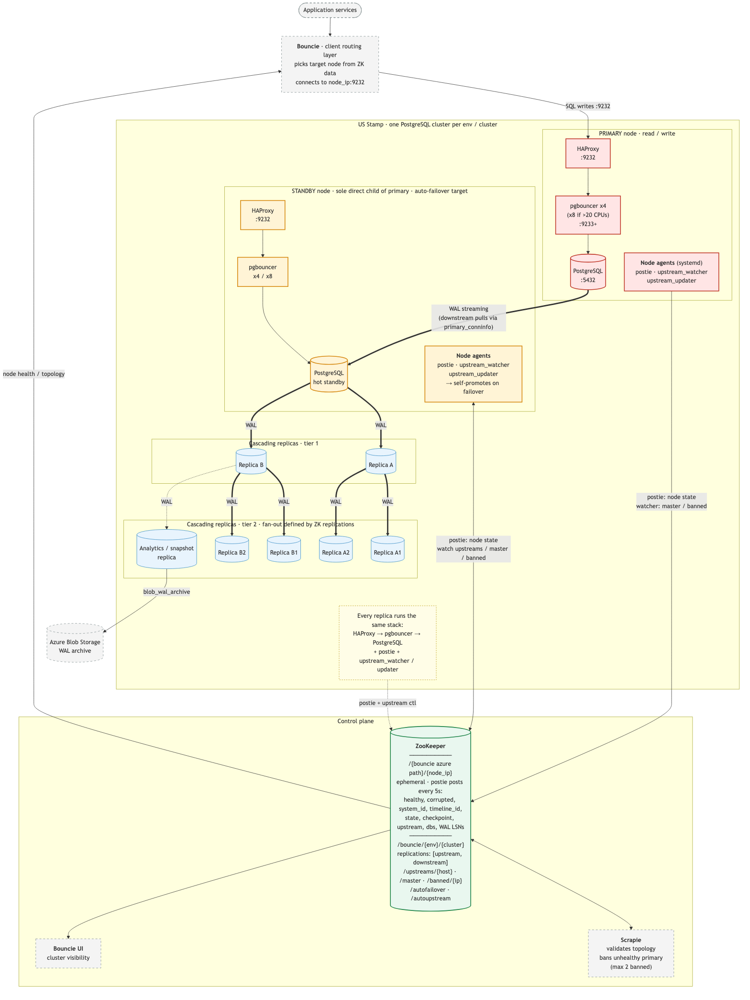
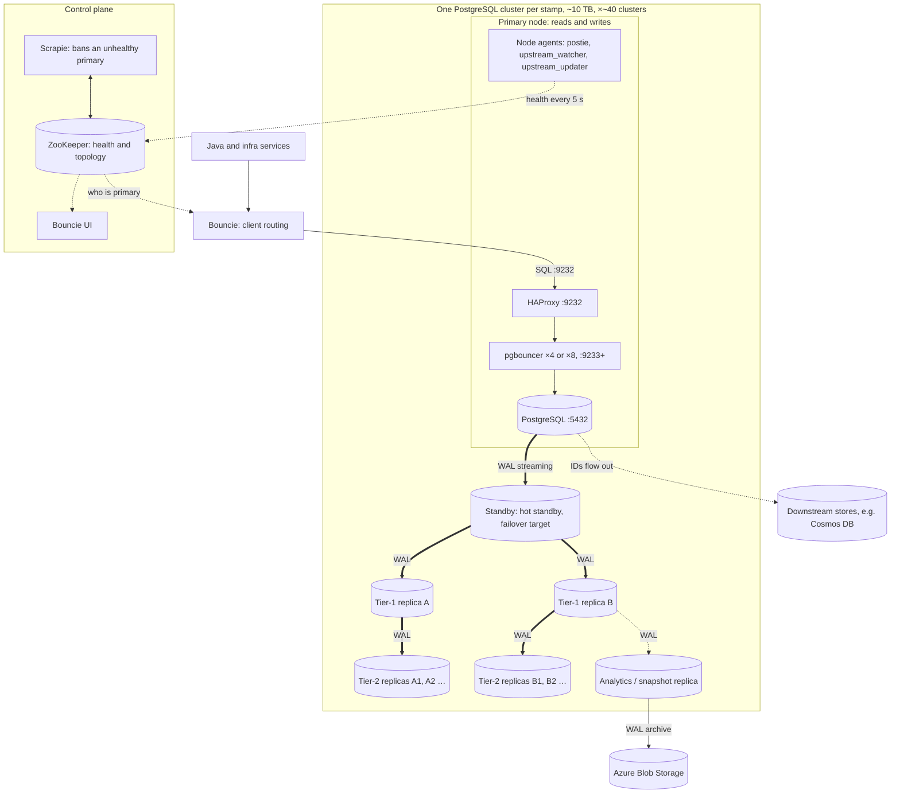
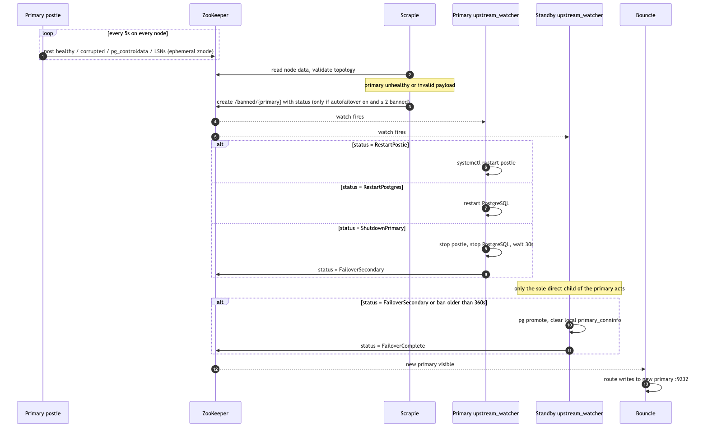
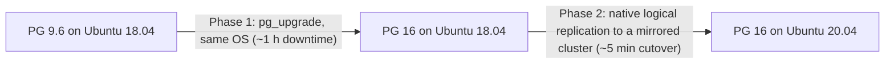
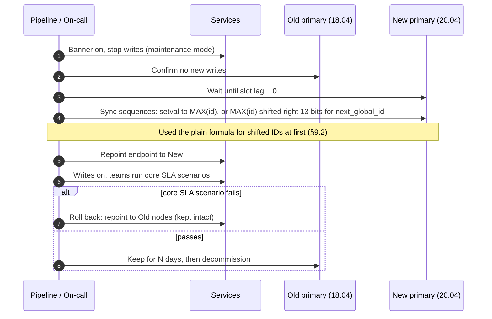

# Tech Retro: PostgreSQL 9.6 → 16 and Ubuntu 18.04 → 20.04

> 45 minutes, interactive, whiteboard, no slides. Talk as if onboarding a senior engineer: why → requirements → architecture → trade-offs → roadblocks → results. Be ready to go one level down on every box and arrow. *(verify)* marks anything to check first (§14).

---

## 0. Run Plan

| Time | Segment | Whiteboard |
|---|---|---|
| 0–4 min | Why it existed (§1) | Nothing. End on "the gate to Teams and Copilot." |
| 4–6 min | Requirements (§3) | Zero loss, ~1 h window, rollback, ~40 clusters, 15 teams |
| 6–12 min | Architecture, failover, protocols (§4) | **Diagram 1:** one cluster |
| 12–25 min | Two-phase design (§5–§7) | **Diagram 2:** 9.6/18.04 → 16/18.04 → 16/20.04 |
| 25–33 min | Roadblocks (§9), lead with §9.1 | **Diagram 3:** the cutover; circle the sequence step |
| 33–38 min | Results and lessons (§10–§11) | Upgrade → CVEs cleared → Teams + Copilot → +30% DAU |
| 38–45 min | "What if" probes (§12) | Whatever they ask |

After each segment, ask: "Want me to go deeper on replication or on the rollout?"

---

## Fact Sheet

| Fact | Value |
|---|---|
| **PostgreSQL** | 9.6 → **16** (7 major versions) |
| **OS** | Ubuntu **18.04 → 20.04** (LTS) |
| **Scope** | **~40 prod clusters**, every deployment stamp, plus LAB and STAGE |
| **Size** | **~10 TB per cluster**; largest is **1 primary + 1 standby + 50 replicas** |
| **SLA clusters** | **7**, upgraded **in parallel** by an ADO pipeline |
| **People** | Led **10–15 engineers**; **15 service teams (~150 engineers)** certified |
| **Phase 1** | `pg_upgrade`: **~1 h write outage** per cluster; Engage stayed readable |
| **Phase 2** | Logical replication to the new OS: **~5 min cutover** |
| **Results** | CVEs cleared and Trust met → **Teams and Copilot integrations → +30% DAU**; **−40% incidents** (replication lag, kernel panics, I/O saturation); replication lag eliminated; faster indexing |
| **Adoption** | 15 teams on one certification model; plan post **seen by 173 people**; front-end reuses the banner template; Infra team owns the tooling |
| **Cost** | Extra Azure compute, because the old nodes stayed up as the rollback path |

---

## 1. Context (60-second opening)

"Viva Engage's data tier ran on about 40 PostgreSQL 9.6 clusters on Ubuntu 18.04 in Azure, about 10 TB each. The largest had a primary, a standby and 50 replicas. 9.6 had been end-of-life since November 2021, there were open critical CVEs, and Microsoft's Trust requirements weren't met. That blocked Viva Engage from integrating with Teams and Microsoft 365 Copilot. So we had to move every cluster seven major versions and onto a new OS, with zero data loss, a bounded downtime budget, and 15 service teams signing off. I owned it end to end and led 10 to 15 engineers."

**Why it was critical:**
- **Security:** 9.6 was end-of-life, so its CVEs could never be patched in place.
- **Compliance:** one non-compliant data tier fails the whole product's Trust review.
- **Business:** the Teams and Copilot integrations were blocked. The upgrade sat on the product's critical path.
- **Reliability:** recurring replication lag, kernel panics and I/O saturation on 9.6 / 18.04.

**Line to use:** "Clearing the CVEs wasn't the goal. It was the gate to Teams and Copilot, and those integrations grew DAU 30%."

**Why it was hard:** a 7-version jump, a cross-OS index-corruption trap, 10 TB per cluster, 50-replica fan-out, ~40 clusters, and 15 teams with version assumptions in their code.

---

## 2. My Role

- **I owned:** the two-phase design, runbook, rollback rule and go/no-go criteria; cross-org alignment (org posts, RFC review, exec updates); version-aware infra tooling behind flags; the ADO pipeline (7 SLA clusters in parallel); the trimmed PostgreSQL VM image; the outage-banner template; Azure capacity for the rollback nodes.
- **Delegated:** Amruta, whom I coached, ran certification across the 15 teams. The PM wrote the banner text. The YES team co-owned LAB.
- **Stakeholders:** the executive sponsor, principal engineers, 15 service teams, PMs, the front-end team, Trust and Security, and the Azure capacity team.
- **Key dates (2025):** LAB and STAGE done by May 7 · May 7 plan posted (173 views) · May 8–9 RFC review · May 14 teams' scenario deadline · May 16 staging write-outage test · May 27 Cell 0 dry run ruled out.

---

## 3. Requirements

| Requirement | Target | What it ruled out or forced |
|---|---|---|
| Data loss | Zero | Must prove the target matches the source |
| Downtime | ~1 h write outage (engine), minutes (OS) | No dump/restore of 10 TB; no in-place OS + full `REINDEX` |
| Rollback | A way back at every one-way step | `--link` and the cutover need a designed path back |
| Index correctness | No silent corruption | The glibc collation trap (§5.1) |
| Compatibility | Services work on both versions mid-rollout | Feature flags, no deploy lock |
| Blast radius | SLA clusters last | Non-SLA cohort first |
| Certification | 15 teams sign off in the window | Core SLA scenarios only (§8) |

**Outside my control:** Azure capacity and APIs, the Trust deadline, weekend-only windows, and teams' test coverage.

---

## 4. Architecture (Diagram 1)

Draw one cluster, then say "× ~40". Three layers: client path, replication tree, control plane.





- **Client path:** Bouncie reads ZooKeeper for the primary, then connects to `node:9232` → **HAProxy** → **pgbouncer** ×4 (×8 above 20 CPUs) → **PostgreSQL :5432**. Every node runs the same stack.
- **Node agents:** **postie** posts health to ZooKeeper every 5 s (an ephemeral znode); **upstream_watcher** acts on master and ban changes; **upstream_updater** sets the WAL upstream.
- **Standby:** a hot standby and the **only direct child** of the primary, so the only failover target.
- **Cascading replicas (up to 50):** primary → standby → tier 1 → tier 2, defined in ZooKeeper. The primary sends WAL once, not 50 times. Physical replicas must match their source's major version and glibc.
- **Analytics replica:** archives WAL to Azure Blob, for point-in-time recovery and seeding.
- **ZooKeeper:** the source of truth for health, the tree, `/master`, `/banned` and `/autofailover`. **Scrapie** bans an unhealthy primary, at most 2 nodes at a time.
- **Stamp-wide clusters:** one writable primary serves every cell. IDs flow into Cosmos DB, so a split brain spreads beyond Postgres.

### 4.1 Failover



1. **Report:** postie writes each node's health every 5 s.
2. **Ban:** Scrapie creates `/banned/{primary}`, only if autofailover is on and at most 2 nodes are banned.
3. **Fence:** the old primary's watcher restarts it or **shuts it down** (stop, wait 30 s, set `FailoverSecondary`).
4. **Promote:** the standby promotes on `FailoverSecondary`, **or once the ban is older than 360 s**, then sets `FailoverComplete`.
5. **Reroute:** Bouncie sends writes to the new primary. Tier-1 replicas already follow the standby.

**Why:** fence before promote (no split brain) · a 360 s timeout for a dead primary · one candidate, so no election · a ban cap of 2 · the replica tree survives.
**During the upgrade:** autofailover must be off, or the 9.6 standby promotes itself: a split brain across versions.

### 4.2 Protocols (one level down)

| Hop | Protocol | How it works | When it fails |
|---|---|---|---|
| Client → node | Postgres wire protocol over TCP | Bouncie picks the node from ZooKeeper and connects to `:9232` | Stale ZooKeeper data → wrong node → re-read |
| HAProxy → pgbouncer | TCP, layer 4 | Spreads connections; doesn't parse SQL | A health check pulls a dead pgbouncer |
| pgbouncer → Postgres | Wire protocol, SCRAM auth | Pools server connections; **single-threaded**, hence ×4 or ×8 | Pool exhaustion shows as client wait (`cl_waiting`) |
| Replication tree | Streaming replication | `walreceiver` sends `START_REPLICATION` from its LSN; `walsender` streams WAL; the receiver reports write, flush and replay LSNs, which is the lag metric | Upstream dies → reconnect; WAL gone → archive or rebuild |
| postie → ZooKeeper | ZooKeeper session, ZAB quorum writes | The ephemeral znode disappears when the session expires | A blip longer than the timeout looks dead, so Scrapie bans first |
| ZooKeeper → watchers | One-shot watches | Fire → re-read → re-watch | A slow watcher; the 360 s timeout bounds it |
| Analytics → Blob | `archive_command` | Uploads each 16 MB WAL segment | Archiving fails → WAL piles up on disk |
| Old → new cluster | Logical replication | `pgoutput` plus a slot; rows, not blocks (§7) | A stuck subscriber fills the publisher's disk |

---

## 5. Two-Phase Design (Diagram 2)



| Option | Rejected because |
|---|---|
| `pg_dump` / `pg_restore` | 10 TB → hours of downtime per cluster, × 40 |
| In-place OS upgrade + `pg_upgrade` | glibc 2.28 silently corrupts text indexes; `REINDEX` of 10 TB |
| Physical replica on the new OS | Copies the same corrupt index pages |
| `pglogical`, 9.6 → 16 in one hop | A third-party extension on every fragile 9.6 primary |
| **Chosen: `pg_upgrade` on the same OS, then native logical replication** | Core tooling only, each risk isolated. Cost: two windows, plus DDL and sequences to manage |

**Why this order:** native logical replication starts at PG 10, so the engine moves first. Doing that on the **same OS** keeps the index files valid under the same glibc. Logical replication then rebuilds every index on the new OS.

### 5.1 The collation trap
- PostgreSQL sorts text with glibc for locales such as `en_US.UTF-8`.
- **glibc 2.28** changed the sort order. Ubuntu 18.04 ships 2.27; 20.04 ships 2.31.
- A B-tree index is a **saved sort order**. Under new rules, lookups miss rows and unique constraints admit duplicates, **with no error**.
- Anything that reuses the files carries it over: an in-place OS upgrade, a physical replica, or `pg_upgrade` across OSes. Logical replication ships **rows**, so the new side builds correct indexes.

### 5.2 Key decisions

| Decision | Whose call | Why |
|---|---|---|
| Two phases | Mine | Collation risk and 10 TB per cluster |
| No canary without a write outage; MSIT validates in the window | Mine, after principal engineers broke my first option | Routing Cell 0 = split brain (§9.1) |
| Certify core SLA scenarios, with a pre-agreed rollback rule | Mine; Amruta ran it | Teams couldn't define "working" |
| Non-SLA first, then 7 SLA clusters in parallel | Mine; I built the pipeline | A shorter total outage |
| Continue on minimum nodes when Azure failed | My proposal; leaders agreed | The reversible middle path (§9.3) |

---

## 6. Phase 1: `pg_upgrade` 9.6 → 16 (same OS)

1. `initdb` the PG 16 cluster.
2. `pg_upgrade --check` days ahead, as a pre-flight gate.
3. Stop 9.6: downtime starts.
4. `pg_upgrade --link`: dumps and restores only the catalog, and **hard-links** the data files, so time depends on file count, not on 10 TB.
5. Start 16, run `vacuumdb --all --analyze-in-stages`, validate.

```bash
# Illustrative
/usr/lib/postgresql/16/bin/pg_upgrade \
  --old-bindir=/usr/lib/postgresql/9.6/bin --new-bindir=/usr/lib/postgresql/16/bin \
  --old-datadir=/data/pg96 --new-datadir=/data/pg16 \
  --link --jobs=16 --check        # pre-flight; rerun without --check in the window
```

- **Gotchas:** PG 16 doesn't carry planner statistics over, so analyze before full traffic · data checksums must match on old and new · every extension needs a PG 16 build to pass `--check`.
- **Rollback:** after `--link`, the old data directory isn't safe to start. So we **kept the old 9.6 nodes running** until validation passed, and rollback meant switching back. That's why I got extra compute from the Azure capacity team.
- **Replicas:** a physical replica can't follow a new major version, so the standby and all 50 replicas are rebuilt. Don't pull 500 TB from one primary: seed along the cascade tree, and bring back a **minimum set first**. *(verify)*

**The ~1-hour window: a write outage, not a full outage**
1. All tenants read-only, banner on.
2. Run `pg_upgrade`.
3. Writes on for **MSIT only**, the canary; run validation.
4. Pass → writes on for everyone. Fail → MSIT back to 9.6, and everyone stays on the old version.

Trade-off to own: rolling back after MSIT writes loses those writes.

**Breaking changes (all hit us)**

| Change | Version | What broke | Fix |
|---|---|---|---|
| `pg_xlog` → `pg_wal`; `xlog` functions renamed | 10 | Lag monitoring, WAL scripts | Version-aware tooling behind flags |
| `recovery.conf` → `standby.signal` + `primary_conninfo` | 12 | Replica provisioning | A new path behind a flag |
| Default auth becomes `scram-sha-256` | 14 | Old JDBC drivers | Driver upgrade first |

Feature flags let one build work on 9.6 and 16 for weeks: **no deploy lock** across 15 teams.

```java
String lagSql = flags.isEnabled("pg16." + clusterId)
    ? "SELECT pg_wal_lsn_diff(pg_current_wal_lsn(), replay_lsn) FROM pg_stat_replication"
    : "SELECT pg_xlog_location_diff(pg_current_xlog_location(), replay_location) FROM pg_stat_replication";
```

**Rollout:** LAB → STAGE → non-SLA cohort, with bake time → **7 SLA clusters in parallel** through the ADO pipeline, so every run was identical.

---

## 7. Phase 2: Logical Replication to Ubuntu 20.04

Logical replication ships **row changes**, not disk blocks. `pgoutput` decodes the WAL, and a slot streams the changes to the subscriber's apply worker. The slot keeps WAL until the subscriber confirms it.

```sql
-- Old primary (PG 16, Ubuntu 18.04)
CREATE PUBLICATION os_move FOR ALL TABLES;

-- New primary (PG 16, Ubuntu 20.04), schema loaded with pg_dump --schema-only
CREATE SUBSCRIPTION os_move CONNECTION 'host=old-primary dbname=app user=repl'
  PUBLICATION os_move WITH (copy_data = true);

-- Lag, on the publisher
SELECT pg_size_pretty(pg_wal_lsn_diff(pg_current_wal_lsn(), confirmed_flush_lsn))
FROM pg_replication_slots WHERE slot_name = 'os_move';
```

**Steps:** mirrored cluster on 20.04 → load the schema only, freeze DDL → subscribe (~10 TB initial copy, then streaming) → build the new replicas from the new primary → cut over.

| Risk | Mitigation |
|---|---|
| The slot retains WAL, so a stuck subscriber fills the publisher's disk | Alert on slot lag; `max_slot_wal_keep_size` |
| DDL isn't replicated | DDL freeze |
| Tables without a primary key | Add a PK, or `REPLICA IDENTITY FULL` |
| **Sequences aren't replicated** | Sync them at cutover. **This one bit us (§9.2)** |

**Cutover (Diagram 3)**



**Rollback:** the old nodes stayed intact, so rollback meant repointing. Writes after the cutover don't exist on the old nodes without reverse replication, so the rollback window is short.

---

## 8. Verification

- The 15 teams couldn't prove "everything works", so each certified only its **core SLA scenarios**.
- **Rule, agreed in advance:** a core SLA scenario fails → roll back. Anything else → fix forward.
- Amruta, whom I coached, ran the tracker. Each team reviewed its scenarios including async writes, marked what was recoverable through Vent retries, planned mitigations (longer TTLs, more retries, paused async jobs), and flagged gaps the read-only banner missed.
- Scenario deadline May 14; staging write-outage test May 16.

---

## 9. Roadblocks

| If they ask how you… | Story |
|---|---|
| Negotiated scope | Core SLA scenarios (§9.4); an in-window MSIT canary instead of a no-outage test (§9.1) |
| Got other teams to adopt | 15 teams on one certification model; front-end reuses the banner; Infra owns the tooling |
| Changed direction | Dropped my Cell 0 option (§9.1); minimum nodes (§9.3); the sync formula (§9.2); the VP briefing (§9.5) |

### 9.1 The exec asked to test production with no write outage (lead with this)
- **Ask:** test MSIT on the new version without a write outage for other tenants. The real goal was more test time than a 1-hour window gives, which was legitimate.
- **What I did:** wrote three options (route Cell 0 to new nodes, dry run then revert, dedicated MSIT clusters), posted them to the org (173 views), and asked the experts to break them.
- **Pushback, and it was right:** with one writable primary per stamp, routing Cell 0 means **two primaries: a split brain**. IDs flow into Cosmos DB, so the corruption spreads. Cell affinity isn't guaranteed, and dedicated clusters cost too much.
- **Resolution:** an RFC review. I agreed with the critique of my own option: there's no safe dry run without a write outage, so we upgraded with MSIT as the in-window canary. I named the reviewers to the sponsor.
- **Lesson:** run risky options past the experts before they reach an executive.

### 9.2 Double-shifted sequence IDs after the Ubuntu cutover (own it)
- **What happened:** the sync script used the standard `setval(seq, MAX(id), true)`. **Two days later**, GIF and link-preview creation broke because `open_graph_objects` was getting **negative IDs**. About **50K rows** were affected.
- **Root cause 1:** legacy `*_id_global_seq` IDs come from `next_global_id(seq)`, which stores `nextval(seq) << 13`. `MAX(id)` was already shifted, so writing it into the sequence shifted every new ID twice: **~8,192× too large**. A counter of 1,000,000 gives `MAX(id)` = 8.192 × 10⁹, so the next ID was ≈ **6.7 × 10¹³** instead of **8.2 × 10⁹**.
- **Root cause 2:** `<< 13` hits the sign bit once the counter passes **2⁵⁰**, and Postgres `bigint <<` **drops the high bits instead of raising an error**. `open_graph_objects` (every link and image preview) had the least headroom, crossed 2⁵⁰ in two days, and went negative. Other tables got oversized but valid IDs, so the bug stayed hidden.
- **Why nothing caught it:** inserts succeeded, IDs were unique, and no constraint fired. No check looked at ID *values*.
- **Fix:** reverted each wrapped sequence to its previous, correct counter (`MAX(id) >> 13` of the pre-upgrade rows); fixed the ~50K rows by hand; checked every other `*_id_global_seq`. No bad IDs reached Cosmos DB.

```sql
-- Which ID columns are wrapped by next_global_id?
SELECT c.relname, a.attname, pg_get_expr(d.adbin, d.adrelid)
FROM pg_attrdef d
JOIN pg_class c     ON c.oid = d.adrelid
JOIN pg_attribute a ON a.attrelid = d.adrelid AND a.attnum = d.adnum
WHERE pg_get_expr(d.adbin, d.adrelid) LIKE '%next_global_id%';

-- Headroom to the 2^50 limit
SELECT sequencename, (2::numeric ^ 50) - last_value AS headroom
FROM pg_sequences WHERE sequencename LIKE '%\_id\_global\_seq' ORDER BY headroom;
```

- **Mechanisms now:** a pre-flight check reads each column's default and picks `MAX(id)` or `MAX(id) >> 13` · a gate: the next ID must sit just above `MAX(id)` · alerts on negative IDs, ID jumps, and low headroom under 2⁵⁰.
- **Line to say:** "Our checks proved writes *worked*, not that the values were *right*. So the fixes were value checks and alerts."

### 9.3 Azure provisioning failed on the production Saturday
- New VMs wouldn't come up during Azure maintenance, even though I'd secured extra capacity with the Azure capacity team. Several leads wanted to abort.
- **Options:** abort (re-run prep for 15 teams, slip the deadline) · wait for full capacity (an open-ended outage) · **continue on the minimum node set, my call:** weekend traffic is low, and adding replicas later doesn't touch the upgrade.
- **Outcome:** we finished on the minimum nodes and had full capacity that night.
- **Lesson:** "go or abort" is usually a false binary. Track Azure quota and cores as a pre-flight item.

### 9.4 Fifteen teams couldn't define "working"
There was no bounded definition of done, so I narrowed it to core SLA scenarios with a pre-agreed rollback rule, and Amruta owned the coordination. Next time: rehearse the scenarios in LAB, and publish a RACI, because roles were confused early on.

### 9.5 My first VP review was too technical
Leaders needed a decision; I gave them a design walkthrough. I switched to decision-first: status, risk in business terms, and the ask, with details in an appendix.

### 9.6 The banner couldn't show the maintenance time
The front-end team was busy, so I built the change myself with AI help. Customers saw the exact window, and the front-end team reuses the template.

### 9.7 Rollback testing took longer than planned
Next time, rollback rehearsal is its own milestone, with STAGE kept ready for it.

---

## 10. Results

"The upgrade cleared the critical CVEs and met Trust requirements, which unblocked the Teams and Copilot integrations. After they shipped, DAU grew 30%. Incidents from replication lag, kernel panics and I/O saturation dropped 40%, replication lag was eliminated, and all ~40 clusters were upgraded."

- **Say "unblocked":** the upgrade was the gate; the integrations drove the +30%.
- **Downtime:** ~1 h write outage per cluster for the engine, ~5 min for the OS. **Don't call it zero-downtime.**
- **Lasting assets:** the parallel ADO pipeline, version-aware tooling, a trimmed VM image, the banner template, and the core-SLA certification model. The Infra team owns the tooling.
- **People:** Amruta now owns cross-team testing coordination.

---

## 11. Lessons (as mechanisms)

1. **Design around the one-way doors** (`--link`, the cutover): write the rollback point down first.
2. **Automate the pre-flight:** `--check`, extensions, checksums, the default-aware sequence check, Azure quota, slot lag.
3. **Stage gates with numbers:** LAB → STAGE → non-SLA → SLA.
4. **Rehearse with production-like writes, and check the values,** not just that writes succeed.
5. **Bounded certification** with a pre-agreed rollback rule.
6. **Decision-first** communication for executives.

**Vision:** stay within N-1 of supported versions, so upgrades are routine instead of a seven-version jump. *(verify)*

---

## 12. Probe Bank

- **Why not `pglogical` in one hop?** A third-party extension on every fragile 9.6 primary, and non-core replication for 10 TB. Two core-tool phases isolate each risk.
- **Why not an in-place OS upgrade + `REINDEX`?** Every text index on 10 TB. `REINDEX CONCURRENTLY` takes hours and doubles index I/O on I/O-saturated hosts, and missing one index gives silently wrong results.
- **Near-zero downtime for Phase 1?** That needs logical replication on the old version, which 9.6 lacks. From PG 10 on, I'd do both moves in one logical-replication cutover.
- **Why not managed Azure PostgreSQL?** It's a platform migration (extensions, HA, networking, tooling, cost), the wrong scope for a CVE deadline.
- **Physical vs. logical replication?** Both use the streaming replication protocol. Physical ships raw WAL: a byte-identical copy on the same major version. Logical decodes rows with `pgoutput`: it crosses versions and OSes and rebuilds indexes, but doesn't carry DDL or sequences.
- **Sync or async standby?** Sync means zero loss, but adds commit latency and stalls writes if the standby dies. Async is faster, with a small loss window. *(verify yours)*
- **Lag never reaches 0 at cutover?** Writes are frozen, so it must converge; if not, the apply worker is stuck (`pg_stat_subscription`). Time-box it, abort, and reopen writes on the old primary. Clients never moved.
- **Subscriber down for hours?** The slot holds WAL and the publisher's disk fills. Alert on retained WAL; `max_slot_wal_keep_size` invalidates the slot instead of taking down the primary.
- **Why Ubuntu 20.04, when standard support ended in May 2025?** It's LTS, with security updates through Ubuntu Pro until 2030, and 18.04 was the urgent problem (ended 2023). The next OS move reuses the same pattern. *(verify the real reason)*
- **500 TB of replica seeding?** Seed along the cascade tree, minimum set first, then the rest in waves. *(verify)*
- **How did you know the data was correct?** Row counts, sampled checksums, `amcheck` on indexes, plus the core SLA scenarios. *(verify)*
- **10× traffic?** WAL volume is the limit, not read fan-out. The cascade already spares the primary; add tier-1 relays, and shard long term.
- **Riskiest moment?** The Azure Saturday: I found the reversible middle option (§9.3).
- **What counted as a core SLA scenario?** A flow the team's SLA covers. Listing everything meant running everything in the window, and any failure meant rollback, so the lists stayed short.
- **What if the minimum nodes couldn't carry the load?** Reads degrade first; I'd watch replica CPU, p99 and lag. The rollback rule still applied, and capacity was a dial.
- **Why fix front-end code yourself?** Fixed dates, a small scoped change, AI help, and the team kept the template.
- **Why would Teams care about your database's CVEs?** Their bar covers the whole stack. An end-of-life database with open CVEs fails it, however good the app code is.
- **An exec asks for something unsafe?** Treat the goal as real, write down the options, let the experts break them, change position if they do, and close with named reviewers (§9.1).
- **Why not canary one cell?** One writable primary per stamp and version-matched replicas: two primaries is a split brain, and IDs spread to Cosmos DB.
- **How did Engage stay readable?** It was a write outage only. Replicas served reads while the primary was down; new-version replicas must be up before writes reopen.
- **How would you catch the double shift sooner?** A gate comparing the next ID with `MAX(id)` (an 8,192× jump fails), alerts on negative IDs and jumps, and a headroom dashboard against 2⁵⁰.

---

## 13. Whiteboard Cheat Sheet

1. **Diagram 1:** Bouncie → HAProxy :9232 → pgbouncer → Postgres; primary → standby → tier 1 → tier 2; ZooKeeper, postie and Scrapie on the side. Walk the failover: ban → fence → promote → reroute.
2. **Diagram 2:** 9.6/18.04 → 16/18.04 → 16/20.04, labeled with why that order.
3. **Diagram 3:** the cutover. Circle the sequence-sync step and tell §9.2 there.

Legend: **solid** arrows for client traffic, **dashed** for replication.

---

## 14. Verify Before the Interview

1. Why Ubuntu 20.04, and the next OS step (is the Q2 2026 goal this move or the next?).
2. `--link` used; `pg_upgrade` and `vacuumdb --analyze-in-stages` timings.
3. Which old nodes were kept for rollback, how much extra Azure compute, and when they were released.
4. Replica rebuild method; the minimum set size on Saturday, and what you watched.
5. Sync or async standby; collation (`en_US.UTF-8` or `C`); extensions; checksums on 9.6.
6. Config: Bouncie (library or proxy), HAProxy mode and health checks, pgbouncer pool mode and sizes, ZooKeeper session timeout, `hot_standby_feedback`, slots, the WAL archive tool.
7. Was autofailover off during the window, and how was the ZooKeeper tree rebuilt?
8. Sequence incident: how long previews were broken, and how you fixed 50K rows (find, re-key, references, verify).
9. MSIT writes made before a rollback decision; the read path during the write outage.
10. Reverse replication after the OS cutover; how long the old nodes were kept.
11. Baselines: the −40% incident window, replication lag before and after, CVE count, DAU baseline and window, and the Teams/Copilot gate and ship dates.
12. Pipeline stages and gate criteria; number of rollbacks; time saved by running in parallel.
13. Data validation you actually ran; whether `pglogical` or managed Flexible Server was evaluated.
14. Who owned the OS move; workstream headcounts; production dates; whether the N-1 policy is your proposal.
15. Cost: engineer-months, and Azure spend for the rollback nodes.
