# Roblox Multi-Tenant Storage Platform

Thousands of game teams (tenants) store player and session state. 100M+ daily players, global. Tenants must be isolated.

The design evolves in stages. Each stage lists **what we add**, **what if it fails**, **trade-offs**, and **why we move on**.

---

## 0. Requirements and Sizing

| Item | Value |
|---|---|
| Tenants | ~10K experiences; top 1% drive > 50% of traffic |
| Players | 100M DAU, ~15M peak concurrent (CCU) |
| Access | Load on join, autosave every 30–60s, final save on leave; one writer per player |
| Values | Opaque blobs ≤ 4MB (typically 1–50KB) |
| Writes | 15M / 30s ≈ 500K/s → **~1.5M/s** with burst headroom |
| Reads | **~1–2M/s** (joins, teleports, shared data) |
| Data | ~100TB logical → **0.5–1PB** with 3 replicas + 30 days of versions |
| SLOs | p99 read < 50ms, p99 write < 30ms, 99.99% availability, no data loss on AZ failure |

Player state is **write-heavy** (1 load : ~100 saves). Shared data (leaderboards, profiles, config) is **read-heavy**.

**Fault-tolerance principles used throughout:** redundancy across AZs, isolation (bulkheads), graceful degradation, static stability (data plane survives control-plane loss), idempotent retries with jitter, fencing tokens, load shedding.

---

## 1. Stage 1 — Single PostgreSQL

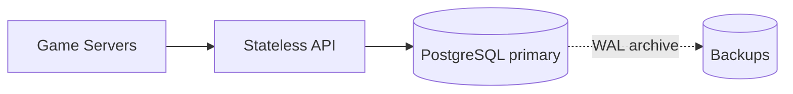

- Table keyed by `(tenant_id, store, key)`; `tenant_id` comes from the auth token, enforced with row-level security.
- Optimistic concurrency: `UPDATE ... WHERE version = $expected`.

| What fails | Impact | Mitigation |
|---|---|---|
| API server | Requests fail | Stateless, LB retries |
| DB primary | **Total outage** | Restore from backup (minutes–hours) |
| Disk | Data loss | WAL archive + PITR (RPO ≈ minutes) |

**Trade-off:** simple, ACID — but single point of failure, ~10–50K writes/s ceiling, no tenant isolation.
**Move on because:** need 1.5M writes/s; teleports cause item duplication (late save from old server overwrites new one).

---

## 2. Stage 2 — Replicas, Cache, Session Leases

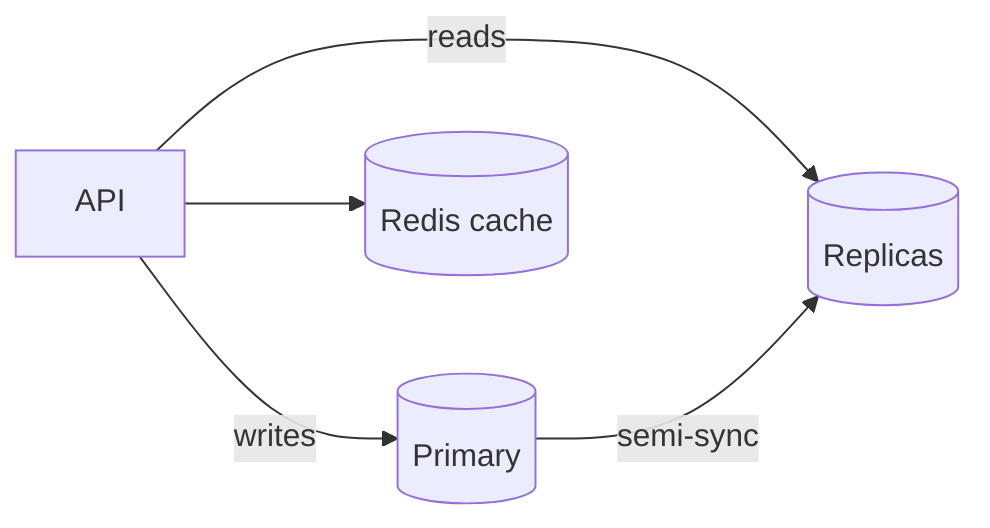

- **Semi-sync replication:** commit after one replica acks → RPO = 0 on primary loss; automatic failover (Patroni + etcd).
- **Redis cache-aside** for read-many data (profiles, config, leaderboard top-N).
- **Session lease + fencing epoch** stops duplication: every write must carry the current epoch; a stale server's write is rejected.

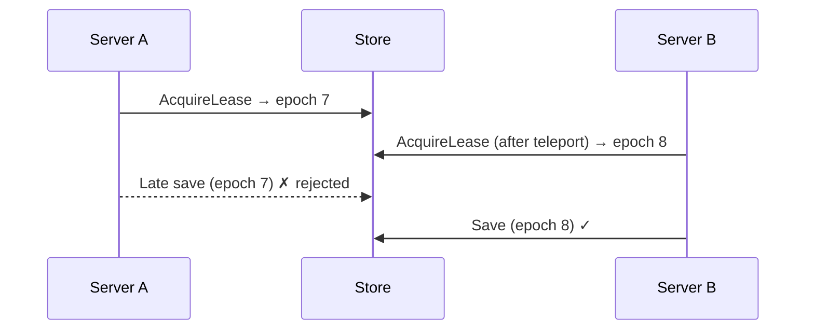

- **Rule:** a failed load returns an error, never empty data — otherwise the game "creates a new player" and wipes real data.

| What fails | Impact | Mitigation |
|---|---|---|
| Primary | 10–30s write outage | Auto failover; no data loss (semi-sync) |
| Network partition | Split-brain risk | etcd quorum elects leader; old primary fenced |
| Replica lag | Stale reads | Lease holder reads from primary |
| Redis down | Miss storm on DB | Single-flight loads, rate-limit misses, size DB for cold cache |
| Game server crash | Player locked out | Lease TTL (~60s) or force-steal (bumps epoch) |

**Trade-off:** HA and read scaling, but writes still hit one primary.
**Move on because:** write ceiling; one failover affects every tenant.

---

## 3. Stage 3 — Sharded LSM Store with Raft

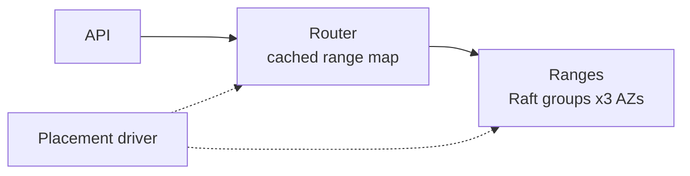

### Storage engine

| | B-tree (Postgres) | LSM (RocksDB) |
|---|---|---|
| Writes | Random, in-place | Sequential append — **much higher throughput** |
| Reads | One lookup — **faster** | Multiple levels (Bloom filters help) |
| Best for | Read-heavy, queries | Write-heavy |

**Choice:** **RobloxDB** — RocksDB as the local engine with an in-house distributed layer (Raft ranges, placement, transactions; TiKV-like) — write throughput **plus** strong consistency, CAS and small transactions. Cassandra lacks transactions; Postgres can't absorb the writes. See Section 9 for the distributed layer and burst handling.

### Sharding tenants — why not consistent hashing?

| Option | Problem |
|---|---|
| Consistent hash on `tenant_id` | A huge tenant can't be split; balances key count, not load; can't pin a tenant to dedicated hardware |
| Consistent hash on `(tenant, key)` | Every tenant on every node → no isolation; tenant delete/move touches the whole cluster |
| **Directory + ranges** ✓ | Explicit placement; big tenants split, small ones share |

- **Level 1:** directory `tenant_id → cell` (control plane, cached in routers).
- **Level 2:** range map. Key = `tenant | store | hash(player) | key`, so each tenant is contiguous; ranges split by size/load and move via Raft membership changes (no downtime).
- Consistent hashing is still fine for stateless tiers and caches.

### Deletes

| Case | How |
|---|---|
| Single key | Versioned tombstone, kept 30 days for undo, dropped by compaction |
| TTL | Compaction filter drops expired entries |
| Player erasure (GDPR) | `user_id → keys` index; delete everywhere; **erasure log** replayed after any restore |
| Tenant delete | Soft delete + 30-day grace → **destroy tenant KMS key** (crypto-shred, covers backups) → `DeleteRange` on prefix |

Watch-outs: tombstone buildup slows reads (compact on density); out-of-order CDC can resurrect data (versioned tombstones). Raft avoids Cassandra-style resurrection because every replica gets the delete via the log.

| What fails | Impact | Mitigation |
|---|---|---|
| Node / AZ | One replica lost | Raft majority continues; re-elect in seconds; RPO = 0 |
| Stale router map | Wrong node | Node redirects; router refreshes |
| Placement driver | No splits/moves | Data plane keeps serving (static stability) |
| Compaction lag | Write stalls | Early backpressure, add capacity |

**Trade-off:** linear write scaling and auto-failover, at the cost of cross-AZ write latency (~1–2ms), compaction overhead and 2PC for trades.
**Move on because:** all tenants share nodes — one viral game hurts everyone.

---

## 4. Stage 4 — Multi-Tenant Isolation

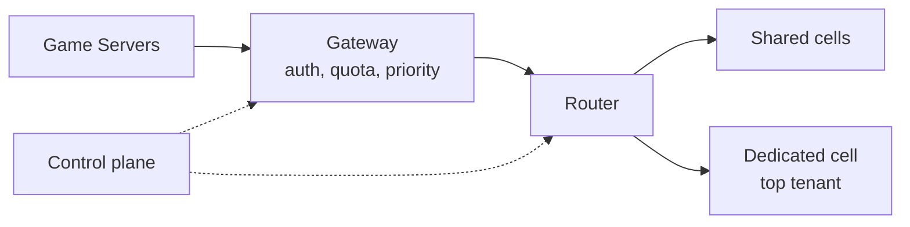

| Dimension | Mechanism |
|---|---|
| Security | Gateway sets tenant prefix; per-tenant encryption keys |
| Performance | Per-tenant token buckets + weighted fair queuing on nodes |
| Quotas | Scale with players, e.g. `60 + 10 × CCU` req/min; separate read/write budgets |
| Blast radius | Cells + shuffle sharding; big tenants get dedicated cells |

### Read vs write priority

| Priority | Requests |
|---|---|
| **P0 write** | Final save on leave, purchases, trades, lease renew |
| **P1 read** | Join/teleport load, config, lease checks |
| P2 degrade | Autosaves (coalesce), leaderboards, other profiles |
| P3 shed first | ListKeys, exports, analytics |

| What fails | Impact | Mitigation |
|---|---|---|
| Noisy tenant | Neighbor latency | Throttle, fair queuing, move to dedicated cell |
| Quota service | Stale limits | Cached quotas; fail open for P0/P1 |
| Cell | Its tenants only | Cell-by-cell deploys |
| Control plane | No changes | Data plane runs on cached state |

**Trade-off:** strong isolation, but more moving parts and lower utilization for dedicated cells.
**Move on because:** ephemeral queues, leaderboards and durable state fight over one engine.

---

## 5. Stage 5 — Specialized Stores (CQRS)

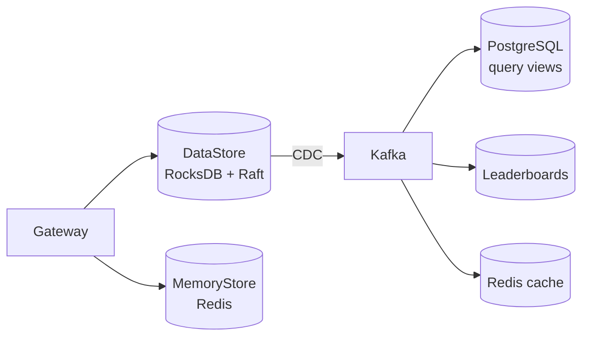

### Write-heavy vs read-heavy split

| Data | Store | Why |
|---|---|---|
| Player state, saves, leases | **RobloxDB** (RocksDB) | Write-heavy, key lookups |
| Config, quotas, catalog, billing | **PostgreSQL** + replicas | Read-heavy, relational, low write |
| Searchable player views | **PostgreSQL via CDC** | SQL queries over write-heavy data |
| Sessions, queues | **Redis** | Ephemeral, sub-ms |

Rules for the PostgreSQL projection:
- Feed it **only from CDC** — never dual-write from the app.
- **Never load a player's own state from it** (lags seconds → overwrite risk).
- Coalesce to the latest version per key and project only indexed fields — Postgres can't take 1.5M writes/s.
- Idempotent upsert: `... WHERE view.version < EXCLUDED.version`.

### Redis essentials

- **Never the only copy** of currency or inventory — async replication can lose acked writes.
- A player's own data isn't cached; the game server holds it in memory.
- Cache-aside: write DB → **delete** cache key (not update).

| Cache problem | Fix |
|---|---|
| Stampede (hot key expires) | Single-flight, serve stale while refreshing |
| Avalanche (mass expiry) | TTL jitter |
| Penetration (missing keys) | Negative caching / Bloom filter |
| Hot key | In-process L1 cache, key replicas |
| Multi-tenancy | Proxy enforces per-tenant memory/ops quota; hash-tag keys `{tenant:scope}` |

| What fails | Impact | Mitigation |
|---|---|---|
| Kafka / CDC | Views stale | Writes unaffected; resume from offsets |
| PostgreSQL view | Queries fail | Rebuild from Kafka; writes unaffected |
| Redis primary | ~1s ephemeral loss | Replica promotion; acceptable for ephemeral data |

**Trade-off:** right engine per workload and isolated failures, but read views are eventually consistent and there are more systems to run.
**Move on because:** single region → high latency far away and region-wide outages.

---

## 6. Stage 6 — Multi-Region

- Each player has a **home region**; range leaders live there (3 AZs, sync).
- **Async DR replica** in a paired region (RPO: seconds).
- Purchases: **sync across 3 regions** (no loss, +50–150ms).
- Cross-region reads: follower reads with bounded staleness. Redis stays in-region.

| Option | Latency | RPO (region loss) | Conflicts |
|---|---|---|---|
| **Home-region leader + async DR** ✓ | Low | Seconds | None |
| Sync multi-region | High | 0 | None |
| Active-active | Low | Seconds | Yes — risky for inventory |

| What fails | Impact | Mitigation |
|---|---|---|
| Region | Home players can't save | Promote DR; region epoch fences the old region |
| Inter-region link | DR lags | Home region keeps serving; DR catches up |

**Trade-off:** low latency for most players, non-zero RPO on full region loss.

---

## 7. Stage 7 — Lifecycle and Operations

- **30-day versions** + **per-tenant point-in-time restore** — tenant code bugs are the #1 data incident.
- **Cold tiering:** players inactive > 90 days → object storage, rehydrated on join.
- **Safe deploys:** cell by cell, auto rollback; regular chaos tests and restore drills.

**Trade-off:** versions cost 2–5× storage; cold players load slower.

---

## 8. Full System Architecture

**Legend:** <span style="color:#d62728">**thick red = write path**</span> · <span style="color:#1f77b4">**blue = read path**</span> · gray dotted = async replication / CDC · light dotted = control plane.

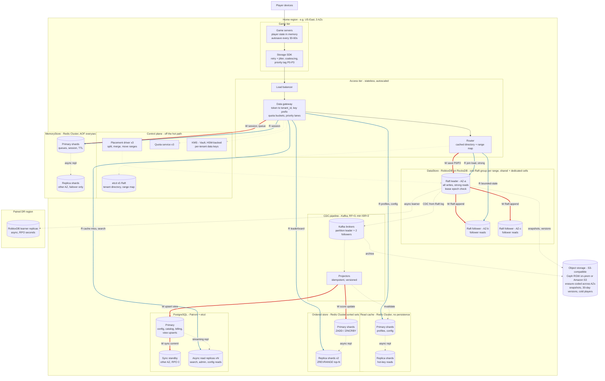

The control plane is never on the per-request path: routers and gateways use cached state.

### Write path vs read path

| | Write path | Read path |
|---|---|---|
| Player state | Router → **Raft leader** → majority ack from followers → commit | Join: **leader** (strong). Others' data: **follower read** (bounded-stale) |
| Session / queues | Gateway → **Redis primary** (async to replica) | **Redis primary** (replica only on failover) |
| Leaderboards | CDC → projector → **ZSET primary** | **ZSET replicas** (top-N) |
| Profiles / config | DataStore or Postgres primary; CDC **invalidates** cache | **Redis cache** → miss → Postgres replica / follower |
| Search / admin | CDC → projector → **Postgres primary** (+ sync standby) | **Postgres async replicas** |
| Backups / cold | Snapshots + Kafka archive → **object storage** | Restore / cold-player rehydration only |

### Data store topology

| Store | Technology | Primary / leader | Replicas | Replication | Failover | RPO |
|---|---|---|---|---|---|---|
| DataStore | **RobloxDB** (RocksDB + Raft) | 1 leader per range | 2 followers (3 AZs) + 1 learner in DR region | Sync majority in region; async to DR | Raft election, seconds | 0 (AZ) / seconds (region) |
| MemoryStore | **Redis Cluster** | 1 primary per shard | 1 replica in another AZ | Async | Cluster bus promotes replica, seconds | ~1s (ephemeral, acceptable) |
| Read cache | **Redis Cluster** | 1 primary per shard | 1–2 replicas | Async | Replica promotion | N/A — disposable |
| Ordered store | **Redis Cluster sorted sets** (`{tenant:board}` keys) | 1 primary per shard | 2 replicas serve reads | Async | Replica promotion; rebuild from Kafka / DataStore | N/A — derived |
| PostgreSQL | **PostgreSQL + Patroni** | 1 primary | 1 sync standby + N async read replicas | Sync to standby, streaming to replicas | Patroni + etcd, 10–30s | 0 |
| CDC | **Kafka** (KRaft) | 1 leader per partition | 2 followers, RF=3, `acks=all`, min ISR=2 | Sync to in-sync replicas | Controller elects new partition leader | 0 |
| Object storage | **S3-compatible**: Ceph RGW / MinIO on-prem, or Amazon S3 | — | Erasure coding (e.g. 8+3) across AZs; cross-region copy for backups | Sync within region | Built in | 0 |
| Control plane | **etcd** (x5), PD (x3) | Raft leader | Followers across AZs | Raft majority | Raft election | 0 |
| KMS | **HashiCorp Vault** (or cloud KMS), HSM-backed | Active node | Standby nodes, multi-region | Raft | Standby takes over; data keys cached in gateways | 0 |

**Why Redis sorted sets for leaderboards:** `ZINCRBY` / `ZREVRANGE` are O(log N), sub-ms, and a leaderboard is derived data that can be rebuilt from the DataStore. Trade-off: memory-bound. Very large or all-time boards can fall back to RobloxDB range scans on score-encoded keys (`tenant | board | inverted_score | player`).

**Why S3-compatible object storage:** cheapest durable bytes (erasure coding ≈ 1.4× overhead vs 3× for replicas), and every backup / analytics tool speaks the S3 API. Roblox runs its own data centers, so Ceph RGW or MinIO on-prem is the likely fit; Amazon S3 if on cloud. Trade-off: 10–100ms latency, so it never sits on the hot path.

### Request paths

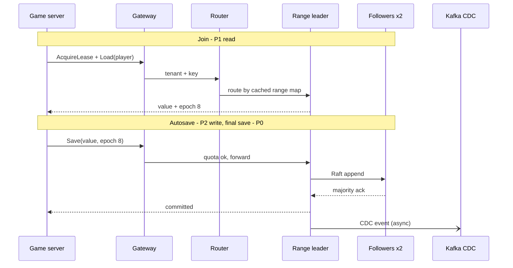

### Latency budget (in-region)

| Step | Read (join) | Write (save) |
|---|---|---|
| Gateway (auth, quota) | ~1ms | ~1ms |
| Router lookup (cached) | < 0.5ms | < 0.5ms |
| Leader read / Raft commit across AZs | 1–5ms | 2–5ms (incl. fsync) |
| **Typical / p99 target** | **~5ms / < 50ms** | **~8ms / < 30ms** |
| Player outside home region | +100–200ms | +100–200ms |

### Component trade-offs

| Component | Choice | Why | Trade-off | If it fails |
|---|---|---|---|---|
| Game server | Holds player state in memory | Load once, save periodically | Up to one autosave of progress lost on crash | Lease TTL expires; player rejoins elsewhere |
| SDK | Coalescing, retries, priority tags | Cuts write volume 2–5×; safe retries | Logic in clients must be versioned | Game keeps state in memory and retries |
| Gateway | Stateless, tenant binding at edge | Isolation enforced before storage | Extra hop (~1ms) | LB routes to healthy instances |
| Router | Cached two-level map | No lookup on hot path | Stale map → one redirect | Nodes redirect; router refreshes |
| Directory + ranges | Not consistent hashing | Split big tenants, pin to cells | Needs placement service | Cached maps keep serving |
| Storage engine | RocksDB (LSM) | 1.5M writes/s | Compaction CPU/IO, read amplification | — |
| Replication | Raft, 3 AZs | Auto failover, RPO 0, no split brain | Majority ack adds ~1–2ms | Re-elect in seconds |
| Cells | Shared + dedicated | Contain blast radius | Lower utilization in dedicated cells | Only that cell's tenants affected |
| Fair queuing + quotas | Per tenant, per priority | Noisy neighbors contained | Tuning complexity | Cached quotas; fail open for P0/P1 |
| Leases | Epoch fencing | No item duplication | Lease is critical path for writes | TTL / force-steal |
| MemoryStore | Redis Cluster | Sub-ms ephemeral ops | Async replication can lose ~1s | Replica promotion |
| Read cache | Redis, CDC invalidation | Offloads read-heavy shared data | Stale for seconds | DB absorbs misses (single-flight) |
| CDC (Kafka) | From Raft log | No dual writes; feeds all views | Eventual consistency | Writes unaffected; views lag |
| PostgreSQL | Config + query views | SQL, indexes for read-heavy data | Can't take full write volume | Views rebuildable; config cached |
| KMS | Per-tenant keys | Isolation + crypto-shred on delete | Dependency on decrypt path | Cached data keys |
| DR region | Async replicas | Low write latency | RPO seconds on region loss | Promote with region epoch fence |
| Object storage | Snapshots, versions, cold tier | Cheap durability, PITR | Slow cold loads | Hot path unaffected |

---

## 9. RobloxDB — Distributed Layer on RocksDB and Burst Handling

### 9.1 What RocksDB gives vs what we build

| RocksDB provides (per node) | RobloxDB must build (cluster) |
|---|---|
| LSM engine, WAL, memtables, compaction | **Replication:** multi-Raft, one Raft group per range |
| Column families, snapshots, checkpoints | **Sharding:** ranges, split/merge, placement driver |
| Bloom filters, block cache, rate limiter | **Routing:** directory + range map, leader leases |
| Atomic write batches on one node | **Transactions:** MVCC + 2PC across ranges, timestamp oracle |
| SST ingestion (`IngestExternalFile`) | **Rebalancing, backups, multi-tenancy, admission, burst control** |

### 9.2 Layered architecture

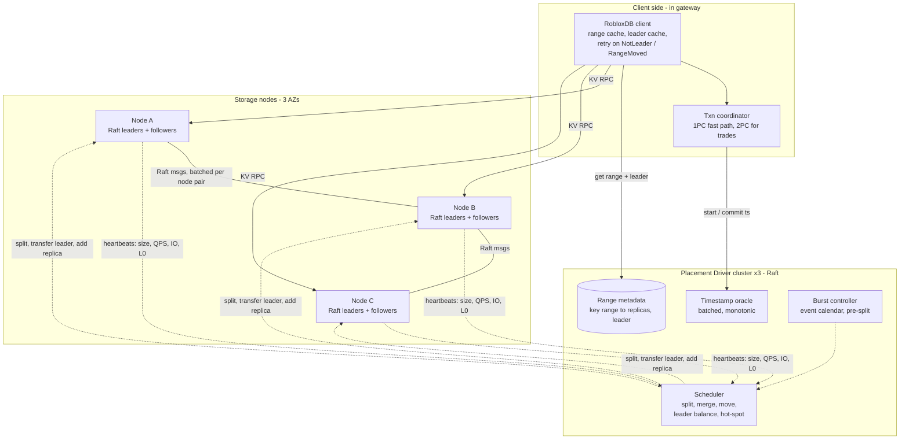

| Layer | Responsibility |
|---|---|
| **Client** | Caches range map and leaders; routes each key to the leader; retries on `NotLeader` / `RangeMoved` with the hint returned by the node |
| **Transaction** | Single-key writes (most saves) use a **1PC fast path**; multi-key trades use Percolator-style 2PC with timestamps from the TSO |
| **Range (multi-Raft)** | Each ~96–512MB range is a Raft group of 3 replicas; the leader serves writes and strong reads |
| **Engine** | RocksDB on each node stores the Raft log and the MVCC data |
| **Placement driver (PD)** | Range metadata, TSO, scheduling, burst controller |

### 9.3 Storage node internals

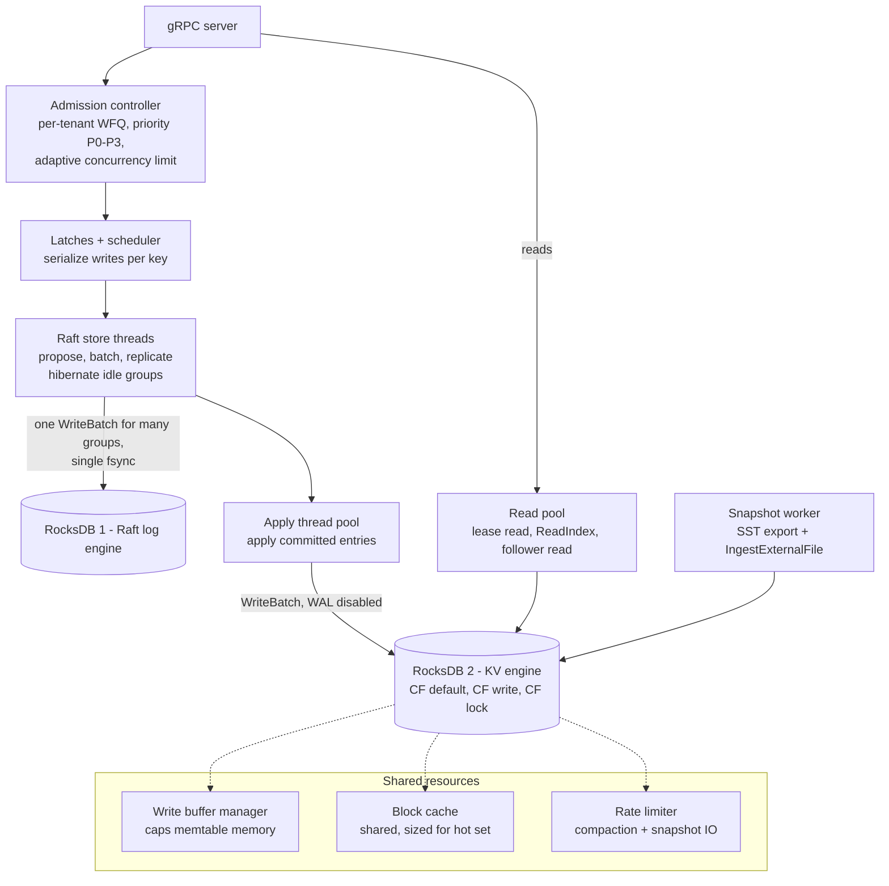

| Design choice | Why | Trade-off |
|---|---|---|
| **Two RocksDB instances**: Raft log + KV | Raft log is append-then-truncate; isolating it avoids compaction churn on data | Two engines to tune |
| **Disable the KV engine's WAL** | The Raft log already is the WAL — no double writes | Recovery replays from the Raft log |
| **Batch many Raft groups into one WriteBatch + one fsync** | Thousands of ranges share disk syncs — critical during bursts | Small latency added by the batching window |
| **Hibernate idle Raft groups** | Millions of cold ranges don't burn CPU on heartbeats | Wake-up adds latency to the first request |
| **One shared KV engine per node** (not per tenant) | Shared block cache and memtable budget; thousands of tenants stay cheap | Shared compaction → per-tenant IO accounting needed |
| **Dedicated nodes for top tenants** | Their compaction and bursts can't hurt others | Lower utilization |
| **Admission before latches** | Reject early, before using Raft or disk resources | Must estimate cost per request |

### 9.4 Key encoding and MVCC

```
CF default : tenant | store | hash(player) | key | start_ts   -> value blob
CF write   : tenant | store | hash(player) | key | commit_ts  -> {start_ts, PUT or DELETE}
CF lock    : tenant | store | hash(player) | key              -> {primary, start_ts, ttl}   (2PC only)
```

- Timestamps are stored inverted so the **newest version sorts first** — a read is one seek.
- **1PC fast path:** a single-key save writes `default` + `write` in one Raft entry, no lock record. This covers > 95% of traffic.
- **2PC (trades):** prewrite locks on all keys → commit primary → commit secondaries asynchronously. A crashed coordinator is resolved by checking the primary lock.
- **30-day versions** are just MVCC history: a GC safe-point plus a compaction filter drops older versions.
- The **lease epoch is checked inside the same Raft entry**, so fencing is atomic with the write.

### 9.5 Write path

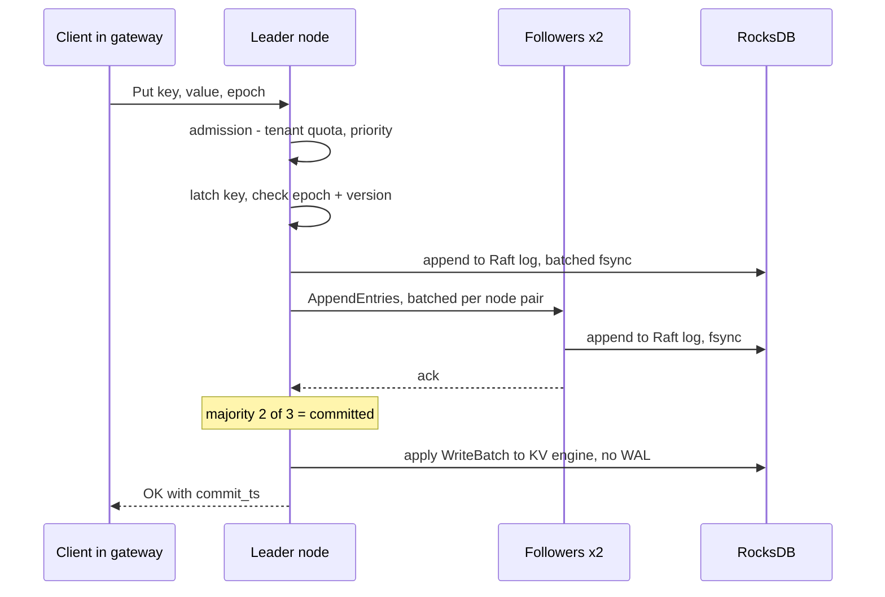

Latency ≈ 1 cross-AZ round trip + 1 fsync (both batched) → **~2–5ms**.

### 9.6 Read path

| Read type | How | Consistency | Cost |
|---|---|---|---|
| **Lease read** (default) | Leader holds a time-based lease (shorter than election timeout) and serves locally | Linearizable | Local only |
| **ReadIndex** | Leader confirms leadership with one heartbeat round, then reads | Linearizable | +1 RTT |
| **Follower read** | Follower gets the leader's commit index (or a safe timestamp), then reads locally | Linearizable or bounded-stale | Spreads load over 3 replicas |
| **Stale read** | Read at `now - 5s` from any replica | Bounded-stale | Cheapest; used for others' profiles |

### 9.7 Range lifecycle: split, move, merge

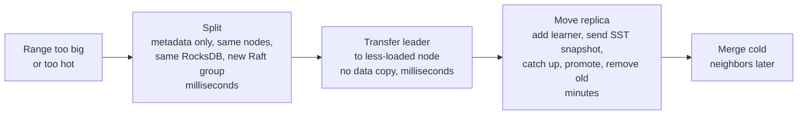

- **Split is cheap:** all ranges on a node share one RocksDB, so no data moves — only metadata.
- **Leader transfer is cheap:** a Raft leadership handoff moves *load* instantly without moving *data*.
- **Replica move is expensive:** a bulk data copy, throttled by the rate limiter and avoided during bursts.
- This order — **split → move leaders → move data later** — is the key to reacting fast to bursts.

**Placement driver scheduling:** nodes report size, QPS, IO, L0 files and pending compaction every few seconds. The scheduler balances leaders (CPU), replicas (disk) and hot ranges (QPS) while respecting AZ spread and tenant placement (shared vs dedicated cells).

### 9.8 The burst problem

A big game update or live event can push traffic **10–100× within minutes**, usually concentrated on **one tenant**:

| Burst | Cause | Load shape |
|---|---|---|
| **Save storm** | Update shuts down all servers of a game → every player's final save at once | Massive P0 writes |
| **Join storm** | Players rejoin the new version / event starts | Massive P1 reads + lease acquires |
| **Event writes** | Limited-time event: everyone earns items, global counters | Write spike + hot keys |

Load-based range splitting **can't react in time**: splitting and moving data takes minutes, and moving data during a burst adds more load.

### 9.9 Burst control architecture

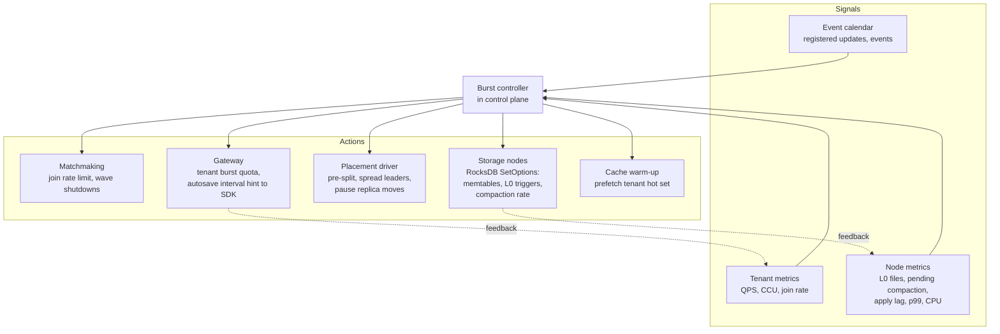

**Timeline of a planned game update**

| Time | Action |
|---|---|
| **T − 30 min** | Event registered → pre-split the tenant's ranges (e.g. 64 → 512), spread leaders across all nodes in its cell, pause non-urgent replica moves |
| **T − 10 min** | Warm block cache with the tenant's hot keys; raise memtable budget and L0 triggers via `SetOptions` |
| **T 0** | Shut servers down in waves (e.g. 10% per minute); final saves go on the P0 lane |
| **T + 0–15 min** | Join queue caps the rejoin rate; autosave interval stretched to 120s; P3 shed |
| **T + 15–60 min** | Restore normal options; pay compaction debt with extra IO budget; merge surplus ranges later |

**Unplanned (viral) burst:** the controller detects a steep QPS rise for a tenant → splits hot ranges (ms) → transfers leaders to idle nodes (ms) → tightens that tenant's burst quota so neighbors stay safe → moves data only after the spike.

### 9.10 Absorbing bursts — layer by layer

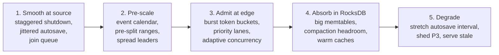

| Layer | Technique | Effect |
|---|---|---|
| **1. Source** | Shut down / migrate servers in waves during updates | Turns one save spike into a ramp |
| | Jittered autosave timers; SDK coalescing | No synchronized write waves |
| | Matchmaking join queue (waiting room) | Caps join rate to what storage can take |
| **2. Pre-scale** | Developers register big updates/events in an **event calendar** | Platform knows bursts ahead of time |
| | **Pre-split** the tenant's ranges and **spread leaders** across nodes before the event | Load lands on many nodes from second one |
| | Move leadership first (cheap, no data copy), data later | Fast rebalance during a surprise burst |
| | `hash(player)` in the key | Bursts spread across ranges, never one hot range |
| **3. Edge** | Token buckets with burst capacity; P0 final saves reserved | Critical writes always go through |
| | **Adaptive concurrency limits** (AIMD on latency) per node | Node never accepts more than it can finish |
| | Deadline propagation — drop requests already past deadline | No wasted work on requests nobody waits for |
| | Retry budgets + jitter in SDK | Prevents retry storms |
| **4. RocksDB** | Larger / more memtables (`max_write_buffer_number`), pipelined writes, group commit | Absorbs write spikes in memory |
| | Steady-state IO kept < 50–60% | Room for compaction debt during the burst |
| | Rate-limited compaction; raise L0 slowdown/stop triggers temporarily | Avoids write stalls; pay compaction debt after |
| | Bloom filters + block cache pre-warmed for event tenant | Join storm served from memory |
| | Follower reads for joins of non-lease data | Spreads reads over 3 replicas |
| **5. Degrade** | Server tells SDK to stretch autosave from 30s → 120s | Cuts P2 write volume ~4× instantly |
| | Shed P3 (ListKeys, exports); serve stale profiles/leaderboards | Frees capacity for P0/P1 |
| | Hot event counters: write-combining in gateway / sharded counters | No single-key hotspot |

### 9.11 What if it fails during a burst?

| Failure | What happens | Mitigation |
|---|---|---|
| **Write stall** (L0 files / pending compaction too high) | RocksDB blocks writes → latency spike | Early backpressure at the node before stall thresholds; temporary higher triggers; compaction headroom |
| **Retry storm** (metastable failure) | Timeouts → retries → more load → more timeouts, persists after the spike | Retry budgets, circuit breakers, adaptive concurrency, deadline dropping |
| **Memtable memory pressure** | Node OOM | Global write-buffer manager caps memtable memory across column families |
| **Lagging follower** | Raft log grows; snapshot sending adds IO | Throttle snapshots; delay non-urgent rebalancing until after the burst |
| **Compaction debt after burst** | Read amplification → slower reads for hours | Scheduled catch-up compaction; extra IO headroom off-peak |
| **Unannounced viral spike** | No pre-split | Leader transfer first (seconds), then splits; edge admission protects other tenants |
| **Timestamp oracle slow / down** | 2PC trades stall | 1PC saves don't need the TSO; TSO is Raft-replicated with batched allocation |
| **Placement driver down** | No splits or leader moves | Nodes keep serving with current placement; admission + degradation handle the burst |
| **Split storm** | Too many tiny ranges, heartbeat overhead | Rate-limit splits; hibernate idle groups; merge after the burst |

### 9.12 Trade-offs

| Decision | Gain | Cost |
|---|---|---|
| Building our own distributed layer on RocksDB | Full control of tenancy, bursts, priorities | Large engineering and operational investment |
| IO headroom (< 60% steady state) | Absorbs bursts without stalls | Hardware cost |
| Event calendar + pre-splitting | Bursts handled before they hit | Depends on developers registering events |
| Stretching autosave under load | Big instant write reduction | More progress at risk if a server crashes |
| Join queues at matchmaking | Storage never overwhelmed | Players wait longer to join |
| Relaxed compaction during burst | No write stalls | Slower reads until compaction catches up |
| Central timestamp oracle | Simple global ordering for MVCC / 2PC | Extra RPC per transaction; mitigated by batching and the 1PC path |
| Lease reads | Linearizable reads with no extra round trip | Correctness depends on bounded clock drift |

---

## 10. Summary

| Stage | Adds | Fixes | Cost |
|---|---|---|---|
| 1 | Single Postgres | Start simple | SPOF, write ceiling |
| 2 | Replicas, cache, leases | HA, reads, duplication | Single write primary |
| 3 | Sharded RocksDB + Raft | Write scale, fast failover | Compaction, 2PC |
| 4 | Gateway, quotas, cells | Noisy neighbors | Complexity |
| 5 | Redis, Postgres views, CDC | Workload interference | Eventual consistency |
| 6 | Multi-region | Latency, region outages | RPO > 0 on region loss |
| 7 | Versions, tiering | Tenant mistakes, cost | Storage overhead |

| Workload | Store | Consistency |
|---|---|---|
| Player state | RocksDB + Raft, lease-fenced | Strong |
| Purchases / trades | DataStore transactions, sync multi-region | Strong |
| Sessions / queues | Redis | Best effort, TTL |
| Leaderboards, profiles | Derived via CDC + Redis cache | Eventual (seconds) |
| Config / catalog | PostgreSQL + cache | Eventual, versioned |
