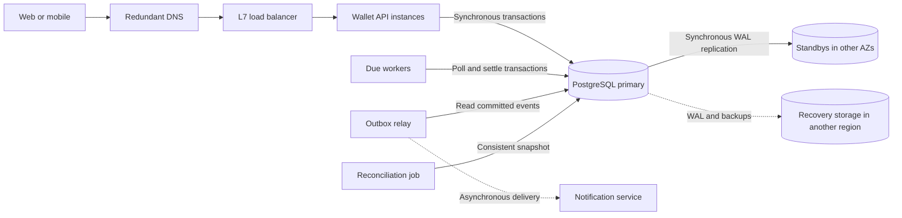
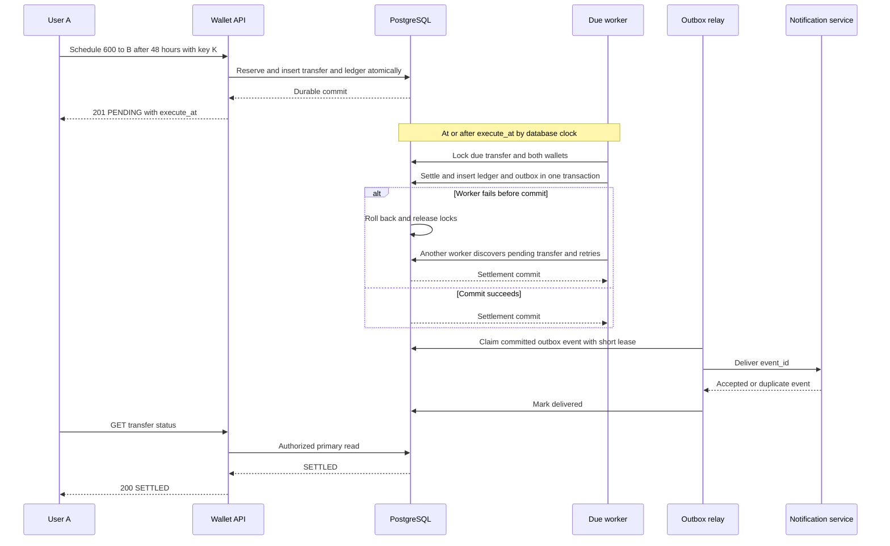

# Roblox: Delayed Robux Transfers

> User A pays User B **600 Robux after 48 hours**. User C pays User D **100 Robux after 2 hours**.
>
> Reserve funds now, store the deadline durably, and settle with an atomic, idempotent wallet transaction. A timer triggers work; it does not authorize moving money.

This is a hypothetical internal wallet design, not a claim that Roblox offers a public arbitrary user-to-user transfer API. All scale figures and service targets below are interview assumptions, not Roblox production facts.

## 1. Clarify the Requirements

### Functional Requirements

The questions that determine the design are: reserve funds now or debit at execution, can a sender cancel, how late may execution be, and what happens if a recipient becomes ineligible? For this complete answer, assume:

| Requirement | Chosen semantics |
|---|---|
| Create transfer | Authenticated sender chooses recipient, positive integer Robux amount, and delay |
| Funding | Reserve the entire amount at creation; reject insufficient available funds |
| Execution | Credit recipient no earlier than the durable `execute_at` timestamp |
| Cancellation | Sender may cancel only while pending and strictly before `execute_at` |
| Status and history | Sender and recipient can view authorized transfer details and cursor-paginated history |
| Eligibility | Validate both wallets at creation and again at execution; permanent rejection releases the hold |
| Notifications | Best-effort asynchronous notification after settlement; never part of financial success |
| Retry behavior | Client retries and worker retries cannot create an additional financial effect |

The delay starts at the authoritative server timestamp assigned during creation. A `201` means the hold and deadline committed durably, not that the recipient was paid. If a slow creation transaction commits after the deadline, settlement can occur immediately afterward, never before it.

**Example at server time `2026-11-05T12:00:00Z`:**

| Transfer | Reserve immediately | Execute no earlier than | Effect on settlement |
|---|---|---|---|
| A to B | A.available -= 600, A.held += 600 | `2026-11-07T12:00:00Z` | A.held -= 600, B.available += 600 |
| C to D | C.available -= 100, C.held += 100 | `2026-11-05T14:00:00Z` | C.held -= 100, D.available += 100 |

C's transfer executes first despite being created second. No FIFO ordering across transfers is required. Each wallet has a serialized sequence of balance changes, but equal-deadline transfers have no prescribed relative order.

### Non-Functional Requirements

| Area | Assumed target |
|---|---|
| Scale | 10 million DAU, 1 million scheduled transfers/day, 10x peak multiplier |
| Delay range | 1 minute to 30 days; examples are 48 hours and 2 hours |
| API latency | p99 < 250 ms for create/cancel/status in the home region |
| Execution latency | Never early relative to the authoritative clock; 99.9% of eligible transfers settle within 5 seconds after deadline under provisioned load |
| API availability | 99.95% monthly; scheduling timeliness measured separately |
| Consistency | Strong transactional consistency for money and state; read-your-writes for status; eventual notifications |
| Durability | RPO 0 for acknowledged transfers under a single-node or single-AZ failure; in-region RTO target < 60 seconds |
| Regional disaster | Initial asynchronous DR target RPO <= 1 minute, RTO <= 30 minutes; this is explicitly weaker than normal durability |
| Security | Server-derived sender identity, wallet eligibility checks, transfer limits, authorization, encrypted transport/storage, auditable operations |

The five-second execution target excludes infrastructure outages and policy-blocked transfers, which must be reported separately rather than hidden in successful timing metrics. A failover can exceed it. RPO 0 across a complete regional loss would require synchronous cross-region durability and a different latency/cost budget.

### Scope

In scope: one currency, internal wallets, one-time transfers, holds, cancellation, failure release, status/history, and reconciliation. Out of scope: real-money purchases, taxes, exchange rates, recurring payments, external banking, and implementing Roblox's actual policy engine.

Three controlling requirements: no overspending, no early settlement, and at-most-one financial outcome despite retries. Eventual completion additionally requires database availability, eligible accounts, and workers keeping up with accepted load.

## 2. Estimation & Scale (Read vs. Write Heavy)

### Traffic Estimation

Assume 0.1 scheduled transfers per active user/day and five status/history reads per transfer. MAU and persistent connections do not drive this design and are not assumed.

$$
\text{Creates/day} = 10^7 \times 0.1 = 10^6
$$

$$
\text{Average create QPS} = \frac{10^6}{86{,}400} \approx 11.6,
\qquad \text{Peak create QPS} \approx 116
$$

| Operation | Daily volume | Average QPS | Assumed peak QPS |
|---|---|---|---|
| Create and reserve | 1 million | 11.6 | 116 |
| Status/history read | 5 million | 57.9 | 579 |
| Settle or release | Approximately 1 million at steady state | 11.6 | 116 under the same arrival-spread assumption |

The client read:create ratio is **5:1**. Including execution, reads:financial transactions is approximately **2.5:1**, before cancellations. Each financial transaction writes multiple rows, so logical QPS understates database work.

Deadlines need not follow creation traffic: a coordinated event could make one million transfers due together. Clearing them in five seconds would require about 200,000 settlements/second, far above this baseline. Apply per-deadline-bucket admission limits or negotiate a wider execution window; never promise precise timing for an unbounded accepted burst.

### Storage & Bandwidth Estimation

Assume **2 KB logical data per completed transfer lifecycle**, including transfer metadata, two financial transactions with four ledger postings total, idempotency metadata, and compact outbox records. Large policy evidence and logs are separate.

| Estimate | Calculation | Result |
|---|---|---|
| Daily logical growth | 1 million x 2 KB | Approximately 2 GB/day |
| One-year logical retention | 2 GB x 365 | Approximately 730 GB |
| Physical database capacity | Logical x 1.5 indexes/overhead x 3 database copies | Approximately 3.3 TB/year, excluding WAL and backups |
| Pending population | 1 million/day x assumed mean 2-day delay | Approximately 2 million pending transfers |
| Live transfer metadata | 2 million x assumed 0.5 KB/row | Approximately 1 GB before indexes |
| Peak create ingress | 116/s x 1 KB/request | Approximately 116 KB/s |
| Peak read egress | 579/s x 2 KB/response | Approximately 1.2 MB/s |
| Peak notification payload | 116/s x 0.5 KB/event | Approximately 58 KB/s |

Use decimal units. Bandwidth estimates exclude TLS, retries, replication, WAL, and existing wallet traffic. Assume one year of online transfer history; ledger archive/deletion policy requires compliance approval and is not inferred from that assumption. Archive terminal transfer metadata and delivered outbox rows without losing ledger auditability.

### Architectural Implications

One well-provisioned relational primary is a plausible starting point, subject to load testing. An indexed pending set is small enough to poll; no distributed timer service or Redis is initially necessary. Due-time skew and popular recipients, not network throughput, are likely bottlenecks. Read replicas are optional for stale-tolerant history, not monetary decisions.

## 3. Define APIs

Use HTTPS REST with authenticated identity; never accept an authoritative `sender_id` from the client. Amounts are bounded positive integers in Robux, represented internally as signed 64-bit integers with overflow checks. Reject self-transfers, unknown recipients, ineligible wallets, unsupported currency, and delays outside the permitted range.

### Create

```http
POST /v1/scheduled-transfers
Authorization: Bearer <session>
Idempotency-Key: a-to-b-600-48h
Content-Type: application/json

{"recipient_id":"B","amount":600,"currency":"ROBUX","delay_seconds":172800}
```

```http
HTTP/1.1 201 Created
Location: /v1/scheduled-transfers/tr_ab

{"transfer_id":"tr_ab","sender_id":"A","recipient_id":"B","amount":600,"currency":"ROBUX","status":"PENDING","created_at":"2026-11-05T12:00:00Z","execute_at":"2026-11-07T12:00:00Z"}
```

C uses the same endpoint with `recipient_id=D`, `amount=100`, `delay_seconds=7200`, and a separate idempotency key. Its deadline is `2026-11-05T14:00:00Z` for the same creation timestamp.

The key is unique per sender and create operation. Store a canonical request hash and original response in the reservation transaction. Concurrent requests use a database unique constraint, not a check-then-insert race. Same key and payload returns the original response with `200`; different payload returns `409 IDEMPOTENCY_CONFLICT`. Retain the key mapping with the online transfer for at least one year, document that retry window, and never retry an old uncertain request with a new key.

### Query and Cancel

| Operation | Contract | Success |
|---|---|---|
| Status | `GET /v1/scheduled-transfers/{id}` | `200` with parties, amount, status, deadline, terminal timestamp, and safe failure reason |
| History | `GET /v1/me/scheduled-transfers?role=sent&limit=50&cursor=...` | `200 {"items":[...],"next_cursor":"..."}` |
| Cancel | `POST /v1/scheduled-transfers/{id}/cancel` | `200 {"transfer_id":"tr_ab","status":"CANCELLED"}` after funds are released |

History uses an opaque `(created_at, transfer_id)` cursor and a capped limit. Both parties can query a transfer; only the sender can cancel. Return `404` to callers without visibility. Status reads use the primary for read-your-writes. A client timeout is an unknown outcome, not proof of failure: repeat with the same create key or query status.

Errors: `400 INVALID_ARGUMENT`, `401 UNAUTHENTICATED`, `403 WALLET_INELIGIBLE`, `409 INSUFFICIENT_FUNDS`, `409 TOO_LATE_TO_CANCEL`, `409 ALREADY_FINAL`, `429 RATE_LIMITED` with `Retry-After`, and `503 TEMPORARILY_UNAVAILABLE`. A repeated cancellation of an already cancelled transfer returns `200` without another release. Deadline and terminal-state checks run after obtaining the transfer lock; no client-supplied timestamp can bypass them.

## 4. High-Level Design

### 4.1 Clients

Web/mobile clients call a regional HTTPS endpoint through redundant DNS and an L7 load balancer. Authenticate using existing Roblox identity infrastructure. Private wallet responses are not CDN-cached; a CDN may serve static client assets only. No WebSocket or continuous client connection is required to execute a transfer.

### 4.2 App Servers

Use one wallet application with stateless API instances and separately scalable worker processes, not a microservice per operation. PostgreSQL owns balances, pending work, and ledger state. Due workers poll every 250 ms in bounded batches; they execute short transactions rather than sleeping for two days. The durable pending table is the initial work queue.



Solid arrows are synchronous calls or replication; the worker's invocation is asynchronous relative to creation. Dashed arrows show asynchronous delivery or recovery copying. Notifications can be down without stopping money movement.

### 4.3 Database

Choose PostgreSQL because reservation, two-wallet settlement, terminal state, ledger postings, and notification intent must commit together. This design assumes the wallet platform permits all these updates in the same transactional database. If wallets are an external service, that service must expose idempotent hold/capture/release operations; local SQL cannot atomically update a remote balance.

| Entity | Important fields and constraints |
|---|---|
| `wallets` | `user_id PK`, `available BIGINT >= 0`, `held BIGINT >= 0`, eligibility state, version |
| `scheduled_transfers` | `transfer_id PK`, sender/recipient FKs, `amount > 0`, currency, `execute_at`, `next_attempt_at`, `status`, attempt count, terminal timestamp |
| `financial_transactions` | `transaction_id PK`, `transfer_id FK`, operation, `UNIQUE(transfer_id, operation)` |
| `ledger_postings` | `(transaction_id, posting_no) PK`, wallet ID, bucket `AVAILABLE` or `HELD`, signed integer delta |
| `idempotency_records` | `(sender_id, operation, key) PK`, request hash, transfer ID, original response |
| `outbox` | `event_id PK`, transfer ID, type, payload, retry time, lease expiry, delivered timestamp |

Every financial transaction has zero-sum postings. The posting key permits multiple entries for one operation; placing `UNIQUE(transfer_id, operation)` on individual postings would incorrectly prevent a balanced pair. Enforce posting balance within the controlled wallet transaction path, deny arbitrary balance writes, and reconcile against immutable ledger records.

Indexes: partial `(next_attempt_at, execute_at, transfer_id) WHERE status = 'PENDING'`, plus `(sender_id, created_at, transfer_id)` and the corresponding recipient index. Initially `next_attempt_at = execute_at`; retries move it forward, never the deadline. The worker query checks both timestamps.

State transitions are only `PENDING -> SETTLED`, `PENDING -> CANCELLED`, or `PENDING -> FAILED_RELEASED`. The last state means policy permanently rejected execution and the held amount was atomically returned. Transient infrastructure failures leave the transfer pending. There is no durable `PROCESSING` state or execution lease in the baseline because settlement happens in one short database transaction.

Use synchronous WAL flush to a standby in another AZ before acknowledging commit. Automatic failover requires an external quorum-backed HA controller, promotion of an eligible synchronous replica, and fencing of the old primary. PostgreSQL streaming replication alone is not a leader-election system. If synchronous durability cannot be maintained, stop acknowledging writes instead of silently weakening the promise.

Do not shard initially. Retain the live pending table and split/archive large terminal history when measured needs justify it; partitioning one database is not independent database sharding. A transfer-ID hash can distribute scheduling work but cannot co-locate both arbitrary users' wallets. Future physical sharding requires distributed serializable transactions or a separately specified escrow protocol, not two unrelated balance updates.

### 4.4 Cache

**No shared cache in the baseline.** The estimated read load is modest, status should reflect committed state, and cache invalidation adds no value to correctness. The operating system/database buffer cache handles the working set.

If history becomes expensive, an optional cache-aside Redis entry such as `history:{user_id}:{cursor}` may have a 15-second TTL and a 100,000-entry cap. At 2 KB/entry, payload capacity is approximately 200 MB before Redis overhead. It is not consulted for spending, holds, deadline checks, cancellation, or authoritative transfer status.

## 5. Deep Dives

### 5.1 Test Cases

| Scenario | Expected result and invariant |
|---|---|
| A has 1,000 available and creates the 600 transfer | A.available=400, A.held=600, B unchanged |
| C has 250 available and creates the 100 transfer | C.available=150, C.held=100, D unchanged |
| At t0 + 2 hours | C.held=0, D gains 100; A's hold remains 600 |
| At t0 + 48 hours | A.held=0, B gains 600; no second credit to D |
| Worker runs just before deadline | No settlement; database deadline predicate rejects it |
| Repeated create with the same key | One transfer, one reservation; conflicting payload gets 409 |
| Two simultaneous 600 reservations against 1,000 | Only one succeeds; available never negative |
| Multiple workers choose one transfer | One terminal outcome and one set of settlement postings |
| Crash before commit / after commit before response | Rollback or committed result; retry never adds a second effect |
| Cancellation before deadline | Available restored once; recipient never credited |
| Cancellation begins before deadline but waits past it | Recheck after locking; reject as too late |
| Recipient becomes permanently ineligible | Hold released once and transfer becomes FAILED_RELEASED |
| A-to-B and B-to-A settle concurrently | Canonical wallet lock order prevents a wallet lock-order cycle |
| Notification delivery repeats | Notification deduplicated by event ID; no balance change |

Use controlled time at the application/database boundary in a test environment and real PostgreSQL transactions for concurrency tests; mocked locks are insufficient. At the assumed peak, exercise 116 creates/s, 116 settlements/s, and 579 reads/s together. Pass criteria: p99 API < 250 ms, >=99.9% eligible settlements within five seconds, zero early or duplicate settlements, nonnegative balances, and zero-sum postings. Separately test due-time bursts, failover, deadlock retries, and backlog drainage; the peak target must be measured, not inferred from CPU count.

### 5.2 Core Component Breakdown & Data Flow

#### Create and Reserve

1. API authenticates, applies abuse and deadline-bucket admission limits, and validates input. Derive sender from identity.
2. Begin a transaction and insert the sender-scoped idempotency key. A conflicting concurrent insert waits for the winner; compare hashes and return the committed result. Roll back the key if creation fails.
3. Lock the sender wallet; verify eligibility and available funds. Read recipient eligibility under the wallet platform's transaction rules, but do not perform remote calls while holding database locks.
4. Assign `created_at` from database time and calculate `execute_at = created_at + delay`. Move 600 from A.available to A.held using a conditional balance update.
5. Insert the pending transfer, RESERVE financial transaction and its two postings `A.available:-600`, `A.held:+600`, plus the idempotency response. Commit synchronously before returning `201`.

An eligibility change after creation is handled at settlement. A creation timeout can occur after commit; the same idempotency key resolves that ambiguity.

#### Discover and Settle Due Work

Each worker finds one candidate using the partial pending index, locks the transfer with `FOR UPDATE SKIP LOCKED`, and completes the following transaction. Workers repeat within bounded loops; they do not hold a large batch of transfer locks while waiting on wallet rows.

```text
BEGIN
  select one eligible PENDING transfer
    where execute_at <= database_time and next_attempt_at <= database_time
    order by next_attempt_at, execute_at, transfer_id
    FOR UPDATE SKIP LOCKED
  if none: COMMIT and finish this polling cycle

  lock sender and recipient wallets in ascending user_id order
  recheck PENDING and execute_at <= current database clock
  if a wallet is permanently ineligible:
    sender.held -= amount; sender.available += amount
    insert RELEASE financial transaction and balanced postings
    set status = FAILED_RELEASED
  else:
    sender.held -= amount; recipient.available += amount
    insert SETTLE financial transaction and balanced postings
    set status = SETTLED
  insert terminal event into outbox
COMMIT
```

For A, SETTLE postings are `A.held:-600`, `B.available:+600`. A.available is **not debited again**. Both wallets, ledger, transfer state, and outbox change atomically; the unique operation key is an additional backstop, not a replacement for the transfer lock and status check.

The database row lock is the worker claim. A crash before commit releases locks and rolls back changes; another worker finds the pending row. A crash after commit leaves a terminal row that cannot be settled again. This is **at-most-once financial effect with retry-based eventual execution**, not a claim of exactly-once message delivery.

Use short lock/statement timeouts. On lock timeout or deadlock, roll back and retry with bounded exponential backoff and jitter; in a separate short transaction, update `next_attempt_at` and attempts only if the transfer is still pending. If that retry update is lost, immediate rediscovery is safe. Persistent errors generate alerts and a durable exception record; do not silently drop a transfer or release funds merely because infrastructure retries were exhausted.

#### Cancel and Read

Cancellation locks the transfer, checks sender ownership, then reads the current database clock **after the lock wait**. Use `clock_timestamp()` for this check in PostgreSQL because `now()` represents transaction start. If pending and strictly before the deadline, lock the sender wallet, return held funds, append RELEASE postings, change state to CANCELLED, and insert an outbox event in the same transaction. Execution and cancellation serialize on the same transfer row.

Status lookup goes from client to API authorization to the primary's transfer row, then returns the committed state. Wallet spending reads the transactional balance, not a history cache. Paginated history follows the sender/recipient indexes; optional stale history is explicitly labeled as such.



#### Queue/Worker Model and Streaming

The pending database table is a durable deadline-ordered work queue. The index, due-time predicates, and row locks provide discovery and safe concurrent execution. No delayed broker message, in-memory timer, or Redis sorted set is the source of truth. Polling means up to one poll interval plus queue/lock/transaction latency, not exact wall-clock delivery.

The outbox relay claims notification rows using expiring leases, sends outside the claim transaction, and marks delivery only after acknowledgment. Delivery is at least once: a crash after send but before marking causes a repeat. The consumer deduplicates on `event_id`; notifications for a transfer carry its terminal state. Poison events move to a durable dead-letter table with alerting and replay tools, without changing financial state.

If measured worker isolation needs justify a ready broker, a dispatcher must write a READY outbox record and a renewable scheduling lease on the transfer in one transaction. The relay publishes `transfer_id`; consumers recheck the authoritative deadline and perform the same settlement transaction, then ACK only after commit. Expired scheduling leases make still-pending transfers rediscoverable. A primary overdue scan repairs gaps; a lost or duplicate broker message cannot lose or duplicate money. Hash transfer IDs across broker partitions for concurrency, not recipient IDs that concentrate popular users. Prefetch and consumer counts are bounded by database capacity, and leases must account for normal queue delay to avoid repeated publication storms.

This is scheduled transactional processing, not a stream-processing problem: event-time windows and stream checkpoints are unnecessary. In the optional broker path, consumer acknowledgments/offsets and redelivery provide recovery; domain idempotency remains in the database. Do not assume partition order provides global payment order.

#### Partitioning and Hot Wallets

In the baseline all wallet requests route to one primary, and workers share an indexed pending set. Add scheduler buckets only if measured scan contention requires them; a `(bucket, next_attempt_at)` index and leased bucket assignments can then bound each worker's scan. Bucket reassignment affects discovery only; locked financial transactions remain authoritative.

A celebrity recipient can serialize many credits on one wallet row even when transfers hash evenly. Measure wallet lock waits and apply per-wallet limits. For a sustained hot account, consider bounded batches of independently due credits under a single wallet lock, retaining per-transfer ledger entries and terminal checks. Broader sharding must solve cross-shard balance atomicity; choose a distributed serializable SQL store if single-primary capacity is genuinely insufficient, then budget for distributed transaction retries, network latency, and hot-key limits that still remain.

### 5.3 Edge Cases

- **Two terminal actions:** Every action locks the transfer and transitions only from PENDING. CANCELLED and FAILED_RELEASED release once; SETTLED credits once. There is no rollback from a terminal state; corrections are new audited transactions.
- **Insufficient funds later:** Already reserved funds cannot be spent elsewhere. Insufficient held funds at execution is an invariant violation requiring quarantine and investigation, not a normal retry or a second available-balance debit.
- **Clock changes:** Store UTC timestamps, monitor database clock offset, use disciplined time synchronization, and pause execution if authoritative time health is uncertain. Database predicates prevent early execution relative to that clock; an absolute never-early real-world guarantee requires bounded clock uncertainty and a conservative guard interval.
- **Out-of-order work:** Always recheck `execute_at`, even if a broker or prefetcher delivers early. Different transfers need no global ordering.
- **Deleted or frozen accounts:** Wallet records are tombstoned, not physically deleted while referenced. A permanent policy decision releases held funds atomically; temporary policy-system unavailability leaves the transfer pending. If compliance requires frozen funds to remain frozen, model an explicit blocked state instead of claiming unconditional release.
- **Balance overflow and amount limits:** Check bounds on creation and recipient credit. An uncreditable transfer follows an explicit permanent-failure policy, never integer wraparound.
- **Thundering herd:** Jitter polling starts, cap workers and per-iteration work, and use SKIP LOCKED plus short lock waits. Duplicate discovery must remain safe even without any cache.
- **Reconciliation race:** Compare ledger, balances, and pending holds in a consistent database snapshot, not independent reads while transfers mutate. Alert on unexplained differences; do not repair by blindly overwriting balances.

### 5.4 Cache

No cache means no financial cache invalidation, TTL, or eviction dependency. PostgreSQL restart/cold buffers can still raise latency; bound API and worker concurrency while the buffer pool warms.

For the optional history cache, use cache-aside with a 15-second TTL, randomized expiration, and LFU eviction under a memory cap. A miss reads an indexed history page and populates it; a financial commit can emit best-effort invalidation through the outbox. Missed invalidations permit at most the documented TTL staleness during normal cache operation, so cached history never substitutes for primary status. Avoid negative caching of newly created transfers. Coalesce identical misses and rate-limit fallback when Redis fails; never dump an unbounded cache miss surge onto the wallet primary.

### 5.5 CAP Theorem

For balance mutations and authoritative status, choose linearizable behavior within the single-primary/fenced-leader design. During a network partition, requests that cannot reach the legitimate writer and required synchronous durability path fail or wait within a timeout; isolated nodes do not independently accept wallet writes. Thus these operations sacrifice CAP availability, which requires a successful response at every non-failing node, to protect consistency.

An optional stale history view may remain available with weaker consistency. Notifications may pause and later replay. These choices do not make all of Roblox a single CP or AP system. The 99.95% uptime SLO is not CAP availability, and synchronous replication latency is a normal-operation trade-off distinct from partition behavior.

### 5.6 Trade-offs

| Decision | Selected approach | Alternative | Benefit and cost | Revisit when |
|---|---|---|---|---|
| Funding | Reserve now | Debit at deadline | Prevents overspending and late insufficient funds, but reduces sender liquidity immediately | Product explicitly permits payment failure for lack of funds |
| Scheduling | Indexed DB polling | Distributed timers or delayed broker | Fewer failure boundaries, but polling and settlement share DB capacity | Measured poll/worker isolation needs justify dispatch complexity |
| Settlement | Atomic relational transaction | Independent debit/credit calls | No partial payment, but shared primary and hot-wallet limits | Proven capacity ceiling warrants distributed transactions |
| Worker claim | Row lock for short execution | Durable lease across multiple steps | Automatic rollback on crash, but unsuitable for long external work | Settlement must call an external wallet platform |
| Caching | None for financial state | Redis balances/deadlines | Simpler correctness, more primary reads | Stale-tolerant read load demonstrably dominates |
| Durability | Synchronous cross-AZ WAL | Async standby | Protects acknowledged data in scoped failures, adds latency and can block writes | Requirements change latency or regional-loss guarantees |
| Timing | Never early, bounded-lateness SLO | Exact execution instant | Realistic under bounded load, but outages cause lateness | Tighter deadline classes have funded dedicated capacity |

## 6. Bottlenecks & Fault Tolerance

### 6.1 10x Traffic Spike

A further 10x over the estimated peak means approximately 1,160 creates/s, 1,160 settlements/s, and 5,790 reads/s. This is a new scenario, not the original 10x average-to-peak multiplier counted twice without explanation. Financial transactions are more expensive than one row write; benchmark WAL flush, index maintenance, and wallet lock contention before promising capacity.

Scale stateless APIs horizontally, but cap total database connections through bounded pools. Scale workers using oldest eligible overdue age and settlement throughput, not CPU alone. If measured worker throughput is `mu` transfers/second, a starting concurrency estimate is:

$$
N \ge \left\lceil \frac{\lambda}{0.7\mu} \right\rceil
$$

This formula assumes independent capacity; it stops helping when shared database or hot-wallet contention dominates. To drain backlog `B` within `T` seconds, provision throughput above new arrival rate by at least `B/T`.

During a short burst, accepted transfers remain durably pending while admission limits protect new creation and deadline buckets. Prioritize existing due obligations over history scans, pause nonessential notifications if needed, and return `429` or `503` before creating new holds that capacity cannot service. Do not silently drop accepted work or claim its deadline SLO still holds when backlog exceeds capacity.

For sustained growth: optimize indexed queries, reduce archived data on hot paths, batch safely, add optional stale-history replicas/cache, then evaluate physical sharding or distributed SQL with the explicit cross-wallet protocol described above. A larger queue buffers work but cannot create settlement throughput.

### 6.2 Fault Tolerance & Component Failures

| Component/failure | Detection and user impact | Recovery/fallback | Remaining risk |
|---|---|---|---|
| DNS or L7 balancer | Synthetic probes and error rate; clients cannot reach API | Redundant managed endpoints, health routing, client retry budgets | DNS caching and provider/control-plane failure delay rerouting |
| API instance | Health checks and dropped connections; response may be lost after commit | Remove instance and retry with the same idempotency key | Caller must treat timeout as unknown, not create a new key |
| Due worker | Missing heartbeat and growing overdue age; delayed execution | Other workers poll pending rows; DB disconnect releases transaction locks | Hung connections need DB-side transaction/statement timeouts |
| Database primary | Failed probes and replication monitoring; writes and primary status unavailable | HA quorum promotes eligible synchronous standby and fences old primary | Failover exceeds five-second timing target; promotion safety outranks availability |
| Synchronous standby/AZ | WAL acknowledgment stalls or lag; commits may block | Maintain redundant eligible standbys and safely reconfigure required acknowledgments | Do not silently switch to async while promising RPO 0 |
| HA quorum/controller | Leadership health alerts; unsafe promotion prevented | Quorum across failure domains, fencing, documented manual recovery | Lost quorum can halt failover even with a healthy replica |
| DB connection pool saturation | Pool wait and transaction latency rise | Bound concurrency, shed reads/new work, preserve due-work headroom | More app instances can worsen overload |
| Outbox relay | Event age grows; notifications delayed | Lease expiry, bounded retries with jitter, event-ID deduplication | Without downstream deduplication, duplicate notifications remain possible |
| Notification/identity dependency | Timeouts or provider errors | Retry notifications asynchronously; validate cached signing keys where safe, otherwise reject new unauthenticated calls | Existing scheduled work continues without client login; revocation freshness still matters |
| Reconciliation job | Missing success heartbeat; invariant checking delayed | Restart from a consistent snapshot with bounded read load | Latent corruption may remain undetected during the gap |
| Backup/DR storage | Backup freshness and restore drill failures | Redundant encrypted backup storage, retry WAL archival, alert on missing segments | Backup existence alone does not prove recoverability |
| Clock source | Offset and synchronization alarms | Pause unsafe scheduling and correct/fail over time source | Pausing prevents early payments but increases lateness |
| Optional cache/read replica | Cache errors or replica lag; stale history | Bounded primary fallback or temporary history unavailability | Cache is not a financial dependency; prevent fallback overload |
| Optional ready broker | Broker health, lag, or missing messages; delayed execution | Expired dispatch leases plus primary overdue scan recreate work, idempotent consumers handle replay | Broker recovery can flood database without bounded prefetch |

**Single points and failure domains:** the database writer is a logical single writer but not a single machine. Dependence on a region, HA quorum, identity control plane, time source, and available synchronous replicas remains explicit. Redundant API workers do not remove these shared risks.

**Regional disaster:** restore or promote the asynchronous DR copy, fence the former writer, reconcile known outcomes, then resume. The assumed <=1-minute RPO permits loss of acknowledged records and is not sufficient for a strict globally lossless wallet. A production requirement forbidding that loss needs synchronous cross-region durability or a suitable multi-region transactional store before launch; asynchronous replication cannot be described as solving it.

**Backups and recovery:** replication copies accidental deletes too, so retain encrypted base backups plus WAL for point-in-time recovery. Run restore drills and reconciliation before accepting restored traffic; track actual achieved RPO/RTO. A five-second settlement objective does not imply a five-second disaster recovery objective.

**Observability:** track API p99 and errors, eligible settlement lateness p99/p99.9, oldest overdue transfer, pending counts by due bucket, wallet lock waits, deadlocks, retry ages, WAL/replication lag, clock offset, outbox age, and backup freshness. Trace by transfer ID and idempotency key without exposing secrets. Alert on any negative balance or duplicate terminal effect, and reconcile:

- Each financial transaction's signed ledger postings sum to zero.
- Each wallet's balances agree with its opening balances plus ledger changes.
- For this feature, each sender's held Robux equals the sum of its PENDING transfer amounts; other hold types require separate buckets or inclusion in the reconciliation.
- Every terminal transfer has exactly one appropriate terminal financial operation; every eligible overdue pending transfer remains discoverable.

**Interview recap:** A's 600 Robux is reserved immediately and credited to B at or after 48 hours; C's 100 Robux is credited to D at or after two hours. Durable due-time indexing supplies liveness, while atomic state transitions and balanced ledger entries supply correctness. The first scaling risks are concentrated deadlines and hot wallet rows; the central trade-off is preserving money during failures at the cost of temporarily unavailable or late execution.