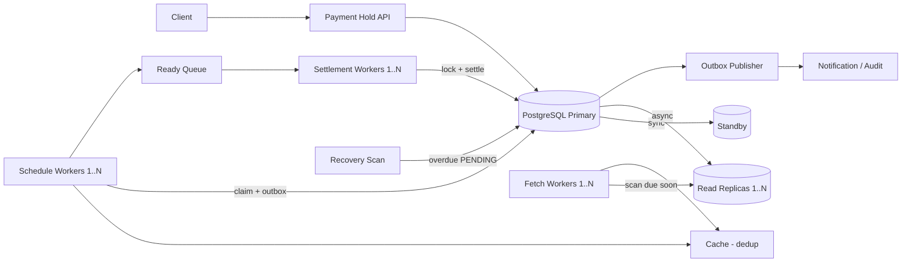

# Roblox Payment Holds

Hold a variable amount of Robux and pay it to a recipient after a designated, variable delay.

- Pay 100 Robux from UserA to UserB after 48 hours
- Pay 300 Robux from UserC to UserD after 2 hours

---

## 0. Requirements

| Item | Value |
|---|---|
| Functional | Create hold, settle at `release_at`, optional cancel, query status |
| Funds | Reserved at creation; sender cannot spend held Robux |
| Timing | Never settle early; a few seconds late is acceptable |
| Correctness | Each hold settles **exactly once** or is cancelled once; total Robux conserved |
| Delays | Minutes to days (store durably, not in process timers) |
| Availability | Survive worker crashes, queue redelivery, cache loss, DB failover |

**Central invariant:** every reserved amount is transferred once or returned once.

---

## 1. Architecture



| Component | Role |
|---|---|
| Payment Hold API | Validates, enforces idempotency, reserves funds in one transaction |
| PostgreSQL primary | **Source of truth** for wallets, holds, ledger |
| Standby | Synchronous replica; promoted on failover, old primary fenced |
| Read replicas | Discovery reads only (may lag) |
| Fetch workers | Scan replicas for holds due soon, per partition; push candidates to cache |
| Cache | Dedups scheduling work. **Optimization, not correctness** |
| Schedule workers | Claim due holds on primary with a lease; publish via outbox |
| Ready Queue | At-least-once delivery of `hold_id` |
| Settlement workers | Idempotent settlement transaction on primary |
| Outbox publisher | Delivers notification/audit events after commit |
| Recovery scan | Finds overdue `PENDING` holds missed due to cache loss or replica lag |

---

## 2. Data Model

```sql
wallets(user_id PK, available BIGINT CHECK (available >= 0), held BIGINT CHECK (held >= 0))

holds(hold_id PK, sender_id, recipient_id, amount BIGINT CHECK (amount > 0),
      release_at TIMESTAMPTZ, status, partition SMALLINT,
      lease_owner, lease_until, created_at)
  INDEX (partition, status, release_at)

ledger_entries(txn_id, hold_id, operation, account_id, amount)
  UNIQUE (hold_id, operation)   -- operation: RESERVE | SETTLE | CANCEL

idempotency(sender_id, idem_key, request_hash, hold_id)
  UNIQUE (sender_id, idem_key)

outbox(event_id PK, hold_id, type, payload, published_at)
```

Hold states: `PENDING → SETTLED` or `PENDING → CANCELLED` (terminal, one-way).

---

## 3. Create Hold

`POST /holds {recipient_id, amount, release_at}` with `Idempotency-Key`.

One transaction:

1. Check `idempotency`; same key + same hash returns the existing hold, different hash fails.
2. `UPDATE wallets SET available = available - :amt, held = held + :amt WHERE user_id = :sender AND available >= :amt` (0 rows means insufficient funds).
3. Insert `RESERVE` ledger entries.
4. Insert hold (`PENDING`, `partition = hash(hold_id) % 256`) and idempotency record.

---

## 4. Scheduling

1. **Fetch** workers own partitions via leases; scan replicas for `PENDING` holds with `release_at <= now() + window`, push IDs to cache.
2. **Schedule** workers pick due IDs and claim on the **primary**:

```sql
UPDATE holds
SET lease_owner = :worker, lease_until = now() + interval '30 seconds'
WHERE hold_id = :id AND status = 'PENDING' AND release_at <= now()
  AND (lease_until IS NULL OR lease_until <= now())
RETURNING hold_id;
```

3. In the same transaction, insert an outbox row; a publisher sends it to the Ready Queue.
4. **Recovery scan** on the primary periodically picks up overdue `PENDING` holds with expired leases.

Simpler starting point: skip fetch and cache; schedulers poll the primary with `FOR UPDATE SKIP LOCKED`.

---

## 5. Settlement (No Double Charge)

```text
BEGIN
  SELECT * FROM holds WHERE hold_id = :id FOR UPDATE
  IF status != 'PENDING' OR release_at > now(): COMMIT; RETURN   -- duplicate, no-op
  lock sender and recipient wallets in user_id order
  sender.held       -= amount
  recipient.available += amount
  INSERT ledger_entries (hold_id, 'SETTLE', ...)   -- unique constraint backstop
  UPDATE holds SET status = 'SETTLED'
  INSERT outbox (notification event)
COMMIT
ACK queue message
```

| Scenario | Outcome |
|---|---|
| Two workers get the same hold | Second waits on row lock, sees `SETTLED`, no-op |
| Crash before commit | Rollback; message redelivered |
| Crash after commit, before ack | Redelivery sees `SETTLED`, no-op |
| Cache evicts dedup key | Duplicate scheduled; settlement still no-op |
| Cancel vs settle race | Both lock the hold row; only one transition from `PENDING` wins |

**Exactly-once financial effect over at-least-once delivery.** Settlement debits `held`, never `available` again.

---

## 6. Cancel

Same lock on the hold row. If `PENDING`: `held -= amt`, `available += amt`, `CANCEL` ledger entry, status `CANCELLED`.

---

## 7. Scaling

- Fixed logical partitions (e.g. 256) independent of worker count; assign with leases. Adding workers redistributes partitions.
- Hash by `hold_id`, not sender, to avoid hot partitions.
- Bounded batches, queue backpressure so scheduling cannot overwhelm settlement.
- Autoscale on **oldest overdue hold age** and backlog, not CPU: $N \ge \lceil \lambda / (0.7\,\mu) \rceil$.
- Shard the DB by partition only when the primary is the bottleneck; cross-shard transfers then need a dedicated transfer protocol.

---

## 8. Failure and Recovery

| Failure | Mitigation |
|---|---|
| Primary down | Promote synchronous standby; fence old primary |
| Replica lag | Discovery only; claims and settlement on primary; recovery scan |
| Cache down | Fall back to recovery scan on primary |
| Queue redelivery | Idempotent settlement |
| Notification failure | Outbox retries; payment unaffected |
| Poison message | Retry with backoff, then DLQ and alert |

---

## 9. Monitoring

- Oldest overdue `PENDING` hold, settlement lag p99
- Retries, DLQ depth, lease takeovers
- Insufficient-funds rejection rate
- Reconciliation: `wallet.held == SUM(amount of PENDING holds)` per sender; total Robux conserved; ledger entries balance to zero

---

## 10. Interview Summary

> The cache reduces duplicate scheduling and the queue delivers at least once. Neither guarantees payment correctness. PostgreSQL row locks, state checks, and `UNIQUE(hold_id, operation)` ensure each hold moves money at most once; leases, outbox, and recovery scans ensure every pending hold eventually settles.
