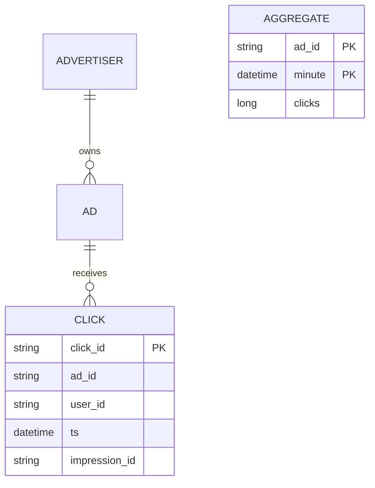
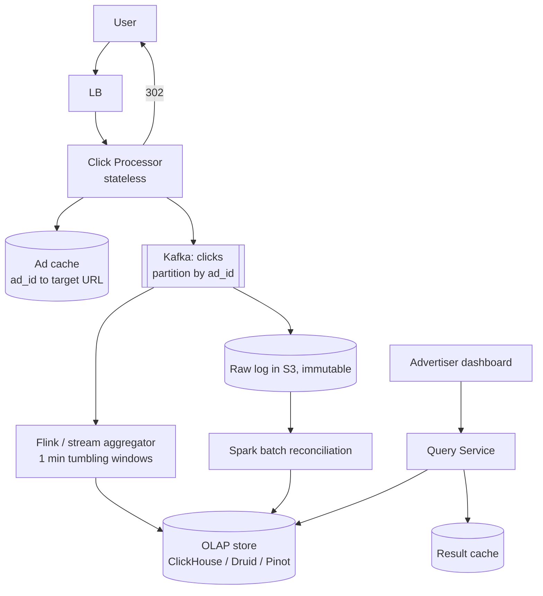
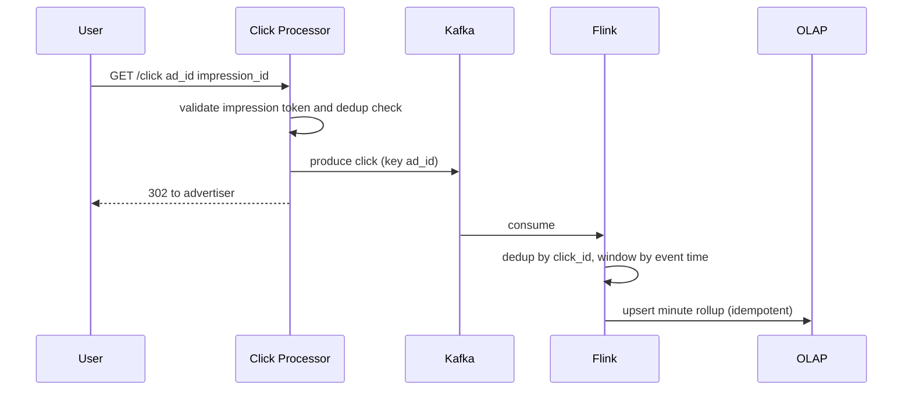

# Designing an Ad Click Aggregator

> Interview-ready walkthrough: requirements → estimates → entities → API → HLD → deep dives (**scale of clicks, exactly-once-style correctness, hot ads, click fraud and dedup, reconciliation**) → trade-offs. The hard parts are **stream aggregation at 10K clicks/s** and **never losing or double counting**.

---

## 0. Talk track

1. Clarify: record clicks, redirect user, advertiser queries aggregated metrics (per-minute), fraud prevention.
2. Insight: **write-heavy ingest, read of aggregates, durability over low-latency**.
3. HLD: click processor to stream to aggregator to OLAP store.
4. Deep dives: scaling the pipeline, hot shards, idempotency/dedup, batch reconciliation (lambda), query layer.

---

## 1. Problem

When a user clicks an ad, **redirect** them to the advertiser's site and **record the click**. Advertisers query **aggregated click metrics** (by ad, by time) with up to **1-minute** granularity and low latency.

**What makes it hard**
- **10K clicks/s average, 100K peak**; no click may be lost.
- Aggregates must be **accurate** (billing) yet **fresh** (near real time).
- **Hot ads** during events; **duplicate/fraudulent clicks** must not be billed.

---

## 2. Requirements

### Functional
- Users click an ad and are redirected to the advertiser's site.
- Advertisers query click metrics over time at **1-minute minimum granularity**.

**Out of scope:** ad targeting, impression tracking, conversion attribution, cross-device tracking.

### Non-functional
- Scale: **10K clicks/s** peak 100K; billions of clicks stored.
- **Low-latency analytics queries** (about 100 ms-1 s).
- **Fault tolerant and accurate**: no data loss.
- **Near real-time** (data within minutes).
- **Idempotent** click tracking (no double counting).

---

## 3. Estimation

| Quantity | Assumption | Result |
|---|---|---|
| Clicks | 10K/s avg | **864M/day** |
| Click record | about 100 B | 86 GB/day raw, about 30 TB/yr |
| Peak | 10x | 100K/s: Kafka partitions needed |
| Aggregates | 10M ads x 1/min active | much smaller; stored as rollups |

**Consequence:** raw log in cheap storage (S3), aggregated rollups in an OLAP/time-series store. Ingest scales through **partitioned stream**.

---

## 4. Entities



---

## 5. API

```http
GET /click?ad_id=a1&impression_id=<signed token>     -> 302 Location: advertiser URL   # also records the click
GET /metrics?ad_id=a1&from=...&to=...&granularity=minute -> [{ts, clicks}]
```

Redirect target is **looked up server-side** (cached ad_id to URL), never taken from the client (open-redirect/fraud).

---

## 6. Architecture



### 6.1 Components and responsibilities

| Component | Responsibility | Scaling / state |
|---|---|---|
| Click Processor | Validate impression token, dedup, resolve target URL, produce to Kafka, return 302 | Stateless; autoscale on RPS |
| Ad cache (Redis) | `ad_id -> target_url, status` lookup on the hot path | Read-through from Ad DB; TTL 5 min |
| Dedup store (Redis) | `SET NX impression_id` with TTL; first click wins | Sharded by `impression_id` |
| Kafka `clicks` | Durable buffer, replayable log, decouples redirect from aggregation | Partitioned by `ad_id` (salted for hot ads) |
| Flink | Event-time 1-min tumbling windows, dedup by `click_id`, idempotent sink | Parallelism = partitions; checkpoints to S3 |
| S3 (raw log) | Immutable source of truth for replay/reconciliation | Parquet, partitioned by `dt/hour` |
| Spark batch | Hourly/daily recompute from raw, overwrite rollups, apply fraud flags | Ephemeral cluster |
| OLAP (ClickHouse) | Serve minute/hour/day rollups for advertiser queries | Sharded by `ad_id`, replicated x2 |
| Query Service | AuthZ (advertiser owns ad), choose rollup table by range, cache | Stateless |
| Result cache (Redis) | Cache dashboard queries; short TTL for the current minute | TTL 30-60 s |

### 6.2 Data stores: tables, columns, and why

#### a) Ad metadata (source of truth for ads) - Postgres (or DynamoDB)

Low write volume, relational (advertiser owns ads), strong consistency for target URL and status changes; fronted by the Redis ad cache.

| Table `ads` | Type | Notes |
|---|---|---|
| `ad_id` | `UUID` PK | |
| `advertiser_id` | `UUID` FK, indexed | Used for authZ in the query service |
| `target_url` | `TEXT` | Validated/allow-listed at creation (no open redirect) |
| `status` | `ENUM(active, paused, ended)` | Cache invalidated on change |
| `created_at` / `updated_at` | `TIMESTAMP` | |

#### b) Kafka topic `clicks` - the ingest buffer

Chosen because it absorbs 100K/s bursts, is durable (`acks=all`, RF=3), supports replay for Flink recovery, and lets multiple consumers (Flink + S3 sink) read the same stream.

| Field | Type | Notes |
|---|---|---|
| key | `ad_id` (or `ad_id#salt`) | Per-ad ordering; salt for hot ads |
| `click_id` | `UUID` | Generated by processor; dedup key downstream |
| `ad_id` | `string` | |
| `impression_id` | `string` | Signed token, single-use |
| `user_id` | `string` (nullable) | |
| `event_ts` | `int64` (epoch ms) | Event time used for windowing |
| `ip_hash`, `user_agent` | `string` | Fraud analysis |
| `is_suspect` | `bool` | Set by inline rate-limit checks |

#### c) Dedup store - Redis

Single-use impression check needs sub-ms atomic `SET NX` with TTL. Key: `imp:{impression_id}` -> `click_id`, TTL 24 h. Flink also dedups by `click_id` in keyed state so a Redis loss does not double count.

#### d) Raw click log - S3 (Parquet)

Cheapest durable storage for about 30 TB/yr; immutable and columnar so Spark can recompute any window. Written by a Kafka-to-S3 sink (Flink/Connect).

| Column | Type | Notes |
|---|---|---|
| `click_id` | `string` | |
| `ad_id` | `string` | |
| `impression_id` | `string` | |
| `user_id` | `string` | |
| `event_ts` | `timestamp` | |
| `ingest_ts` | `timestamp` | For late-event analysis |
| `ip_hash`, `user_agent` | `string` | |
| `is_valid` | `bool` | Set false post hoc by fraud jobs (new version of the file, never edited in place) |

Partition: `dt=YYYY-MM-DD/hour=HH`.

#### e) Rollups - ClickHouse (alternatives: Druid, Pinot)

Columnar, vectorized scans, and native time-bucket aggregation give 100 ms-1 s range queries on billions of rows. `ReplacingMergeTree` makes writes **idempotent**: re-writing the same `(ad_id, minute)` with a higher `version` replaces the old row, so Flink restarts and batch reconciliation never double count.

| Table `click_agg_minute` | Type | Notes |
|---|---|---|
| `ad_id` | `String` | Sort key (1) |
| `minute` | `DateTime` | Sort key (2); partition by month |
| `clicks` | `UInt64` | Valid, deduped clicks |
| `invalid_clicks` | `UInt64` | Filtered fraud, kept for audit |
| `version` | `UInt64` | Flink = `window_end_ts`; batch = larger value so it wins |

`ORDER BY (ad_id, minute)`, `ENGINE = ReplacingMergeTree(version)`.

| Table `click_agg_hour` / `click_agg_day` | Type | Notes |
|---|---|---|
| `ad_id`, `hour` / `day` | `String`, `DateTime` | Same sort key pattern |
| `clicks`, `invalid_clicks`, `version` | `UInt64` | Rolled up from minute (materialized view or batch) |

The query service picks the table by range: <= 6 h uses minute, <= 7 d uses hour, else day.

#### f) Result cache - Redis

Key: `m:{ad_id}:{granularity}:{from}:{to}` -> JSON points. Closed windows cached for hours; the current (open) minute cached for about 30 s.

### 6.3 Why not the alternatives

| Choice | Rejected | Reason |
|---|---|---|
| Kafka | Direct write to DB | DB cannot absorb 100K/s bursts; no replay; couples redirect latency to DB |
| Kafka | SQS/Kinesis | SQS has no replay/ordering at scale; Kinesis is viable but has tighter shard limits and cost |
| Flink | Spark Streaming | Flink has true event-time, watermarks, and lower latency with checkpointed state |
| ClickHouse | Postgres/MySQL | Row store; `GROUP BY` over billions of rows is too slow |
| ClickHouse | Cassandra/DynamoDB counters | Counters are not idempotent on retry; no ad-hoc time-range scans |
| ClickHouse | Druid/Pinot | Equally valid; pick for real-time upsert ingest and managed ops. ClickHouse chosen for simplicity and strong SQL |
| S3 raw log | Keep only in Kafka | Retention cost; Kafka is a buffer (days), S3 is the audit trail (years) |
| Redis dedup | DB unique constraint | Unique insert per click at 100K/s is a hot write path; Redis is atomic and sub-ms |

---

## 7. Flow



---

## 8. Deep dive 1: ingest and aggregation

| Approach | Verdict | Why |
|---|---|---|
| Write each click to SQL, aggregate with `GROUP BY` | Bad at scale | Write amplification; slow analytics |
| Batch only (Spark every N min) | Good | Accurate, but stale |
| **Stream (Kafka + Flink)** with windowed aggregation | Great | Near real-time; can combine with batch |

Acknowledge the click once it's durably in **Kafka** (acks=all, replication factor 3), then redirect. Redirect shouldn't wait on aggregation. Flink checkpointing plus idempotent sink gives effectively-once.

## 9. Deep dive 2: hot ads

A viral ad hammers one partition keyed by `ad_id`. Mitigate: **key salting** (`ad_id#0..N`), aggregate partial counts per salt, then merge in a second stage; or pre-aggregate in the click processor in 1 s micro-batches before producing.

## 10. Deep dive 3: dedup and fraud

- **Impression id**: server issues a **signed, single-use impression token** embedded in the ad; the click must present it. Dedup `(impression_id)` via Redis `SET NX` with TTL (or in Flink state) so repeated clicks on one impression count once.
- Bot detection: rate limit per IP/user, anomaly detection offline; mark clicks invalid but **retain** raw record.
- Ads can be invalidated post hoc (billing correction) via batch recompute.

## 11. Deep dive 4: accuracy and reconciliation

**Lambda-style**: stream gives fast, approximate-fresh numbers; **batch from the raw S3 log** recomputes the truth periodically and overwrites rollups. Handles late events, bugs, and replay. Raw log is the **source of truth** (append-only, immutable).

## 12. Query layer

OLAP stores (columnar, pre-aggregated) answer time-range queries fast. Optional **pre-rollups** at minute, hour, day to avoid scanning; result cache for dashboards; sharded by ad_id/time.

---

## 13. Failure handling

| Failure | Mitigation |
|---|---|
| Click processor crash | Stateless, LB reroutes; client retry safe via dedup |
| Kafka broker down | Replication ISR; producer retries with idempotence |
| Flink job failure | Restart from checkpoint, offsets replay |
| OLAP write duplicates | Upsert keyed `(ad_id, minute)` |
| Late/out-of-order | Event-time windows + watermarks + batch fix |
| Kafka lag | Alert; autoscale consumers |

---

## 14. Trade-offs

| Decision | Chosen | Alternative | Given up |
|---|---|---|---|
| Ingest | Kafka | Direct DB write | Extra infra; gains durability and buffering |
| Aggregation | Stream plus batch | Stream only | Dual pipelines to maintain |
| Dedup | Signed impression ids | IP heuristics | Needs impression tracking |
| Storage | Raw S3 + OLAP rollups | OLAP only | Cost for storing raw |
| Freshness | About 1 min | Sub-second | Window latency |

---

## 15. Level expectations

- **Mid:** click log, redirect, DB aggregation.
- **Senior:** Kafka + Flink, partitioning, OLAP, idempotency, batch backup.
- **Staff+:** hot-key salting, watermarks/late data, fraud pipeline, reconciliation, exactly-once semantics.

## 16. Follow-ups

Conversion attribution, budget pacing (real-time spend limits), per-user frequency capping, multi-region ingest.

## 17. Summary checklist

- [ ] Durable Kafka before redirect, partition by ad_id (salt hot)
- [ ] Flink minute windows, idempotent upsert to OLAP
- [ ] Signed impression IDs for dedup
- [ ] Raw S3 log and batch reconciliation
- [ ] Cached query layer on pre-rolled aggregates
