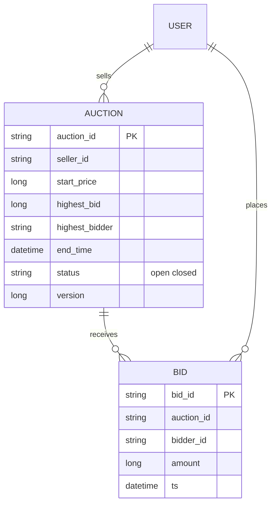
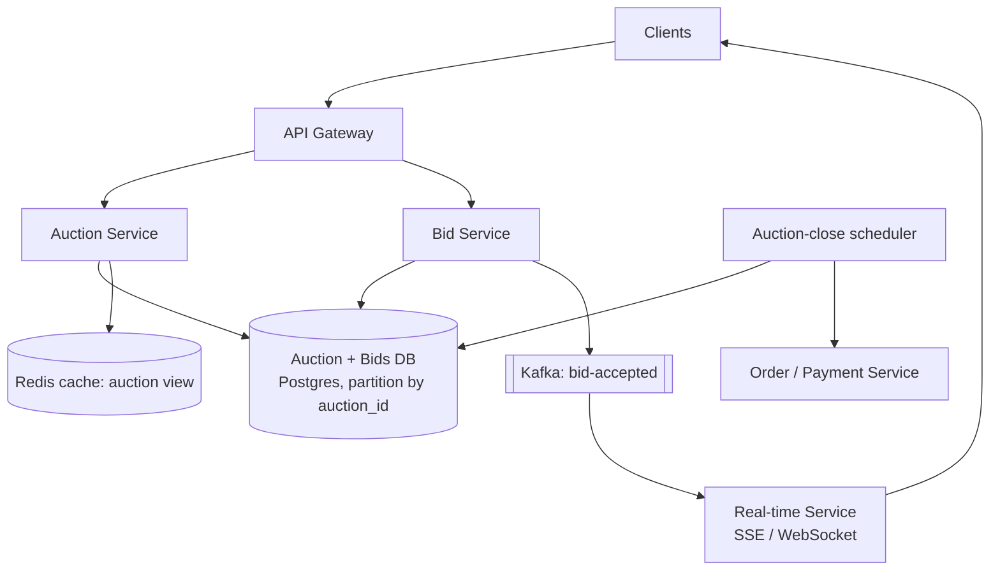
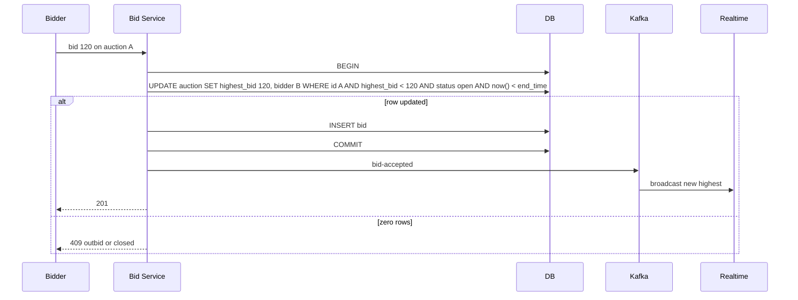

# Designing an Online Auction (eBay-style)

> Interview-ready walkthrough: requirements → estimates → entities → API → HLD → deep dives (**consistent highest-bid under concurrency, real-time bid broadcast, auction end and fairness, hot auctions, payments handoff**) → trade-offs. The hard part is **never accepting a lower bid than the current highest and ending exactly once**.

---

## 0. Talk track

1. Clarify: sellers post items with start price and end time; buyers place bids; highest bid wins at end; users see live current bid.
2. Core: **strongly consistent bids** per item, real-time fan-out of the current price.
3. Deep dives: concurrency on bids (OCC / lock), real-time updates, end-of-auction, scale and hot items, failures.

---

## 1. Problem

Run time-boxed auctions: accept bids, always know the **current highest bid**, show it live, and **close** the auction at the deadline, picking one winner.

**What makes it hard**
- Concurrent bids on the same item; **no lost updates, no lower-bid overwrite**.
- Many viewers need **real-time** updates.
- Auction end must be **exactly once** and fair near the deadline (sniping).

---

## 2. Requirements

### Functional
- Post an item for auction (start price, end time).
- Place a bid (must exceed the current highest).
- View an auction with the **current highest bid** (live).

**Out of scope:** search, payments/escrow details, shipping, reserve prices (mention), proxy/auto-bidding.

### Non-functional
- **Strong consistency** for bids (highest bid correct).
- **Fault tolerant and durable** (no lost bids).
- **Real-time** price display (under a second).
- Scale: **10M concurrent auctions**, bids up to 10K/s overall; hot items 1000s of bidders.

---

## 3. Estimation

| Quantity | Assumption | Result |
|---|---|---|
| Auctions | 10M active | metadata about 10M x 1 KB = 10 GB |
| Bids | 100M/day | about 1.2K/s avg, **about 10K/s peak** |
| Viewers | 1M watching hot items | fan-out in the millions of messages |
| Bid row | 100 B | 10 GB/day |

Consequence: modest data; the difficulty is **contention per item** and **fan-out**.

---

## 4. Entities



---

## 5. API

```http
POST /auctions       { item, start_price, end_time }              -> 201 { auction_id }
GET  /auctions/{id}                                                -> { current_bid, end_time, ... }
POST /auctions/{id}/bids  Idempotency-Key  { amount }             -> 201 | 409 bid too low or auction closed
SSE  /auctions/{id}/stream                                         # live bid updates
```

---

## 6. Architecture



---

## 7. Bid flow



---

## 8. Deep dive 1: consistent highest bid

| Approach | Verdict | Why |
|---|---|---|
| Read highest, compare in app, write | Bad | Race: two bids both pass the check |
| **Pessimistic lock** (`SELECT ... FOR UPDATE` on the auction row) | Good | Correct; serializes per auction; contention on hot items but fine |
| **Optimistic concurrency / conditional update** (`WHERE highest_bid < :amount` or `version = :v`) | Great | No long locks; the DB atomically guarantees monotonic max; loser gets 409 |
| Cache-based (Redis) check + later DB write | Risky | Source of truth ambiguity; needs Lua + durability |
| **Serialize via queue per auction** (partition by auction_id; single consumer) | Great at scale | Natural ordering; adds latency, async result |

Keep **all writes for an auction on one shard/leader** (partition by `auction_id`). Idempotency key on bids so retries don't duplicate. Reject bids after `end_time` using the **DB clock**.

**One-liner:** *Conditional update on the auction row makes "highest bid" a DB invariant.*

## 9. Deep dive 2: real-time updates

| Approach | Verdict |
|---|---|
| Polling every second | OK for small scale; heavy at 1M viewers |
| **SSE/WebSocket** with **pub/sub topic per auction**; servers subscribe only to auctions their clients watch | Great |
| Conflate to at most 1-2 updates/s for hot auctions | Great |

Cache current state in Redis for first paint; broadcast deltas from Kafka after commit (never before).

## 10. Deep dive 3: ending the auction

Single closer: **scheduler** picks auctions with `end_time <= now` and does a conditional `UPDATE status='closed' WHERE status='open'` (exactly-once by CAS), reads the winner, and emits a `won` event to payments/orders and notifications. Bids accepted only when `now < end_time` in the same conditional statement, so there is a **crisp cutoff**. Anti-sniping extension (extend by 2 min if a bid lands in the last minute) is a product option, implemented by updating `end_time` and rescheduling.

## 11. Deep dive 4: hot auctions and scale

- Contention on one row is bounded by DB single-row update rate (about thousands/s), plenty for any auction; **admission** control: per-user rate limit, drop obviously low bids at the edge using the cached current price (fast reject, final decision still in DB).
- Partition by `auction_id`; read replicas/cache for views; CDN for item media.
- Fan-out tier scales horizontally; hot auctions' topics replicated across more servers.

## 12. Payments handoff

On close, create an order and invoke payment (idempotent, see Payment doc); if the winner fails to pay, offer to the next highest bid (bids are retained, ordered).

---

## 13. Failure handling

| Failure | Mitigation |
|---|---|
| Bid service retry | Idempotency key |
| DB primary down | Failover (sync replica); bids retried; no accepted bid lost |
| Broadcast failure | Clients re-fetch current state; SSE resume |
| Scheduler crash | Another instance; CAS close is idempotent |
| Clock skew | Use DB time for cutoff |
| Cache stale | Never used for decisions |

---

## 14. Trade-offs

| Decision | Chosen | Alternative | Given up |
|---|---|---|---|
| Concurrency | Conditional update | Distributed lock | Retry on 409 |
| Store | SQL ACID | NoSQL | Auto-scale (partition by auction) |
| Updates | Push with conflation | Poll | Connection mgmt |
| Close | Scheduler + CAS | Timer per auction in memory | Slight delay (seconds) |
| Read path | Cached view | Direct DB | Slight staleness for display only |

---

## 15. Level expectations

- **Mid:** tables, check highest then write, polling.
- **Senior:** race analysis, OCC/locking, SSE/WebSocket, scheduler-based close.
- **Staff+:** sharding/ordering per auction, anti-sniping, fraud (shill bidding), reconciliation with payments, cost.

## 16. Follow-ups

Proxy bidding (max bid auto-increments), reserve prices, Dutch auctions, bid retraction rules, fraud detection.

## 17. Summary checklist

- [ ] Conditional UPDATE enforces monotonic highest bid
- [ ] Partition by auction_id; idempotent bids
- [ ] Post-commit Kafka to per-auction pub/sub to SSE
- [ ] CAS close by scheduler; DB-time cutoff
- [ ] Payments handoff with fallback to runner-up
