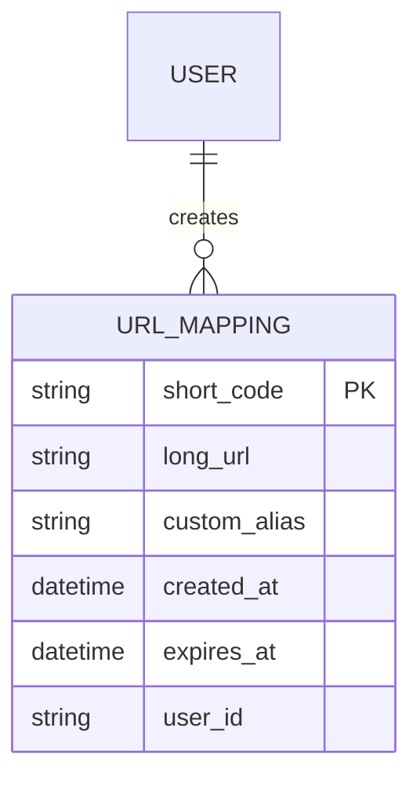
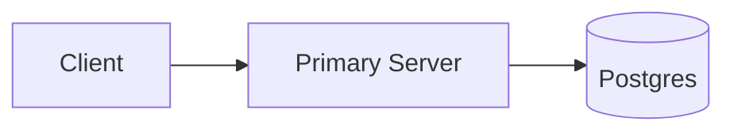
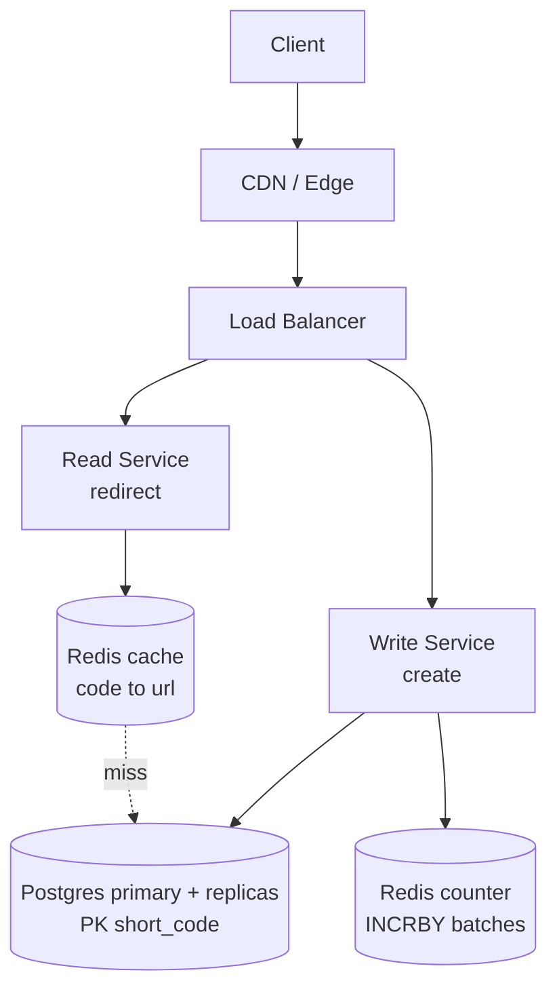
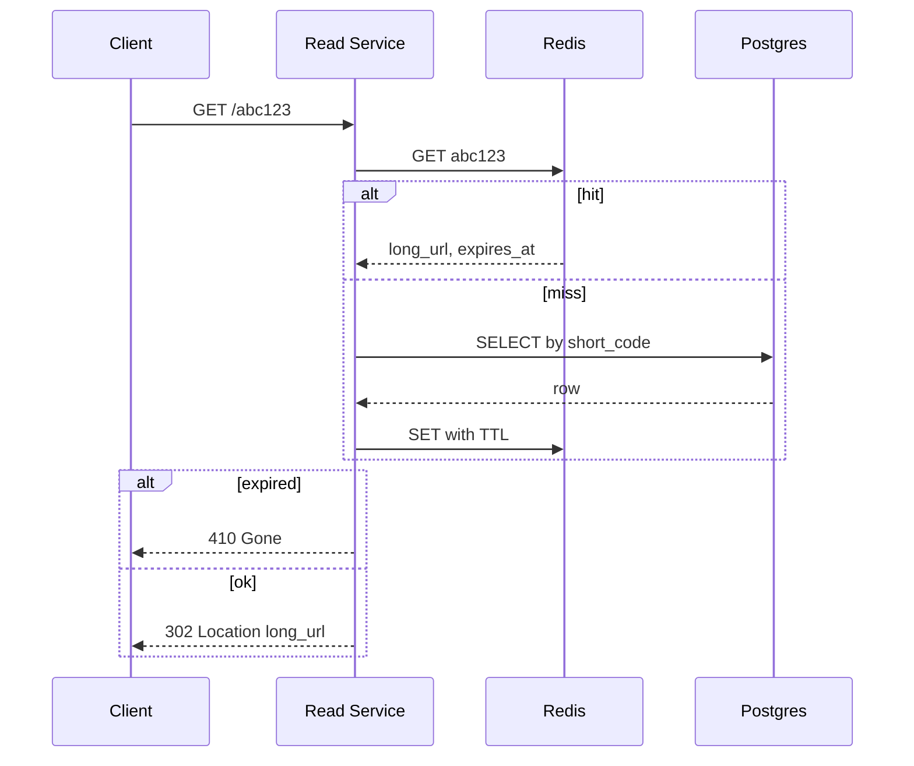

# Designing a URL Shortener (Bit.ly)

> Interview-ready walkthrough based on the Hello Interview breakdown: requirements → estimates → entities → API → v1 → deep dives (**unique codes, fast redirects, scaling to 1B URLs / 100M DAU**) → failure handling → trade-offs. The hard parts are **globally unique short codes** and **extreme read skew**.

> Entry-level question, but seniors are graded on counter coordination, cache invalidation for expiry, 301 vs 302, multi-region, and failure of the counter.

---

## 0. How to drive the interview (talk track)

1. **Clarify**: create short URL, redirect, optional custom alias + expiry. Analytics and auth out of scope.
2. **Estimate**: 100M DAU, 1B URLs, read:write about 1000:1.
3. **Entities and API**: `POST /urls`, `GET /{code}`.
4. **v1**: client, one server, one DB.
5. **Deep dive 1**: unique code generation (prefix, hash, counter + base62).
6. **Deep dive 2**: fast redirect (index, Redis, CDN).
7. **Deep dive 3**: scale (split read/write services, Redis counter batching, HA).
8. **Close** with failure modes and trade-offs.

---

## 1. Problem

Convert a long URL into a short code (`short.ly/abc123`) and redirect visitors to the original. The mapping is **immutable-ish, tiny, and read about 1000x more than written**.

**What makes it hard**
- Codes must be **unique** with **no coordination bottleneck**.
- Codes must be **short** (7 chars of base62 is about 3.5 trillion values).
- Redirects must be **< 100 ms** and **99.99% available**.

---

## 2. Requirements

### Functional
- Submit a long URL and get a short URL.
- Optional **custom alias** and optional **expiration date**.
- Visiting the short URL redirects to the long URL.

**Out of scope:** auth/accounts, click analytics, spam/malicious URL detection.

### Non-functional
- Uniqueness: one short code maps to exactly one long URL.
- Redirect latency < 100 ms.
- Availability 99.99% (availability over consistency).
- Scale: 1B URLs, 100M DAU.

### Clarifying questions
- Can one long URL have many short codes? (Yes: separate expiry, owner, alias.)
- Should codes be guessable/enumerable? (Usually fine; private URLs need a larger space or a permutation.)
- Is analytics needed later? (Affects 301 vs 302.)

---

## 3. Estimation

| Quantity | Assumption | Result |
|---|---|---|
| New URLs/day | 100K | about 1 write/s |
| Redirects/day | 100M DAU x 1 click | about 1.2K/s avg, about 10K/s peak |
| Row size | code 8B + url 100B + ts + alias + expiry | about 200 B, round to 500 B |
| Total storage | 1B x 500 B | **about 500 GB** (fits one SSD) |
| Read:write | skewed | **about 1000:1** |

**Consequences**
1. 500 GB fits one Postgres node, so sharding is **not needed yet**; replicas for HA.
2. Writes are about 1/s, so the DB is not the write bottleneck. **Reads dominate**, so cache aggressively.
3. Hot links (viral) follow a power law, so a small cache covers most traffic.

---

## 4. Entities



---

## 5. API

```http
POST /urls
{ "long_url": "https://example.com/very/long", "custom_alias": "my-link", "expiration_date": "2027-01-01" }
-> 201 { "short_url": "http://short.ly/abc123" }
-> 409 alias already taken, 400 invalid URL

GET /{short_code}
-> 302 Location: https://example.com/very/long
-> 404 unknown code, 410 expired
```

**301 vs 302**
| | 301 permanent | 302 temporary |
|---|---|---|
| Browser caches | Yes, skips our server | No |
| Pros | Lowest latency and load | Control: expire, edit, analytics |
| Cons | Cannot revoke or expire; analytics lost | Every click hits us |

Choose **302** because the service is an indirection layer (expiry, takedown, future analytics).

---

## 6. Architecture

### v1

Cons: full-table lookup, one server, uniqueness unspecified.

### Final design


---

## 7. Data flow



---

## 8. Deep dive 1: unique short codes

| Approach | Verdict | Why |
|---|---|---|
| **Long URL prefix** (first N chars) | Bad | Collisions are certain; not unique |
| **Hash** (SHA-256 of long URL + salt, base62, first 7 chars) | Good | Stateless, no coordination. Truncation raises collisions (birthday paradox). Needs DB unique constraint and retry with a new salt. Same URL = same code unless salted |
| **Counter + base62** | Great | Collision-free by construction. Needs a shared counter |

Base62: `[0-9a-zA-Z]`. 62^7 is about 3.5T, enough for 1B URLs for centuries.

**Custom alias:** check uniqueness with an insert on the PK. Keep generated codes in a separate namespace (e.g. prefix or reserved charset) so aliases never collide with counter values.

**One-liner:** *Counter + base62 gives guaranteed uniqueness; hashing is the stateless alternative that pays with collision retries.*

---

## 9. Deep dive 2: fast redirects

| Layer | Effect |
|---|---|
| **Index** on `short_code` (PK, B-tree) | O(log n) instead of full scan; the baseline |
| **Redis cache** (cache-aside, LRU) | Sub-ms; power-law hot set is small. 20% of 1B x 500 B is large, but the **hot** few GB is what matters |
| **CDN/edge** | Cache 302s near the user; short TTL so expiry and takedown still work |

TTL on cache entries <= URL expiry, so expired links evict themselves. Negative-cache unknown codes briefly to resist scanning.

**One-liner:** *Index, then cache-aside Redis, then edge. Keep TTLs aligned with expiry.*

---

## 10. Deep dive 3: scaling to 1B URLs and 100M DAU

- **Split Read and Write services**: 1000:1 skew, scale independently.
- **Storage**: 500 GB fits one node. Shard by `short_code` hash only if it grows. Replicate for HA; take backups.
- **Counter across many writers**: central **Redis `INCR`** (atomic, 100K+ ops/s). Use **counter batching**: each writer grabs a block of 1000 via `INCRBY 1000` and issues IDs locally.
- **Counter HA**: Redis Sentinel/Cluster. On failover a few values may be lost or re-issued. Uniqueness is preserved by the **DB unique constraint** (retry with a new batch). Gaps are harmless.
- **Multi-region**: disjoint ranges per region (A: 0-1B, B: 1B-2B) so no cross-region coordination.
- **Alternatives**: Snowflake IDs (no central dependency but 11-char codes), pre-allocated ranges from DB/ZooKeeper.

**Bottleneck path:** DB read, then Redis hit rate, then Redis counter, then DB write.

---

## 11. Failure handling

| Failure | Impact | Mitigation |
|---|---|---|
| Redis cache down | Reads hit DB | Replicas, request coalescing, rate limit, controlled warm-up |
| Redis counter loses state | Possible duplicate codes | DB PK rejects; fetch new batch and retry; restart from max(code) |
| DB primary down | No writes | Promote replica; reads continue from cache/replicas |
| Write service crash | Unused counter block | Gaps are fine |
| Region outage | Region's links | Multi-region replicated DB; DNS failover |
| Abuse (scanning/spam) | Load | Per-IP rate limits, CAPTCHA, malicious URL checks |

---

## 12. Trade-offs

| Decision | Chosen | Alternative | Given up |
|---|---|---|---|
| Code generation | Counter + base62 | Hash | Central coordination point |
| Redirect | 302 | 301 | Latency and server load |
| DB | Postgres + replicas | DynamoDB | Auto-scaling convenience (not needed at 1 write/s) |
| Dedup same long URL | No | Yes | Storage for per-link expiry/analytics |
| Code predictability | Sequential | Permuted/random | Enumeration risk (mitigate with a permutation or wider space) |

---

## 13. What is expected at each level

- **Mid:** working create + redirect, unique code idea, 302 reasoning, index, cache when prompted.
- **Senior:** drives read-heavy analysis, hash vs counter trade-off, cache invalidation with expiry, read/write split, Redis counter scaling.
- **Staff+:** multi-region ranges, counter failover behavior, enumeration/security, expiry cleanup, product evolution (analytics, link edit).

---

## 14. Follow-ups

- Add click analytics (stream to Kafka, aggregate offline; forces 302).
- Custom domains per tenant.
- Link expiry cleanup (TTL index, lazy deletion).
- Prevent enumeration (format-preserving encryption of the counter).

## 15. Summary checklist

- [ ] Read-heavy (1000:1), 500 GB, one node + replicas
- [ ] Counter + base62, batched from Redis, DB unique PK as safety net
- [ ] 302 redirect, cache-aside Redis, CDN
- [ ] Read/write service split
- [ ] Multi-region via disjoint ranges
