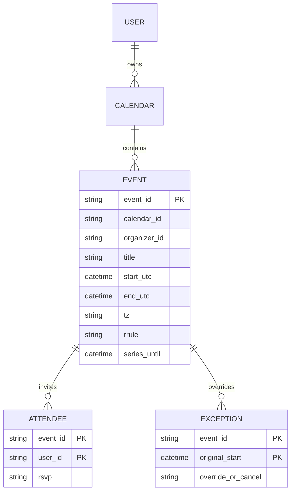
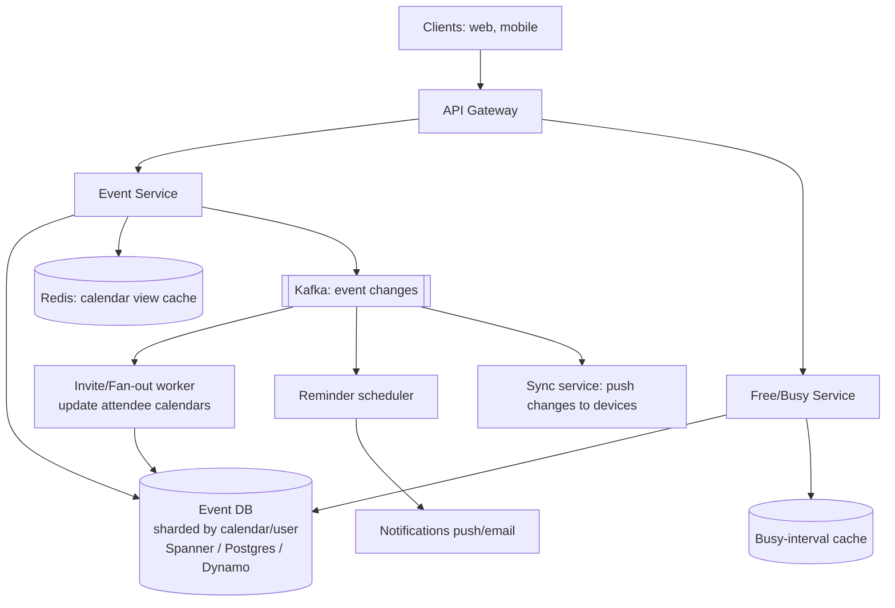
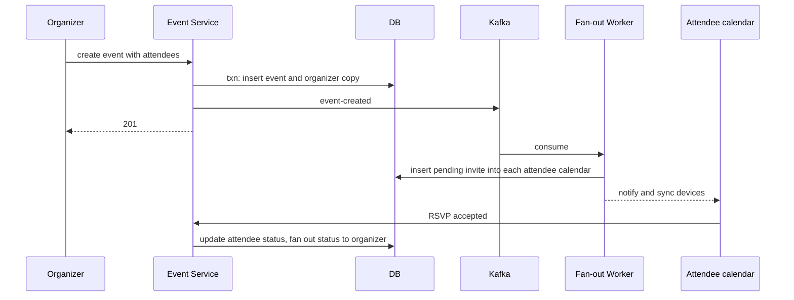

# Designing Google Calendar

> Interview-ready walkthrough: requirements → estimates → entities → API → HLD → deep dives (**recurring events and exceptions, time zones and DST, availability/conflict queries, sharing and invites, sync, notifications/reminders**) → trade-offs. The hard parts are **recurrence modeling** and **time-range queries across many calendars**.

---

## 0. Talk track

1. Clarify: create/edit/delete events, view day/week/month, invite attendees (RSVP), recurring events, reminders; multiple calendars.
2. Note: read-heavy, mostly per-user partitioned; correctness on recurrence and time zones.
3. Deep dives: recurrence storage (RRULE + exceptions), range queries, free/busy, invites and consistency, reminders, sync.

---

## 1. Problem

Users manage events (time, location, attendees), view calendars by time range, share/invite others, and get reminders, across devices.

**What makes it hard**
- **Recurring events** (infinite series, exceptions, "this and following").
- **Time zones/DST** semantics.
- Event shared by many attendees: **keep copies consistent**.
- Efficient **range queries** and **free/busy** across many people.

---

## 2. Requirements

### Functional
- Create, read, update, delete events.
- View events by day/week/month.
- Invite others; RSVP (accept/decline).
- Recurring events and reminders (notifications).

**Out of scope:** room booking, video link integrations, smart scheduling AI.

### Non-functional
- **Fast calendar view** (under 200 ms).
- **High availability**, eventual consistency across attendees (seconds).
- Scale: **500M users, 100M DAU**.
- Durable; no lost events.

---

## 3. Estimation

| Quantity | Assumption | Result |
|---|---|---|
| Events per user | about 200 active | 100B event rows if fully materialized; so store **series**, not instances |
| View reads | 100M DAU x 10 | 1B/day, **about 12K/s, about 50K/s peak** |
| Writes | 20M/day | about 230/s |
| Read:write | | about 50:1 |
| Event row | 1 KB | **about 100 TB**: sharded by user |

---

## 4. Entities



---

## 5. API

```http
POST /events    { title, start, end, tz, rrule?, attendees:[...], reminders:[...] }   -> 201 { event_id }
GET  /events?from=2027-03-01&to=2027-03-08&calendar=...                              -> expanded instances
PATCH /events/{id}?scope=this|following|all   { ... }
DELETE /events/{id}?scope=...
POST /events/{id}/rsvp { response:"accepted" }
GET  /freebusy?users=u1,u2&from=&to=
```

---

## 6. Architecture



---

## 7. Flow



---

## 8. Deep dive 1: recurring events

| Approach | Verdict | Why |
|---|---|---|
| **Materialize all instances** | Bad | Infinite series; edits touch thousands of rows |
| **Store the series once (RRULE)** and **expand at query time** for the requested window | Great | Compact; small windows are cheap |
| **Hybrid**: store RRULE plus **exception rows** (modified/cancelled instances) overriding expansion; optionally materialize a rolling window (next 1-2 years) for indexed queries | Great | Efficient edits ("this", "this and following" splits the series: end old with `UNTIL`, create new) |

Query: fetch events whose `[start, series_until]` overlaps the window, expand RRULEs, apply exceptions, sort. Cache expanded view per `(calendar, week)`; invalidate on change.

**One-liner:** *Store rules, expand on read, override with exceptions.*

## 9. Deep dive 2: time zones and DST

Store event instants in **UTC** plus the **IANA timezone** (e.g. America/New_York) and compute recurrences in **local wall time** (a 9 AM weekly meeting stays at 9 AM across DST, so UTC time shifts). All-day events are date-only, not instants. Convert at display using the viewer's tz.

## 10. Deep dive 3: range queries and indexing

Index `(calendar_id, start_utc)` to scan a window. For recurring events keep an upper-bound column (`series_until`, or max end) so overlap queries prune. Shard by `user_id/calendar_id`: a view hits one shard (plus shared calendars).

## 11. Deep dive 4: shared events and consistency

| Model | Verdict |
|---|---|
| **One canonical event** referenced by attendees (shared row) | Single source of truth, fast updates; permission and per-user overrides need a separate table |
| **Per-attendee copies** (Google-style event in each calendar) with fan-out | Fast reads (single shard), per-user settings (reminders, colors); **updates must fan out**, eventual consistency |

Choose copies with an **organizer as owner**: edits go to the organizer's event, then Kafka fan-out updates attendee copies. Conflicts: organizer wins; attendee only changes own RSVP/personal fields. Optimistic concurrency with `version`.

## 12. Deep dive 5: free/busy

`freebusy(users, window)` unions busy intervals (events that are `busy`, including expanded recurrences). Cache per-user **busy-interval summaries** for near-term windows, merging sorted intervals; respect privacy (return only busy/free, not details). Big attendee lists: parallel shard queries.

## 13. Deep dive 6: reminders

A **reminder scheduler** (like the Job Scheduler doc): time-bucketed table of `(fire_time, event, user)`; near-term items are pulled into a delay queue; at-least-once with dedupe; recurring events generate the next reminder after firing. Push/email via notification service.

## 14. Deep dive 7: sync across devices

Per-calendar **sync token / change log**; clients call `GET /changes?since=token`, with push (WebSocket/FCM) hints. Same cursor-based pattern as Dropbox.

---

## 15. Failure handling

| Failure | Mitigation |
|---|---|
| Fan-out lag/failure | Retry via queue; idempotent per (event, attendee); eventual |
| Cache stale | Invalidate on change; short TTL |
| Shard outage | Replicas; other users unaffected |
| Reminder missed | Lease/retry; catch-up on recovery (send late flagged) |
| Concurrent edits | Version check, last-writer by organizer, conflict error |

---

## 16. Trade-offs

| Decision | Chosen | Alternative | Given up |
|---|---|---|---|
| Recurrence | RRULE + exceptions, expand on read | Materialize | Read-time compute |
| Shared events | Per-attendee copies | Single shared row | Fan-out complexity |
| Time storage | UTC + tz | Local only | Conversion care |
| Consistency | Eventual across attendees | Strong | Short divergence |
| Sharding | By user/calendar | By time | Cross-user queries need scatter |

---

## 17. Level expectations

- **Mid:** event table, range query, invites.
- **Senior:** RRULE, time zones, fan-out for shared events, reminders.
- **Staff+:** exceptions and series splitting, free/busy at scale, sync tokens, DST correctness, multi-region.

## 18. Follow-ups

Meeting room resources, working hours/OOO, smart scheduling, external calendar interop (CalDAV/ICS), delegation.

## 19. Summary checklist

- [ ] Series stored as RRULE, exceptions as rows
- [ ] UTC plus IANA tz, recurrence in wall time
- [ ] Index (calendar_id, start); cache views
- [ ] Per-attendee copies, Kafka fan-out
- [ ] Reminder scheduler, sync tokens
