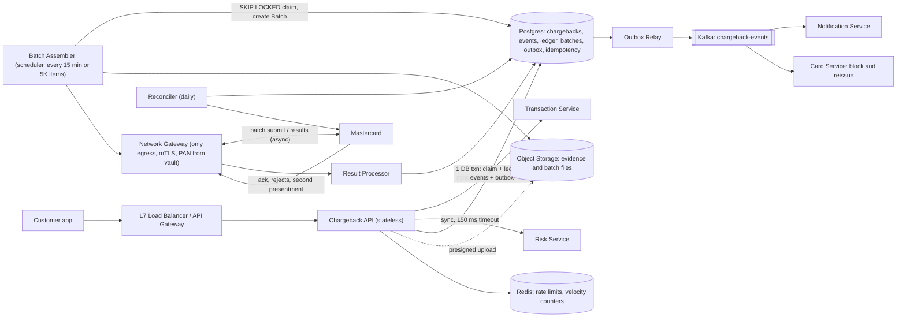
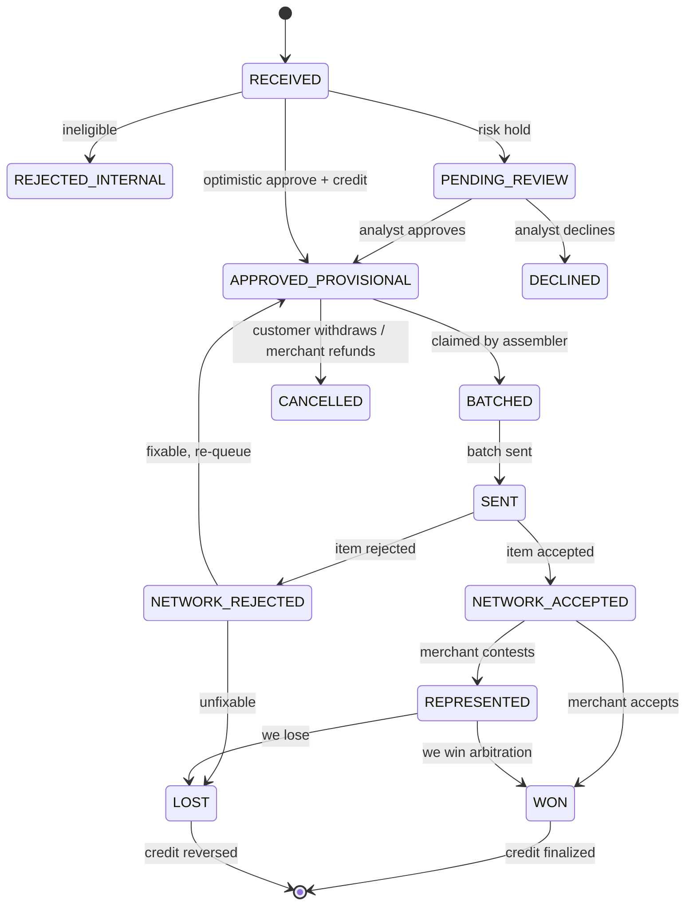

# Designing a Chargeback System for Fraud Transactions

> Interview-ready walkthrough: requirements → estimates → entities → API → HLD → deep dives → bottlenecks. Customers report fraud, we **optimistically approve** (provisional credit now), then **batch** the claims to the card network (Mastercard). The hard part is **money correctness under optimism**: never double-credit, never double-submit, never lose a claim before its network deadline, and bound the loss if the optimism is wrong.

**Target level:** Senior, going deeper to Staff in financial exposure, reconciliation, and failover-with-ambiguous-batches.

---

## 0. Opening (30 seconds) and clarifying questions

"We are the **card issuer** (or issuer-processor). A cardholder says 'I didn't make this charge'. We immediately accept the claim and credit them provisionally, then asynchronously file a chargeback with Mastercard in batches. The network forwards it to the merchant's bank, who may contest it. We reconcile the outcome and make the credit permanent or reverse it."

Questions I would ask (assumed answers in parentheses, so I can proceed):

| # | Question | Assumed answer |
|---|---|---|
| 1 | Are we the issuer, acquirer, or merchant? | **Issuer**; the customer is the cardholder. |
| 2 | What does "optimistically approve" mean to the customer? | Claim accepted and **provisional credit posted immediately**, before the network sees it. |
| 3 | Is the network call batch-only? | Yes. Submission is file/bulk style, asynchronous, with per-item results later. |
| 4 | Scope of dispute types? | **Fraud only** (unauthorized use). Not "item not received", not merchant disputes. |
| 5 | Regulatory anchor? | US Reg E-style: provisional credit within ~10 business days if unresolved. We go faster. |
| 6 | Time limit to file? | Network window (commonly ~120 days from the transaction; verify against current rules). |
| 7 | Scale? | 50M cardholders, ~150M card transactions/day. |

Assumptions about Mastercard (dispute reason codes such as 4837 "No Cardholder Authorization", the first chargeback → second presentment → arbitration lifecycle, and file/bulk submission) are **assumptions from public knowledge**. I would confirm them with the team. The design only depends on these properties: submission is **async, batched, deduplicated by a reference we control, with partial per-item rejects, and has hard deadlines**.

---

## 1. Clarify the Requirements

### Functional Requirements (top 3)

1. **Cardholders should be able to report a transaction as fraudulent** and get an immediate decision and provisional credit (optimistic approval).
2. **The system should submit approved chargebacks to the card network in batches**, exactly once in effect, before the network deadline.
3. **Cardholders should be able to track a chargeback's status and see the final outcome**; the provisional credit becomes permanent (won) or is reversed (lost).

Read vs. write: intake (write, sync), status (read, sync), batch submission and network results (write, async).

### Non-Functional Requirements

| Requirement | Target | Why |
|---|---|---|
| **Correctness / consistency** | At most one open chargeback per (transaction, amount-slice); provisional credit posted **exactly once**; ledger always balances. Strongly consistent within the system of record. | Money. A double credit is a direct loss; a double submit is a network penalty. |
| **Intake latency** | p99 < 500 ms for `POST /chargebacks`; status reads p99 < 150 ms | Customer is waiting in the app; risk and transaction lookups are on this path. |
| **Availability** | 99.95% for intake; network outage must **not** make intake unavailable | Intake is decoupled from the network; deadlines are days, not seconds. |
| **Durability** | RPO = 0 for accepted claims and ledger entries; RTO < 15 min | Once we say "approved" and credit money, we must never forget it. |
| **Bounded financial exposure** | Optimistic approval risk capped per customer and in aggregate, with a kill switch | Optimism is only safe if the loss from being wrong is bounded. |
| **Security / compliance** | PCI-DSS (no PAN outside the vault and gateway), authn/authz, full audit trail, abuse (friendly fraud) controls | Cardholder data and regulated funds. |

### Scope

- **In:** fraud claim intake, optimistic approval and provisional credit, risk gate, batching and submission, network result processing (ack, reject, second presentment, final outcome), status API, reconciliation.
- **Out:** the card authorization path, the full fraud-detection model (we call it), arbitration legal workflow UI, non-fraud dispute types, merchant-side representment tooling, collections.

**Scoping statement:** "I'll design the claim → provisional credit → batch → outcome pipeline first. It's the hardest part because it joins a *synchronous money movement* with an *asynchronous external system that can be ambiguous*. I'll cover the risk gate in a deep dive and leave arbitration workflow out."

The two requirements that shape everything: **(1) optimism with bounded loss** and **(2) exactly-once effect against an external system over batches**.

---

## 2. Estimation & Scale

I'll skip heavy upfront math and compute only what decides a design choice.

| Input | Assumption |
|---|---|
| Cardholders | 50M; 3 txns/day each → **150M txns/day** (~1.7K TPS avg, ~5K peak) |
| Fraud-dispute rate | 0.05% of txns → **75K chargebacks/day** |
| Peak multiplier | 10x for the day-after-a-breach pattern |

| Quantity | Calculation | Result | **Design consequence** |
|---|---|---|---|
| Avg intake QPS | 75K / 86,400 | **~0.9/s** | A single relational primary handles this trivially. **Intake is not a throughput problem; it's a correctness problem.** No sharding in v1. |
| Peak intake | 0.9 × 10 | ~9/s | Same. |
| Breach burst | 100x for ~1 hour (e.g. a compromised merchant) | ~90/s, up to ~1K/s if bulk-imported | Still within one Postgres primary (~8 rows/claim → ~8K rows/s), but the **downstream** (risk, txn lookup, exposure) hits limits first (§6.1). |
| Rows per claim | chargeback + ~4 events + 2 ledger lines + outbox + idempotency | ~8 rows, ~5 KB | 75K × 5 KB ≈ **375 MB/day, ~140 GB/yr**. Fits on one node; partition by month for retention/archival. |
| Evidence blobs | 30% of claims × 2 MB | 75K × 0.3 × 2 MB ≈ 45 GB/day, **~16 TB/yr** | Does **not** go in the DB. Object storage with presigned upload. |
| Batch size | Batch every 15 min: 75K / 96 windows | **~800 items/batch avg**; breach: ~80K per window | Network files have size caps (assume 10K items) → **cap batch size** and emit multiple batches. |
| Exposure | 75K claims × avg $120 | **~$9M/day provisionally credited** | This is the number that matters. Wrong optimism costs real money, so we need **caps, risk tiers, and a kill switch**. |
| Batch latency budget | 120-day window vs. 15-min batch | Batch delay is negligible vs. deadline | Batching costs us nothing on the deadline; we pick the interval for network and ops efficiency, not for speed. |

**Read vs. write:** write-heavy relative to reads at intake (one claim, a handful of status polls) but small in absolute terms. Hot keys: a single merchant or BIN in a breach (batch grouping), one customer spamming claims (rate limit).

---

## 3. Core Entities & APIs

### 3.1 Core Entities (first draft)

- **Cardholder (Customer)**
- **Transaction** (owned by the existing transaction service; we read it)
- **Chargeback** (the claim, with a state machine)
- **ChargebackEvent** (append-only history)
- **LedgerEntry** (double-entry; provisional credit, finalize, reversal)
- **Batch** and **BatchItem** (a network submission and its members)
- **NetworkMessage** (inbound/outbound, raw and parsed)
- **Evidence** (attachments)

### 3.2 APIs (REST; internal network gateway is not customer-facing)

The customer is derived from the auth token, never the body.

**1. Report fraud (functional req 1)**

```
POST /v1/chargebacks
Headers: Authorization: Bearer <jwt>, Idempotency-Key: <uuid>
{
  "transactionId": "txn_8f3a",
  "reason": "UNAUTHORIZED_USE",
  "amount": 12000,                 // minor units; default = full txn amount
  "currency": "USD",
  "description": "I was not at this store",
  "evidenceIds": ["ev_1"]          // optional, uploaded beforehand
}
→ 201 Created
{
  "chargebackId": "cb_91c2",
  "status": "APPROVED_PROVISIONAL",
  "provisionalCredit": { "amount": 12000, "currency": "USD", "postedAt": "..." },
  "networkDeadline": "2027-02-14T00:00:00Z"
}
```

**What success means:** the claim is **durably persisted and the provisional credit is posted**. It does **not** mean the network has received it. The `status` field is honest about that.

| Code | Case |
|---|---|
| 200 | Replay of the same `Idempotency-Key` (returns the original response) |
| 201 | Created and approved |
| 202 | Accepted but **held for review** (risk gate declined optimism; no credit yet) |
| 403 | Transaction doesn't belong to the caller |
| 404 | Unknown transaction |
| 409 | An open chargeback already exists for this transaction/amount; or same key with a different payload |
| 422 | Ineligible: outside time window, already refunded, non-card-present type not supported, amount > remaining disputable |
| 429 | Rate limited |

**2. Status (functional req 3)**

```
GET /v1/chargebacks/{id}                       → 200 { status, timeline[], credit{provisional|final|reversed} }
GET /v1/chargebacks?status=OPEN&cursor=...&limit=20   → 200 { items[], nextCursor }
```

Pagination is cursor-based on `(created_at, id)`. Reads are authorized by `cardholder_id = token.sub`. Status is eventually consistent with the network (seconds to hours), and read-your-writes right after `POST`.

**3. Evidence upload (supporting):** `POST /v1/chargebacks/evidence-uploads` returns a presigned URL; the blob goes straight to object storage.

**Batch submission (functional req 2)** has no customer API. It is an internal scheduled workflow plus the network contract: `submitBatch(batchId, items[])` and `getBatchResult(batchId)`.

---

## 4. High-Level Design

### Data flow (this is a pipeline, so I'll list it)

1. Customer submits a claim; we validate it against the transaction.
2. Risk gate decides optimistic approve vs. hold.
3. Atomically: record claim, post provisional credit, enqueue events.
4. Customer is notified; the card is blocked and reissued (side effects via events).
5. Batch assembler groups `QUEUED` claims into a batch.
6. Network gateway submits the batch; the network acknowledges.
7. Per-item results come back (accepted / rejected).
8. Merchant may contest (second presentment); we respond or accept.
9. Final outcome: finalize credit or reverse it.
10. Daily reconciliation against network reports.

### v1: simplest thing that works

One **Chargeback Service** + **Postgres**. `POST` validates, inserts the chargeback and credits the customer in one transaction. A **cron job every hour** selects approved claims, builds a file, sends it to Mastercard, and marks them `SUBMITTED`.

| Pros | Cons (what I'd attack next) |
|---|---|
| Trivial, one transaction for approval | Cron overlap or retry → **double submit** |
| | Crash mid-send → we don't know whether the network got it (**ambiguous**) |
| | No per-item result tracking, no reject handling |
| | No bound on optimistic losses; one bad actor can drain money |
| | Side effects (notify, block card) can be lost after commit |

### v2: what I'd draw (fixes the flaws)

- Make **Batch/BatchItem first-class state** with a deterministic ID, so submissions are idempotent and resumable.
- Use **SKIP LOCKED claiming** so only one assembler owns an item.
- Add a **transactional outbox** for events (no dual write).
- Add a **risk gate with exposure caps** in front of the credit.
- Add **per-item result handling and daily reconciliation** as the backstop.



### 4.1 Clients
Mobile and web apps over HTTPS to the API gateway (TLS termination, JWT validation, coarse rate limit). Status updates reach the user by **push notification from events**, with polling `GET` as the fallback. No CDN needed for the API; presigned URLs serve evidence upload.

### 4.2 App Servers
- **L7 load balancer** (needs path routing, auth header inspection, per-route rate limits). Stateless **Chargeback API** instances across 3 AZs.
- **Not microservices for their own sake.** Boundaries follow *different failure and security domains*:
  - **Chargeback API + Result Processor** (core domain, one deployable is fine).
  - **Batch Assembler**: a scheduled singleton-by-lock worker (scales by partition, §6.1).
  - **Network Gateway**: separate because it is in PCI scope, holds network credentials and mTLS certs, and is the single place to rate-limit and circuit-break the external dependency.
  - Risk, Transaction, Notification, and Card are **existing** services we call.
- Queues and workers only where justified: outbox → Kafka for fan-out of side effects. The batch pipeline is **DB-driven** (the table is the queue) because volume is tiny and we want transactional claiming.

### Building it one endpoint at a time

**`POST /v1/chargebacks`** (state changes, in order):
1. Check the idempotency key (unique insert); a replay returns the saved response.
2. Read the transaction (sync); verify ownership, window, remaining disputable amount.
3. Risk gate (sync): returns `APPROVE` or `REVIEW`, plus an exposure check.
4. **One DB transaction:** insert `chargebacks` (`APPROVED_PROVISIONAL`), insert 2 `ledger_entries` (provisional credit), insert `chargeback_events`, insert `outbox` rows, save the idempotency response.
5. Return `201` with the provisional credit. Notifications, card block, and everything else are **async via outbox**.

**Batch submission** (no API; scheduler):
1. Assembler claims up to N `APPROVED_PROVISIONAL` rows with `FOR UPDATE SKIP LOCKED`, creates `batches(CREATED)` + `batch_items`, and marks claims `BATCHED`, all in one transaction.
2. Builds the file, uploads it to object storage, sets the batch `READY`.
3. Network Gateway sends it (`SENDING` → `SENT`), recording the network's file/reference ID on ack.
4. Result Processor consumes the per-item results: `NETWORK_ACCEPTED` or `NETWORK_REJECTED`.

**`GET /v1/chargebacks/{id}`:** read from Postgres (primary or replica; see consistency in §5.5), joined with events for the timeline.

### 4.3 Database

**Choice:** **PostgreSQL** (relational, ACID). Why: the core need is multi-row atomic transactions (claim + ledger + events + outbox) and uniqueness constraints that encode invariants. Access is by id, by cardholder, and by status/age. A document store would give up cross-row transactions. Scale (~375 MB/day) doesn't force anything else.

| Table | Key fields | Notes |
|---|---|---|
| `chargebacks` | `id` PK, `cardholder_id`, `transaction_id`, `amount`, `currency`, `reason`, `status`, `version`, `network_deadline`, `network_ref`, `batch_id`, `risk_tier`, `created_at` | Index `(cardholder_id, created_at desc)`, `(status, created_at)` for the assembler, `(network_deadline) WHERE status IN (open states)` for deadline alerts. **Partial unique index** `(transaction_id) WHERE status IN (open states)` enforces one open claim per transaction (partial claims are modeled as slices with a remaining-amount check under row lock). |
| `chargeback_events` | `id`, `chargeback_id`, `type`, `from_status`, `to_status`, `payload`, `schema_version`, `at` | **Append-only**. Source of audit. Current state on `chargebacks` is a projection updated in the same transaction. |
| `ledger_entries` | `id`, `chargeback_id`, `account` (customer / chargeback_receivable / network_settlement / writeoff), `direction`, `amount`, `kind` (PROVISIONAL / FINALIZE / REVERSAL), `unique(chargeback_id, kind)` | **Immutable double-entry.** The unique constraint makes "post provisional credit" idempotent at the database level. Corrections are new entries, never updates. |
| `batches` | `id` (deterministic), `status`, `item_count`, `file_uri`, `file_checksum`, `network_file_id`, `sent_at`, `acked_at`, `lease_owner`, `lease_expires_at` | |
| `batch_items` | `batch_id`, `chargeback_id`, `seq`, `result`, `reject_code` | PK `(batch_id, chargeback_id)`; `unique(chargeback_id) WHERE result IS NULL OR result='ACCEPTED'` prevents being in two live batches. |
| `network_messages` | `id`, `direction`, `network_msg_id` (unique), `raw_uri`, `parsed`, `processed_at` | Inbound dedupe by `network_msg_id`. |
| `outbox` | `id`, `topic`, `key`, `payload`, `published_at` | Dual-write fix. |
| `idempotency_keys` | `(cardholder_id, key)` PK, `request_hash`, `response`, `expires_at` | TTL 24h-7d. |

**State machine** (monotonic; transitions guarded by `WHERE status = :expected` or the `version` column):



**Schema evolution:** expand/contract migrations; events carry `schema_version`; the network file builder is versioned per network spec so a new format ships behind a flag while old in-flight batches use the old version. **Source of truth:** Postgres for our state and money; the **network is the source of truth for the dispute outcome**, which reconciliation enforces.

**Replication/partitioning:** primary + synchronous standby in a second AZ (RPO 0 for ledger) + async read replicas. Time-partition `chargeback_events` and `network_messages` by month. **Shard key (if ever needed): `cardholder_id`**, so intake and ledger are single-shard. Batch assembly would then run per shard. Not needed at 1 write/s average.

### 4.4 Cache
Honest answer: **the write path has no cache.** Correctness reads (transaction, remaining amount, uniqueness) hit the source of truth.

| Cached | Where/key | Pattern | Why |
|---|---|---|---|
| Rate-limit and velocity counters (`claims:{cardholderId}:24h`, `$ exposure`) | Redis, INCR with TTL | Write-through counters | Needed by the risk gate and rate limiter; microsecond updates. Source of truth for caps is still the DB (Redis is a fast pre-filter). |
| `GET /chargebacks/{id}` status | Redis, key `cb:{id}`, TTL 30 s | Cache-aside, delete on event | Optional. Working set is tiny (open claims, ~few hundred thousand × 1 KB = <1 GB). I'd add it only if replicas become the bottleneck. |

Redis over local cache because counters must be shared across API instances.

---

## 5. Deep Dives

### 5.1 Test Cases

**Functional / integration**

| Test | Input | Expected | Invariant protected |
|---|---|---|---|
| Happy path | Valid claim | 201, credit = amount, 2 balanced ledger lines, event + outbox rows | Ledger balances; atomic approval |
| Duplicate request | Same `Idempotency-Key` ×5 concurrently | One chargeback, one credit, identical responses | Exactly-once credit |
| Same key, different body | | 409 | Key scope integrity |
| Two different keys, same txn (race) | Two parallel POSTs | One 201, one 409 (partial unique index) | One open claim per transaction |
| Over-disputing | Slices summing > txn amount | 422 | Never credit more than the charge |
| Risk down | Risk timeout | Small/low-risk: approve under conservative cap; else 202 hold | Bounded exposure when degraded |
| Ineligible | Txn > 120 days, or already refunded | 422, no ledger entry | Eligibility |
| Merchant refund arrives mid-flight | Refund event for disputed txn | Chargeback → `CANCELLED`, credit reversed once | No double recovery |

**Batch / failure recovery**

| Test | Expected |
|---|---|
| Two assemblers run simultaneously | Disjoint batches (SKIP LOCKED); no claim in two batches |
| Crash after batch `READY`, before send | New gateway instance resumes by lease expiry; **same batch ID** sent |
| Network timeout after send (ambiguous) | Gateway **queries status for that batch ID first**; resubmits only if the network has no record; no duplicates at the network |
| Partial reject (3 of 1000 items) | 997 → accepted; 3 → `NETWORK_REJECTED`, routed to fix or reverse; batch itself succeeds |
| Duplicate/out-of-order network message | Deduped by `network_msg_id`; stale transitions ignored by state guard |
| Poison item (malformed field) | Quarantined to the DLQ/review; rest of the batch proceeds |
| Deadline | Claim stuck in `APPROVED_PROVISIONAL` 7 days before deadline raises a page |
| Reconciliation | Inject a diff (network says lost, we say accepted) → surfaced, correcting entries created |

**Load tests with pass criteria**
- Intake at 100/s sustained, 1K/s for 10 min (breach profile): p99 < 500 ms, **zero** duplicate credits, DB CPU < 60%, exposure cap enforced.
- Batch of 80K items → ≥8 batches of ≤10K; all submitted < 30 min after the spike; no item lost.
- Chaos: kill API pods, DB failover, network gateway kill during `SENDING`: zero lost/duplicated claims after reconciliation.

### 5.2 Core Component Breakdown & Data Flow

| Component | Responsibility | State owned | Sync/Async |
|---|---|---|---|
| Chargeback API | Validate, idempotency, risk call, atomic claim + credit | Writes `chargebacks`, `ledger`, `events`, `outbox`, `idempotency` | Sync |
| Risk Service (existing) | Score + exposure decision | Velocity features | Sync, short timeout |
| Outbox Relay | Publish committed events to Kafka | `outbox.published_at` | Async, at-least-once |
| Batch Assembler | Claim eligible rows, build batch + file | `batches`, `batch_items` | Async, scheduled |
| Network Gateway | Only egress; mTLS; PAN fetch from vault; rate-limit, retries, circuit breaker | Network sessions/creds, `network_messages` | Async |
| Result Processor | Apply per-item results and lifecycle events to the state machine; post ledger entries | `chargebacks`, `ledger` | Async, idempotent consumer |
| Reconciler | Compare our batches/claims/ledger to network reports | Diff reports | Async daily |

**Critical write (claim):** token → idempotency check → txn lookup → risk gate → **single DB transaction** → 201. The credit is committed in the same transaction as the claim, so a crash gives either nothing (client retries with the same key) or everything.

**Critical read (status):** token → `GET` → Redis (optional) → Postgres primary for the user's just-written claim (read-your-writes), replica for list views.

**Queue / worker model (batch):**
- *Producer handoff:* the outbox is written in the same transaction as the state change, then a relay publishes (closes the DB→Kafka dual-write gap). Consumers dedupe on `event_id`.
- *Batch pipeline is the DB table:* claiming = `UPDATE ... WHERE id IN (SELECT id FROM chargebacks WHERE status='APPROVED_PROVISIONAL' ORDER BY network_deadline LIMIT :n FOR UPDATE SKIP LOCKED)`. Ordering by **deadline first** means the most urgent claims are never starved.
- *Batch ID is deterministic* (`bt_<date>_<partition>_<seq>`, persisted before sending) and the file's content checksum is stored. The network deduplicates on file ID, so retrying the **same** batch is safe.
- *Leases and heartbeats:* the gateway takes a lease on a batch (`lease_expires_at`); if the owner dies, another instance resumes that batch ID.
- *Retries:* exponential backoff with jitter, retry budget per batch, then alert. *DLQ:* items rejected for malformed data go to a review queue; they never block the batch.

**Sharding/partitioning:** not needed now. If we reach it, `cardholder_id` is the shard key (intake and ledger single-shard, no cross-shard transactions). Cross-shard concerns are only batch assembly (runs per shard) and exposure aggregates (async counter). Hot partition risk: a breach hitting one merchant concentrates **batch grouping**, not shard load. Mitigation: batch cap size, multiple batches in parallel.

**Sequence: claim, batch, ambiguous timeout recovery**

```mermaid
sequenceDiagram
    autonumber
    participant C as Customer
    participant API as Chargeback API
    participant R as Risk / Txn Svc
    participant DB as Postgres
    participant A as Batch Assembler
    participant G as Network Gateway
    participant N as Mastercard

    C->>API: POST /chargebacks (Idempotency-Key)
    API->>DB: insert idempotency key
    API->>R: txn lookup + risk gate (timeouts)
    R-->>API: APPROVE
    API->>DB: TXN: claim + ledger credit + event + outbox
    API-->>C: 201 APPROVED_PROVISIONAL
    Note over DB: outbox -> Kafka -> notify, block card (async)

    loop every 15 min or 5K items
        A->>DB: SKIP LOCKED claim -> Batch CREATED + items
        A->>G: batch READY (file in object storage)
    end
    G->>DB: lease batch, status SENDING
    G->>N: submit batch bt_123
    N--xG: timeout (ambiguous)
    Note over G: never blind-resend
    G->>N: query status of bt_123
    alt network has bt_123
        N-->>G: received
        G->>DB: status SENT
    else network unknown
        G->>N: resubmit same bt_123 (network dedupes on file id)
        N-->>G: ack
        G->>DB: status SENT
    end
    N-->>G: per-item results (later)
    G->>DB: Result Processor: item states + ledger as needed
    Note over C,DB: Final: WON -> finalize credit; LOST -> reverse credit
```

### 5.3 Edge Cases

| Problem | Mechanism |
|---|---|
| **Duplicate request / retry after timeout** | Idempotency key scope = `(cardholder_id, key)`, stored with a request hash and the response, TTL 7 days. Even without the key, the **partial unique index** and `unique(chargeback_id, kind)` on the ledger stop a second credit. Two layers: client-level dedupe and DB-enforced invariants. |
| **Concurrent claims on one transaction** | Row lock on the transaction's dispute-summary row (or advisory lock on `transaction_id`) + partial unique index. Remaining disputable amount is checked under the lock. |
| **Ambiguous network submit** | Deterministic batch ID + persisted-before-send + query-before-resubmit. The network's idempotent file ID is the final guard. |
| **Crash between DB commit and Kafka publish** | Outbox. Relay is at-least-once; consumers dedupe by `event_id`. |
| **Out-of-order or duplicate network events** | State machine with expected-state guards and `version`; `network_msg_id` unique; late events that don't fit are parked in `network_messages` with `processed_at IS NULL` for review. |
| **Merchant refunds while we dispute** | Subscribe to refund events; transition to `CANCELLED` and reverse the provisional credit (otherwise the customer is paid twice). Reconciler also catches it. |
| **Customer spent the provisional credit, then lost** | Reversal posts a debit; if the balance goes negative, move to a **receivable/write-off** account and hand off to collections. This residual is the *priced-in cost of optimism* (see the exposure bound). |
| **Friendly fraud / abuse** | Risk gate, per-customer rolling caps (count and $), cooldown after lost claims, tiering: low-risk → instant credit; medium → credit with a hold on withdrawal of that amount; high → `PENDING_REVIEW` with no credit. |
| **Poison batch item** | Pre-validate at assembly; per-item reject handling never fails the whole batch. |
| **Deadline expiry** | Query ordered by `network_deadline`; alert at T-7d, T-2d; expired unsent claims → business decision (absorb loss), reported loudly. |
| **Hot key** | A viral breach: per-merchant/BIN skew only affects batch grouping; customers are independent rows. A single customer hammering → rate limit. |

### 5.4 Cache

- **Invalidation:** event-driven: on any state-change event, delete `cb:{id}`; TTL 30 s as a backstop. Acceptable staleness: ≤30 s for status (not money). Money-affecting reads never use the cache.
- **Eviction:** LRU. Working set < 1 GB, so memory is not a pressure.
- **Stampede:** single-flight per key in the API; TTL jitter. Negative caching for unknown ids (5 s) to blunt enumeration/abuse.
- **Counters:** Redis INCR with TTL for velocity; on Redis loss we **fail to a conservative cap** computed from the DB (slower, bounded), not fail-open.
- **Cold start/cache loss:** the DB sees at most the status-read QPS (tiny at ~1 write/s and a few reads per claim). Protected by connection pools, the rate limiter, and the circuit breaker. Cache is an optimization, never a dependency for correctness.

### 5.5 CAP Theorem

Operation-by-operation during a **network partition**:

| Operation | Choice | Behavior |
|---|---|---|
| `POST /chargebacks` (credit) | **Consistency (CP)** | Needs linearizable uniqueness and ledger writes. The partition side without the primary/quorum returns **503**, rather than risking a double credit. Customers retry; no money is created in a split brain. Sync standby + fencing prevents two primaries. |
| `GET` status | **Availability (AP-ish)** | Replicas answer, possibly stale by seconds-to-minutes. Read-your-writes handled by pinning a just-written read to the primary or a version token. |
| Batch submission | **Consistency** | One owner per batch via DB lease. In a partition, we delay submission rather than risk duplicate files. Deadlines are days, so delay is cheap. |
| Network ↔ us partition | **Availability for intake** | Intake keeps working (decoupled by the batch table). The backlog grows; the gateway circuit-breaks and resumes. |
| Risk service unreachable | Degraded: bounded optimism (see §6.2) | |

Latency vs. consistency in normal operation: synchronous standby adds ~1-3 ms intra-region commit latency; we accept it for RPO 0 on money.

### 5.6 Trade-offs

| Decision | Chosen | Alternative | Rationale | Downside / revisit when |
|---|---|---|---|---|
| Approval model | Optimistic provisional credit with risk tiers + caps | Wait for network/analyst | Customer experience and Reg E timing | Bounded loss from fraudsters; revisit if loss rate exceeds budget → tighten tiers |
| Submission | **Batch** every 15 min / 5K items | Per-claim real-time API | Network is batch-oriented; fewer calls, dedupe, rate limits, pre-validation | Up to ~15 min delay (irrelevant vs. 120-day window); revisit if network offers real-time with deadline pressure |
| Store | Postgres | DynamoDB/Cassandra | Multi-row ACID + uniqueness; tiny scale | Single-writer limit; shard by cardholder at ~100x |
| History | Append-only events + immutable ledger | Mutable rows | Audit, reconciliation, regulators | More storage and projection logic |
| Batch queue | **DB table + SKIP LOCKED** | Kafka work queue | Transactional claim with state change; ~1 item/s | Revisit if >10K items/s or many consumers |
| Events | Outbox → Kafka | Direct publish | Close the dual-write gap | Slight latency; relay to operate |
| Ambiguity handling | Query-before-resubmit + deterministic IDs | Retry blindly | Avoid duplicate submissions | Depends on network offering status lookup/dedupe; else rely on reconciliation |
| Microservices | Few services split by security/failure domain | Many services | Small team, small scale | Revisit if teams/ownership grow |
| Consistency on intake | CP | AP with later reconcile | Money | Intake unavailable on the minority side during a partition |

---

## 6. Bottlenecks & Fault Tolerance

### 6.1 10x Traffic Spike

**First bottleneck is not storage.** At ~9/s peak, a 10x is ~90/s, and even a 100x breach burst (~1K/s) is within one Postgres primary. The first things to break are:

1. **Financial exposure.** 100x of $9M/day is an unbounded liability. Mitigation: **per-customer caps, aggregate exposure budget, risk tiers, kill switch** that flips new claims to `PENDING_REVIEW` (accepted, not credited). This is "graceful degradation" for optimism.
2. **Synchronous dependencies** (Risk and Transaction service at ~1K/s). Mitigation: bulkheads and timeouts, caching immutable transaction facts for a short TTL, and breach-mode **bulk intake** (issuer-initiated claims for the compromised card list, bypassing per-customer lookups).
3. **Analyst review queue** (humans). Mitigation: auto-prioritize by exposure; bounded queue; customers get an honest SLA message.

*Short burst vs. sustained:* a burst is absorbed by DB headroom and the batch backlog (the batch table is a durable buffer). Sustained 10x means more batches of ≤10K; the network's submit rate/size caps become the limiter.

**Admission control before capacity arrives:** rate limit per customer (e.g., 5 claims/hour), global limiter at the gateway, 429 + `Retry-After`; shed lowest-risk-value work last (we never drop accepted claims; we only reject or delay *new* ones).

**Where the bottleneck moves next:** (a) Postgres primary write IOPS (~8 rows/claim at 1K/s ≈ 8K rows/s, still OK, but connection pool and WAL fsync with sync standby become the tight spot); (b) batch builds / network file caps. Then: **scale up the primary** (vertical, cheap and simple), add read replicas for status, run multiple assemblers per partition `hash(merchant_id) % k`, and if truly sustained 100x, **shard by `cardholder_id`**. App tier scales horizontally; the primary scales vertically first, because horizontal DB sharding adds cross-shard complexity we don't need yet.

### 6.2 Fault Tolerance & Component Failures

**SPOFs and shared failure domains:** the Postgres primary (mitigated by sync standby and automated failover), the Network Gateway credentials/certs (expiry is a real outage cause; monitor expiry), a single region (see below), and the Risk service (bounded fallback).

| Component | Detection | User impact | Failover / fallback | Remaining risk |
|---|---|---|---|---|
| **DNS / LB / API GW** | Health checks, synthetic probes | Brief 5xx | Multi-AZ LBs, health-based routing; DNS TTL limits regional failover speed (~60 s) | DNS caching in clients |
| **API server** | Liveness/readiness, error rate | Retries by client | Stateless; LB reroutes; in-flight request is safe by idempotency key and atomic DB txn | Client sees a timeout and must retry with the same key |
| **Postgres** | Replication lag, failover manager, quorum | Intake 503 for the failover (~30-60 s) | Promote the **sync** standby (no data loss for committed money); fencing token prevents split brain; async replicas may lag and are only used for list reads | Async cross-region copy may lose last seconds → handled by reconciliation (below) |
| **Cache (Redis)** | Error rate, latency | None/slower | Status falls through to replicas; velocity counters fall back to a **conservative DB-derived cap**; rate limit & coalescing protect the DB | Slightly stricter approval during outage |
| **Risk service** | Timeouts, circuit breaker | More claims `PENDING_REVIEW` | Circuit breaker → **conservative mode**: auto-approve only low-amount claims for customers with cached "good standing" flag, else hold | Slower decisions; bounded loss |
| **Outbox/Kafka** | Consumer lag, outbox age | Delayed notifications/card block | Outbox keeps events durable; relay retries; consumers idempotent; replay from offsets | Delay in card block → monitor outbox age p99 |
| **Batch Assembler** | Missed schedule, oldest `APPROVED` age | None for customers; deadline risk | Any instance can run (lease/SKIP LOCKED); alert if oldest queued item > 1 h | Persistent bug → deadline pressure; manual submission runbook |
| **Network Gateway** | Send/ack failures, cert expiry | None immediate | Circuit breaker, retry w/ backoff+jitter and retry budget; lease lets another instance resume; **query-before-resubmit** | Extended network outage → backlog; ops can use the network's manual portal for urgent deadlines |
| **Mastercard (external)** | Error rates, no ack | Status "submitted" lingers | Backlog in DB; resume when healthy; never lose a claim | Deadline-driven escalations |
| **Object store** | Upload errors | Evidence upload fails; batch file build delayed | Multi-AZ by default; retry; batch file can be regenerated from DB (file is derived data) | Low |

**AZ/region outage (99.95% target):** multi-AZ for everything. For a regional loss, **warm standby region** with async replication (RPO seconds, RTO ~15 min). The tricky bit: after failover, some batches/claims may be in ambiguous states. Recovery rule: **never blindly resubmit**. Query the network by batch ID and run reconciliation first; ledger uniqueness constraints protect against double credit. The few seconds of RPO claims lost in a regional disaster are recoverable because the customer can retry (their app shows no claim) and the network side has no record to conflict with.

**Backups vs replication:** replication protects against host/AZ loss, not against bad deploys or `DELETE`. We also take PITR (WAL archive) + daily snapshots, and run **restore drills quarterly** to prove RTO. Events and ledger are append-only, so a bad projection can be **rebuilt from the events**.

**Security and abuse:**
- Authn: OAuth/JWT, customer derived from the token; authz row-level (`cardholder_id = sub`); admin actions use RBAC + dual approval for write-offs.
- **PCI:** only the vault and Network Gateway see PANs; the API and DB hold tokens + last 4. Batch files with PANs are encrypted (KMS), short-lived, in a restricted bucket.
- Input validation, rate limits, enumeration protection (404 vs. 403 consistency), evidence virus scanning and size/type limits.
- **Fraud on the fraud system:** friendly-fraud scoring, velocity, device/account-takeover signals (a freshly taken-over account filing claims on large charges), merchant-collusion patterns.
- Full audit log, encryption at rest/in transit, PII minimization and retention policy.

**Observability and debugging**
- **Correlation:** `chargebackId`, `batchId`, `traceId` propagated through API → outbox event → batch → network message; distributed tracing (OpenTelemetry), structured logs.
- **Golden signals + business SLIs:** intake p99 and error rate; approval vs. hold ratio; **provisional exposure outstanding ($) and aging**; oldest `APPROVED_PROVISIONAL` age (SLO: submitted <1 h p99); batches stuck in `SENDING` > 10 min; network reject rate by code; ack lag; outbox lag; DLQ depth; **claims within 7 days of deadline and not accepted**; reconciliation diffs (should be ~0).
- **Alerts:** page on deadline-at-risk, stuck batches, double-credit detection (ledger invariant job), cert expiry <14 d; ticket on elevated reject rate.
- **On-call debug path:** "customer says nothing happened" → status by `chargebackId` → event timeline → batch → network message with raw payload.

**Safe rollout:** canary (1% → 10% → 100%), feature flags for risk thresholds, optimistic-approval kill switch, and a **shadow mode for new batch-file formats** (build and validate but don't send). Backward-compatible expand/contract schema changes; roll back by flag or by deploying the previous version (events are versioned, so old readers ignore new fields).

**Recap:** an idempotent, atomic intake (claim + credit in one DB transaction) gives instant optimistic approval; a deterministic, lease-owned batch pipeline gives exactly-once-in-effect network submission; an append-only ledger/events and daily reconciliation keep us honest. The **main bottleneck is financial exposure and downstream dependencies, not storage**, and the key remaining trade-off is **how much optimism (loss) to accept for customer experience**, controlled by risk tiers, caps, and a kill switch.

---

## Appendix: Interview Delivery

### Whiteboard Talking Track

- **Opening:** "We're the issuer; customers report fraud, we credit provisionally right away, then batch claims to Mastercard and reconcile outcomes. Quick questions: are we issuer or acquirer? Is the network API batch-only? Fraud disputes only? Is there a Reg-E-like deadline? What's the scale?"
- **Scoping:** "I'll build claim → provisional credit → batch → outcome first, since the hard part is combining a synchronous money movement with an ambiguous async external system. Risk gating is a deep dive; arbitration workflow is out."
- **v1 → v2:** "v1 is one service, Postgres and an hourly cron. Flaws: overlap = double submit, crash = ambiguous, no per-item results, no bound on optimism, lost side effects. v2 makes Batch a first-class entity with deterministic IDs and leases, adds SKIP LOCKED claiming, outbox, risk caps, and reconciliation."
- **Invite input / push back:**
  1. "How much loss is the business willing to take from optimistic approval? That sets the risk tiers; I'd assume a small bounded percentage."
  2. "Does the network support batch status lookup/dedupe by file ID? If not, I'll lean harder on reconciliation."
  3. Respectfully challenge a "make it real-time" ask: the 120-day window and the network's batch interface mean real-time adds cost with no customer benefit; the customer already got instant provisional credit.
- **Likely follow-ups**

| Question | Short answer |
|---|---|
| 10x traffic? | DB isn't the first limit (~1 write/s avg); exposure caps, sync dependencies, and batch file caps are. Kill switch → `PENDING_REVIEW`. |
| Network down for a day? | Intake unaffected; backlog in the batch table; ordered by deadline; resume; manual portal for imminent deadlines. |
| What if the batch send times out? | Never blind-resend: deterministic batch ID, query status first; network dedupes on file ID; reconciliation backstops. |
| Double credit? | Idempotency key, partial unique index, `unique(chargeback_id, kind)` on the ledger, plus an invariant-checking job. |
| Customer already spent the money and we lose? | Reversal debit; negative balance → receivable/write-off; priced into the exposure budget. |
| Why not Kafka for batching? | ~1 item/s; DB claiming is transactional with state; Kafka adds a second source of truth. |
| Region failover? | Warm standby, RPO seconds; query network and reconcile before any resubmit. |

### Real-World References
- Stripe Engineering, *"Designing robust and predictable APIs with idempotency"*: the idempotency-key pattern applied to claim intake.
- Airbnb Engineering, *"Avoiding Double Payments in a Distributed Payments System"*: idempotency plus a state machine around ambiguous external calls, which I use for batch submission.
- CFPB Regulation E (provisional credit rules) and Mastercard's dispute documentation (Mastercom / chargeback guides): the regulatory and network constraints I'm assuming; I'd verify exact time limits and reason codes with the team rather than cite them from memory.
- Pattern from past work: "make the table the queue and the state machine the contract". I'd relate any experience with outbox/reconciliation-driven payment or settlement pipelines.

### Questions for the Team
1. How do you currently decide the optimism/exposure budget, and who owns the loss if it's exceeded?
2. What has been the most painful reconciliation break with a network or processor, and what did it change in your design?
3. How do you balance on-call load between platform reliability and regulatory/deadline-driven work?

### Level Calibration
- **Targeted level: Senior**, with Staff-level depth on: bounded financial exposure and kill switch, ambiguous-batch recovery after regional failover, ledger-level idempotency, reconciliation as the backstop, and PCI-scoped egress.
- **Mid:** v1 + API + state machine + "batch with a cron" and idempotency.
- **Senior:** names the key challenge (optimism vs. exactly-once with an external batch system), justifies Postgres, deterministic batch IDs, outbox.
- **Staff+:** multi-region ambiguity, exposure economics, abuse/friendly fraud, evolving network formats with shadow mode, operability.

### Common Patterns to Reuse
- **Multi-step workflows:** outbox + idempotency keys + state machine + reconciliation as the backstop (fits: claim → batch → outcome).
- **Long-running work:** durable table-as-queue, leases and heartbeats, idempotent tasks (fits: batch submission and result handling).
- **Contention:** partial unique index/conditional update, one owner per batch (fits: one open claim per txn, no double-batching).
- **Scaling writes:** batching to the network; partition by `cardholder_id` only if needed.
- **Scaling reads:** cache-aside + replicas for status (low priority here).
- **Large blobs:** presigned upload for evidence.

### Concept Checklist
- **Distributed systems:** sync intake vs. async batch; exactly-once effect from at-least-once delivery; CP for money, AP-ish for reads. ✔
- **Data & storage:** Postgres by access pattern; append-only events + double-entry ledger; partial unique indexes; schema evolution; shard key `cardholder_id`. ✔
- **Scale & performance:** numbers decided no-sharding, batch caps, exposure budget; bottleneck moves from exposure → downstream → DB primary. ✔
- **Reliability & operations:** sync standby, leases, circuit breakers, DR with ambiguous batches, SLIs on deadlines and exposure, canary/flags/kill switch. ✔
