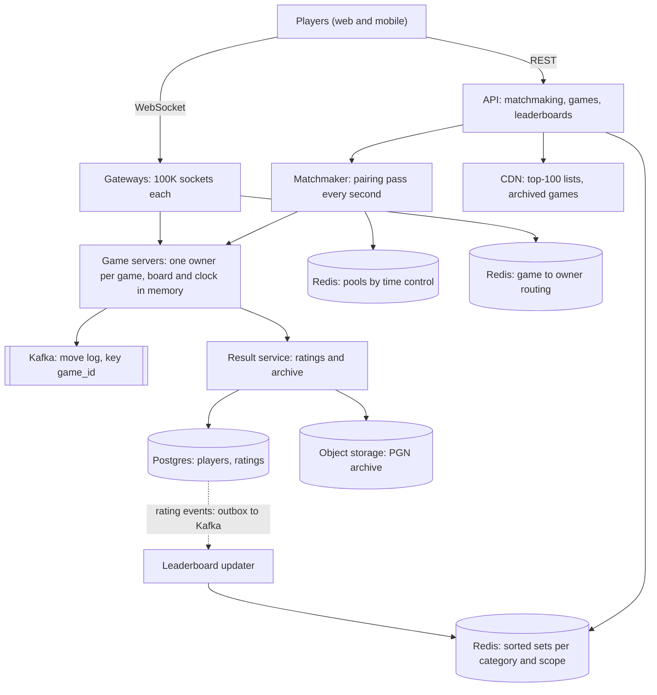
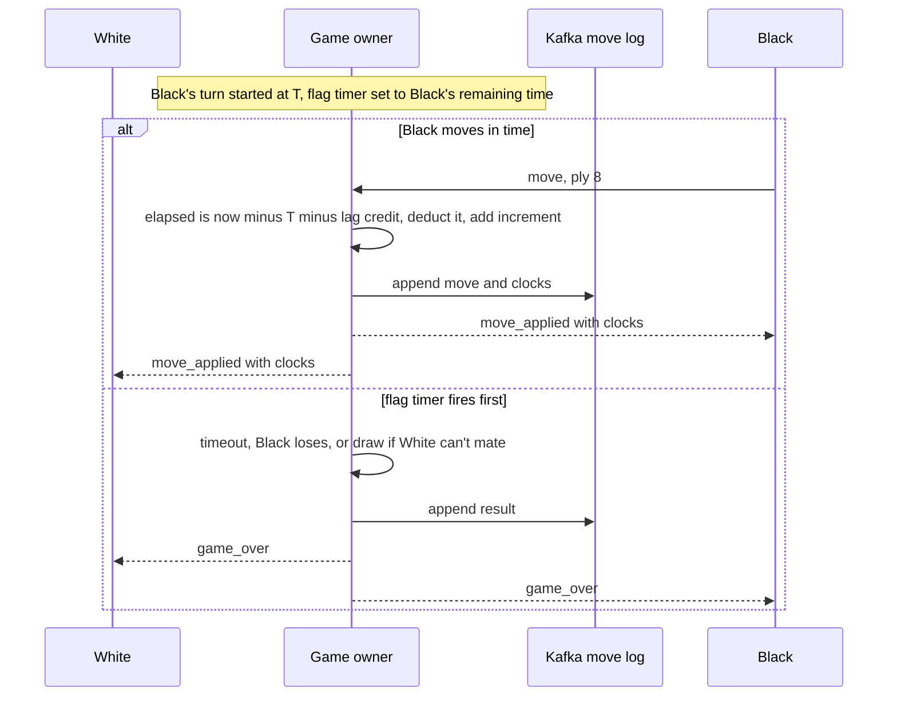

# Designing an Online Chess Platform with Leaderboards (Concise)

> Think Lichess or Chess.com. Players are matched by rating, play timed games in real time, and climb per-time-control leaderboards. The key idea: **each live game has one authoritative server that owns its board and clock**, so moves need no distributed coordination. The hard parts are the clock under network lag, never losing a live game, and leaderboard ranks over millions of players. All numbers are assumptions.

---

## 1. Requirements

**Functional (top 3)**
1. Users can **request a timed game** (e.g. 3+2 blitz) and get **matched with a similar-rated opponent**.
2. Users can **play in real time**: only legal moves are accepted, the server runs the clocks, and the game ends with a result that **updates both players' ratings**.
3. Users can **see leaderboards**: the top players per time control (global and per country), plus **their own rank**.

**Non-functional**

| Requirement | Target |
|---|---|
| Move latency | Move round trip p99 < 100 ms in the same region |
| Correctness | Board and clock are never wrong; no illegal move is ever applied; nobody is flagged for their own network lag |
| Durability | A live game survives a server crash; a finished rated game and its rating change are never lost |
| Availability | Game play 99.95%; leaderboards can be a few seconds stale but are always readable |
| Scale | 10M daily users, 1M players in games at peak, leaderboards over about 10M active players per time control |

**Out of scope:** bots, puzzles, tournaments, chat, correspondence chess, and anti-cheat detection beyond enforcing legal moves.

**Say this:** "The server is the only authority on the board and the clock; clients are just views. I'll build matchmaking and the live game first, then the leaderboard, then go deep on the clock and crash recovery."

---

## 2. Estimation (only numbers that decide something)

| Quantity | Math | Result | Decision |
|---|---|---|---|
| Live games | 1M players in games ÷ 2 | 500K games at peak | About 5 KB each = 2.5 GB, which fits in one node's memory, but one node would be a single point of failure holding 1M sockets → **shard games across about 25 servers** |
| Moves | 500K games × one move every 4.5 s | about 110K moves/s at peak | Validation takes microseconds. A database write per move would need a large cluster → **append moves to a log (Kafka)** instead |
| Connections | 1M players | 1M WebSockets | About 100K per gateway → **10 or more gateway nodes**, separate from game servers |
| Games finished | 10M users × 5 games | 50M/day, about 2K/s at peak | Each produces one rating update for both players and one archive record |
| Rating updates | 50M games × 2 players | about 3.5K/s at peak | Fine for a Postgres primary, two rows per transaction |
| Leaderboard size | About 10M active players per time control | About 1 GB per sorted set | **Fits one Redis node.** An update and a rank lookup each cost O(log N) |
| Archive | 50M games × 2 KB (compressed PGN) | 100 GB/day | Object storage plus CDN; finished games never change |

---

## 3. Entities and APIs

**Entities:** Player, Rating (per time-control category: rating, deviation, volatility), Game, Move (ordered by `ply`, the half-move number), MatchTicket, Leaderboard entry.

**REST** (request and response):

```http
POST   /v1/matchmaking/tickets   {"time_control": "3+2"}        → 201 {ticket_id}; the match arrives over WebSocket
DELETE /v1/matchmaking/tickets/{ticket_id}                      → 204, stop searching
GET    /v1/games/{game_id}                                      → board (FEN), clocks, moves, status: reconnect or replay
POST   /v1/games/{game_id}/resign
GET    /v1/leaderboards/blitz?scope=global&limit=100            → top 100 (cached about 30 s)
GET    /v1/leaderboards/blitz?scope=country:IN&limit=100
GET    /v1/leaderboards/blitz/me                                → {rank, rating, percentile}
```

**WebSocket** (the live game):

```jsonc
// server → player
{ "type": "match_found", "game_id": "g42", "color": "white", "clocks": {"white": 180000, "black": 180000} }
// player → server
{ "type": "move", "game_id": "g42", "ply": 7, "uci": "e7e8q" }
// server → both players
{ "type": "move_applied", "ply": 7, "san": "e8=Q+", "fen": "...", "clocks": {"white": 171200, "black": 174300} }
{ "type": "move_rejected", "ply": 7, "reason": "illegal_move" }
{ "type": "game_over", "result": "0-1", "reason": "timeout", "rating_change": {"white": -8, "black": 8} }
```

- A move is identified by (`game_id`, `ply`): a duplicate is ignored, and a stale or out-of-turn move is rejected.
- `move_applied` means the move was validated **and written to the durable move log**.
- The player always comes from the auth token.

---

## 4. High-Level Design

**v1:** one server holds every game in memory, moves arrive by polling, each move is written to Postgres, and the leaderboard is `ORDER BY rating LIMIT 100` plus `COUNT(*) WHERE rating > mine` for rank.
**It breaks on:**
- one node is a single point of failure for 1M sockets, and a crash loses live games;
- polling makes clocks laggy;
- 110K database writes per second;
- a `COUNT(*)` rank query is slow for players far down the list, because it walks every higher-rated row.

**v2, one requirement at a time:**
1. **Matchmaking:** a ticket goes into a Redis sorted set `pool:{time_control}` scored by rating. Every second, a pairing pass matches each waiting player with the nearest rating inside a window that **widens the longer they wait**. Then it creates the game on its owner server and pushes `match_found`.
2. **Play:** the player's WebSocket goes to a gateway, which looks up the game's owner server in Redis and forwards the move. The owner validates it with the rules engine, updates the clock, appends it to Kafka (keyed by `game_id`) and broadcasts `move_applied`. At the end, the **Result service** updates both ratings in one Postgres transaction and writes the PGN to object storage.
3. **Leaderboard:** each rating change emits an event, through an outbox, to Kafka. The **Leaderboard updater** runs `ZADD lb:{category}:global` and `lb:{category}:{country}` for eligible players. The API serves the top 100 from a cache and answers "my rank" with `ZREVRANK`.



**Data**

| Store | Holds | Why |
|---|---|---|
| Game server memory | Live board (FEN), clocks, position history | Microsecond validation; a single writer means no locks |
| Kafka, partitioned by `game_id` | Every accepted move, with clocks after it | Durable and ordered per game; replayed to rebuild a crashed game |
| Redis | Matchmaking pools and game-to-owner routing | Fast and short-lived; rebuildable |
| Postgres | Players; ratings per category; rating history (unique per `game_id` and player) | The source of truth for ratings; both players updated together |
| Redis sorted sets | `lb:{category}:{scope}` → player, scored by rating | O(log N) updates and rank lookups; rebuildable from Postgres |
| Object storage + CDN | Finished games as PGN | Immutable, cheap, cacheable replays |

**Cache:** the top-100 lists are cached for about 30 s (they barely change). "My rank" isn't cached, because one `ZREVRANK` costs microseconds. Archived games live on the CDN for good. Live games are never cached; the owner's memory is the truth.

---

## 5. Deep Dives

### 5.1 Tests that matter
- **The same move sent twice** (same `ply`) → applied once. **A move for the wrong `ply`** → rejected.
- **A move arrives 1 ms before vs. 1 ms after the clock hits zero** → deterministic, and the same result every run.
- **Kill a game server mid-game** → the game resumes on a new owner with the identical board and clocks.
- **The rating update runs twice** for one game → ratings change once.
- **The leaderboard matches Postgres** (top 100 and sampled ranks) after a full rebuild.
- **Load:** 110K moves/s with p99 < 100 ms; 3.5K rating updates/s; leaderboard reads at 10× normal with Redis CPU under 50%.

### 5.2 Core flows

**The clock (the hardest part)**



- **The server owns time.** Elapsed = receive time − turn start − **lag credit**. The lag credit is each player's measured one-way network delay from ping and pong, **capped** at a few hundred ms so it can't be abused.
- **One owner per game decides "move or timeout" in a single thread,** so a buzzer-beater has exactly one outcome.
- Clients count down locally but **snap to the server's clocks** on every update, so they never drift apart.

**Never losing a live game**
- The owner keeps a **lease with an epoch number** (Redis or etcd). If it dies, a new owner takes the lease with epoch + 1 and **replays that game's moves from Kafka** to rebuild the board and clocks.
- Every move carries its epoch, so late writes from the old owner are ignored during replay.
- The time spent recovering isn't charged to the player whose turn it was. Their clock resumes from the last logged value.

**Matchmaking window:** `allowed gap = 50 + 10 × seconds waited` rating points. It starts wider for new players, whose rating is still uncertain, and prefers same-region opponents first.

**Rating update, exactly once:** Glicko-2 per category, with the simple Elo story `R' = R + K·(S − E)`. Both players change in **one Postgres transaction**, along with a `rating_history` row that is **unique per (game_id, player)**. A retried update hits that unique key and does nothing. The same transaction writes an **outbox** event for the leaderboard.

**Leaderboard**
- **Eligibility:** at least 10 rated games in the category, a settled rating (low deviation), and a game in the last 30 days. A nightly sweep removes inactive players (`ZREM`).
- **Writes:** one `ZADD` per rating change, about 3.5K/s at peak. Redis handles over 100K operations per second.
- **Reads:** top 100 = `ZREVRANGE 0 99`, cached about 30 s. My rank = `ZREVRANK` + 1, and percentile = rank ÷ `ZCARD`.
- **Ties:** Redis orders equal scores by member ID. If ties should favor whoever reached the rating first, add a small fraction to the score based on when they reached it.
- **Recovery:** if Redis is lost, rebuild from Postgres (one scan of about 10M rows per category, a few minutes). Meanwhile, keep serving the last cached top 100.

### 5.3 Edge cases
- **Disconnect:** the clock keeps running, so you can't gain time by dropping. The opponent sees a "disconnected" notice. A reconnect fetches the board and clocks. A game with no first move within 30 s is aborted and unrated.
- **Both players act at the buzzer** (resign vs. flag, move vs. flag): the owner's single thread processes events in arrival order; the first one wins.
- **Timeout when the opponent can't mate** (e.g. only a king left): it's a draw, not a win.
- **A player changes country:** remove them from the old country's list, add them to the new one.
- **Provisional players** (few games) never appear on leaderboards, which blocks fresh accounts farming a top spot.
- **Rating events arriving out of order:** each event carries a per-player version, and the updater ignores anything older than what's stored.

### 5.4 CAP, per operation

| Operation | During a network partition |
|---|---|
| Playing a game | **Consistent:** only the lease holder may accept moves. If the owner is cut off, the game pauses briefly rather than risk two owners |
| Matchmaking | **Available:** pools are rebuildable; at worst, players re-queue |
| Rating update | **Consistent:** needs the Postgres primary; otherwise the result waits in Kafka and is applied later, exactly once |
| Leaderboard reads | **Available:** a few seconds stale, served from replicas and cache |

### 5.5 Trade-offs

| Choice | Instead of | What we gave up |
|---|---|---|
| One in-memory owner per game | Replicating every move | A short pause on failover while the game replays |
| Kafka move log | A database write per move | Replay is needed to rebuild a game |
| Server-owned clock with capped lag credit | Client-timed clocks | Players on very slow connections still lose some time |
| Redis sorted set per leaderboard | SQL `ORDER BY` and `COUNT` | A second copy of ratings to keep in sync, seconds behind |
| Exact rank for everyone | An approximate percentile | Fine at 10M players; needs sharding at about 1B (6.1) |

---

## 6. Bottlenecks and Failures

**10× traffic** (10M players in games):
1. **Gateways and game servers** scale out first; each is stateless or sharded by `game_id`. Add Kafka partitions as moves reach about 1.1M/s.
2. **Next, rating writes** at about 35K/s. Shard players by `player_id`. The two-player transaction becomes two independent updates, each made safe to retry by the unique (`game_id`, player) key.
3. **Leaderboards stay fine** up to about 100M players per set (about 10 GB): add read replicas, and the top 100 is already cached. **At about 1B,** split each leaderboard by rating range across nodes, and keep a count per range. My rank = players in higher ranges + rank within mine.

| Failure | Impact | Response |
|---|---|---|
| Gateway dies | Its sockets drop | The client reconnects to any gateway and resumes from the game snapshot |
| Game server dies | Its games pause for a few seconds | A new owner takes the lease (epoch + 1) and replays the moves from Kafka |
| Kafka broker dies | None | 3 replicas, `acks=all`; the leader moves |
| Redis (pools or routing) lost | Waiting players drop out of the queue | Clients re-queue automatically; owners re-register their games |
| Redis (leaderboards) lost | Leaderboards stale | Serve the cached top 100; rebuild from Postgres in minutes |
| Postgres primary down | Ratings update late | Fail over to the standby; results wait in Kafka and apply once |
| Region down | Its games pause | Players reconnect to another region; games replay from the replicated log |

**Also:** authentication on every action, so only the two seated players can move or resign. Rate limits on moves and queue joins. Asynchronous cheat detection that analyzes the move log. Dashboards for move latency, lag credit, flag rate, Kafka lag and leaderboard freshness.

**Recap:** one in-memory owner per game, plus a durable move log, gives a correct and recoverable game. Glicko-2 updates happen exactly once in Postgres. Redis sorted sets serve the leaderboards and can be rebuilt from Postgres. **Main bottleneck:** connections and game servers, both of which scale out. **Main trade-off:** a brief pause on failover in exchange for no coordination on every move.

---

## Appendix: Interview Delivery

- **Opening:** "Chess is turn-based, so each game is a tiny single-writer state machine. The hard parts are a fair clock under lag, surviving crashes, and ranking millions of players. Only human vs. human? Which time controls? Do leaderboards need exact ranks?"
- **Push back:** "Exact rank for every player is cheap at 10M with a sorted set. At a billion, I'd offer an approximate percentile for low ranks instead."
- **Likely follow-ups:**
  - *Who flagged first under lag?* The owner's single thread decides, using the receive time minus a capped lag credit.
  - *The game server crashes?* A new owner, with the next epoch, replays the move log and resumes with the clocks as logged.
  - *Elo or Glicko-2?* Elo is simple. Glicko-2 adds confidence and inactivity, so new and returning players settle faster.
  - *Why not SQL for the leaderboard?* `COUNT(*)` for rank walks every higher-rated row. A sorted set answers in O(log N).
  - *Ties?* Redis orders equal scores by member ID; a fractional score can make the first to reach a rating rank higher.
- **References:** Lichess (open source, `lichess-org/lila`) uses Glicko-2 and server-side lag compensation; Redis documents sorted sets as the standard leaderboard structure.
- **Questions for the team:** How do you handle cheating at scale today? How fresh must leaderboards be for your players?
