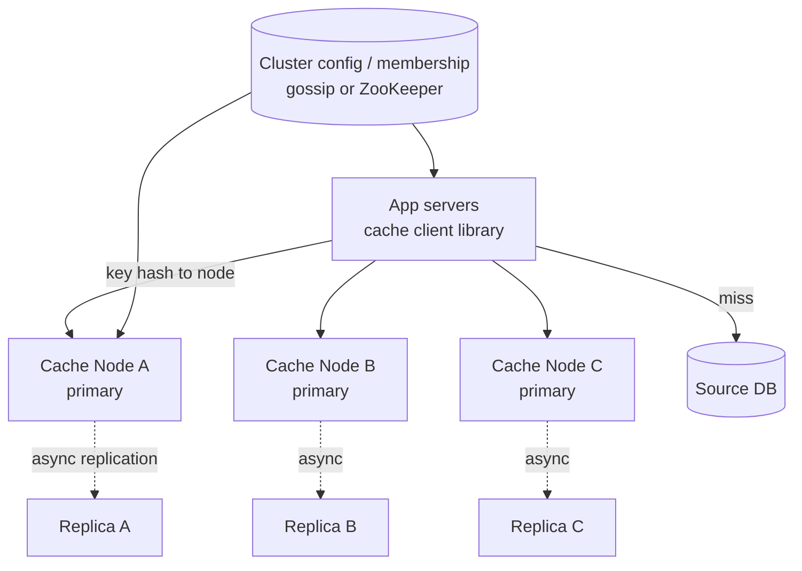
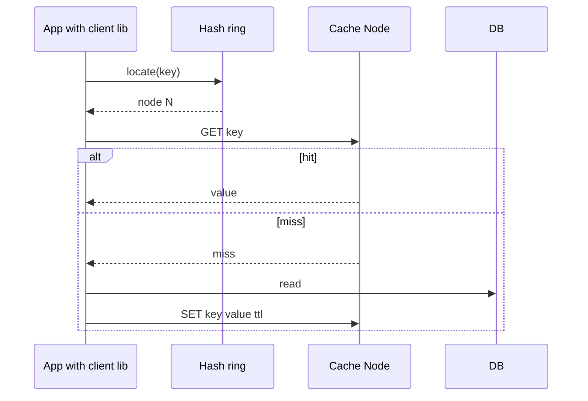

# Designing a Distributed Cache

> Interview-ready walkthrough: requirements → estimates → API → HLD → deep dives (**partitioning and consistent hashing, replication, eviction, hot keys, invalidation and write policies, client vs proxy routing, failure**) → trade-offs. The hard part is **keeping a huge in-memory key space available and balanced as nodes come and go**.

> Related: *In-memory KV store* doc in this folder covers a single node (data structures, persistence). This one is the **distributed** layer.

---

## 0. Talk track

1. Clarify: get/set/delete with TTL, LRU eviction, 1 TB, 100K QPS, under 10 ms.
2. Start with single node, then ask what breaks (memory, throughput, availability).
3. Deep dives: sharding (consistent hashing), replication, eviction/expiry, hot keys, client library, failure.

---

## 1. Problem

A shared in-memory cache fronting databases/services: **O(1) get/set**, TTL, eviction when full, scalable across nodes.

**What makes it hard**
- Data larger than one machine's RAM, QPS greater than one machine.
- **Adding/removing nodes** must not remap everything (cache avalanche).
- Hot keys, availability, and **consistency** with the source of truth.

---

## 2. Requirements

### Functional
- `set(key, value, ttl)`, `get(key)`, `delete(key)`.
- Configurable **TTL**, **LRU** eviction.

**Out of scope:** complex types (Redis structures), transactions, durable persistence.

### Non-functional
- **High availability** (cache loss must not take down the DB).
- **Low latency** (under 10 ms p99, ideally sub-ms), **1M+ QPS** cluster.
- **Scalable** to 1 TB+ and thousands of QPS growth.
- **Eventual consistency** acceptable.

---

## 3. Estimation

| Quantity | Assumption | Result |
|---|---|---|
| Data | 1 TB | **about 16 nodes at 64 GB** (about 3x with replicas) |
| QPS | 1M | at about 100K ops/s per node = **10+ nodes** minimum |
| Item | 1 KB avg | 1B items |
| Hit ratio target | 95%+ | DB load = 5% of reads |

Memory (not CPU) decides the node count; QPS and replication also push it up. **Plan around the larger of both.**

---

## 4. API

```
PUT  /cache/{key}  value, ttl     -> 200
GET  /cache/{key}                 -> 200 value | 404
DELETE /cache/{key}               -> 204
```
Binary protocol (RESP / memcached) in practice; a **smart client** hashes the key to a node.

---

## 5. Architecture



---

## 6. Flow



---

## 7. Deep dive 1: partitioning

| Approach | Verdict | Why |
|---|---|---|
| `hash(key) mod N` | Bad | Changing N remaps about all keys, causing a miss storm |
| **Consistent hashing** with virtual nodes | Great | Adding or removing a node moves about 1/N keys; vnodes even out load |
| Hash slots (Redis Cluster: 16384 slots) | Great | Explicit slot to node map; resharding moves slots; clients cache the map and follow `MOVED` redirects |

**One-liner:** *Consistent hashing with vnodes so membership changes move about 1/N of keys.*

## 8. Deep dive 2: replication and availability

- Each primary has 1+ **replicas** (async for latency; promotion on failure by a failure detector/election).
- **Async replication can lose recent writes**; acceptable for a cache (miss, then refill).
- Reads from replicas boost read throughput at the cost of stale reads.
- Spread replicas across AZs. Alternative: no replicas, accept misses (memcached model) and rely on a warm DB capacity.

## 9. Deep dive 3: eviction and expiry

- **LRU** (hash map + doubly linked list, O(1)); approximated LRU / **LFU** (sampling) in Redis for lower overhead. LFU resists scans.
- **TTL**: lazy expiry on access plus periodic sampled sweep (or timer wheel) to reclaim memory.
- Use `maxmemory` + policy (`allkeys-lru`) to avoid OOM.

## 10. Deep dive 4: hot keys

A single key can overwhelm one node. Options: **local in-process L1 cache** with short TTL in clients, **replicate hot keys** to multiple nodes (key suffix `#0..R-1`, random read), detect via sampling counters, and request coalescing (singleflight).

## 11. Deep dive 5: write policies and consistency

| Pattern | Behavior | Use |
|---|---|---|
| **Cache-aside** | App reads cache, then DB on miss; writes DB, then **invalidate** | Default |
| Write-through | Write cache and DB synchronously | Read-after-write, extra latency |
| Write-behind | Write cache, flush later | Fast writes; risk of loss |
| Read-through | Cache loads from DB itself | Simpler apps |

Races (stale set after invalidate) are mitigated with short TTLs, versioned values, or delete-after-write with a delay. Stampedes: singleflight, locks, TTL jitter, probabilistic early refresh.

## 12. Deep dive 6: client vs proxy topology

| | Smart client | Proxy (Twemproxy/Envoy) |
|---|---|---|
| Hops | 1 | 2 |
| Language support | Library per language | Any |
| Config updates | Client must refresh | Central |

---

## 13. Failure handling

| Failure | Mitigation |
|---|---|
| Node down | Replica promoted; consistent hashing re-routes; DB protected by rate limit and coalescing |
| Cache-wide cold start | Gradual warm-up, circuit breaker/load shedding, pre-warm top keys |
| Network partition | Cache may serve stale; prefer availability; clients fall back to DB with limits |
| Rebalance storm | Move slots gradually, throttle migration |
| Memory pressure | Eviction policy; alert on evictions and hit ratio |

---

## 14. Trade-offs

| Decision | Chosen | Alternative | Given up |
|---|---|---|---|
| Sharding | Consistent hash / slots | Mod N | Mapping complexity |
| Replication | Async | Sync | Possible lost writes |
| Write policy | Cache-aside | Write-through | Stale window |
| Topology | Smart client | Proxy | Client complexity |
| Eviction | Approx LRU/LFU | Exact LRU | Slight accuracy |

---

## 15. Level expectations

- **Mid:** hash map + LRU, TTL, scaling by sharding.
- **Senior:** consistent hashing, replication/failover, hot keys, write policies.
- **Staff+:** rebalancing without storms, stampede protection, hit-ratio economics, multi-region, observability.

## 16. Follow-ups

Multi-region caches, cache warming on deploy, near-cache invalidation via pub/sub, memory-efficient encodings.

## 17. Summary checklist

- [ ] Memory-bound sizing, replicas across AZs
- [ ] Consistent hashing with vnodes or hash slots
- [ ] LRU/LFU plus TTL (lazy + sweep)
- [ ] Hot key replication and L1 cache, singleflight
- [ ] Cache-aside with jittered TTLs; protect the DB
