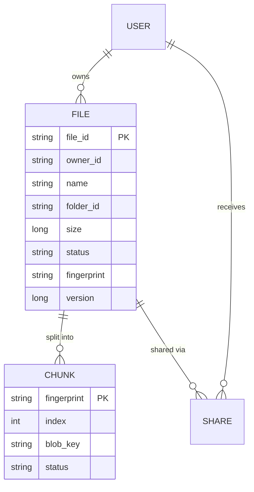
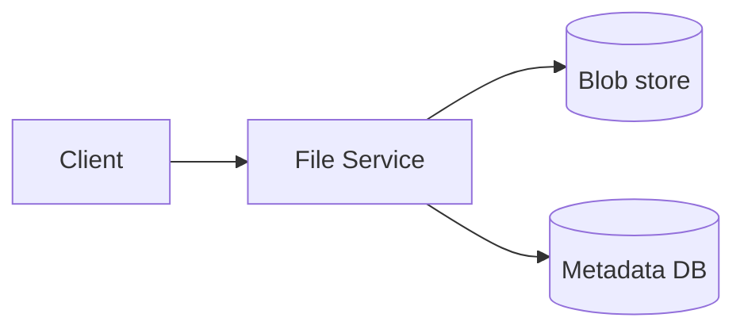
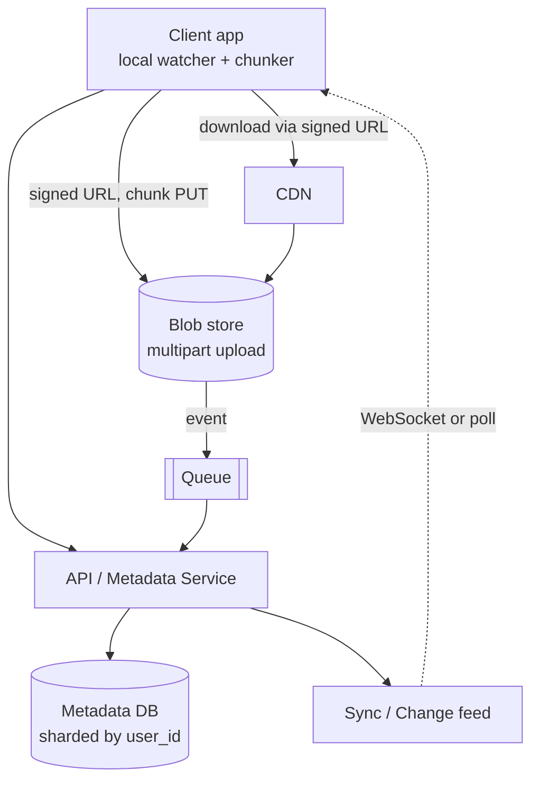
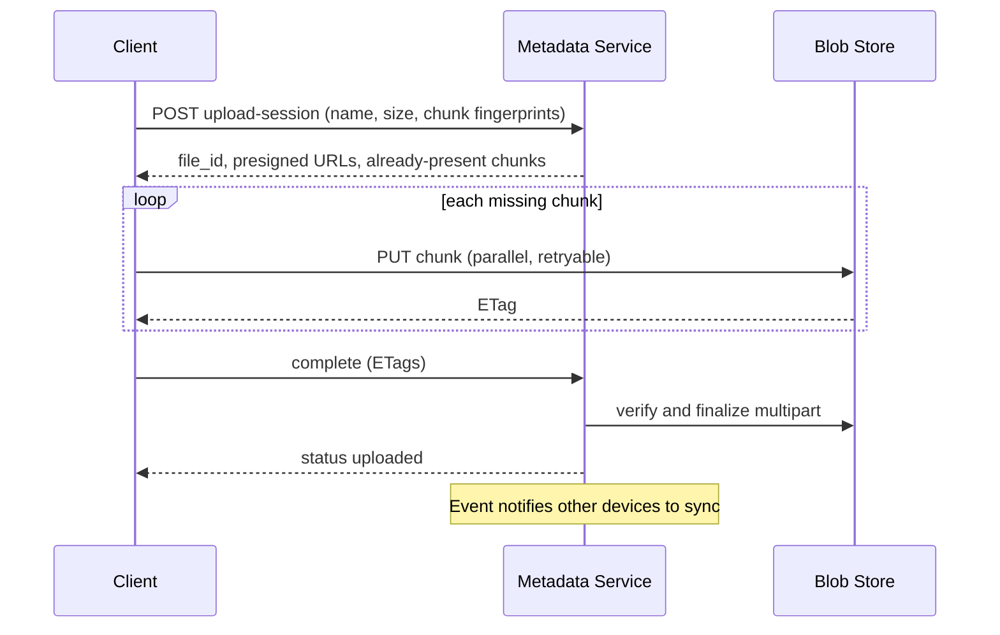

# Designing Dropbox (File Storage and Sync)

> Interview-ready walkthrough: requirements → estimates → entities → API → HLD → deep dives (**large uploads, sync, chunking and dedup, resumable transfers, security**) → trade-offs. The hard parts are **big files over flaky networks** and **efficient multi-device sync**.

> Think Dropbox / Google Drive. Files live in object storage, **metadata** in a database, and clients upload and download **directly** from blob storage through signed URLs.

---

## 0. Talk track

1. Clarify upload/download/sync/share; file size up to 50 GB.
2. Estimate: 500M users, 100M DAU, 50 PB.
3. Entities: File, FileMetadata, User, Share.
4. API: request upload URL, get download URL, sync changes.
5. HLD: metadata service + blob store + signed URLs.
6. Deep dives: large files (chunking), sync (polling/WebSocket + change feed), speed (CDN, compression, delta), security.

---

## 1. Problem

Users store files in the cloud, access from any device, **share** them, and keep devices **automatically synced**.

**What makes it hard**
- Files up to **50 GB**: must not stream through app servers.
- **Flaky networks**: uploads must **resume**.
- **Sync**: local and remote changes must converge quickly and cheaply.
- Durable (no file loss) and **available**.

---

## 2. Requirements

### Functional
- Upload and download files from any device.
- Share files with other users.
- Auto-sync across devices.

**Out of scope:** in-browser editing (Docs), file versioning UI, virus scanning details.

### Non-functional
- **Availability over consistency** (consistency eventual for sync).
- Files up to 50 GB; **resumable** uploads.
- Low latency uploads/downloads.
- **Highly durable** (never lose a file), secure (encrypt at rest and in transit).

---

## 3. Estimation

| Quantity | Assumption | Result |
|---|---|---|
| Users | 500M, 100M DAU | |
| Files/user | 200 avg, 1 MB mean | **about 100B files, 100 PB logical** (dedup/compress reduces) |
| Uploads/day | 100M DAU x 2 | about 2K/s avg |
| Metadata row | about 500 B | **50 TB** metadata |
| Egress | downloads x 2 uploads | multi-Tbps, mostly via CDN |

**Consequences**
- **Blob data goes straight to S3-like storage**; app servers only handle metadata.
- Metadata (50 TB) needs **sharding by user_id**.
- Chunking is essential for large files (retry, parallel, dedup).

---

## 4. Entities



---

## 5. API

```http
POST /files/upload-session            # metadata first
{ "name":"a.mov", "size":8000000000, "fingerprint":"sha256...", "chunk_count": 1600 }
-> 201 { "file_id":"f1", "upload_id":"u1", "presigned_urls":[...] }

PUT <presigned S3 url for chunk i>    # client uploads DIRECTLY to blob store
POST /files/{id}/complete             # server verifies chunks, marks status=uploaded

GET  /files/{id}/download             -> 302 / signed CDN URL
POST /files/{id}/share  { "user_id":"u2", "perm":"read" }
GET  /changes?cursor=123              # sync: delta since cursor
```

---

## 6. Architecture

### v1

Problem: 50 GB through the app server is slow and costly; no resume.

### Final design


---

## 7. Upload flow



---

## 8. Deep dive 1: uploading large files

| Approach | Verdict | Why |
|---|---|---|
| Upload through app server | Bad | Bottleneck; server memory/bandwidth |
| **Presigned URL direct upload** | Good | Offloads bytes to blob store, but one request fails = restart |
| **Chunked/multipart** (5-10 MB chunks) | Great | Parallel, **resumable**, per-chunk retry, enables dedup |

Resume: server tracks which chunks arrived (`status` per chunk or S3 `ListParts`). Client asks "what do you have?" and sends only the rest. Chunk completion is verified by hash/ETag. Files marked `uploading` until the commit; incomplete uploads garbage collected.

**One-liner:** *Chunk and presign: bytes bypass the servers, retries are per chunk.*

---

## 9. Deep dive 2: sync

| Direction | Mechanism |
|---|---|
| Local to remote | OS file watcher detects change, client chunks, uploads, updates metadata |
| Remote to local | Client keeps a `cursor`; **long poll / WebSocket** notified of changes, then `GET /changes?cursor` |

- **Hybrid**: WebSocket/push for fresh files (low latency), periodic polling as safety net.
- **Conflicts**: two devices edit the same file: keep both (`file (conflicted copy)`) and let the user merge, using version/vector.
- **Delta sync**: only changed chunks transfer (content-defined chunking so an insert at the start doesn't change every chunk).

**One-liner:** *Cursor-based change feed plus push notification; sync only changed chunks.*

---

## 10. Deep dive 3: speed and cost

- **Chunk-level dedup** by SHA-256 fingerprint: skip uploads already stored (cross-user dedup carries a side-channel privacy risk, so scope it per user or require proof of possession).
- **Compression** before upload; **CDN** for popular downloads; parallel chunk transfer.
- **Tiering**: cold files to cheap storage (S3 IA/Glacier).

---

## 11. Security

- Auth on API; **short-lived presigned URLs** scoped to a single object and operation.
- Encryption at rest (server-side keys, optionally per-user) and TLS in transit.
- ACL check on every metadata and download request; shares as ACL rows or signed share links with expiry.
- Malware scan on upload completion (async).

---

## 12. Failure handling

| Failure | Mitigation |
|---|---|
| Client drops mid-upload | Resume by chunk |
| Metadata DB primary fails | Replica promotion; shards isolate blast radius |
| Blob store region outage | Cross-region replication, 11 9's durability |
| Orphaned chunks | Lifecycle GC for unfinished uploads |
| Sync storm after outage | Cursor-based catch-up, jittered reconnects, rate limit |

---

## 13. Trade-offs

| Decision | Chosen | Alternative | Given up |
|---|---|---|---|
| Upload path | Direct to S3 | Via servers | Control (mitigated by signed URLs + callbacks) |
| Chunking | Fixed 5-10 MB | Content-defined | Simpler vs better delta dedup |
| Sync | Push + poll | Poll only | Connection management |
| Consistency | Eventual | Strong | Brief divergence across devices |
| Dedup | Per-user | Global | Storage savings vs privacy |

---

## 14. Level expectations

- **Mid:** metadata + blob separation, presigned URLs, basic sync.
- **Senior:** chunked resumable uploads, change feed, conflict handling, CDN, sharded metadata.
- **Staff+:** content-defined chunking, dedup privacy, storage tiering and cost, end-to-end integrity, outage drills.

## 15. Follow-ups

Versioning/undo, shared folders with permissions, offline mode, selective sync, E2E encryption (kills dedup/preview).

## 16. Summary checklist

- [ ] Metadata DB sharded by user, blobs in object store
- [ ] Presigned multipart upload, resumable
- [ ] Change feed with cursor + push
- [ ] Chunk hashes for dedup and delta sync
- [ ] CDN downloads, encryption, ACLs
