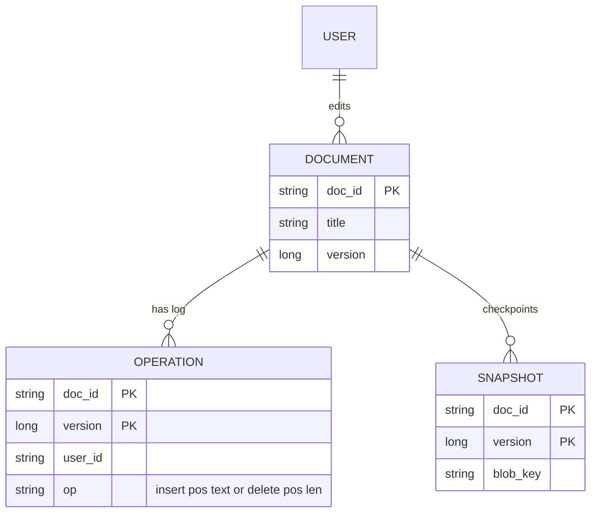
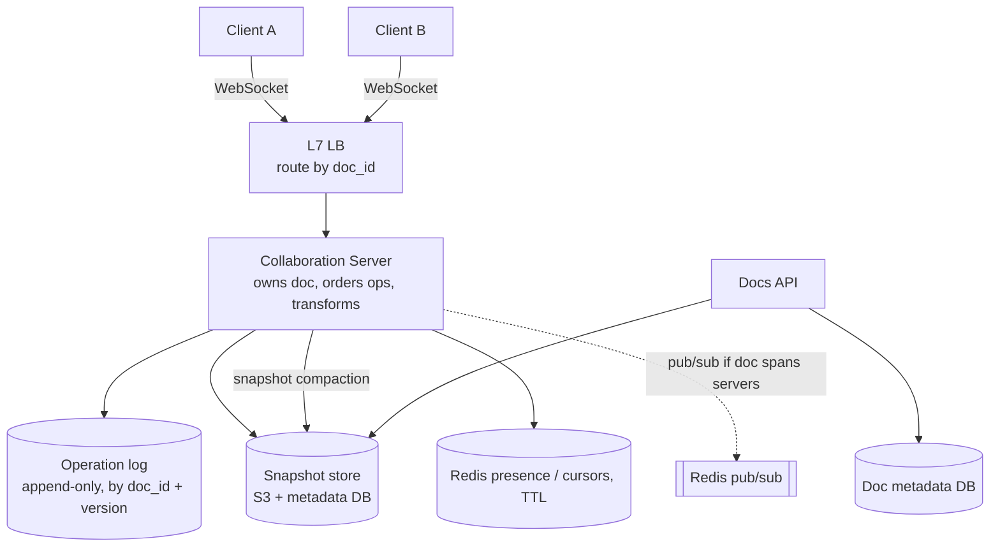
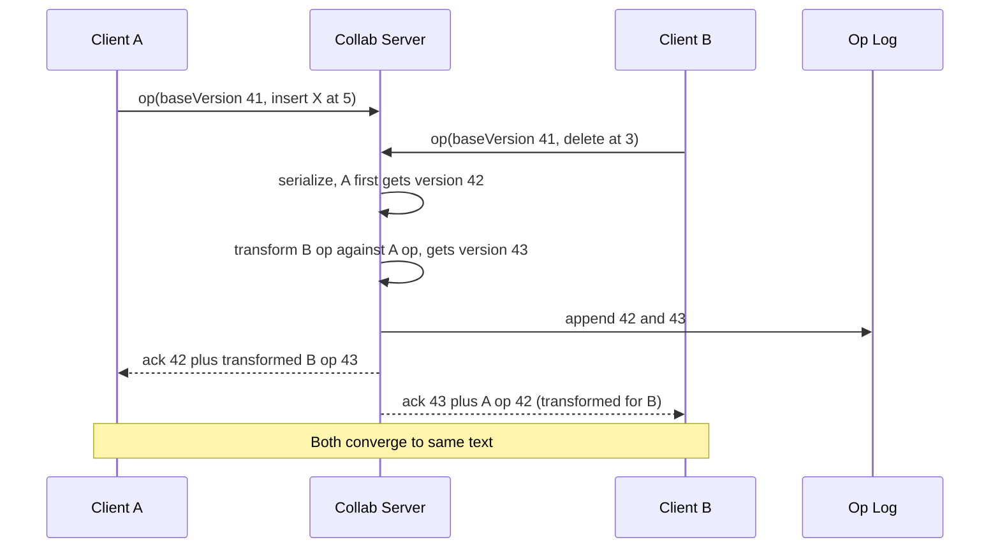

# Designing Google Docs (Real-Time Collaborative Editing)

> Interview-ready walkthrough: requirements → estimates → entities → API → HLD → deep dives (**concurrent edit conflicts: OT vs CRDT, server-ordered operations, WebSocket scaling, presence, storage and snapshots, offline**) → trade-offs. The hard part is **converging concurrent edits from many users without losing intent**.

---

## 0. Talk track

1. Clarify: create docs, concurrent edit by multiple users, see others' cursors, up to 100 editors per doc; offline out of scope.
2. Name the core problem: **concurrent edits conflict**.
3. Show naive fixes fail (last write wins, locking), arrive at **OT** (or CRDT).
4. HLD: WebSocket collaboration servers, per-document ordering, operation log + snapshots.

---

## 1. Problem

Many users edit one document at once; everyone sees changes in **real time** and all copies **converge** to the same text.

**What makes it hard**
- Two users edit simultaneously, so operation positions shift.
- Low latency (under 100 ms perceived) with intention preserved.
- Persist history; reconnect and catch up; scale to **millions of docs and 10M concurrent users**.

---

## 2. Requirements

### Functional
- Create documents.
- **Edit concurrently** with real-time propagation.
- See **cursor and presence** of others.

**Out of scope:** rich formatting depth, permissions/sharing details, comments, offline editing, version history UI.

### Non-functional
- **Eventual consistency**: all clients converge to the same state.
- **Low latency** (under 100 ms updates).
- **Scale**: 10M concurrent editors, 1B docs, up to 100 editors/doc.
- **Durable**; available.

---

## 3. Estimation

| Quantity | Assumption | Result |
|---|---|---|
| Concurrent users | 10M | 10M WebSockets, about 100K/server = **about 100+ servers** |
| Ops | 1 op/s per active editor | **10M ops/s** worst case; avg typing less |
| Op size | about 100 B | about 1 GB/s ingress at the extreme |
| Docs | 1B x 50 KB | **about 50 TB** snapshots |

**Consequence:** a document is the **unit of ordering and sharding**. All editors of one doc connect to **the same collaboration server** (or shard).

---

## 4. Entities



---

## 5. API

```http
POST /docs                -> 201 { doc_id }
GET  /docs/{id}           -> latest snapshot + ops since snapshot (version)
WS   /docs/{id}/edit
  client -> { type:"op", baseVersion: 41, op: { insert: {pos: 5, text:"x"} } }
  server -> { type:"ack", version: 42 }
  server -> { type:"op", version: 43, op: {...}, user:"u2" }       // others' edits (transformed)
  client/server -> { type:"cursor", user:"u2", pos: 17 }           // ephemeral presence
```

---

## 6. Architecture



---

## 7. Flow



---

## 8. Deep dive 1: concurrent edits

| Approach | Verdict | Why |
|---|---|---|
| Send whole doc, last write wins | Bad | Loses edits |
| Locking sections/doc | Bad | Hurts collaboration |
| Operation-based with **position** only | Bad | Positions are stale after concurrent ops |
| **Operational Transformation (OT)** with a central server | Great | Server orders ops, transforms each against concurrent ones; clients converge. Google Docs approach; needs a central authority per doc |
| **CRDT** (Yjs, Automerge, RGA) | Great | Operations commute; no central ordering, supports peer-to-peer/offline; metadata overhead and tombstones grow |

Example: doc `ABC`; A inserts `X` at 1, B deletes `C` at 2 concurrently. Without transform, B's delete after A's insert hits the wrong char; OT shifts B's index to 3.

**One-liner:** *Server assigns a total order per doc; transform concurrent ops (OT), or use CRDTs when you need offline/peer-to-peer.*

## 9. Deep dive 2: scaling WebSockets and routing

- **One doc = one owner server** (consistent hash by `doc_id`), so ordering is local and cheap. The LB routes by `doc_id`.
- Alternative for hot docs: dedicated shard; cap at 100 editors keeps load bounded.
- On server failure, clients reconnect (with last known version), another server **rebuilds state** from snapshot + log tail and resumes; version numbers make resync exact.
- Use a registry (Redis/ZooKeeper) of doc to server with leases to avoid two owners (split brain).

## 10. Deep dive 3: storage

- **Append-only op log** (durable write before ack), periodic **snapshots/compaction** (every N ops or minutes), so loading = latest snapshot + tail.
- Old ops retained for version history; cold docs archived to S3.
- Persist before ack, or batch with a small WAL; trade latency vs durability window.

## 11. Deep dive 4: presence and cursors

Ephemeral, not persisted: Redis with TTL or in-memory on the collab server, broadcast on change (throttled, e.g. 10/s). Loss is harmless.

## 12. Deep dive 5: client behavior

Optimistic local apply immediately; keep a queue of unacked ops; on ack of own op or incoming transformed remote ops, **rebase**. One in-flight op at a time (classic OT client) simplifies the state machine.

---

## 13. Failure handling

| Failure | Mitigation |
|---|---|
| Collab server crash | Reconnect and reload snapshot + log tail; clients resend unacked ops (idempotent by op id) |
| Duplicate ops | Op ids/client sequence numbers |
| Network drop | Client queues, reconnects with last version |
| Log store failure | Replicated store, multi-AZ |
| Split brain on ownership | Lease/fencing token on op log writes |

---

## 14. Trade-offs

| Decision | Chosen | Alternative | Given up |
|---|---|---|---|
| Convergence | OT (central) | CRDT | Offline/P2P; but simpler, smaller state |
| Ownership | Per-doc server | Stateless any-server | Routing/ownership complexity |
| Storage | Log + snapshots | Full copies | Replay cost on load |
| Consistency | Eventual convergence | Strong locking | Transient divergence |
| Presence | Ephemeral | Persisted | Lost cursors on crash |

---

## 15. Level expectations

- **Mid:** WebSocket updates, saving doc, notices conflict problem.
- **Senior:** OT or CRDT explained with an example, per-doc routing, log + snapshots.
- **Staff+:** server failover with fencing, hot-doc handling, op compaction, CRDT trade-offs, permissions on ops, rich-text structures.

## 16. Follow-ups

Offline editing (CRDT), undo/redo semantics, comments/suggestions, permissions, version history/restore.

## 17. Summary checklist

- [ ] Ops (not whole doc) over WebSocket, baseVersion
- [ ] Per-document owner orders and transforms (OT) or CRDT
- [ ] Op log plus snapshot compaction
- [ ] Redis ephemeral presence
- [ ] Reconnect with version, fencing on ownership
