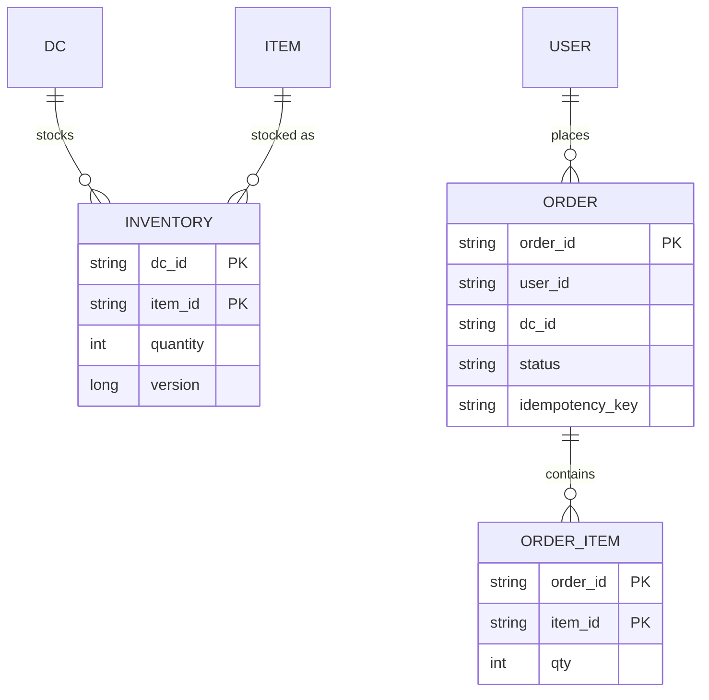
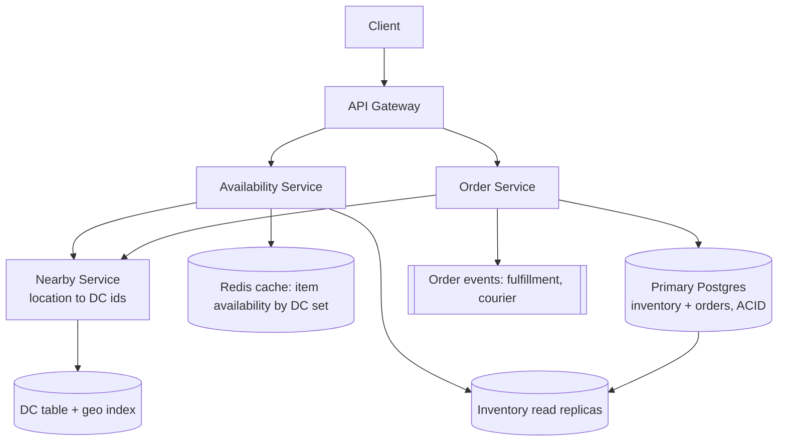
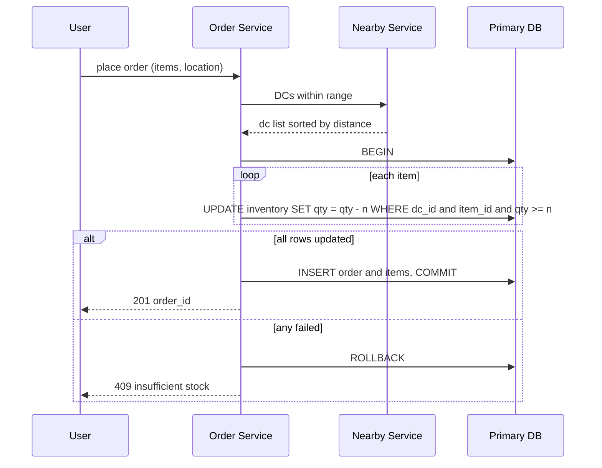

# Designing Gopuff (Local Delivery Service)

> Interview-ready walkthrough: requirements → estimates → entities → API → HLD → deep dives (**nearby DC discovery, inventory aggregation across fulfillment centers, no overselling at order time, scaling reads vs consistent writes**) → trade-offs. The hard parts are **availability queries across nearby inventory** and **atomic order placement that doesn't oversell**.

---

## 0. Talk track

1. Clarify: customers see **available items** (within delivery range), place orders; inventory lives in many **distribution centers (DCs)**; 10-minute delivery promise.
2. Split: **availability reads** (10K/s, eventual) vs **orders** (strong consistency).
3. Deep dives: nearby-DC lookup, inventory aggregate query, atomic order with inventory decrement, scale and partitioning.

---

## 1. Problem

Show what products are **actually available near the user** and let them order, decrementing stock at the right DC.

**What makes it hard**
- Availability = union of inventory across **all DCs within range** of the user.
- **Overselling**: two users buy the last item.
- Read-heavy browse (10K req/s) with strongly consistent order writes.

---

## 2. Requirements

### Functional
- Query **item availability** by delivery location (aggregated over nearby DCs).
- **Place orders** for multiple items.

**Out of scope:** payments, driver/courier logistics, search ranking, returns.

### Non-functional
- **Availability queries**: under 100 ms, 10K req/s, **eventual consistency OK**.
- **Orders**: **strong consistency** (no oversell); about 10M orders/day.
- Scale: 10K items, 1K DCs.

---

## 3. Estimation

| Quantity | Assumption | Result |
|---|---|---|
| Orders | 10M/day | about 115/s avg, **about 500/s peak** |
| Availability reads | | **10K/s** |
| Inventory rows | 10K items x 1K DCs | **10M rows x 100 B = 1 GB** fits in memory |
| Order size | 5 items | 50M inventory updates/day |

Consequence: data is tiny; one strongly consistent DB handles orders, and **a cache plus read replicas** serve availability.

---

## 4. Entities



---

## 5. API

```http
GET  /availability?lat=&lng=&item_ids=...&page=      -> [{ item_id, total_available }]
POST /orders  Idempotency-Key  { items:[{item_id, qty}], lat, lng }   -> 201 { order_id } | 409 insufficient stock
```

---

## 6. Architecture



---

## 7. Order flow



---

## 8. Deep dive 1: finding nearby DCs

| Approach | Verdict | Why |
|---|---|---|
| Call Google Maps for travel time to every DC per request | Bad | Slow, costly |
| **Geo filter** (lat/lng bounding box or geohash cells) then travel-time/ETA service for few candidates | Great | 1K DCs is small |
| Precompute **service-area polygons / cell to DC list**, cached | Great | DC set changes rarely; O(1) lookup |

DCs are few and static: keep them in memory in the Nearby Service, **precomputed by grid cell**; refresh on DC changes.

## 9. Deep dive 2: availability queries

Availability for item X at location = **sum of quantity across nearby DCs**. 

| Approach | Verdict |
|---|---|
| Query primary DB with join per request | Bad at 10K/s |
| **Read replicas** + indexed `(item_id, dc_id)` with `WHERE dc_id IN (...)` | Good |
| **Cache** per `(cell, item)` availability with short TTL (seconds) | Great: stale by seconds is acceptable (order path re-checks) |

Alternatively cache per-DC inventory and sum in the service. Stale reads cause occasional "sorry, out of stock" at order time: acceptable trade-off for latency.

**One-liner:** *Approximate on read, exact on write.*

## 10. Deep dive 3: no overselling

| Approach | Verdict | Why |
|---|---|---|
| Read qty, check, then update | Bad | Race: both see 1 |
| **Single transaction with conditional decrement** (`qty >= n`) | Great | Atomic per row; relies on a **single DB** (or one shard per DC) |
| `SELECT FOR UPDATE` then update | Good | Correct but longer locks |
| Distributed transaction (2PC) across DBs | Avoid | Complex; partition inventory by DC so each order touches one shard |

**Which DC?** Pick the nearest DC that can fulfil **all** items (orders fulfilled from one DC, simplifying atomicity). If none can, reject or split orders (product decision). Use **idempotency key** to prevent double orders. Short **reservation** (hold) before payment if payment is in scope (see Ticketmaster).

## 11. Deep dive 4: scaling

- Inventory table **partitioned by `dc_id`** (or region) so orders in a region only touch one shard; availability reads fan out to a few shards.
- Read replicas and cache absorb 10K/s; primary handles about 500 order tx/s.
- Updates from warehouse systems (restock) apply as increments; cache invalidated/TTL'd.
- Hot items (viral products) use conditional update contention: still fine at this volume; add queueing per item/DC if needed.

---

## 12. Failure handling

| Failure | Mitigation |
|---|---|
| Primary DB failover | Sync replica; order retries safe (idempotency) |
| Replica lag | Order path hits primary, so correctness preserved |
| Cache down | Fall back to replicas with rate limit |
| Nearby service down | Cached cell to DC map; static fallback |
| Duplicate order request | Idempotency key |

---

## 13. Trade-offs

| Decision | Chosen | Alternative | Given up |
|---|---|---|---|
| Availability freshness | Cached, seconds stale | Exact | Occasional failed order |
| Order atomicity | Single DC, single tx | Multi-DC split | Fulfilment flexibility |
| DB | Postgres ACID | NoSQL | Horizontal ease (partition by DC solves) |
| DC lookup | Precomputed cells | Live routing API | Slight ETA inaccuracy |
| Hold inventory | At order time | At cart add | Cart-abandonment locking |

---

## 14. Level expectations

- **Mid:** inventory table, nearby DC query, order transaction.
- **Senior:** read/write split, caching availability, race prevention, partition by DC.
- **Staff+:** reservation strategy, multi-DC order splitting, restock pipelines, demand-driven placement, consistency boundaries.

## 15. Follow-ups

Cart reservations, split shipments, substitution suggestions, predictive restocking, courier assignment integration.

## 16. Summary checklist

- [ ] Tiny data, so ACID Postgres, partition by DC
- [ ] Precomputed cell to DC map
- [ ] Cached/replica availability sums (stale OK)
- [ ] Conditional decrement in one transaction, idempotent orders
- [ ] Order path always hits primary
