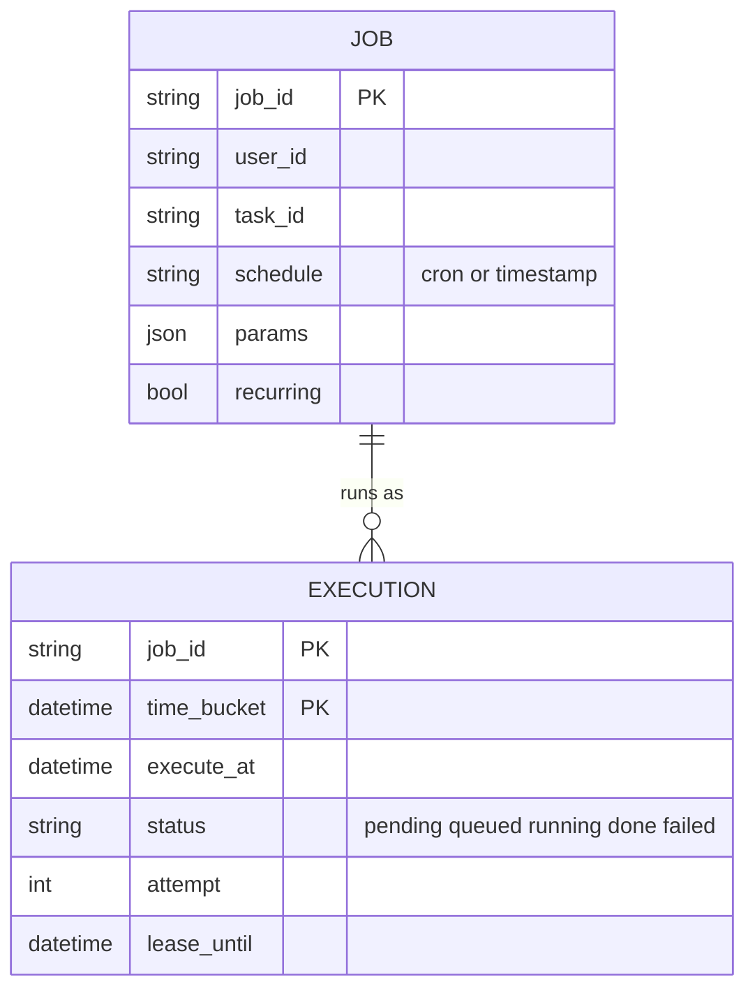
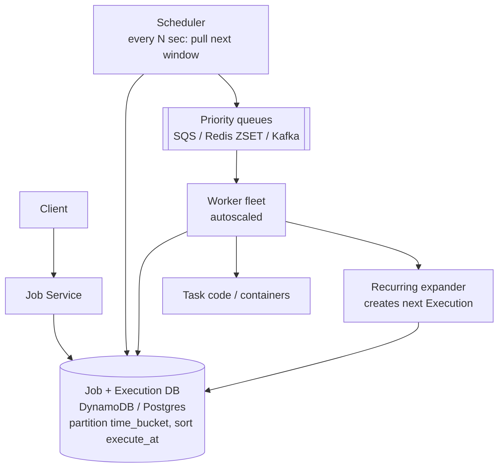
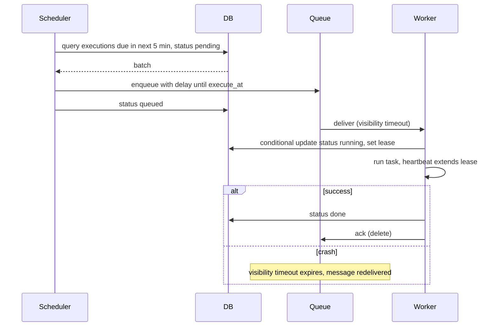

# Designing a Job Scheduler (Distributed Task Scheduler)

> Interview-ready walkthrough: requirements → estimates → entities → API → HLD → deep dives (**scheduling at scale, finding due jobs, at-least-once execution, retries and idempotency, long-running jobs, exactly-once effects**) → trade-offs. The hard part is **reliably executing every job on time, once in effect**, despite worker crashes.

---

## 0. Talk track

1. Clarify: one-time and recurring (cron) jobs, immediate or future, status tracking, retries. 10K jobs/s.
2. Insight: separate **scheduling (when)** from **execution (run)**; durable store + queue.
3. Deep dives: efficient due-job lookup, queueing with visibility timeouts, at-least-once and idempotency, scale.

---

## 1. Problem

Users submit tasks to run **now, later, or on a schedule**; the system executes them reliably and reports status.

**What makes it hard**
- **Time accuracy** at scale (millions of pending jobs).
- Workers crash mid-job: **no lost jobs**, avoid **duplicates**.
- Retries, priority, long-running jobs, bursts at popular times (midnight).

---

## 2. Requirements

### Functional
- Schedule jobs: **immediate, one-time at a future time, recurring (cron)**.
- Monitor job status.

**Out of scope:** UI, job dependencies/DAGs (mention), rich workflow.

### Non-functional
- **High availability** (don't lose jobs).
- **Scale**: 10K jobs/s, up to 10M+ scheduled.
- **At-least-once** execution; **under 2 s** execution delay from due time.
- Jobs may run up to 2 hours.

---

## 3. Estimation

| Quantity | Assumption | Result |
|---|---|---|
| Throughput | 10K executions/s | workers: avg 5 s job gives **50K concurrent** |
| Pending | 10M jobs, 1 KB | **10 GB** metadata: fits a sharded DB, hot window in memory |
| Midnight burst | 10x | queue buffering essential |

---

## 4. Entities



`Job` is the definition; `Execution` is each occurrence (due time, status, attempts).

---

## 5. API

```http
POST /jobs   { "task_id":"send_report", "schedule":"0 0 * * *", "parameters":{...} }  -> 201 { job_id }
GET  /jobs?user_id=...&status=...&cursor=...
GET  /jobs/{id}                 -> definition + execution history
DELETE /jobs/{id}               # cancel future runs
```

---

## 6. Architecture



---

## 7. Flow



---

## 8. Deep dive 1: finding due jobs efficiently

| Approach | Verdict | Why |
|---|---|---|
| Poll `WHERE execute_at <= now` over a full table | Bad | Full scans, hot index |
| Index on `execute_at` + cron every second | Good | Better; still contention and hot partition at "now" |
| **Time-bucketed table**: partition key = `execute_at` truncated to hour, sort key = `execute_at` | Great | Scheduler reads only upcoming bucket(s); writes spread across future buckets |
| **Two-tier**: DB poll every few minutes pulls near-future jobs into **delay queue / Redis ZSET** | Great | Exact timing without per-second DB polling |

Scheduler instances each own bucket ranges (consistent hashing or leader election) to avoid duplicate enqueue; duplicates are harmless if workers claim with a conditional update.

**One-liner:** *DB holds the far future, a queue holds the near future.*

## 9. Deep dive 2: at-least-once with leases

- **Visibility timeout** (SQS) or **lease** field: a job is claimed by a worker; if the lease expires without completion, it is redelivered.
- Worker **heartbeats** extend the lease for long jobs (up to 2 h).
- Claim via **conditional write** (`status=queued AND lease_until<now`) to prevent two workers running one execution.
- Max attempts, **exponential backoff with jitter**, then DLQ and `failed` status.

## 10. Deep dive 3: idempotency (effectively exactly-once)

Execution can occur twice (lease expiry while slow, crash after side effect before ack). Therefore tasks must be **idempotent**: pass `execution_id` as an idempotency key to downstream calls; use transactional outbox/dedup tables. Be explicit: the scheduler guarantees **at-least-once**; the **task** provides idempotency.

## 11. Deep dive 4: recurring jobs and scale

- Recurring: on completion (or creation), compute the next fire time and insert the next `Execution`; avoids pre-materializing years.
- **Scale**: DB partitioned by time bucket and `job_id`; queues sharded by priority; worker autoscaling on queue depth; smoothing for midnight bursts by adding **jitter** to user cron times where acceptable.
- **Priority**: separate queues/weights so urgent jobs bypass backlog; isolate tenants (per-tenant concurrency limits) to prevent noisy neighbors.

---

## 12. Failure handling

| Failure | Mitigation |
|---|---|
| Worker crash | Lease expires, redelivery |
| Scheduler crash | Another instance takes its buckets; re-enqueue safe (claims are conditional) |
| Queue outage | Jobs remain in DB `pending`; scheduler retries enqueue |
| DB failover | Multi-AZ; jobs not lost since durable first |
| Poison job | Attempt cap, DLQ, alerts |
| Clock skew | Use server-side time, NTP, tolerate small drift |

---

## 13. Trade-offs

| Decision | Chosen | Alternative | Given up |
|---|---|---|---|
| Delivery | At-least-once | Exactly-once | Task idempotency burden |
| Store + queue | DB + delay queue | DB only | Extra component |
| Granularity | Seconds | Millisecond-accurate | Cost/complexity |
| Cron expansion | Next occurrence only | Pre-expand | Slightly more write-on-complete logic |
| Claiming | Conditional write | Distributed lock | Needs DB support (cheap) |

---

## 14. Level expectations

- **Mid:** jobs table, poll for due, workers, status.
- **Senior:** time-bucketed index, queue + visibility timeout, retries, idempotency, autoscale.
- **Staff+:** two-tier scheduling, tenant isolation, priority, long-job leases, burst smoothing, observability (lag, late-start SLO).

## 15. Follow-ups

Job DAG dependencies, rate-limited jobs, cancellation/pause, multi-region scheduling, timezone/DST handling for cron.

## 16. Summary checklist

- [ ] Definition vs execution tables, time-bucket partitioning
- [ ] Near-future jobs in a delay queue/ZSET
- [ ] Conditional-claim, lease, heartbeat, DLQ
- [ ] At-least-once plus idempotent tasks
- [ ] Autoscale by queue depth, tenant limits
