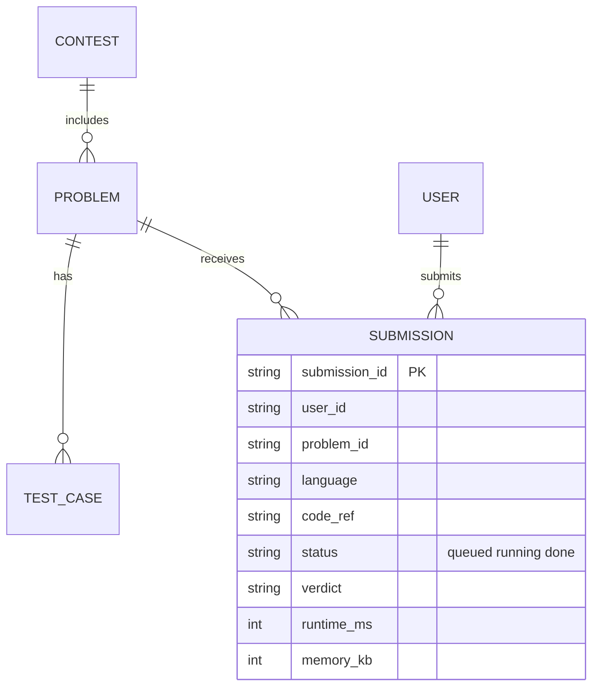
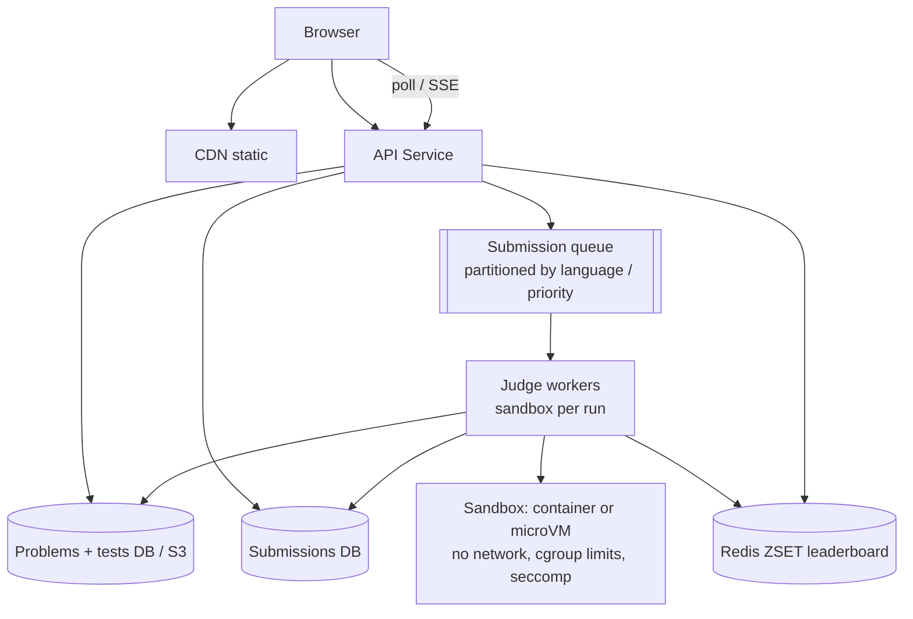
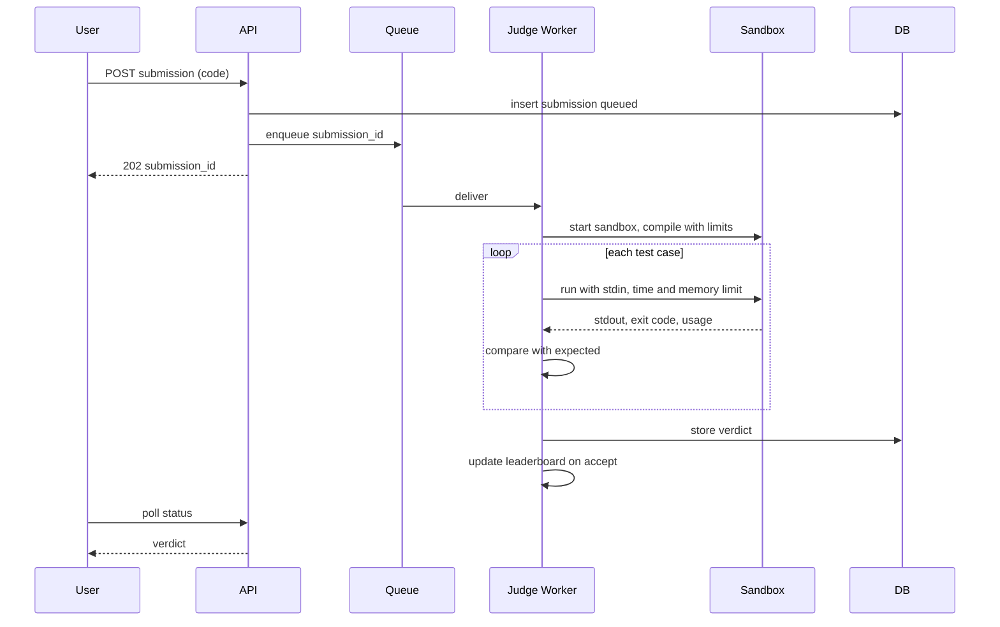

# Designing LeetCode (Online Coding Judge)

> Interview-ready walkthrough: requirements → estimates → entities → API → HLD → deep dives (**secure sandboxed code execution, async judging queue, scaling for contests, leaderboard, isolation and resource limits**) → trade-offs. The hard parts are **running untrusted code safely** and **bursty contest load**.

---

## 0. Talk track

1. Clarify: list problems, view a problem + editor, submit code, get a verdict, contest leaderboard.
2. Focus: execution safety and throughput; reads are easy.
3. HLD: API, problem store, submission queue, sandboxed workers, results.
4. Deep dives: isolation (containers, gVisor/Firecracker), async pipeline, contest scale, leaderboard.

---

## 1. Problem

Users solve coding problems online: write code, **run it against hidden tests**, and get **verdicts** (accepted, wrong answer, TLE, MLE, runtime error), with live **contest leaderboards**.

**What makes it hard**
- Executing **arbitrary untrusted code** (fork bombs, file/network access, infinite loops).
- Fast feedback (a few seconds) under bursty contest load (10K+ users submitting at once).
- Fair, consistent ranking.

---

## 2. Requirements

### Functional
- View a problem list and individual problems.
- Write code in multiple languages and **submit**.
- Receive results (verdict, runtime, memory).
- View a **leaderboard** for live contests.

**Out of scope:** user accounts/auth details, discussion forums, plagiarism checks, custom judges.

### Non-functional
- **Security and isolation** of user code.
- **Availability** for reads; correctness and fairness for contest scoring.
- **Execution latency**: under about 5 s typical.
- Scale: **100K concurrent contest users**, 10K submissions/min at peak.

---

## 3. Estimation

| Quantity | Assumption | Result |
|---|---|---|
| Contest users | 100K | |
| Submissions | each about 5 in 2 h | **500K / 2 h**, bursts about 100/s to 1K/s |
| Run time | about 2-5 s CPU each x multiple tests | 1K/s x 3 s = **3K concurrent sandboxes** |
| Problem data | tens of thousands | small, cache everything |

Workload is **CPU-bound and bursty**, so use a **queue** plus **autoscaled worker pool**.

---

## 4. Entities



---

## 5. API

```http
GET  /problems?page=&tag=              -> list
GET  /problems/{id}                    -> statement, starter code per language
POST /problems/{id}/submissions        { language, code }  -> 202 { submission_id }
GET  /submissions/{id}                 -> { status, verdict, runtime, memory }   # poll (or WebSocket/SSE)
GET  /contests/{id}/leaderboard?cursor= -> ranked users
```

---

## 6. Architecture



---

## 7. Flow



---

## 8. Deep dive 1: safe execution

| Approach | Verdict | Why |
|---|---|---|
| Run on the app server | Bad | Full compromise |
| Plain Docker containers | Good | Namespaces + cgroups, but shared kernel risk |
| **Hardened containers** (seccomp, no network, read-only FS, non-root, cgroup CPU/mem/pids limits, timeouts) | Great | Practical default |
| **gVisor / Firecracker microVM** | Great for hostile workloads | Stronger isolation, small overhead |

Rules: no network, read-only root FS, small tmpfs, **memory cap**, **CPU time cap** plus wall-clock timeout (kill), **PID limit** (fork bombs), output size cap, drop capabilities. Fresh sandbox per submission (or reuse warm pool but reset), and **never trust the run result** inside the sandbox process.

**One-liner:** *Assume the code is hostile: no network, hard resource caps, fresh microVM/container, kill on timeout.*

## 9. Deep dive 2: async pipeline

Submission is **accepted immediately** (202), judged in the background. **Queue** (SQS/Kafka/Redis) gives buffering during bursts, retries on worker crash (visibility timeout), and priority lanes (contest over practice). Autoscale workers on queue depth; **warm pools** reduce cold start. Results via polling (simple), or SSE/WebSocket push. Idempotent by `submission_id`.

## 10. Deep dive 3: contest scale

- Pre-scale workers before the contest start; separate **contest worker pool** from practice.
- Cache problem statements/tests at workers; static content on CDN.
- Per-user submission **rate limits**; per-language queues; shed low-priority load.
- Hidden tests stored in S3, pulled and cached on workers.

## 11. Deep dive 4: leaderboard

Redis **sorted set** per contest: score = solved count and penalty time encoded into one number; `ZADD`/`ZREVRANGE` give rank in O(log n); `ZREVRANK` for a user's rank. Persist truth in the DB and rebuild on failure. Cache top pages; poll every few seconds (no strict real-time need).

## 12. Fairness and correctness

Deterministic judge hardware (same instance class), time limits relative to reference solution, rerun on suspect timing, per-test result storage, and idempotent score updates keyed by `(user, problem)` first accepted.

---

## 13. Failure handling

| Failure | Mitigation |
|---|---|
| Worker crash | Message redelivered; submission re-judged |
| Sandbox escape attempt | Defense in depth (microVM), isolated worker network, no secrets on workers |
| Queue backlog | Autoscale, shed practice, show queue position |
| DB failure | Replicated; verdict writes retried (idempotent) |
| Redis loss | Rebuild leaderboard from submissions |

---

## 14. Trade-offs

| Decision | Chosen | Alternative | Given up |
|---|---|---|---|
| Isolation | Hardened containers / microVM | VMs per run | Startup cost vs security |
| Feedback | Async + poll | Sync request | Simplicity of immediate response |
| Workers | Warm pool | Cold start | Idle cost |
| Leaderboard | Redis ZSET | SQL ORDER BY | Rebuild logic |
| Queue | Priority lanes | Single FIFO | Config complexity |

---

## 15. Level expectations

- **Mid:** submit, run in container, store result, simple queue.
- **Senior:** isolation details, queue plus autoscaling, leaderboard with Redis, rate limits.
- **Staff+:** microVMs, contest pre-scaling, fairness/determinism, abuse and cost, observability.

## 16. Follow-ups

Plagiarism detection, custom checkers/interactive problems, multi-language toolchains, code snapshots, run-against-samples fast path.

## 17. Summary checklist

- [ ] 202 + queue + autoscaled judge workers
- [ ] Sandbox: no network, cgroups, seccomp, timeouts, pid caps
- [ ] Idempotent verdict writes, retry on worker death
- [ ] Redis ZSET leaderboard
- [ ] Contest pool pre-scaled, rate limits
