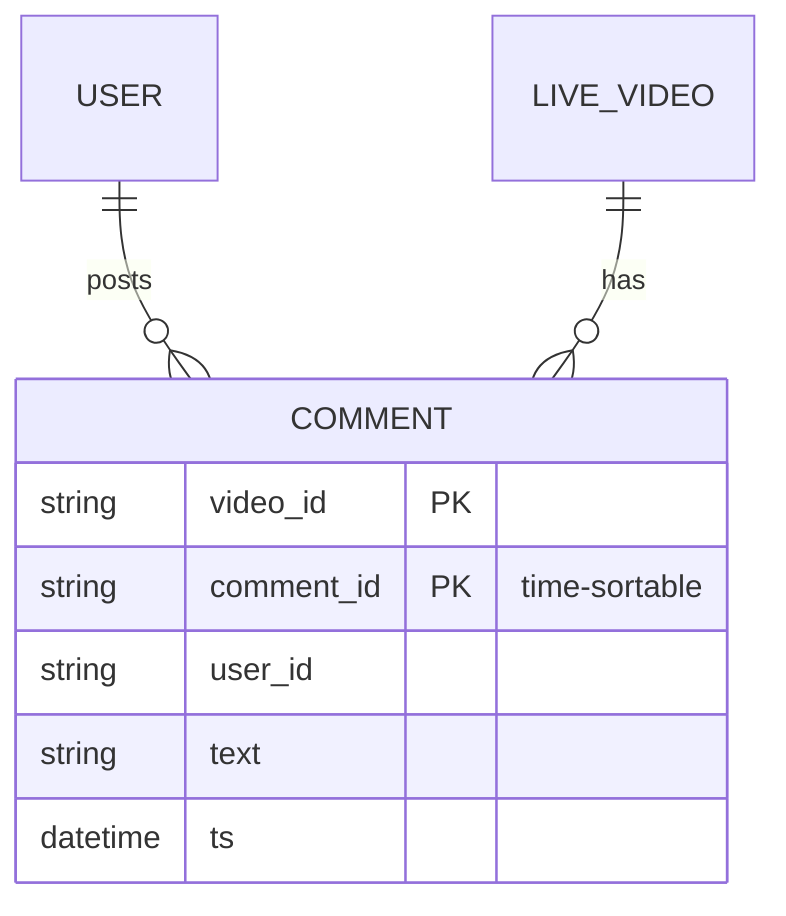
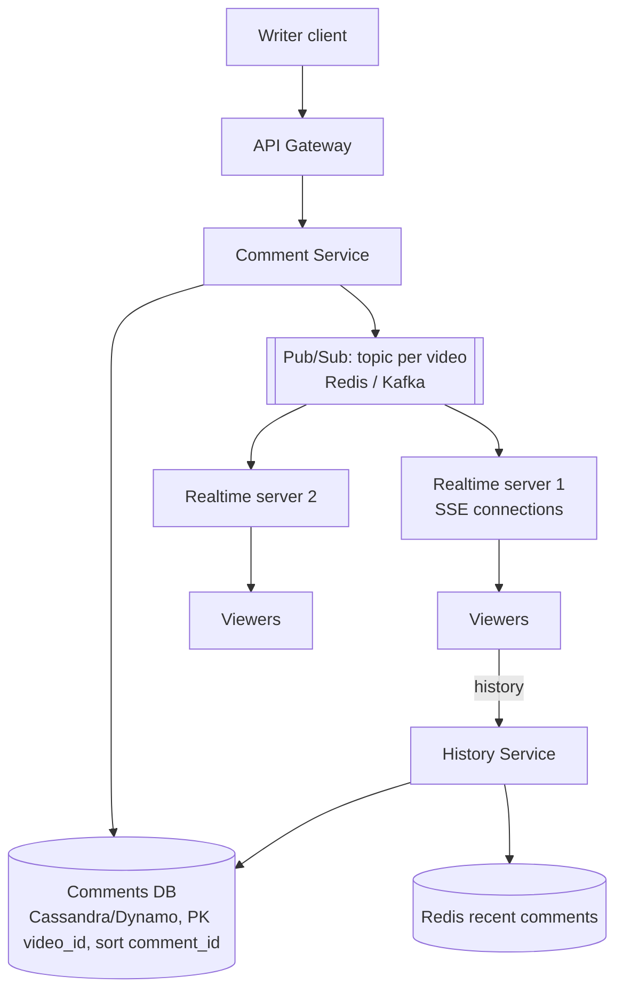
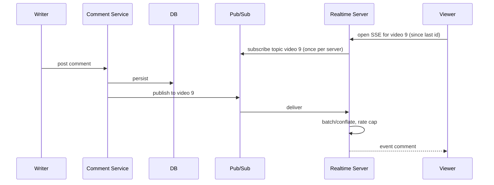

# Designing Facebook Live Comments

> Interview-ready walkthrough: requirements → estimates → entities → API → HLD → deep dives (**real-time delivery to millions of viewers, SSE vs WebSocket, pub/sub fan-out, hot streams, ordering/pagination, rate limiting**) → trade-offs. The hard part is **broadcasting a firehose of comments to millions of concurrent viewers of one stream**.

---

## 0. Talk track

1. Clarify: post comments on a live video, **viewers see new comments in real time**, scroll back history; scale 1M+ viewers on a stream.
2. Note: one-to-many broadcast; **availability over consistency**, eventual ordering fine.
3. Deep dives: transport (polling vs SSE vs WebSocket), pub/sub fan-out tiers, hot stream scaling, storage/pagination, moderation/rate limits.

---

## 1. Problem

Viewers watching a live video post comments and see **other viewers' comments appear within a second**.

**What makes it hard**
- A single popular stream has **millions of watchers** and thousands of comments/s.
- Each comment must be broadcast to every watcher of that stream.
- Late joiners need **recent history**; scrolling needs pagination.

---

## 2. Requirements

### Functional
- Viewers **post comments** on a live video.
- Viewers see **new comments in real time**.
- Viewers can **view older comments** (scroll back).

**Out of scope:** reactions, replies/threading, moderation tools, video delivery.

### Non-functional
- **Scale**: millions of concurrent viewers across thousands of live streams; hot streams with 1M+.
- **Low latency** (under 200 ms-1 s).
- **Availability over consistency** (a viewer may miss a comment briefly; eventual order OK).
- Cost-efficient connections.

---

## 3. Estimation

| Quantity | Assumption | Result |
|---|---|---|
| Concurrent viewers | 10M across platform | 10M connections |
| Hot stream | 1M viewers, 1K comments/s | naive fan-out = 1M x 1K = **1B deliveries/s**, infeasible, so **sample and rate-limit** what each viewer receives |
| Displayed rate | cap about 5-20 comments/s per viewer | 1M x 20 = **20M msgs/s** for the hottest stream |
| Comment | 200 B | storage modest: 1K/s x 200 B = 200 KB/s |
| Connections/server | 100K | **100 servers** for 10M |

Consequence: human readability bounds useful rate (nobody reads 1K/s): **sampling/conflation is a feature**. The cost center is **outbound fan-out**.

---

## 4. Entities



---

## 5. API

```http
POST /videos/{id}/comments   { "text":"hi" }                            -> 201 { comment_id }
GET  /videos/{id}/comments?before=<comment_id>&limit=50                 -> history (cursor pagination)
SSE  /videos/{id}/comments/stream?since=<comment_id>                    -> live new comments (server push)
```

Cursor on a **time-sortable id** (Snowflake/ULID) enables history and `since` catch-up on reconnect.

---

## 6. Architecture



---

## 7. Flow



---

## 8. Deep dive 1: transport

| Approach | Verdict | Why |
|---|---|---|
| **Polling** every N s | Good for small | Simple; load = viewers/N req/s; 1M viewers means 200K+ rps and delay |
| **Long polling** | OK | Fewer empties, still connection churn |
| **SSE** (server push over HTTP) | Great | One-way fits comments; auto-reconnect with `Last-Event-ID`; works through proxies/HTTP2 |
| **WebSocket** | Great | Bidirectional; needed if viewers send over the same socket; heavier infra |

Posting uses normal HTTP POST; viewing uses SSE. WebSocket is not required since reads dominate and are one-way.

**One-liner:** *SSE for server-to-viewer broadcast, plain POST for writes.*

## 9. Deep dive 2: fan-out architecture

Naive: comment service pushes to every viewer: too many connections for one box. Use **tiers**:
1. Comment Service publishes **once** to the video's topic.
2. Each **realtime server** subscribes to topics for videos its viewers watch (one subscription per server per video, not per viewer).
3. Realtime server fans out locally to its connected viewers (in-memory map `video_id to connections`).

Cost: publish = O(servers hosting watchers), local delivery = O(viewers/server). **Viewers of one video are spread across servers** by load balancing; or **co-locate by video_id** (consistent hashing) to reduce subscriptions but risk hot servers. For hottest videos, use hierarchical pub/sub (regional relays) so a publish crosses the network few times.

## 10. Deep dive 3: scaling a hot stream

- **Sample/conflate**: each realtime server sends at most N comments/s per viewer (e.g. newest or random sample); drop the rest (humans can't read more).
- **Batch** sends every 100-250 ms (fewer syscalls, packets).
- **Shard the topic** (video#0..K-1) when the pub/sub itself is hot; servers subscribe to their shard.
- **Admission/rate limits** on posters (per-user, per-video) and spam filters before publish.
- Autoscale realtime tier by connection count; **graceful reconnect** with jitter.

## 11. Deep dive 4: history and catch-up

Store comments in a wide-column store keyed `(video_id, comment_id)` so range scans return newest-first quickly. Keep the **latest N** per live video in Redis for fast initial load. On SSE reconnect, `since=<last id>` queries the missing tail (bounded) then resumes live. Ordering: time-sortable ids; minor cross-server reorder is acceptable (eventual).

## 12. Deep dive 5: moderation and abuse

Rate limit per user/video, profanity/spam filters (sync lightweight, async heavier ML), shadow-ban, delete events published to topic so clients remove the comment.

---

## 13. Failure handling

| Failure | Mitigation |
|---|---|
| Realtime server dies | Clients reconnect (SSE auto), `Last-Event-ID` catch-up |
| Pub/sub node down | Replicated/sharded; clients degrade to polling history |
| DB slow | Publish does not wait for DB for display (or minimal durable buffer), eventual persistence |
| Reconnect storm | Jitter, connection rate limits, staged rollouts |
| Spam flood | Rate limits, circuit breaker on stream |

---

## 14. Trade-offs

| Decision | Chosen | Alternative | Given up |
|---|---|---|---|
| Transport | SSE | WebSocket | Bidirectional on same channel |
| Delivery | Sampled/conflated | Every comment | Completeness (users can't read it anyway) |
| Fan-out | Topic per video + server-local | Per-viewer push from service | Pub/sub dependency |
| Consistency | Eventual | Strong order | Minor reordering |
| Storage | Wide-column | SQL | Ad hoc queries |

---

## 15. Level expectations

- **Mid:** post and poll, DB table, pagination.
- **Senior:** SSE/WebSocket choice, pub/sub, server-local fan-out, history and catch-up.
- **Staff+:** hot-stream math and conflation, hierarchical fan-out, shard hot topics, reconnect storms, moderation pipeline.

## 16. Follow-ups

Reactions (counters with sharding), pinned comments, replies, language translation, geo-restricted comments.

## 17. Summary checklist

- [ ] POST write, SSE read
- [ ] Per-video pub/sub, per-server subscription, local fan-out
- [ ] Rate cap and sampling for hot streams
- [ ] Time-sortable ids, since-cursor catch-up, Redis recent cache
- [ ] Spam/rate limits, jittered reconnects
