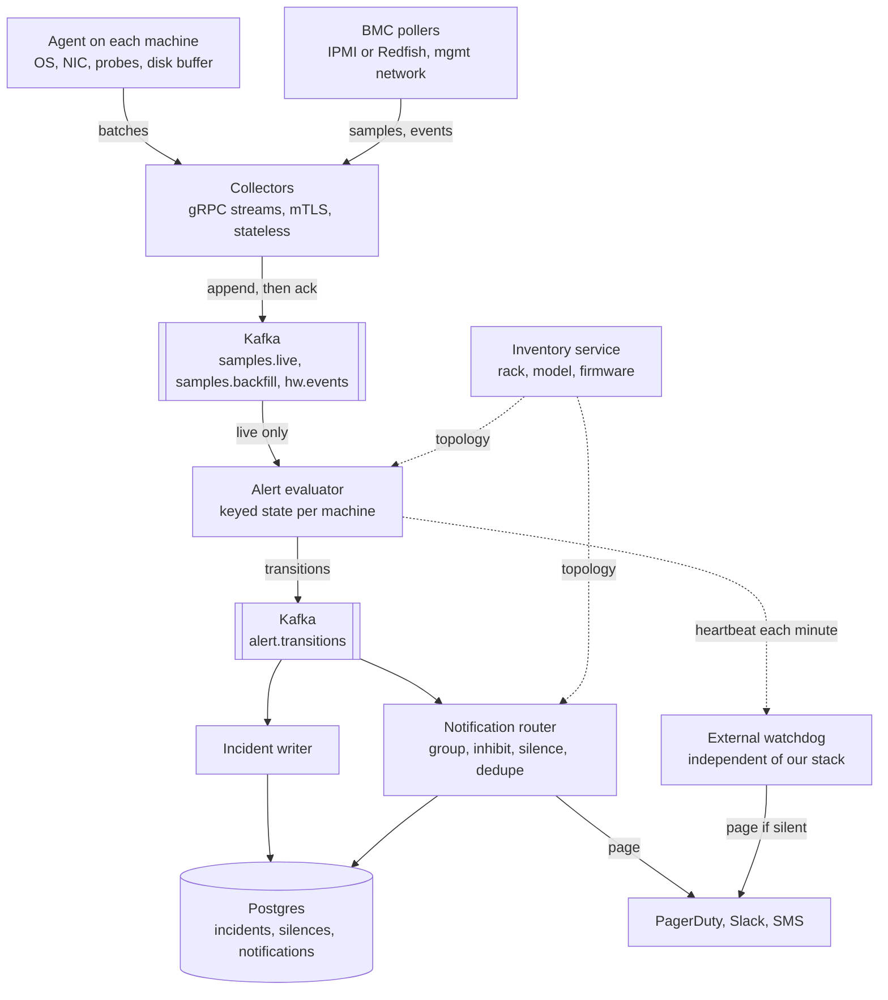
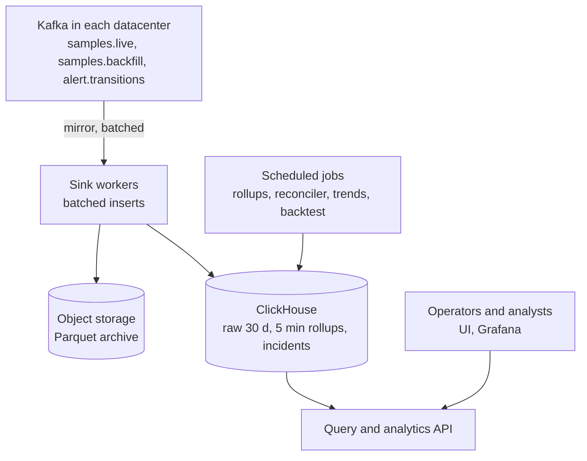
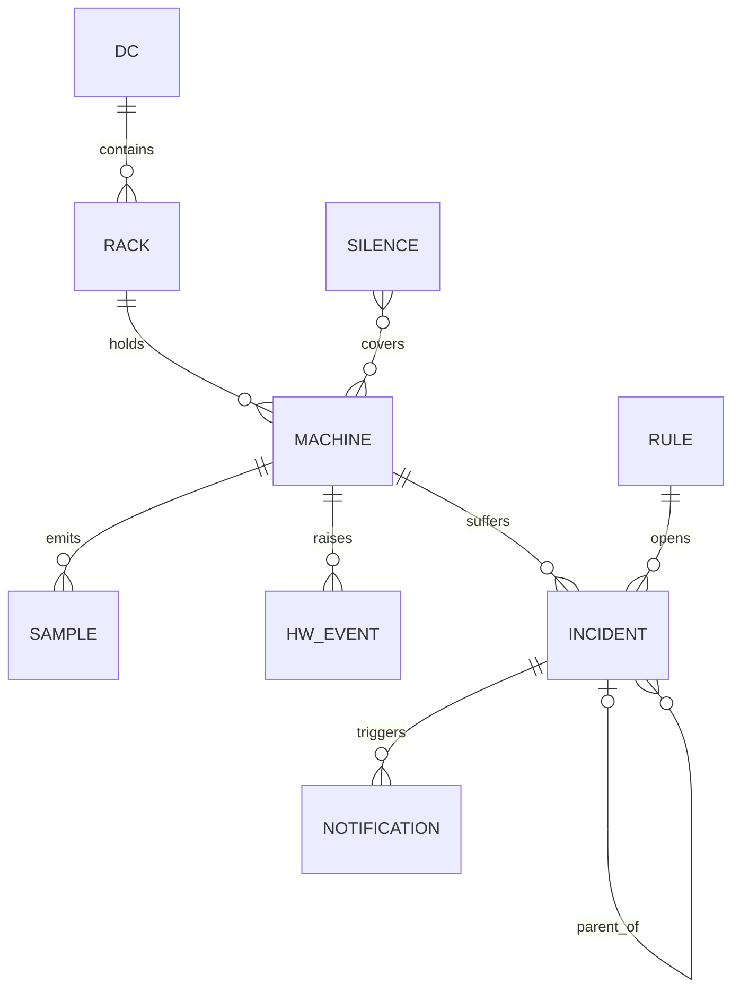
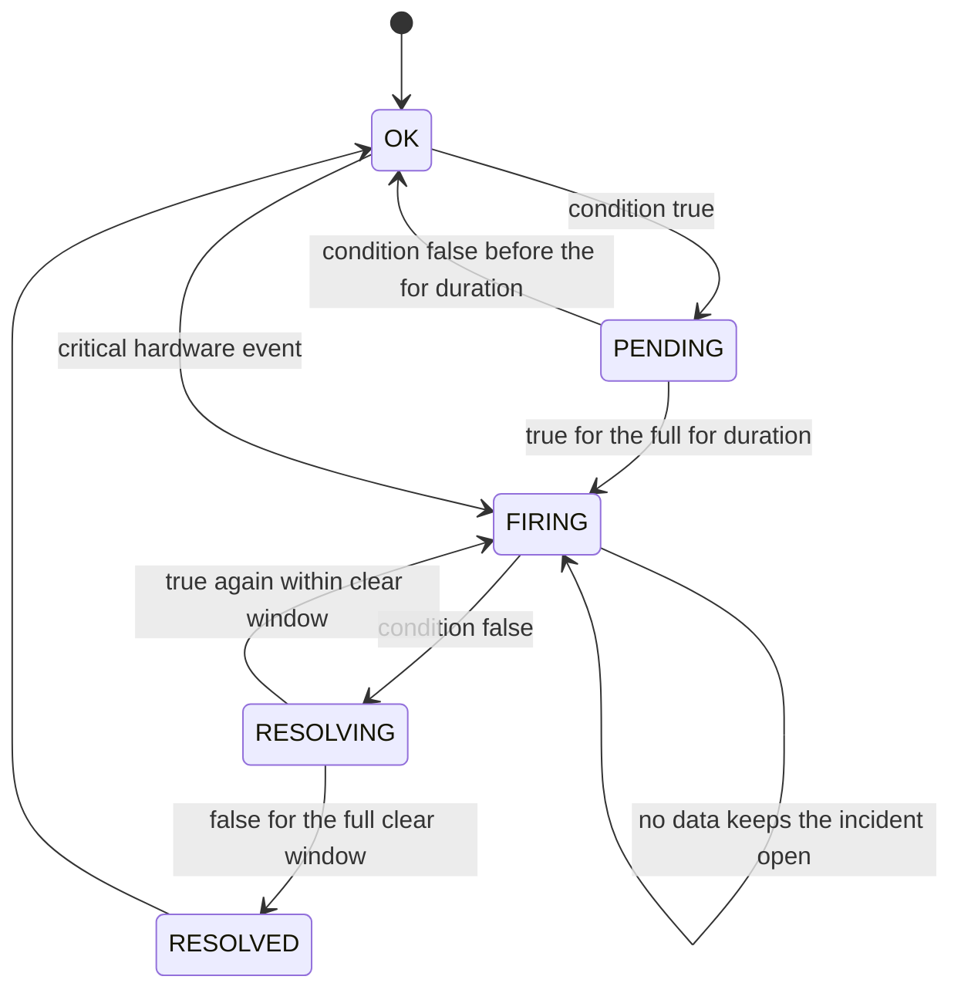
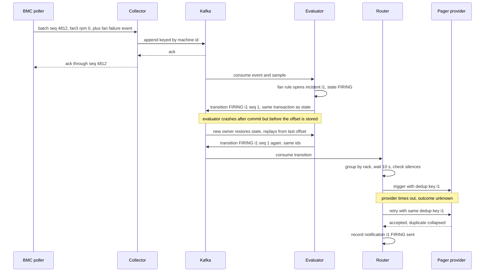
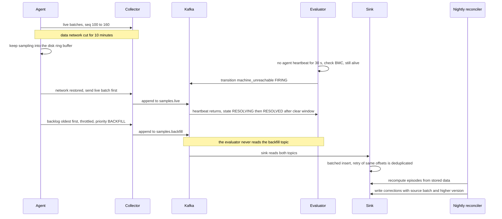

# Designing a Machine Health Monitoring and Alerting System (10,000 Machines)

> Follows the six-step delivery framework: requirements, core entities and API, [optional] data flow, high-level design (built one requirement at a time, v1 then iterate), then deep dives driven by the non-functional requirements. Every number is an assumption and each one ends in a design decision.

> The key observation: this is **not a big-data problem, it is a trust problem**. 100K samples/s is small, so raw scale is never the hard part. The hard parts are (1) alerting on **state, not samples** (no flapping, no pager storms), (2) knowing when **the monitor itself is blind**, because a dead machine and a broken pipeline both look like silence, and (3) turning noisy samples into durable **incident episodes** (start, end, duration) so "which errors last longest" and "is it getting worse" become cheap SQL instead of archaeology in raw time series.

| Framework step | Time | Section |
|---|---|---|
| Functional (top 3) and non-functional (top 3-5) requirements | ~5 min | 1 |
| Estimation, only where it changes a decision | as needed | 2 |
| Core entities, then API per functional requirement | ~7 min | 3 |
| [Optional] data flow and high-level design, one requirement at a time | ~15 min | 4 |
| Deep dives driven by the non-functional requirements | ~15 min | 5 |
| Bottlenecks, failures, wrap-up | ~5-7 min | 6 |

---

## 1. Clarify the Requirements

### Opening (30 seconds)

"We have 10,000 machines. Four kinds of trouble matter: **network issues, over-temperature, failing fans, and a machine simply going dark**. There are two outputs. First, a fast and trustworthy **alert**, for example 'fan 3 on machine m-1712 failed'. Second, **durable history**, so we can analyze which problems last longest and how they trend over months. Let me confirm scope and scale before I draw anything."

**Clarifying questions I would ask** (assumed answers in parentheses):
1. Where are the machines and what access do we have? (3 datacenters, ~3,300 machines each, 40 per rack. Every machine has a BMC on a separate management network, and we can install an agent on the OS.)
2. What counts as a "problem"? (Hardware and network: over-temp, fan, network, unreachable. PSU, disk SMART, and OS metrics use the same machinery and are added as rules.)
3. How fast must a page arrive? (Critical hardware fault under 60 s. Warnings in minutes.)
4. Who gets the alert? (Existing on-call tooling such as PagerDuty plus Slack. We integrate, we do not build on-call schedules or escalation.)
5. What analysis? (Weekly and ad hoc: incident duration by type, frequency, and trends by rack, model, firmware. Minutes to hours of staleness is fine.)
6. Do we auto-remediate (drain, reboot)? (No. Alert only, but we publish an event stream others can consume.)
7. What if a machine goes silent? (That is itself an alert. Silence is never treated as "healthy".)

### Functional Requirements (top 3)

1. **Operators are alerted promptly, and once,** when a machine has a problem (network issue, over-temperature, fan failure, unreachable). Alerts are deduplicated, grouped, carry a severity, and send a resolve notification.
2. **The system persists all health data and a record of every problem** (an *incident* with start, end, and duration), so any machine's current state and history can be viewed.
3. **Analysts can analyze history:** which error types last longest, how often each occurs, and how incident rates trend over weeks and months by rack, model, and firmware.

### Non-Functional Requirements (quantified)

| # | Requirement | Target |
|---|---|---|
| 1 | **Alert latency** | Critical hardware fault (fan failed, over-temp critical) p99 < 60 s from first bad sample to notification. Machine unreachable p99 < 90 s. Warnings take minutes by design |
| 2 | **Alert quality** | One page per problem, not per sample. A flapping sensor or a rack-wide failure never produces a page storm. Missing data never marks a problem resolved |
| 3 | **Availability: monitor must outlive the monitored** | Alert path 99.95%, isolated per datacenter, and **never fail silent**: if the pipeline is down, an independent watchdog pages within 5 min |
| 4 | **Durability** | Alert transitions and incidents RPO ~0. Raw samples kept 30 d, 5-min rollups 2 years, incidents forever. Network outages up to 24 h lose no data (agent buffers) |
| 5 | **Consistency** | Per-machine incident state is strongly consistent (single writer). Analytics eventual, staleness under 5 min |
| 6 | **Security** | Machine identity comes from a per-machine certificate, never from the payload. Read-only BMC credentials in a vault. RBAC and audit on silences and rule changes |

### Scope

- **In scope:** the six items above, for hardware and network health of 10,000 machines in 3 datacenters.
- **Out of scope:** on-call scheduling and escalation (PagerDuty), auto-remediation, log and trace collection, application-level SLO monitoring, ML anomaly detection beyond a simple trend job.
- **What shapes the architecture most:** (a) **alert correctness under noise and failure** (state machine, grouping, never-silent), (b) **telling "machine dead" from "monitor blind"**, (c) **modeling incidents as episodes** so analysis is easy.

> **Say this out loud:** "Throughput is easy at this scale, so I'll spend my time on alert correctness and on the incident model that feeds the analysis. I'll design the alert path first because a missed or noisy alert is the costliest failure, then persistence, then analytics. Tell me if you'd rather flip that order."

---

## 2. Estimation & Scale (Read vs. Write Heavy)

I will only keep numbers that decide something.

### Traffic

| Quantity | Calculation | Result | Design consequence |
|---|---|---|---|
| Series | 10K machines x ~100 (8 fans RPM and PWM, ~15 temps, 4 NIC ports x ~10 counters, probes, PSU, SMART, CPU and memory) | **~1M series** | Too many for per-series alert objects. Rules apply per machine and class |
| Sample rate | 1M series / 10 s | **~100K samples/s** | Well within one modest Kafka cluster or one TSDB node. **Partitioning is for failure isolation and parallelism, not throughput** |
| Batches | 10K machines x 1 batch / 10 s | ~1K batches/s | One gRPC stream per machine (10K long-lived connections). A few collectors per datacenter |
| Wire size | ~1.2 KB per machine per interval, protobuf | ~1.2 MB/s, ~100 GB/day | Trivial network. Kafka 3-day retention is ~300 GB after RF3 per datacenter at lz4 |
| Evaluator state | ~50 rule instances x 10K machines x ~100 B | **~50 MB total** | **Fits in memory on one process.** Partition by machine for HA and parallelism, no external state database needed at runtime |
| BMC polling | ~830 BMCs per poller, 64 concurrent, ~0.5 s per read | ~6 s per 10 s cycle | **BMC polling is the real capacity limit** (BMC chips are weak). Cap concurrency, add pollers per rack group |
| Incidents | ~0.5 per machine per day after flap collapsing | **~5K/day, ~1.8M/year** | ~300 B each is ~0.5 GB/year. Keep forever. Postgres alone could serve analytics, ClickHouse copy is for joins with metrics |
| Notifications | ~5K/day average | ~0.06/s | Delivery volume is trivial. The risk is **storms**: a rack power loss is 40 machines x ~4 alerts = ~160 transitions in seconds, a datacenter event is ~13K. Grouping is mandatory |

### Storage and Bandwidth

| Quantity | Calculation | Result | Design consequence |
|---|---|---|---|
| Raw samples | 100K/s x 86,400 = 8.6B points/day x ~2.5 B compressed (delta-of-delta timestamps, XOR floats) | **~22 GB/day**, 30 d is ~650 GB, ~1.3 TB with RF2 | One shard with replicas is enough. No sharding until ~10x |
| 5-min rollups | 1M series x 288 buckets = 288M rows/day x ~12 B | ~3.5 GB/day, **~1.3 TB/year**, 2 years x RF2 ~5 TB | Keep raw 30 d and rollups 2 years. A 1-min rollup tier is not worth its ~14 GB/day |
| Agent buffer | 8,640 batches/day x ~1.2 KB | **~10 MB per machine per day** | A 24 h disk ring buffer is trivial. Network outages lose nothing |
| Backfill storm | 10K agents x 1 h backlog (360 batches) = 3.6M batches | At a 10K batches/s cap, **~6 min to drain** | Backfill must run on a throttled, **separate topic** so it can never delay live alerting |
| Probes | 10K machines x 3 targets / 10 s | ~3K probes/s | Cheap. Peer probing gives a second vantage point for network problems |

### Read vs. Write Heavy

- **Writes dominate by far:** ~100K rows/s in versus a handful of operator and analyst queries. Roughly 1000:1 by rows. The ratio says **buffer and batch writes** (Kafka, batched inserts) and **pre-aggregate for reads** (rollups).
- **Reads are skewed:** operators look at "what is firing now" and the last few hours of a few machines. Analysts run rare, wide scans over incidents. Different shapes, so different tables, not one cache.
- **Skew and bursts:** per-machine load is uniform (no hot key). The real burst is the **reconnect backfill** after a network outage and the **mass reboot** after a power event. Both are handled by throttling and a separate backfill topic.

---

## 3. Core Entities & APIs

### 3.1 Core Entities (first draft)

- **Machine, Rack, Datacenter:** the inventory, with model and firmware. Used for grouping and cohort analysis.
- **Metric and Sample:** a named reading (fan RPM, CPU temp) with a timestamp and value.
- **Hardware Event:** a discrete message from the BMC system event log, such as "fan 3 failed".
- **Alert Rule:** a versioned condition, `for` duration, clear duration, and severity.
- **Incident:** one **episode** of a problem on one machine, with start, end, and duration. The central derived entity.
- **Notification:** a page or message sent about an incident transition.
- **Silence (maintenance window):** a time-boxed suppression with a reason and owner.
- **Incident Link:** parent and child relation (a rack power loss and its 40 machine incidents).

Fields and relationships are fleshed out in 4.3.

### 3.2 APIs

Two very different interfaces. **gRPC streaming** for agent ingest (high rate, long-lived, bidirectional ack). **REST** for operators and analysts. The current identity always comes from the credential (client certificate or user token), never from the body.

**Requirement 1 and 2: ingest and alerts**

```protobuf
service Ingest {
  rpc Report(stream SampleBatch) returns (stream BatchAck);   // agents and BMC pollers
  rpc ReportEvents(EventBatch)   returns (EventAck);          // fast lane, sent immediately
}
message SampleBatch {
  string source      = 1;   // "agent" or "bmc"
  uint64 batch_seq   = 2;   // monotonic per (machine, source), persisted on disk
  int64  sent_at_ms  = 3;
  Priority priority  = 4;   // LIVE or BACKFILL
  repeated Sample samples = 5;   // {metric_id, ts_ms, value}
}
message BatchAck { uint64 acked_through_seq = 1; }
```

- `machine_id` is **not in the message**. The collector derives it from the mTLS certificate. A BMC poller is a service identity authorized for a set of racks, so it may name machines, and the collector checks each against the inventory.
- **`BatchAck` means durably appended to the replicated log** (Kafka `acks=all`), not processed and not alerted. The agent deletes its buffered batches only after the ack, so a lost ack means a resend, and duplicates are harmless by construction (Section 5.3).

```http
GET  /v1/incidents?state=firing&dc=dc1&alert_type=fan_failed&cursor=...   -> 200 { items[], next_cursor }
GET  /v1/machines/{id}/health                                             -> 200 { state, last_seen, open_incidents[], latest{} }
GET  /v1/machines/{id}/series?metric=fan_rpm&from=...&to=...&step=1m      -> 200 { points[], data_as_of }
POST /v1/incidents/{id}/ack        { "expected_version": 3 }              -> 200 | 409
POST /v1/silences                  Idempotency-Key: <uuid>
     { "machine_ids": ["m-1712"], "reason": "fan swap", "ends_at": "..." } -> 201 | 422 (TTL over 7 days)
PUT  /v1/rules/{id}                { "expected_version": 4, "expr": "...", "for_s": 20, "clear_for_s": 60 }
                                                                          -> 200 | 409 | 422 (backtest failed)
```

**Requirement 3: analysis**

```http
GET /v1/analytics/incident-durations?from=...&to=...&group_by=alert_type&percentiles=50,95,99&include_open=true
-> { "data_as_of": "...", "groups": [
     { "alert_type": "network_degraded", "count": 812, "p50_s": 240, "p95_s": 5400, "machine_hours": 310, "still_open": 7 } ] }

GET /v1/analytics/trends?metric=incident_rate&bucket=week&group_by=alert_type,firmware&normalize=per_1000_machines
```

- Silences require a reason and a **maximum TTL of 7 days**, so a forgotten silence cannot hide a real problem forever.
- Rule updates carry `expected_version` (optimistic concurrency) and are **rejected with 422 if the backtest** (Section 4.C) predicts an alert flood.
- Reads are paginated by cursor and carry `data_as_of` so analysts know how fresh the numbers are.
- Authorization: viewers read, operators ack and silence within their datacenter, rule admins change rules. Every mutation is audit-logged.

---

## 4. High-Level Design

### Data flow

1. An **agent** on each machine and a **BMC poller** per rack group sample sensors every 10 s. Critical BMC events (a fan failure log entry) are sent immediately.
2. Samples are batched and streamed to a **collector** in the same datacenter over mTLS. The collector validates and appends to **Kafka**, then acks.
3. The **alert evaluator** consumes the live stream, runs a per-machine state machine per rule, and emits **incident transitions** (PENDING, FIRING, RESOLVED).
4. A **notification router** groups, inhibits, silences, and sends pages. An **incident writer** upserts the incident record.
5. In parallel, **sink workers** write raw samples to the time-series store and archive to object storage.
6. **Scheduled jobs** compute rollups, reconcile incidents, and produce trend and risk reports for analysts.

### v1 and its flaws

**v1:** one central poller scrapes all 10,000 machines every 10 s, checks thresholds in-process, writes samples to one time-series database, and emails when a value crosses a line.

| Flaw | Why it breaks | Fixed in |
|---|---|---|
| Alert per sample over a threshold | A temp hovering at 85 C pages dozens of times. A rack loss pages hundreds of times | 4.A |
| "Machine did not answer the poll" equals "machine is down" | If the poller or its network is broken, 10,000 machines look dead. If the poller dies, nobody notices | 4.A, 6.2 |
| Single poller and single database | One failure loses both detection and history | 4.A, 4.B |
| Only samples are stored | The question "how long did this fan problem last?" needs episodes, which a sample series does not contain | 4.C |
| Retention is all-or-nothing | Raw samples for years is wasteful, and short retention loses the trend | 4.B |

### 4.A Requirement 1: Get alerted

**My first idea** is to evaluate thresholds at the collector and send each breach straight to the pager. Pro: trivial. Con: flapping, storms, no way to alert on *absence* of data, and no memory of what is already firing. **Next idea:** buy it, with Prometheus and Alertmanager, which already provide `for` durations, grouping, inhibition, and silences. Pro: proven, little code. Con: alerts are ephemeral (no durable episode record with start, end, and hardware metadata for Requirement 3), and our two special needs, a BMC fast lane and a mass-silence guard, would be bolted on. **Chosen:** a small **stateful evaluator** that owns the alert state machine and writes incidents as a first-class output. If the team already runs Prometheus, a defensible hybrid is to keep it for rule evaluation and add a webhook that writes incidents. I'll say so rather than rebuild for its own sake.

**Alert on state, not samples.** Each (machine, rule) pair runs a small state machine (drawn in 5.2): a condition must hold for the rule's `for` duration before it fires (**noise filter**), and must stay false for the `clear_for` duration before it resolves (**hysteresis against flapping**). A flapping sensor therefore produces **one incident with a flap count**, not twenty pages.

| Alert type | Condition per machine | for / clear | Severity |
|---|---|---|---|
| `over_temp_warning` | `cpu_temp_c >= 85` | 2 min / 5 min below 80 | warning |
| `over_temp_critical` | `cpu_temp_c >= 95` or CPU thermal-trip event | 20 s / 2 min below 85 | critical |
| `inlet_temp_high` | `inlet_temp_c >= 35` (usually a rack or cooling cause) | 5 min / 10 min | warning |
| `fan_failed` | `fan_rpm` under 20% of model nominal, or BMC "fan failure" event | 20 s / 1 min | critical |
| `fan_degraded` | `fan_rpm_ratio < 0.7`, where ratio is actual RPM over expected RPM for the commanded PWM duty | 5 min / 10 min | warning |
| `nic_errors` | rx/tx error plus drop rate at or above 1% | 2 min / 5 min | warning |
| `packet_loss` | probe loss to gateway or peers at or above 5% (20% for critical) | 1 min / 3 min | warning or critical |
| `link_flap` | 3 or more carrier changes in 5 min | windowed | warning |
| `machine_unreachable` | no heartbeat for 30 s | 30 s / 20 s of fresh data | critical |

- **Two data paths per machine.** The in-band **agent** reports OS and NIC counters, temps from the kernel, and peer probes. The out-of-band **BMC poller** (IPMI or Redfish over the management network) reports fan RPM, inlet and exhaust temperature, and PSU. The BMC keeps working when the OS is hung or the data network is down, which is exactly when we most need it.
- **Fast lane for critical events.** A BMC log entry such as "fan 3 failed" is sent immediately as an event and opens the incident without waiting for the `for` window. It resolves only when the metric rule confirms recovery.
- **Missing data never resolves anything.** If samples stop while an incident is FIRING, it stays FIRING.
- **Which problem is it?** A silent machine has several explanations. Combining vantage points avoids paging for the wrong thing:

| In-band agent | BMC | Peer probes | Conclusion | Alert |
|---|---|---|---|---|
| silent | alive, power on | fail | OS hang or data-plane network issue | `machine_unreachable` (network or OS) |
| silent | alive, power off | n/a | Powered off or crashed | `machine_down` |
| silent | silent | fail | Rack power or top-of-rack and management switch | `rack_unreachable`, one grouped page |
| many machines silent | many silent | n/a | **Our pipeline or the datacenter link is the problem** | `pipeline_degraded`, single page, per-machine pages suppressed |

- **Grouping and inhibition** (notification router): group by `(datacenter, rack, alert class)` with a short group wait (10 s for critical), so a rack failure is **one** page listing the machines. Inhibition rules suppress children when a parent is firing (a `rack_unreachable` hides its machines' unreachable and network alerts, and a `fan_failed` absorbs the `over_temp_*` that follows on the same machine). Suppressed incidents are **still persisted** with `suppressed_by`, so analytics keeps the full picture.
- **Routing:** critical to the pager, warning to Slack or a ticket. Escalation and schedules are the pager provider's job.

### 4.B Requirement 2: Persist the data

**First idea:** the collector writes straight into the time-series database. Pro: simple. Con: any database hiccup or deploy drops samples and blocks agents, and nothing else can consume the stream. **Iteration:** collectors append to **Kafka** first. The log decouples producers from consumers, gives **replay**, and lets the evaluator, the sink, and the archiver read independently. Kafka here is justified by decoupling and replay, not by throughput, which is tiny. A single central cluster would be simpler, but a wide-area cut would blind a whole datacenter, so each datacenter runs its **own small Kafka** and the alerting plane never crosses the WAN.

- **Hot store:** ClickHouse, 30 days raw, 5-minute rollups for 2 years. Chosen because we need SQL that **joins incidents with metrics** ("what was the fan ratio trend in the 7 days before each fan failure?"), strong compression for time series, and fast scans.
- **Cold store:** Parquet in object storage (the archive and the rebuild source).
- **Operational store:** Postgres per datacenter for silences, notification records, and open-incident state. Small, transactional, and not on the sample path.
- **Backfill topic:** reconnect backlog goes on `samples.backfill`, throttled, **read only by the sink**, never by the evaluator.

### 4.C Requirement 3: Analyze which errors last longer, and trends

**The core modeling decision: derive and persist incidents, and analyze those, not raw samples.** A sample series answers "what was the value at 10:03:20". The analysis questions need "how long was this problem active". So the evaluator produces, for every episode:

- `started_at` = timestamp of the **first breaching sample** (not the time we paged).
- `fired_at` = when the `for` duration elapsed. `fired_at - started_at` is **time to detect**.
- `last_breach_at` = last breaching sample. **Duration = `last_breach_at - started_at`.** Using the resolve time instead would bake the clear window into every duration and bias results upward.
- `resolved_at`, `peak_value`, `flap_count`, `suppressed_by`, `in_maintenance`, plus the machine's rack, model, and firmware **copied onto the row** so cohort queries need no join.

**Two analysis traps I would call out:**
- **Survivorship bias.** An incident that has not resolved is the *longest-lasting* one, and the easy query drops it. Open incidents are counted with duration up to now and reported separately as `still_open`.
- **Planned work is not a failure.** Incidents during a maintenance window are flagged `in_maintenance` and excluded from reliability statistics by default.

```sql
-- Which error types last longest (open incidents counted, not dropped)
SELECT alert_type, count() AS incidents,
       quantile(0.5)(dur_s)  AS p50_s,
       quantile(0.95)(dur_s) AS p95_s,
       round(sum(dur_s) / 3600) AS machine_hours,
       countIf(resolved_at IS NULL) AS still_open
FROM (
  SELECT alert_type, resolved_at,
         if(resolved_at IS NULL, dateDiff('second', started_at, now()),
                                 dateDiff('second', started_at, last_breach_at)) AS dur_s
  FROM incidents FINAL
  WHERE started_at >= now() - INTERVAL 90 DAY AND NOT in_maintenance)
GROUP BY alert_type ORDER BY p95_s DESC;

-- Is it getting worse, and is one firmware or model to blame
SELECT toStartOfWeek(started_at) AS week, alert_type, firmware, count() AS incidents
FROM incidents FINAL
WHERE started_at >= now() - INTERVAL 26 WEEK AND suppressed_by IS NULL AND NOT in_maintenance
GROUP BY week, alert_type, firmware ORDER BY week;
```

The second query counts **root causes only** (`suppressed_by IS NULL`), so one rack power loss is one event, not 40. Counts are then normalized by weekly fleet size per 1,000 machines, so growth in the fleet is not mistaken for a worsening trend.

- **Trend and leading-indicator jobs** (scheduled SQL in ClickHouse, daily): per machine, fit a slope over 14 days of 5-minute `fan_rpm_ratio` (`simpleLinearRegression`). A machine whose ratio is steadily falling gets a low-severity "fan wearing out, replace in the next window" finding **before** it becomes a `fan_failed` page. Rack-level inlet temperature percentiles inform cooling and placement decisions. Mean time between failures per fan model comes from incident start times.
- **Backtest before shipping a rule:** a new or changed rule is first evaluated against the last 7 days of rollups in ClickHouse, producing "this rule would have opened N incidents on M machines". A rule that would flood the pager is rejected with a 422. The same incident machinery gives us shadow-mode alerting for free.
- **Reconciler:** a nightly job recomputes episodes from the stored data for the previous days and writes corrections (`source = batch`, higher `version`). This fixes incidents whose true duration was only known after **backfilled** data arrived. Streaming gives fast and approximate, batch gives final.

### Architecture (v2)

**Alerting plane (one datacenter, repeated three times).** A machine belongs to exactly one datacenter, so **no alert state crosses the WAN**.



**Analytics plane (central).** It reads the same topics, so a WAN cut delays analytics but never alerts.



Solid arrows are the main flow. Everything through Kafka is asynchronous. **Invite input here:** "Does it match your mental model that alerting is local to a datacenter and only analytics is central?"

### 4.1 Clients

- **Agents** (one per machine) and **BMC pollers** open one long-lived **gRPC over HTTP/2 with mTLS** stream to a collector, found via DNS name for the local datacenter with a fallback list. Reconnect uses exponential backoff with jitter. A **max connection age with jitter** rebalances streams after collector deploys.
- **Operators and analysts** use a web UI and Grafana against the REST and SQL layer. **PagerDuty, Slack, and SMS** are outbound only. No CDN and no public ingress: this is an internal system.
- **Agent behavior matters:** sample every 10 s, keep a 24 h on-disk ring buffer, send live data first and backlog throttled, and report its own heartbeat and version.

### 4.2 App Servers

- **Load balancing:** **L4** (TCP) for collectors. mTLS terminates at the collector, and the client certificate carries machine identity, so a L7 proxy that terminates TLS would hide it. Long-lived streams plus a max connection age keep load even. **L7** only for the operator REST API (auth, routing, rate limits).
- **Service boundaries** follow different failure and scaling profiles: collector (ingest), evaluator (stateful rules), notification router (external HTTP, retries), incident writer (database upserts), sink workers (batched analytics inserts), query API. The incident writer and router are separate consumers of the same topic because a slow pager provider must never delay incident persistence. We do not need more microservices than that.
- **Statelessness:** collectors, router, writer, sink, and API are stateless. The **evaluator is the only stateful service**. Its state (~50 MB) lives in memory, is backed by a changelog topic, and is rebuilt after a crash. Partition assignment is the ownership mechanism.
- **Queues and workers** are used where justified: Kafka decouples ingest from evaluation, persistence, and analytics, and gives replay.

### 4.3 Database

| Data | Store | Why |
|---|---|---|
| Live samples and events | Kafka, key `machine_id`, 12 partitions per datacenter, RF3, 3-day retention | Ordered per machine, replay, many independent consumers |
| Alert transitions | Kafka `alert.transitions`, key `machine_id`, 30-day retention | The **log is the source of truth**. Postgres and the notifier are idempotent consumers |
| Evaluator state | In memory plus compacted changelog topic | ~50 MB, rebuilt on failover |
| Open incidents, silences, notifications | Postgres per datacenter, primary plus sync replica | Transactional, tiny, needs ack and silence writes |
| Raw samples | ClickHouse `MergeTree` ordered by `(machine_id, metric_id, ts)`, daily partitions, 30 d TTL | Per-machine time-range scans, high compression, cheap TTL drop |
| Rollups | ClickHouse `AggregatingMergeTree` 5-min via materialized view, 2 y | Long-range trend queries touch 1/30 of the rows |
| Incidents (analytics copy) | ClickHouse `ReplacingMergeTree(version)` ordered by `(alert_type, started_at, incident_id)` | Cheap updates (new version row), joins with rollups |
| Archive | Parquet in object storage by `dt/dc` | Rebuild source and reprocessing |

```text
machines(machine_id PK, dc, rack_id, model, firmware, fan_count, state, last_seen_at, version)   -- inventory replica
rules(rule_id, version, alert_type, expr, for_s, clear_for_s, severity, scope_labels, enabled)    -- source is Git, DB is a cache
incidents(incident_id PK, machine_id, rack_id, dc, model, firmware, rule_id, rule_version, alert_type, severity,
          started_at, fired_at, last_breach_at, resolved_at NULL, peak_value, flap_count,
          suppressed_by NULL, in_maintenance, ack_by, ack_at, last_seq, source, version)
notifications(notif_id PK, incident_id, transition, receiver, dedup_key, status, attempts, sent_at)   UNIQUE(incident_id, transition)
silences(silence_id PK, matcher, starts_at, ends_at, created_by, reason)                              -- TTL max 7 d
samples_raw(machine_id, metric_id, ts, value Float32, recv_ts)                                        -- ClickHouse
samples_5m(machine_id, metric_id, bucket, min, max, avg, count, last)                                 -- ClickHouse
```



- **Modeled around queries:** raw is ordered by machine and time for "show me this machine". Incidents are ordered by type and start time for duration and trend scans, with rack, model, and firmware **denormalized onto the row** so cohort analysis is one table.
- **Append-only where it matters:** `alert.transitions` is an immutable log, and incident rows are derived from it. A correction is a new higher-`version` row, never an in-place edit, so history is auditable and the whole table can be rebuilt by replay. `started_at` is part of the sort key and never changes. A batch correction that must move it writes a tombstone plus a new row.
- **Schema evolution:** protobuf with additive fields only, readers ignore unknown fields, `schema_version` on events, ClickHouse columns added with defaults (expand then contract).
- **Source of truth:** the transitions log for incidents, the raw samples (and the archive) for metrics, Git for rules, the inventory service for topology.

### 4.4 Cache

| What | Key | Working set | Pattern | Why |
|---|---|---|---|---|
| Inventory (machine to rack, model, fan count) | `machine_id` | ~2 MB | In-process map, refreshed each 60 s | Evaluator and router read it on every sample. Tiny, so no network hop |
| Fleet status and "what is firing" | datacenter | ~10 MB | In-process in the API, 5 s TTL | Dashboards refresh constantly, the data changes slowly |
| Analytics results | `(query, range)` | small | Cache-aside, long TTL for closed ranges | Closed windows are immutable. Materialized rollups are the real cache |

**No Redis.** Every working set fits in process memory, and a shared cache would add a network dependency to the alert path, which is the opposite of what a monitor wants.

---

## 5. Deep Dives

### 5.1 Test Cases

| Test | Inputs | Expected | Invariant |
|---|---|---|---|
| Fan hard failure | Fan RPM drops to 0 for 2 samples | Critical page in under 60 s, incident with `started_at` = first bad sample | Critical faults are paged fast |
| Flapping sensor | Temp oscillates 84 to 86 C every 10 s for 10 min | One incident, `flap_count` above 0, at most one page | Alert on state, not samples |
| Duplicate batch | Same `batch_seq` sent twice | Samples stored once, no extra transition | Duplicates are harmless |
| Machine silent, BMC alive | Stop the agent | `machine_unreachable` (network or OS) at ~30 s, not "power" | Diagnosis uses multiple vantage points |
| Rack power loss | Cut 40 machines | **One** grouped page, 40 child incidents with `suppressed_by` | No page storm, no lost data |
| Pipeline blind | Block collector to Kafka for a datacenter | One `pipeline_degraded` page, zero per-machine pages | Silence is not a mass of failures |
| Backfill | Agent offline 1 h with a fan failure inside | No stale pages on reconnect. Nightly reconciler writes the incident with `source = batch` | Live path ignores backfill, batch fixes history |
| Evaluator failover | Kill the partition owner while an incident is FIRING | New owner restores state, **no duplicate page, no lost resolve** | Exactly one logical transition |
| Provider outage | Pager API returns 5xx | Retries with backoff, then falls back to a second channel | A critical alert is never dropped |
| Missing data | Samples stop while FIRING | Incident stays FIRING | No data is not healthy |
| Maintenance | Silence a machine, then trigger a fault | No page, incident flagged `in_maintenance`, excluded from stats | Planned work is not failure |
| Open incident in analytics | An unresolved fan failure | Appears in the duration report as `still_open` | No survivorship bias |
| Watchdog | Stop the heartbeat to the external checker | A page says the monitor is dead within 5 min | Never fail silent |

**Load tests (pass criteria):** 1M samples/s (10x) sustained with live-path alert latency p99 < 60 s. A **backfill storm** (10K agents reconnect with 1 h backlogs) with live alert latency unchanged and backfill lag draining in under 15 min. Kill an evaluator, a collector, and a Kafka broker during the run: no lost incident and no duplicate page. **Synthetic canary:** a test machine injects a fake fault every 5 min and we assert time-to-page, in production, continuously.

### 5.2 Core Component Breakdown & Data Flow

#### Critical write: a sample batch

1. Agent or BMC poller sends `SampleBatch` over its gRPC stream.
2. **Collector** (stateless) authenticates via the certificate, takes `machine_id` from it, validates (metric id on the allowlist, value within plausible bounds such as temperature between -40 and 150 C, timestamp not more than 5 min in the future), stamps `recv_ts`, and applies a **per-machine token bucket** (a runaway agent cannot flood Kafka). Stale samples older than 2 min are routed to `samples.backfill`, the rest to `samples.live`. It acks only **after the Kafka ack**.
3. **Kafka:** partition key `machine_id`, so one machine's samples are ordered and one evaluator instance owns them. `acks=all`, `min.insync.replicas=2`, RF3.
4. **Evaluator** (Section below) updates state and may emit a transition. **Sink workers** consume independently and write batched inserts to ClickHouse and Parquet.

Ordering scope is **per machine**. Cross-machine order is irrelevant. Backpressure: Kafka absorbs bursts, consumer lag is an alert, and nothing is lost.

#### Critical write: the alert evaluator

State per (machine, rule), kept in memory and checkpointed to a changelog topic:



- **Time handling:** the `for` and `clear_for` windows use the **sample's own timestamp** (event time), so jitter in delivery does not change behavior. **Liveness** uses the collector's wall clock `recv_ts`, because a silent machine produces no events to carry a timestamp. A punctuator scans the 10K `last_seen` entries every 5 s.
- **Liveness per source:** the heartbeat is tracked separately for agent and BMC. If the BMC poller dies, the fan data goes stale while temps still flow, which fires `metric_stale` rather than looking healthy.
- **Ownership:** the Kafka consumer group assigns each partition to one instance, so there is **a single writer per machine** and no distributed lock. Per-machine transitions are ordered.
- **Emitting a transition:** the transition record is written to `alert.transitions` **in the same Kafka transaction** as the state changelog update. Incident id is **deterministic**, `hash(machine_id, rule_id, started_at)`. After a crash, the new owner restores state from the changelog, replays from the last committed offset, and may re-emit a transition with the **same incident id and sequence number**. Consumers treat that as a no-op.
- **No database-to-queue dual write exists.** Postgres and the notifier are *consumers* of the log, not co-writers with it. The incident writer applies `UPDATE ... WHERE last_seq < :seq`, so redelivered or reordered transitions are ignored.

**Latency budget for a critical fan failure:**

| Step | p99 budget |
|---|---|
| Sample interval (worst case wait for next poll) | 10 s |
| Agent or poller to collector to Kafka ack | 2 s |
| Second consecutive bad sample confirms `for` (20 s rule) | 10 s |
| Evaluator processing and transaction commit | 1 s |
| Router group wait (critical, single machine) | 10 s |
| Delivery to the pager provider | 5 s |
| Total | **~38 s**, leaving ~22 s slack under 60 s |

A BMC "fan failure" event skips the `for` step and the poll wait, landing at roughly 15 to 20 s.

#### Critical write: notification

The router consumes transitions, looks up silences and inhibition, groups, then calls the provider with `dedup_key = incident_id`. It records the attempt in `notifications` with `UNIQUE(incident_id, transition)`. A retry after an ambiguous timeout reuses the same `dedup_key`, so the provider collapses duplicates. Sequence numbers prevent a late retry of FIRING from being sent after RESOLVED.



#### Critical read: "which errors last longest"

1. Analyst calls `GET /v1/analytics/incident-durations`. The API authorizes and checks the result cache for closed ranges.
2. On a miss it runs the SQL from 4.C against the ClickHouse `incidents` table (~1.8M rows per year, a sub-second scan).
3. Open incidents are added with duration up to now. The response includes `data_as_of`, which is the last sink commit, so staleness is explicit.

Trends over metrics (fan ratio slope, inlet temperature by rack) read the **5-minute rollups** rather than raw, so a 90-day range touches about 1/30 of the rows.

#### Network outage and backfill



#### Sharding and partitioning

- **Kafka** is keyed by `machine_id`. Load is uniform, so no hot key. A noisy machine is bounded by its token bucket. Rebalancing moves whole machines.
- **Evaluator** parallelism equals the partition count (12 per datacenter), far above the load of ~33K samples/s per datacenter. Two instances exist for high availability, not capacity.
- **ClickHouse** is not sharded at 100K rows/s. One shard with 2 or 3 replicas is enough. The sharding key would be `machine_id` (so a machine's history is local), and we would add it at ~10x or beyond ~10 TB. Cross-shard queries are only fleet-wide analytics, which are small after rollup.
- **Postgres** is per datacenter, ~3,300 machines each. No sharding needed and no cross-partition transactions exist.

#### Queue and worker model

- **Producer handoff:** collector to Kafka (ack before agent ack). The evaluator is both consumer and producer, using transactions so state and transition commit together.
- **Consumers:** evaluator, incident writer, router, and sink are separate consumer groups with their own offsets. Committed offsets move only after the effect is durable (database upsert, provider accepted, batch inserted).
- **Retries and dead letters:** the router retries with exponential backoff and jitter, then fails over to a secondary channel. Messages that cannot be parsed, or that fail validation repeatedly, go to a dead-letter topic with an alert and never block the partition.
- **Batching:** the sink accumulates ~100K rows or 1 s per insert, because ClickHouse prefers a few large inserts over many small ones.

### 5.3 Edge Cases

| Edge case | Mechanism |
|---|---|
| **Flapping sensor** | `for` plus asymmetric `clear_for` hysteresis, one incident with `flap_count` |
| **Single bad reading** (a 255 or -127 spike) | Bounds validation at the collector, plus `for` needs consecutive breaches |
| **Duplicate or retried batch** | At-least-once by design. Evaluator ignores samples with `ts` not newer than its last for that series. ClickHouse inserts are block-deduplicated and the key `(machine_id, metric_id, ts)` makes repeats idempotent |
| **Out-of-order samples** | Single ordered stream per machine. Late timestamps are dropped by the evaluator, kept by the sink |
| **Agent clock skew** | Agent runs `chrony`. Collector stores both `ts` and `recv_ts`, rejects timestamps far in the future, and liveness uses `recv_ts` only |
| **Counter reset on agent restart** | NIC rates use reset-aware deltas, so a restart does not look like a traffic spike or a huge negative |
| **Machine reimaged or renamed** | `machine_id` is a stable asset id, never the hostname. Hostname is a label |
| **Planned reboot or repair** | Silence with reason and owner, auto-silence when inventory marks the machine as draining. Incidents still recorded as `in_maintenance` |
| **Sensor not present on a model** | Rules are scoped by model labels and expected fan count from inventory, so a fanless model never pages |
| **Rule changed while an incident is open** | The incident keeps its `rule_version`. A new threshold applies to new episodes, it does not retroactively rewrite history |
| **Alert storm** | Grouping and inhibition, then a storm breaker: above N pages in 5 min, collapse into one summary page and move the rest to a digest |
| **Resolve arrives before trigger at the provider** | Per-incident sequence numbers. A stale lower sequence is dropped |
| **Stale silence hides a real fault** | Max TTL 7 days, audit log, and a critical `pipeline_degraded` or `over_temp_critical` ignores silences scoped to warnings |
| **Poison message** | Dead-letter topic and an alert. It never blocks the partition |
| **Compromised or buggy agent** | Identity comes from its certificate, per-machine rate limit, a cap on incidents per machine per hour. It cannot report for another machine or resolve another machine's incident |

#### Mass-silence guard (the monitor-is-blind invariant)

If the evaluator simply fires `machine_unreachable` for each silent machine, a collector or WAN failure pages 3,300 times and tells the on-call nothing useful. **Instead**, the evaluator tracks the fraction of machines silent *per rack and per datacenter*. When more than ~20% of a rack goes silent together it emits one `rack_unreachable`. When more than ~20% of the datacenter does, or the collector tier's own metrics are unhealthy, it emits one `pipeline_degraded` and **suppresses** the per-machine pages (while still recording the incidents). Independently, each datacenter's evaluator posts a **heartbeat each minute to an external watchdog** (an always-firing "Watchdog" alert pattern). If the evaluator, Kafka, or the whole datacenter dies, the watchdog's silence is itself the page. A different datacenter's evaluator also watches this one.

### 5.4 Cache

| Cache | Invalidation | TTL and eviction | Staleness tolerated |
|---|---|---|---|
| Inventory map | Periodic refresh each 60 s, plus change events | Replaced atomically | A minute. A moved rack briefly groups under the old rack |
| Fleet status | None, TTL only | 5 s | Seconds |
| Analytics results | Closed windows are immutable. Open window short TTL | Hours (closed), 30 s (open), LRU | Matches "minutes" freshness |

- **Stampede:** single-flight per `(query, range)` for dashboards, jittered TTLs.
- **Negative caching:** "no such machine" cached briefly to avoid repeated inventory lookups.
- **Cold start or cache loss:** an evaluator restores state from the changelog before processing, so it never alerts from an empty state. Inventory loads from the local snapshot first. If the inventory service is down, grouping **degrades to per-machine** (noisier, still correct) rather than blocking alerts. ClickHouse rollups bound analytics cost, so a lost result cache is limited by single-flight.
- **Pre-aggregation is the cache that matters:** 5-minute rollups for long ranges, and incident-level tables for the analyst questions. Trade storage for query speed.

### 5.5 CAP Theorem

Per operation during a network partition (consistency means linearizable, availability means a non-error response from every non-failing node):

| Operation | Choice | Behavior |
|---|---|---|
| Agent to collector, during a cut | Available **locally** | Agent keeps sampling and buffering for 24 h. Evaluator treats the machine as silent, not healthy |
| Alert evaluation within a datacenter | Consistent **per machine** | Single writer per partition. A partitioned minority cannot own a machine |
| Cross-datacenter | Available | Each datacenter alerts independently. Nothing in the alert path crosses the WAN |
| Analytics replication | Eventual | A WAN cut delays analytics, never alerts. Catches up from Kafka mirror or archive |
| Ack, silence, rule change | Consistent | Postgres primary with sync replica. A minority side rejects the write |
| Paging while a silence write is unavailable | **Fail loud** | When uncertain, page. Over-paging is cheaper than a missed fault |
| "Is it dead or can't I see it?" | Not decidable | A true partition and a dead machine look the same from one vantage. We add the BMC and peer probes and fall back to a grouped "unreachable" |

**Latency versus consistency in normal operation:** the evaluator's Kafka transaction and the sync replica add a few milliseconds, irrelevant against a 60 s budget. We choose correctness there and pay nothing visible.

### 5.6 Trade-offs

| Decision | Chosen | Alternative | Rationale | Downside |
|---|---|---|---|---|
| Collection | Push from agents plus out-of-band BMC | Central pull (Prometheus-style) | Disk buffering, backfill, works through firewalls, BMC survives OS hangs | Agents to deploy and keep current |
| Alerting engine | Custom stateful evaluator | Prometheus plus Alertmanager | Incidents as first-class episodes, BMC fast lane, mass-silence guard | More code to own. Hybrid is a valid fallback |
| Transport | Kafka per datacenter | Direct gRPC to evaluator, one central Kafka | Replay, decoupling, WAN isolation | Operating Kafka for a small load |
| Alert state | In-memory plus changelog | External state store (Redis, Postgres) | ~50 MB, no extra runtime dependency on the alert path | Warm-up after failover |
| Source of truth for incidents | The transitions log, projected into Postgres | Evaluator writes Postgres directly | No dual-write gap, full replay | Two copies to keep idempotent |
| Time-series store | ClickHouse | Prometheus, VictoriaMetrics, TimescaleDB | SQL joins of incidents with metrics, good compression | Less native alerting tooling |
| Analysis input | Incidents (episodes) | Raw samples | Duration and trend questions become cheap, stable SQL | Depends on rule correctness. Reconciler patches |
| Missing data | Never resolves | Treat as OK after a timeout | Silence is the most dangerous failure | Needs explicit `metric_stale` handling |
| Duration definition | `last_breach_at - started_at` | Resolve time minus start | Removes clear-window bias | Slightly harder to explain |
| Live versus backfill | Separate topics, backfill never alerts | One stream | Protects live latency, avoids stale pages | Incident duration fixed only by nightly batch |
| Cache | None, in-process maps | Redis | Fits in memory, no network dependency on alert path | Each process holds its own copy |

Revisit Kafka per datacenter if we collapse to one site, ClickHouse sharding at ~10x, and the custom evaluator if the team standardizes on Prometheus and accepts its alert model.

---

## 6. Bottlenecks & Fault Tolerance

### 6.1 10x Traffic Spike (100K machines or 1M samples/s)

**Burst versus sustained:** a **burst** (reconnect backfill, mass reboot) is absorbed by the separate backfill topic, per-agent token buckets, and Kafka. **Sustained** 10x needs capacity.

Bottlenecks in the order I expect them:
1. **Humans, not machines.** At 10x there are ~10x the incidents (~50K per day), and a datacenter-scale event is ~130K transitions. The first thing to break is the pager and on-call attention. Strengthen grouping and inhibition, add the storm breaker, and send non-critical alerts to digests and tickets. This is a scaling problem and an alert-quality problem at once.
2. **BMC polling capacity.** BMC controllers are slow and cannot be hammered. Add pollers per rack group (cheap), lengthen the interval for slow-moving sensors to 30 s, and keep critical sensors and the event log at 10 s.
3. **ClickHouse ingest and storage.** 1M rows/s means ~220 GB/day raw. Add shards keyed by `machine_id`, shorten raw retention to ~7 days, and rely on rollups for history. Batch inserts larger.
4. **Kafka partitions and collectors.** Scale from 12 to ~96 partitions per datacenter and add collectors. Both are stateless or simple to expand.
5. **Evaluator.** State grows to ~500 MB, which still fits in memory. It scales by partition. This is the *last* thing to worry about.

**Admission control and backpressure:** per-agent token buckets, a global backfill cap (~10K batches/s), bounded queues in collectors, and a **shed order**: backfill first, then low-priority metrics (per-port counters), and **never** critical sensors or hardware events. Horizontal scaling is right for collectors, evaluator, and sinks. Vertical scaling is appropriate for the ClickHouse node until sharding.

### 6.2 Fault Tolerance & Component Failures

**Single points of failure to remove:** the evaluator (run two instances, warm standby via changelog), Postgres (sync replica, fenced promotion), the collector tier (N+2 behind L4), Kafka (RF3, 3 brokers), the pager provider (secondary channel), and **the monitoring system itself** (external watchdog plus cross-datacenter watching).

| Component | User impact | Detection | Fallback and recovery | Remaining risk |
|---|---|---|---|---|
| Agent crash or hang | Machine looks silent | Missing heartbeat | Supervisor restart, BMC confirms hardware state, `machine_unreachable` | Brief blind period for in-band data |
| BMC poller | No fan or inlet data | Per-source stale heartbeat | `metric_stale` alert, standby poller takes the rack group | Fan faults are caught late until takeover |
| Collector | Agents reconnect | Connection errors, LB health checks | Other collectors, agents buffer to disk, backoff with jitter | None if outage under 24 h |
| Kafka broker | Brief ingest pause | ISR shrink, producer errors | RF3, `acks=all`, leader election, collectors retry, agents buffer | Lag, no loss |
| Evaluator | Alerts briefly delayed | Consumer lag, heartbeat to watchdog | Rebalance, restore from changelog, replay from last offset, idempotent transitions | Tens of seconds of delay in the worst case |
| Postgres | Ack, silence, UI pause | Replication lag, health | Sync replica, fenced promotion. **Paging continues** from the log | Replication is not a backup |
| Notification router | Pages delayed | Router lag, send failures | Another instance, consumer offset resumes, dedup key prevents repeats | Delay only |
| Pager provider | Pages not delivered | Error rate, delivery timeouts | Retry with backoff and jitter, circuit breaker, secondary channel (SMS, Slack) | Wide provider outage needs human phone tree |
| Inventory service | Grouping degraded | Refresh failures | Last good snapshot, per-machine fallback | Noisier pages |
| ClickHouse | Analytics and series pause | Replica health | Replicas, rebuild from the archive and replay | **Alerting is unaffected** |
| Sink or mirror to central | Analytics lag | Sink lag | Retries, backlog stays in Kafka (3 d) | If longer than retention, rebuild from archive |
| WAN link | Central view stale | Mirror lag | Alerting is local, analytics catch up | Central dashboards stale |
| Entire datacenter | Its machines unmonitored | External watchdog and peer-datacenter check | Page "monitor for DC-x is silent" | Machines there are blind until restored. Accepted |
| Object storage | Archive paused | Request errors | Retries, multi-AZ by default | Rebuild delayed |

**Regions and DR:** alerting is per datacenter and **active-active by isolation**. The analytics plane lives in one datacenter across availability zones, with the archive in object storage. Stated RPO and RTO: alert transitions and incidents RPO ~0 (RF3 with `acks=all`, sync replica), alert-plane RTO under 2 min (evaluator rebalance and warm-up). Raw samples RPO under 1 min plus the agent buffer. Analytics RTO under 1 h by rebuilding from the archive. **Backups** (Postgres PITR, daily ClickHouse snapshot, immutable archive) are separate from replication. Restore is drilled quarterly, including "rebuild incidents by replaying `alert.transitions`".

**Security and abuse:** per-machine certificates from an internal CA with short lifetimes and automatic rotation, mTLS everywhere, the BMC network isolated with read-only vaulted credentials, per-agent rate limits and caps, input validation and bounds, RBAC with an audit log on silences, acks, and rule changes, rules as code reviewed in Git, outbound webhooks signed. Hostnames and metrics are not personal data, but retention is still bounded.

**Observability (of the monitor):** the **coverage metric** (percent of machines reporting both agent and BMC data) is the top-line health signal. Others: collector error rate, Kafka consumer lag per group, **end-to-end alert latency from the synthetic canary**, evaluator state size, notification success rate, transition-versus-notification count mismatch, stale-silence count. On-call debugging: `machine_id`, `incident_id`, and `batch_seq` travel through every record, so one problem is traceable from sample to page. Start at the coverage dashboard, then the incident, then the raw samples around `started_at`.

**Rollout:** agents roll out in stages (1%, 10%, 100%) with **automatic rollback if heartbeat coverage drops**. Rules and thresholds are code, reviewed, backtested, and applied to one rack first in shadow mode. Protobuf and ClickHouse changes are additive, so old agents and new servers interoperate. Rollback is by flag, previous rule version, or previous agent release.

**Recap:** the design is a per-datacenter alerting plane (agents and BMC pollers into Kafka, a single-writer stateful evaluator, a grouping notification router) plus a central analytics plane built on **incident episodes** rather than raw samples. The main bottleneck is not throughput but **alert quality at storm scale**, then BMC polling capacity. The most important remaining trade-off is **fast-but-approximate streaming incidents versus final batch-reconciled ones**, which costs a second code path and buys correct durations after outages.

---

## Appendix: Interview Delivery

### Whiteboard Talking Track

- **Opening (30 s):** restate the problem (four failure classes, two outputs), then ask the clarifying questions from Section 1, especially access to BMCs, datacenter count, and the page latency target.
- **Scoping:** "Throughput is small, so I'll focus on alert correctness and on modeling incidents as episodes. Alert path first, persistence second, analytics third."
- **v1 to v2 narrative:** one poller and one database, then name the flaws (page per sample, "no answer" equals "down", single point of failure, no episodes), then fix each in turn: state machine, multi-vantage diagnosis, per-datacenter plane, incident table.
- **Invite input:** (1) after the architecture diagram, ask if local-per-datacenter alerting matches their mental model. (2) before deep dives, ask which they want deeper: noise control, monitor-is-blind, or the analytics model. (3) **Pushback point:** "Kafka for ~0.4 MB/s per datacenter is arguably heavy. I'd still keep it for replay and decoupling, but if you'd rather go direct with agent disk buffers plus a reconciler, that also works. What constraints do you have on operating Kafka?"
- **Likely follow-ups:**
  - *10x?* The pager and on-call attention break first. Grouping, inhibition, storm breaker. Then BMC polling.
  - *What if the collector tier dies?* One `pipeline_degraded` page, per-machine pages suppressed, agents buffer 24 h, backfill later.
  - *How do you know the monitor is alive?* External watchdog heartbeat plus cross-datacenter watching, plus a synthetic canary that injects a fault and measures time-to-page.
  - *How do you measure how long an error lasts?* First breaching sample to last breaching sample, with open incidents included to avoid survivorship bias, and maintenance excluded.
  - *Why not analyze raw samples?* Durations are a property of episodes. Deriving them once, in the evaluator, makes the questions cheap and consistent.
  - *Prometheus?* A good answer when the team has it. I'd keep it for rule evaluation and add a webhook that writes incidents.

### Real-World References

- *Gorilla: A Fast, Scalable, In-Memory Time Series Database* (Facebook, VLDB 2015): delta-of-delta timestamp and XOR float compression, the basis for the ~2 to 3 bytes per point estimate.
- *Pingmesh: A Large-Scale System for Data Center Network Latency Measurement and Analysis* (Microsoft, SIGCOMM 2015): all-pairs probing to localize network issues, supporting the peer probe and multi-vantage design.
- *Site Reliability Engineering* (Google), "Monitoring Distributed Systems" and "Practical Alerting from Time-Series Data": alert on symptoms, keep pages actionable, and the rule-evaluation model.
- *Prometheus and Alertmanager* documentation: `for` durations, grouping, inhibition, silences, and the always-firing Watchdog alert used to detect a dead alerting pipeline.
- *More details about the October 4 outage* (Meta engineering): internal tools and out-of-band access depended on the failing network, a lesson for keeping the BMC and watchdog paths independent.
- *Failure Trends in a Large Disk Drive Population* (Pinheiro et al., Google, FAST 2007): found that obvious signals such as temperature predicted failures less than expected, so thresholds should be validated with fleet data, which is the reason for the analysis path.
- **Past-project pattern to relate:** any threshold alert that paged on every sample, fixed with a `for` duration, hysteresis, and grouping, and any "no data" case that was mistaken for healthy.

### Questions for the Team (final 5 min)

1. How do you separate "machine is dead" from "monitoring cannot see it" today, and how often has that gone wrong?
2. What has been your noisiest alert, and how did you decide to change or retire it?
3. How do you validate that a new alert rule is safe before it pages someone?

### Level Calibration

- **Mid-level:** agents send metrics to a queue, a rule engine checks thresholds, a database stores history, notifications go to the pager. Recognizes flapping and basic retention.
- **Senior:** names the state machine with `for` and hysteresis, separates in-band and out-of-band data, treats silence as an alert, buffers on the agent, uses a log for replay, derives incidents for analysis, and explains the failover of the evaluator without duplicate pages.
- **Staff+:** raises the monitor-is-blind problem unprompted (watchdog, mass-silence guard, cross-datacenter watching), survivorship bias in duration analysis, event-time versus liveness clocks, backtesting rules, reconciling streaming with batch, and the alert-fatigue limit at 10x.
- **This answer targets Senior with Staff+ depth** on meta-monitoring, the incident model, and backfill handling.

### Common Patterns to Reuse

- **Scaling reads:** pre-aggregated rollups, in-process maps, materialized views, single-flight on dashboards.
- **Scaling writes:** Kafka buffer, batched inserts, per-agent rate limits, a separate throttled backfill topic.
- **Realtime updates:** not needed for ingest. Operators poll with a short TTL, and the pager is the real-time channel.
- **Contention:** one owner per machine (partition), optimistic concurrency for rules and acks.
- **Long-running work:** a state machine with timers (`for`, `clear_for`, heartbeat), leases through partition ownership, idempotent transitions.
- **Large blobs:** not applicable. The archive is columnar Parquet written by the sink.
- **Multi-step workflows:** the log as source of truth with idempotent consumers, deterministic ids, and a nightly reconciler as the backstop.

### Concept Checklist

- **Distributed systems:** sync (ingest ack) versus async (everything after Kafka), stream versus batch (evaluator versus reconciler), availability for alerting versus consistency for ack and silence, idempotency under at-least-once delivery.
- **Data and storage:** store by access pattern (log, operational Postgres, columnar analytics), query-driven denormalization, partitioning by machine, retention tiers, schema evolution.
- **Scale and performance:** the small-scale numbers that rule out sharding, the BMC polling limit, where the bottleneck moves at 10x (people first).
- **Reliability and operations:** isolation per datacenter, SPOFs removed, graceful degradation (grouping falls back, alerts never block), meta-monitoring with a watchdog and canary, replicas versus backups, staged rollout and backtested rules.
