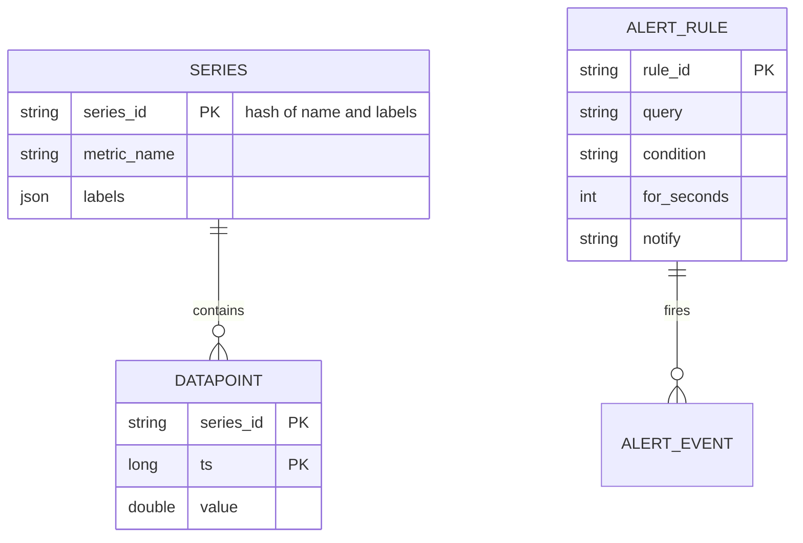
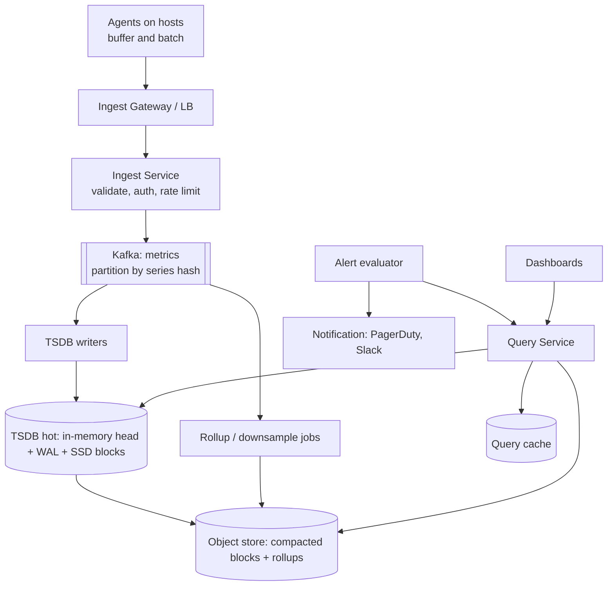
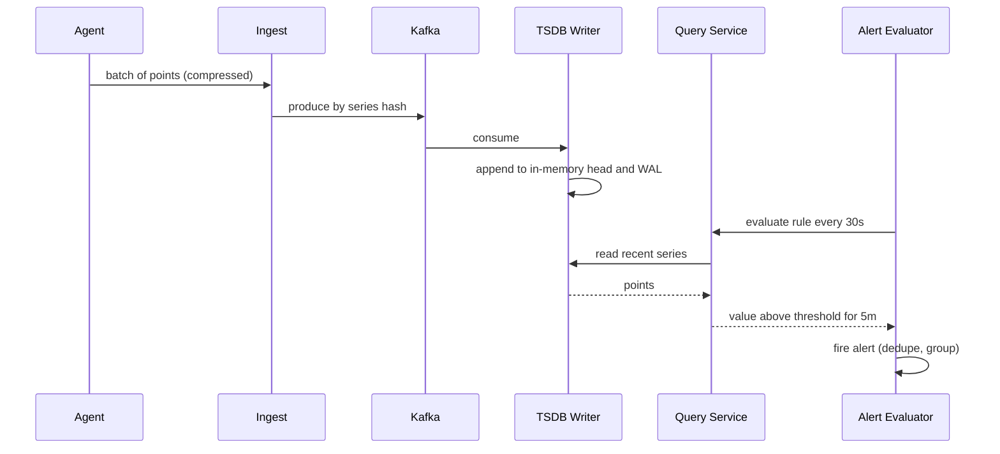

# Designing a Metrics Monitoring System (Datadog / Prometheus-style)

> Interview-ready walkthrough: requirements → estimates → entities → API → HLD → deep dives (**ingestion at scale, push vs pull, time-series storage and compression, downsampling/rollups, query performance, alerting, cardinality**) → trade-offs. The hard parts are **write-heavy ingestion**, **TSDB storage layout**, and **high-cardinality blowups**.

---

## 0. Talk track

1. Clarify: ingest metrics from services (CPU, latency, counters), query dashboards over time ranges, **alerting**.
2. Insight: **write-heavy, append-only, time-ordered**, reads are recent-heavy aggregations.
3. HLD: agents, ingest gateway, Kafka, TSDB, query service, alert evaluator.
4. Deep dives: ingestion and pipeline, TSDB design, rollups/retention, query path, alerting, cardinality.

---

## 1. Problem

Collect time-series metrics from thousands of hosts/services, store them cheaply, let users **query and graph** them, and **alert** on conditions.

**What makes it hard**
- Millions of data points/s, append-only.
- Fast range/aggregate queries over huge history.
- **Cardinality explosion** (label combos).
- Alerts must be **timely and reliable even when the system is under stress**.

---

## 2. Requirements

### Functional
- **Ingest** metrics (name, labels/tags, timestamp, value).
- **Query** time ranges with aggregation (avg, p99, sum by tag).
- **Dashboards** and **alerts** with notifications.

**Out of scope:** logs, traces, anomaly detection ML.

### Non-functional
- **Scale**: 10K hosts x 1K metrics each = **10M series**, 10 s scrape: **1M points/s**.
- **High write throughput**; ingestion must not lose data.
- Query latency: seconds for dashboards (under 1 s for recent).
- **Availability** high (monitoring must outlive the thing monitored); retention (raw 15 days, rollups 1 year+).

---

## 3. Estimation

| Quantity | Assumption | Result |
|---|---|---|
| Series | 10M | |
| Rate | 1 point / 10 s per series | **1M points/s** |
| Point | 16 B raw (8 ts + 8 val); **compressed about 1.5 B** (Gorilla delta-of-delta) | raw 16 MB/s = **1.4 TB/day**; compressed **about 130 GB/day** |
| Retention 15 d raw | | **about 2 TB** compressed |
| Alert rules | 100K evaluated every 30 s | about 3.3K evals/s |

Consequence: compress aggressively; **recent data in memory/SSD**, old data downsampled to cheap storage.

---

## 4. Entities



---

## 5. API

```http
POST /v1/write   [{ "name":"cpu", "labels":{"host":"a1","dc":"us"}, "ts":..., "value":0.73 }, ...]   -> 204
GET  /v1/query_range?query=avg(cpu{dc="us"})&start=&end=&step=60s     -> series of [ts,value]
POST /v1/alerts  { query, condition:"> 0.9", for:"5m", notify:"pagerduty" }
```

---

## 6. Architecture



---

## 7. Flow



---

## 8. Deep dive 1: ingestion

| Approach | Verdict | Why |
|---|---|---|
| Services write directly to the DB | Bad | Overload, coupling |
| **Pull (Prometheus scrape)** | Good | Central control of targets, simple health detection (`up`); needs service discovery; harder through NAT |
| **Push via agent to gateway** | Good | Works for short-lived jobs and across networks; need auth and backpressure |
| **Agent batching + Kafka buffer** | Great | Absorbs bursts, decouples ingest from storage, enables replay |

Agents **batch and compress**, retry with backoff, buffer locally (bounded) during outages. Backpressure with rate limits per tenant. Partition by **series hash** so a series' points land on one writer (ordering, good compression).

## 9. Deep dive 2: time-series storage

| Approach | Verdict | Why |
|---|---|---|
| General SQL row per point | Bad | Too much overhead, slow aggregates |
| Wide-column (Cassandra) | OK | Scales; poor compression and query ergonomics |
| **Purpose-built TSDB**: in-memory head block + WAL, flush to immutable **time-partitioned blocks**, columnar, **Gorilla compression** (delta-of-delta timestamps, XOR floats) | Great | About 1-2 bytes/point; fast scans |

An **inverted index** from labels to series ids supports queries like `host=a1,dc=us`. Writes are append-only (sequential), so throughput is high. Shard by series hash across nodes; replicate (2-3x) for durability or rely on Kafka/WAL replay.

**One-liner:** *Append-only head with WAL, flush to compressed time blocks, label index for lookup.*

## 10. Deep dive 3: retention and rollups

Raw (10 s) for 15 days; **downsample** to 1 min (7 days to 90 days) and 1 h (1 year+) storing min/max/sum/count (so averages and quantile approximations remain computable). Query service picks the resolution from the requested range (`step`). Old blocks move to object storage (cheap), with **TTL deletion** by block, so deleting is dropping a file.

## 11. Deep dive 4: query performance

- Range queries touch few time blocks; **block time bounds + label index** prune.
- **Query cache** for dashboard refreshes (cache by query + aligned time window; only recompute the newest slice).
- Parallelize across shards and merge; limit series per query; timeouts.
- Percentiles: store **histograms/sketches (t-digest)** rather than raw p99 values, since percentiles can't be averaged.

## 12. Deep dive 5: alerting

An **evaluator** runs rules periodically (every 30 s), with `for: 5m` conditions to suppress flapping, groups/deduplicates alerts, and uses **state** (pending, firing, resolved) persisted so restarts do not re-page. Make the alerting path **independent** from heavy dashboard load (separate query pool, priority). HA via redundant evaluators with dedupe at the notifier; add a **dead man's switch** (heartbeat alert) to detect monitoring failure.

## 13. Deep dive 6: cardinality

Each unique label combination creates a series; unbounded labels (user_id, request_id) explode memory and index. Enforce **limits per tenant/metric**, reject or drop offending labels, provide cardinality dashboards, and guide users to put high-cardinality data in logs/traces.

---

## 14. Failure handling

| Failure | Mitigation |
|---|---|
| Ingest node down | LB reroutes; agents retry and buffer |
| Writer crash | Replay Kafka from offset; WAL recovery |
| Storage node loss | Replicas / re-read from object storage and Kafka |
| Query overload | Query limits, caching, shed low priority |
| Alert evaluator dies | Standby takes over; state persisted |
| Cardinality bomb | Tenant limits and circuit breaker |

---

## 15. Trade-offs

| Decision | Chosen | Alternative | Given up |
|---|---|---|---|
| Ingestion | Agent push via Kafka | Pull scrape | Target discovery simplicity |
| Storage | Custom TSDB blocks | Generic DB | Build/ops cost |
| Resolution | Downsampled over time | Keep raw forever | Fine detail on old data |
| Percentiles | Sketches | Raw points | Slight approximation |
| Replication | Kafka + WAL + 2 replicas | Single copy | Storage cost |

---

## 16. Level expectations

- **Mid:** agents, DB, dashboards, alert polling.
- **Senior:** Kafka buffering, TSDB reasoning, rollups/retention, query cache.
- **Staff+:** compression math, cardinality governance, multi-tenancy, alert reliability, monitoring-the-monitor.

## 17. Follow-ups

Distributed tracing correlation, anomaly detection, SLO burn-rate alerts, multi-region federation, cost allocation per tenant.

## 18. Summary checklist

- [ ] Agent batching, Kafka buffer by series hash
- [ ] TSDB: head + WAL + compressed time blocks, label index
- [ ] Rollups and retention tiers, object storage for cold
- [ ] Query cache, sketches for percentiles
- [ ] Alerts with state, `for`, dedupe, dead-man switch; cardinality limits
