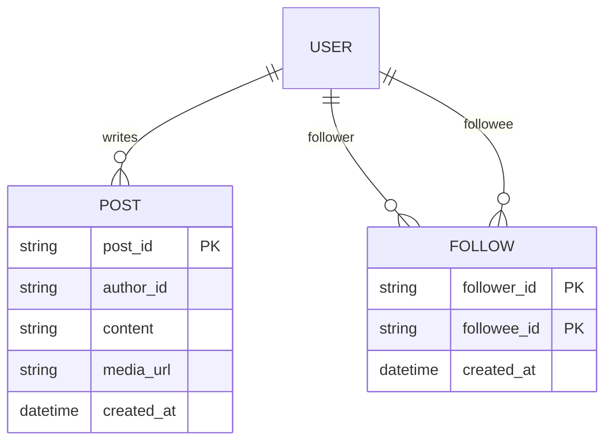
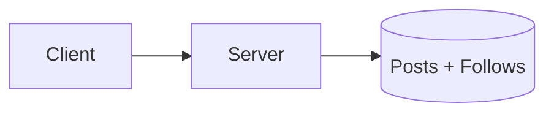
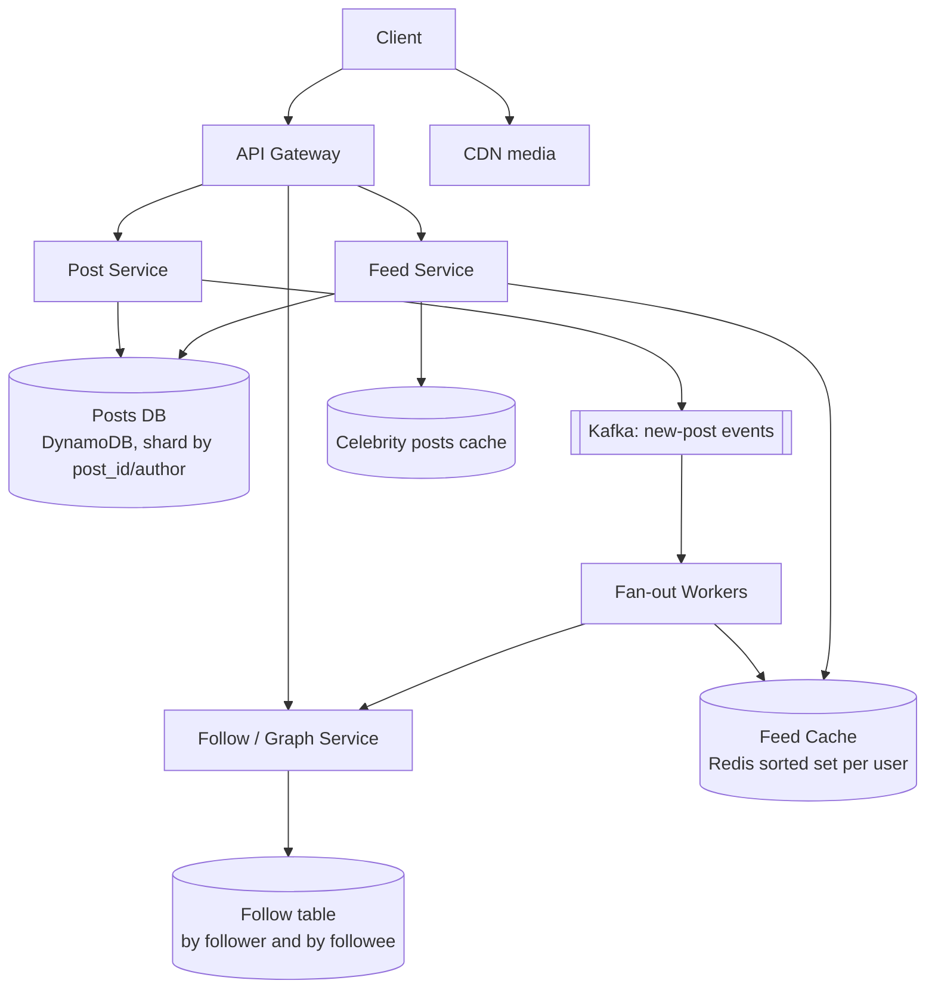
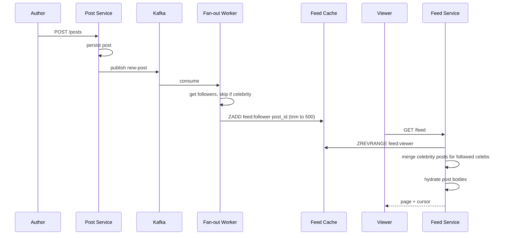

# Designing a News Feed (Facebook-style)

> Interview-ready walkthrough: requirements → estimates → entities → API → HLD → deep dives (**fan-out on write vs read, hybrid for celebrities, hot-key caching, pagination**) → trade-offs. The hard part is **producing a fast feed for users who follow many accounts, some with millions of followers**.

> Sibling doc: *Instagram feed* in this folder covers photo specifics. This one is the generic text/link feed (Facebook / X) per Hello Interview.

---

## 0. Talk track

1. Clarify: create posts, follow, view feed (chronological/ranked), scale 2B users.
2. Core insight: **read-heavy, eventual consistency OK**, feed latency under 500 ms.
3. Entities and API (cursor pagination).
4. v1: pull model with joins.
5. Deep dives: fan-out on write, hybrid for celebrities, feed cache, hot posts, media.
6. Failures and trade-offs.

---

## 1. Problem

Users follow people/pages and see a **reverse-chronological (or ranked) feed** of their posts.

**What makes it hard**
- A user may follow **hundreds to thousands** of accounts; a feed read can't scan them all.
- **Celebrities** with 10M+ followers make fan-out on write explosive.
- Must be fast (under 500 ms) and **highly available**.

---

## 2. Requirements

### Functional
- Create posts (text, media links).
- Follow and unfollow users.
- View a **feed** of followed users' posts (newest first, infinite scroll).

**Out of scope:** likes/comments, ranking ML, ads, privacy settings, notifications.

### Non-functional
- **Availability over consistency** (eventual: a post may appear after up to about 1 minute).
- Feed read under 500 ms p99.
- Scale: **2B users**, follow up to 5K accounts, celebrities up to 100M followers.

---

## 3. Estimation

| Quantity | Assumption | Result |
|---|---|---|
| DAU | 500M | |
| Feed reads | 10 per user/day | 5B/day = about 58K/s avg, about 200K/s peak |
| Posts | 100M/day | about 1.2K/s |
| Read:write | | **about 50:1** |
| Avg followers | 200 | fan-out 1.2K x 200 = **about 240K feed inserts/s** |
| Post size | about 1 KB metadata | about 100 GB/day |
| Feed cache | 500M users x 500 post ids x 8 B | **about 2 TB** (Redis cluster) |

Consequence: precompute feeds (**write fan-out**) for normal users, handle celebrities differently.

---

## 4. Entities



---

## 5. API

```http
POST /posts      { "content":"...", "media":["..."] }          -> 201 { post_id }
POST /follows    { "followee_id":"u2" }                          -> 204
DELETE /follows/{followee_id}
GET  /feed?cursor=<post_id_or_ts>&limit=20                      -> { posts:[...], next_cursor }
```

**Cursor (keyset) pagination** instead of offset: stable under new inserts and O(log n).

---

## 6. Architecture

### v1 (pull)

Feed query: `SELECT p FROM posts JOIN follows ... ORDER BY ts LIMIT 20`. Scans 1K+ users' posts: too slow at scale.

### Final design (hybrid)


---

## 7. Flow



---

## 8. Deep dive 1: fan-out strategy

| Approach | Verdict | Why |
|---|---|---|
| **Fan-out on read** (query followees' posts at read time) | Fine for small, bad at scale | Reads are 50x more frequent; N-way merge per request |
| **Fan-out on write** (push post id into each follower's feed list) | Great for normal users | O(1) read; write cost = followers |
| **Hybrid** | Best | Push for normal authors; **pull for celebrities** and merge at read |

**Celebrity threshold** (e.g. > 100K followers): skip fan-out. At read time the feed service fetches recent posts for the followed celebrities (typically few) from a hot cache and merges by time. Inactive users: skip precompute, build on first read (saves memory).

**One-liner:** *Push for the many, pull for the famous, merge at read.*

---

## 9. Deep dive 2: feed storage and pagination

- Feed = **Redis sorted set** per user of `(timestamp, post_id)`, trimmed to about 500-1000. Older pages fall back to pull from the DB.
- Store only **ids**; hydrate post bodies from a post cache (read-through) to avoid duplicating content.
- Post ids are **time-sortable** (Snowflake / ULID), so the cursor is the last id.

---

## 10. Deep dive 3: hot posts and caching

- A viral post is read by millions: **post cache** (Redis) plus CDN for media. Replicate hot keys across cache nodes or use local in-process caches with short TTL.
- Counters (likes) not in scope; if added, use sharded counters to avoid hot rows.

---

## 11. Storage and scaling

| Data | Store | Key |
|---|---|---|
| Posts | DynamoDB/Cassandra | `post_id` (index by `author_id, ts`) |
| Follows | Two tables | `(follower_id)` for feed build, `(followee_id)` for fan-out |
| Feed lists | Redis cluster | `feed:{user_id}` |
| Media | S3 + CDN | |

Shard Redis by user_id; feed service stateless.

---

## 12. Failure handling

| Failure | Mitigation |
|---|---|
| Fan-out lag | Queue lag metric; feed still serves older entries; eventual |
| Redis node loss | Rebuild feed from posts + follows on miss (pull fallback); replicas |
| Kafka backlog on celeb post | Celebrities bypass fan-out; priority lanes |
| Fan-out worker crash | At-least-once with idempotent ZADD (same member = no dup) |
| Thundering herd after cache loss | Request coalescing, jittered TTL, rate-limited rebuild |

---

## 13. Trade-offs

| Decision | Chosen | Alternative | Given up |
|---|---|---|---|
| Fan-out | Hybrid | Pure push / pull | Read-path complexity |
| Feed contents | IDs only | Full posts | Extra hydration hop |
| Consistency | Eventual | Strong | Few seconds of delay |
| Pagination | Cursor | Offset | Random jump |
| Cache sizing | Active users only | All | Cold-start cost on first read |

---

## 14. Level expectations

- **Mid:** pull vs push, basic tables, pagination.
- **Senior:** hybrid fan-out, Redis feed lists, cursor pagination, hot-key mitigation.
- **Staff+:** celebrity threshold tuning, backfill/rebuild, ranking pipeline hooks, capacity math, failure drills.

## 15. Follow-ups

Ranked feed (candidate gen + scorer), deletion/edit propagation, blocked users, ads injection, real-time updates via SSE.

## 16. Summary checklist

- [ ] Hybrid fan-out, celebrity pull
- [ ] Redis sorted-set feed of ids, trimmed
- [ ] Cursor pagination, time-sortable ids
- [ ] Post cache and CDN for hot content
- [ ] Idempotent workers, lag monitoring
