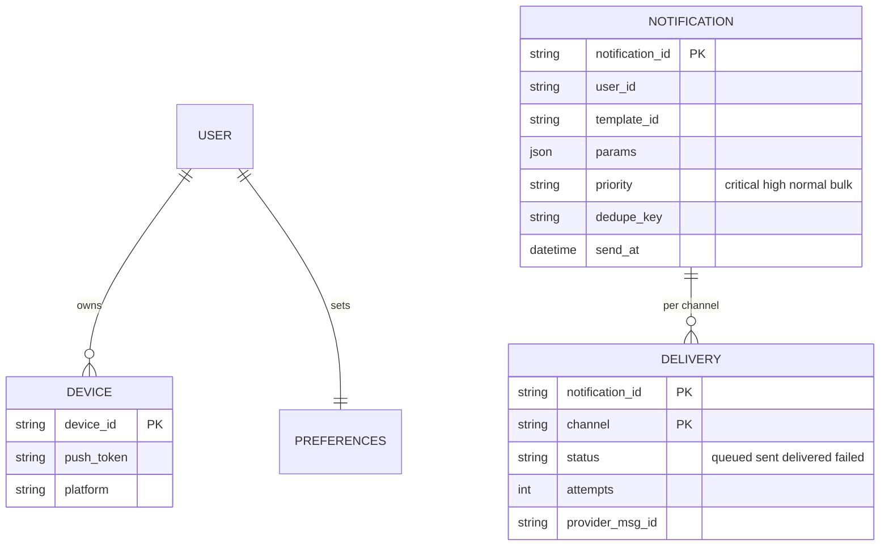
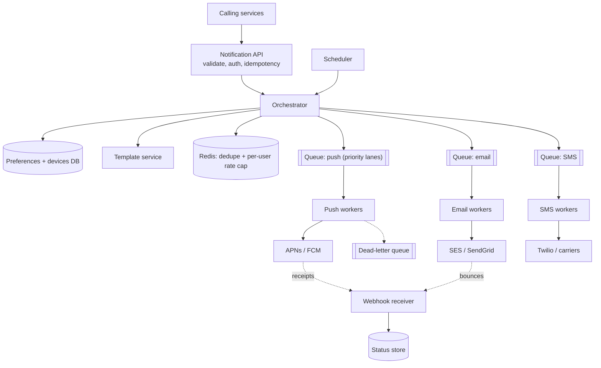
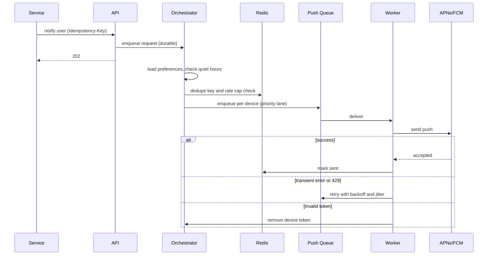

# Designing a Notification Service

> Interview-ready walkthrough: requirements → estimates → entities → API → HLD → deep dives (**multi-channel delivery, queues and priority, retries and at-least-once with dedupe, user preferences and rate limiting, templating, scheduling, third-party provider failures**) → trade-offs. The hard parts are **reliable fan-out through flaky third parties** and **not spamming users**.

---

## 0. Talk track

1. Clarify: send **push, SMS, email, in-app** notifications triggered by services or schedules; user preferences; scale 10B/day.
2. Core: asynchronous pipeline with **queues per channel**, workers calling providers (APNs/FCM/Twilio/SES).
3. Deep dives: reliability, priority, preferences/dedupe/throttle, provider failover, bulk campaigns, observability.

---

## 1. Problem

A central service other teams call to notify users across channels, **reliably, once, respecting preferences**, with bursts (marketing blast to 100M users).

**What makes it hard**
- Third-party providers are rate-limited and flaky.
- **Exactly-once feel** from at-least-once infrastructure.
- Priorities: OTP/security alerts must not queue behind a marketing blast.
- User fatigue: dedupe, caps, quiet hours.

---

## 2. Requirements

### Functional
- Send notifications via **push (iOS/Android), SMS, email, in-app**.
- **Templates** and personalization.
- **User preferences** (channel opt-in/out, quiet hours).
- **Scheduled** and bulk (campaign) sends; delivery status tracking.

**Out of scope:** campaign targeting/segmentation UI, analytics dashboards, in-depth content creation.

### Non-functional
- **Scale**: 10B notifications/day, bursts to 1M+/s for campaigns.
- **Latency**: transactional (OTP) under seconds; bulk is best effort.
- **At-least-once delivery** with dedupe; high availability; durable.

---

## 3. Estimation

| Quantity | Assumption | Result |
|---|---|---|
| Volume | 10B/day | **about 115K/s avg, about 1M/s peak** |
| Payload | 1 KB | 10 TB/day in queues |
| Channels | 70% push, 20% email, 10% SMS | SMS is the cost/limit driver (carrier rate limits) |
| Status events | 3 per notification | 30B/day logs: **sampled/aggregated** storage |

Consequence: everything async; **Kafka-class queues** with per-channel partitions; autoscaled workers; careful provider rate limiting.

---

## 4. Entities



---

## 5. API

```http
POST /v1/notifications   Idempotency-Key
{ "user_ids":["u1"], "template":"order_shipped", "params":{...}, "priority":"high", "channels":["push","email"], "send_at": null }
-> 202 { notification_id }
GET  /v1/notifications/{id}      -> delivery status per channel
PUT  /v1/users/{id}/preferences  { email:true, sms:false, quiet_hours:"22:00-07:00" }
```

Providers' delivery receipts/bounces arrive via webhooks to us.

---

## 6. Architecture



---

## 7. Flow



---

## 8. Deep dive 1: reliability

- **Durable ingestion**: persist the request (Kafka/DB) **before** returning 202.
- Workers use **at-least-once** consumption (ack after provider accepted); duplicates controlled via **dedupe key** `(user, notification_id, channel)` in Redis/DB checked just before sending (provider message ids help as well).
- **Retries**: exponential backoff + jitter for transient errors/429, capped attempts, then DLQ and alert; permanent errors (invalid token, bounced email) are not retried and update device/contact state.
- **Circuit breaker** per provider; **failover** to a secondary provider (e.g. second SMS vendor) when error rate spikes.
- Outbox pattern between request DB and queue to avoid dual-write loss.

**One-liner:** *Persist first, retry transient, drop permanent, dedupe at send, DLQ the rest.*

## 9. Deep dive 2: priority and isolation

Separate **queues/lanes per channel and priority** (critical OTP, high transactional, normal, bulk). Workers weight critical lanes first; bulk campaigns are **rate-paced** (token bucket per provider and per tenant) so they cannot starve transactional. Dedicated worker pools and quotas per team prevent noisy neighbors. Autoscale on queue depth and age.

## 10. Deep dive 3: preferences, dedupe, throttling

- Preferences cached (Redis), consulted by the orchestrator; respect opt-out and **quiet hours** (delay to window), **regulatory** (unsubscribe, consent).
- **Per-user frequency caps** (e.g. 5 marketing/day) with Redis counters; **collapse keys** (replace stale notifications of same topic); digest batching.
- Timezone-aware scheduling.

## 11. Deep dive 4: bulk and scheduled

A campaign to 100M users: split recipients into **shards/chunks** processed by parallel orchestrator tasks that expand to per-user messages gradually (pace to provider limits). Scheduler (time-bucketed, see Job Scheduler doc) triggers sends at `send_at`. Progress tracked as aggregates, not per-message rows only.

## 12. Deep dive 5: templating and content

Template service with versioned templates, localization, and variable substitution; render in orchestrator or worker (render late to keep queues small). Validate params; sandbox rendering; link tracking/unsubscribe links.

## 13. Deep dive 6: status and observability

Status store updated from provider webhooks/receipts (eventual); keep summaries per notification and sampled detail given 30B events/day. Track delivery rate, latency percentiles, queue age, provider error rates, DLQ size; alert on lag rather than just errors.

---

## 14. Failure handling

| Failure | Mitigation |
|---|---|
| Provider outage | Circuit breaker; failover provider; queue and delay |
| Worker crash | Message redelivered; dedupe prevents double-send |
| Queue backlog | Autoscale; shed/expire bulk (TTL on messages) |
| Redis loss (dedupe) | Fall back to DB check with rate limit; rare duplicate acceptable for non-critical |
| Poison message | Attempt cap, DLQ, inspection tooling |
| Token invalidation storm | Batch cleanup, ignore known-bad tokens |

---

## 15. Trade-offs

| Decision | Chosen | Alternative | Given up |
|---|---|---|---|
| Delivery | At-least-once + dedupe | Exactly-once | Rare duplicate on dedupe-store loss |
| Processing | Async queues | Sync call to providers | Immediate status |
| Priority | Separate lanes | Single queue | More infra, but protects OTP |
| Bulk | Paced fan-out | Blast | Slower campaign completion |
| Status | Eventual via webhooks | Sync | Fresh delivery info |

---

## 16. Level expectations

- **Mid:** API, queue, workers per channel, provider integration.
- **Senior:** retries/DLQ, dedupe, priority lanes, preferences, rate limiting, scheduling.
- **Staff+:** provider failover economics, bulk pacing, tenant isolation, compliance, observability at 30B events/day.

## 17. Follow-ups

A/B testing content, delivery-time optimization, in-app inbox with read state, rich push, cross-channel fallbacks (push then SMS).

## 18. Summary checklist

- [ ] Durable ingest, 202, outbox
- [ ] Queue per channel and priority, autoscaled workers
- [ ] Dedupe key, retries with backoff + jitter, DLQ
- [ ] Preferences, quiet hours, frequency caps
- [ ] Provider circuit breakers/failover, receipts via webhooks
