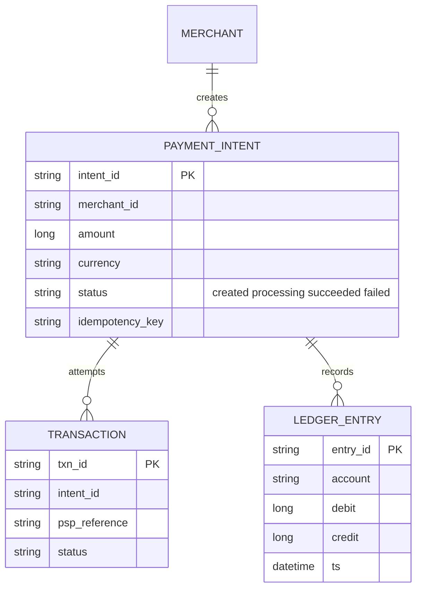
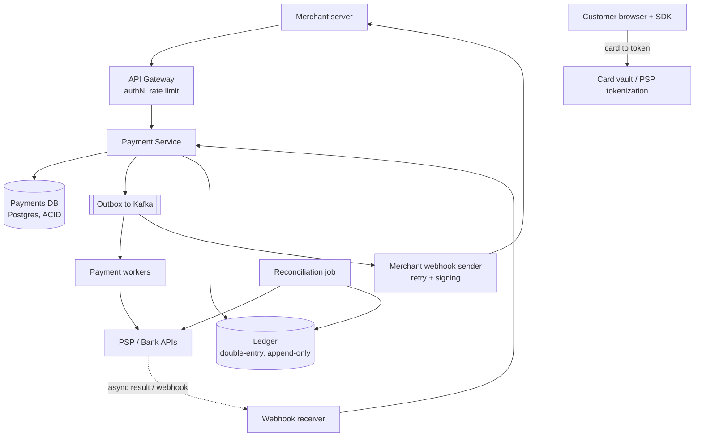
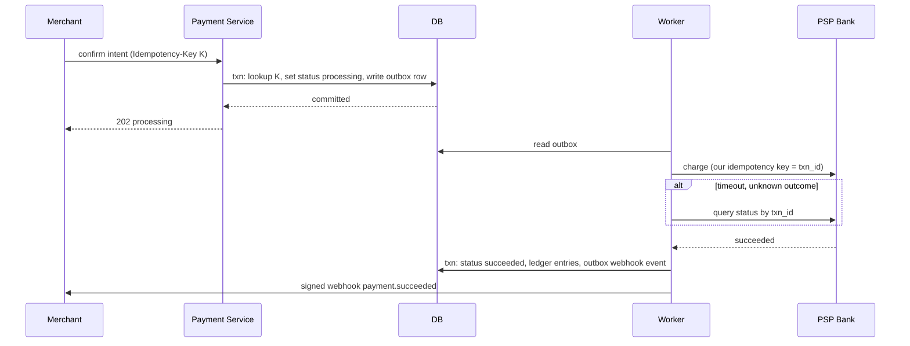

# Designing a Payment System (Stripe-style Payment Processing)

> Interview-ready walkthrough: requirements → estimates → entities → API → HLD → deep dives (**idempotency, durability and no lost payments, webhooks, double-entry ledger, reconciliation, security/PCI**) → trade-offs. The hard part is **correctness**: money must never be lost, duplicated, or invented.

---

## 0. Talk track

1. Clarify: merchants initiate payments, customers pay by card, merchants check status and get webhooks. Not building the card network.
2. Priorities: **correctness and durability over latency**; 10K TPS.
3. Entities and API with **idempotency keys**.
4. HLD: API, payment DB, PSP/bank integration, webhooks.
5. Deep dives: idempotency, durable state machine, async bank calls and webhooks, security, reconciliation/ledger, scale.

---

## 1. Problem

A platform that lets **merchants charge customers** (cards, wallets), routes to banks/PSPs, tracks status, and notifies merchants.

**What makes it hard**
- **Exactly-once effect** of money movement over unreliable networks.
- External banks are slow, flaky, asynchronous.
- **Security/PCI**: card data is toxic.
- Audit and **reconciliation** with external truth.

---

## 2. Requirements

### Functional
- Merchants initiate payment requests (a customer pays for an order).
- Users pay for products.
- Merchants query payment status.
- Merchants receive **webhook** updates.

**Out of scope:** payouts, fraud ML details, multi-currency FX, subscriptions.

### Non-functional
- **Security** (PCI-DSS), **durability** (no payment lost), **strong consistency / transactional integrity**.
- **Idempotent** operations.
- **High availability** (but correctness before availability).
- Scale: **10K TPS**; latency of seconds acceptable (bank-bound).

---

## 3. Estimation

| Quantity | Assumption | Result |
|---|---|---|
| Peak TPS | 10K | **about 860M/day** (upper bound) |
| Record | about 2 KB (events + metadata) | about 1.7 TB/day, so partition and archive |
| Webhooks | about 1 per transition x 3 | about 30K/s outbound |

Key point: volume is moderate; **consistency, auditing and failure handling** dominate, not raw throughput.

---

## 4. Entities



---

## 5. API

```http
POST /payment-intents   Idempotency-Key: <uuid>
{ "amount": 4999, "currency":"USD", "order_id":"o1" }     -> 201 { intent_id, client_secret }

POST /payment-intents/{id}/confirm   Idempotency-Key
{ "payment_method_token":"tok_..." }                        -> 202 { status:"processing" }

GET  /payment-intents/{id}                                  -> { status }
POST (merchant endpoint) webhook: { event:"payment.succeeded", intent_id, signature }
```

Cards are **tokenized by the PSP/vault** in the browser SDK; our servers never see raw PANs (reduces PCI scope).

---

## 6. Architecture



---

## 7. Flow



---

## 8. Deep dive 1: idempotency

| Approach | Verdict | Why |
|---|---|---|
| No keys, retry blindly | Bad | Double charges |
| **Client-supplied `Idempotency-Key`** stored with unique constraint, saved response replayed | Great | Retry-safe across network failures |
| Also pass an idempotency key (`txn_id`) to the **PSP** | Required | Protects the downstream call |

Store `(merchant_id, key) -> request hash, response, status` with a **unique index**; the same key with a different body is a 422. Key TTL about 24 h+.

**One-liner:** *Idempotency key at every hop: merchant to us, us to bank.*

## 9. Deep dive 2: durability and the dual-write problem

Never "update DB then call Kafka" separately. Use the **transactional outbox**: write state and the outbox event in one DB transaction; a relay publishes events (CDC or poller). The payment is a **state machine** (`created to processing to succeeded|failed`), transitions via conditional updates, so a crash resumes from the persisted state. Use **sagas** with compensations (refund/void) across steps.

## 10. Deep dive 3: async bank calls and webhooks

- Bank may respond after minutes; support **both** synchronous result and **inbound webhook** from PSP (verify signature, dedupe by event id).
- Timeouts mean **unknown**, never "failed": reconcile by querying the PSP using the idempotency key.
- **Outbound webhooks** to merchants: at-least-once, HMAC-signed, retried with exponential backoff for days, DLQ, event ids for dedupe; merchants can also poll `GET`.

## 11. Deep dive 4: ledger and reconciliation

- **Double-entry, append-only ledger**: every movement has balanced debit/credit entries; balances derived, never updated in place. Immutability gives auditability.
- **Reconciliation**: nightly compare our ledger with PSP/bank settlement files; flag mismatches (missing, duplicate, amount) for investigation. This is the backstop for any bug.

## 12. Deep dive 5: security

- **PCI scope reduction**: tokenization/vault, TLS everywhere, encrypt at rest, HSM-managed keys.
- AuthN for merchants (API keys, OAuth), HMAC for webhooks, strict authorization (merchant sees own data).
- Fraud: velocity checks, risk scoring, 3-D Secure; rate limits.
- Least privilege, audit logs, secret rotation.

## 13. Deep dive 6: scale

Shard payments DB by `merchant_id` (or intent id hash), stateless services, Kafka partitioned by `intent_id` for ordering per payment, read replicas for status reads, archival of old data. Postgres ACID for the core; avoid eventual-consistent stores for money state.

---

## 14. Failure handling

| Failure | Mitigation |
|---|---|
| Client retries | Idempotency key replay |
| Crash after bank charge | Resume via state + PSP query by key; outbox ensures events |
| Bank/PSP outage | Circuit breaker, failover to secondary PSP (routing), queue and retry |
| Webhook to merchant failing | Backoff retry, DLQ, polling fallback |
| DB failover | Synchronous replica for payments; RPO = 0 |
| Duplicate PSP callback | Event-id dedupe |

---

## 15. Trade-offs

| Decision | Chosen | Alternative | Given up |
|---|---|---|---|
| Store | ACID SQL | NoSQL | Horizontal ease (shard by merchant) |
| Processing | Async with 202 | Synchronous | Immediate answer |
| Consistency | Strong | Eventual | Availability in partitions |
| Events | Outbox | Dual write | Relay component |
| Card data | Tokenize at PSP | Store ourselves | Control; large PCI burden removed |

---

## 16. Level expectations

- **Mid:** payment flow, DB, status API, retries.
- **Senior:** idempotency keys, async/webhooks, state machine, outbox, PCI tokenization.
- **Staff+:** ledger design, reconciliation, PSP failover/routing, saga compensation, audit, multi-region and cost.

## 17. Follow-ups

Refunds/chargebacks, multi-currency, payouts, subscriptions, fraud scoring, multi-PSP smart routing.

## 18. Summary checklist

- [ ] Idempotency keys end to end
- [ ] Outbox plus state machine, never dual-write
- [ ] Timeout means unknown, so query to resolve
- [ ] Append-only double-entry ledger and nightly reconciliation
- [ ] Tokenization, signed webhooks, retries
