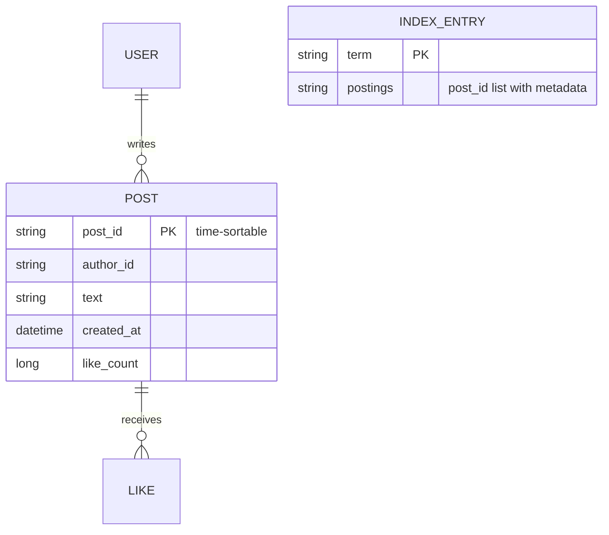
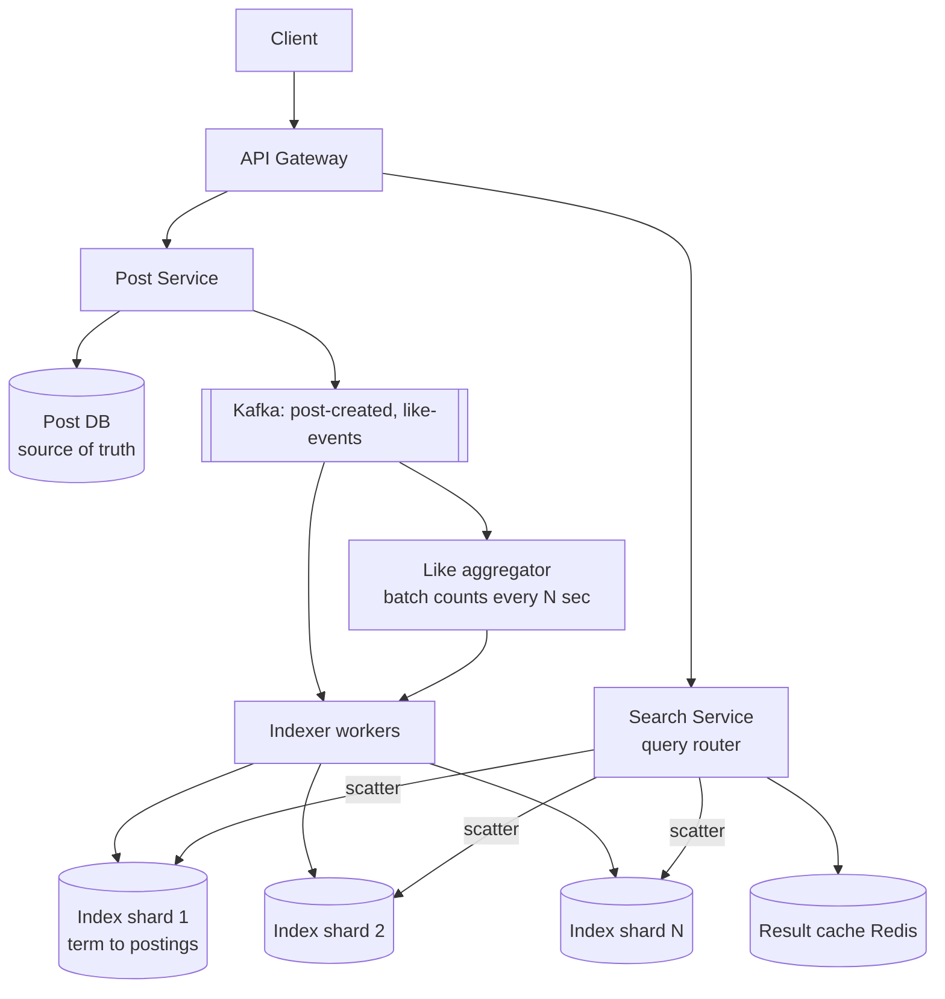
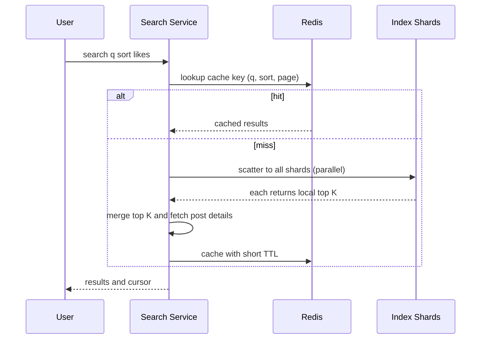

# Designing Facebook Post Search

> Interview-ready walkthrough: requirements → estimates → entities → API → HLD → deep dives (**inverted index, sharding the index, near-real-time indexing, ranking and recency/likes, caching, scaling reads and handling hot terms**) → trade-offs. The hard parts are **index size and sharding**, **fast freshness**, and **ranking by relevance + engagement**.

---

## 0. Talk track

1. Clarify: search posts by keyword, results sorted by recency or likes, posts created and liked continuously. Out: personalization, typeahead, privacy ACL (mention).
2. Estimate: 1B posts/yr? 100K searches/s reads; likes are write-heavy.
3. Evolve: SQL `LIKE` to inverted index to sharded index to separate ingest path, ranking, caching.

---

## 1. Problem

Users search all public posts by keywords and get results sorted by **recency** or **like count**, with fresh posts discoverable quickly.

**What makes it hard**
- Large corpus (trillions of tokens) so need a **distributed inverted index**.
- **Freshness**: new posts searchable in seconds.
- **Likes change constantly** so ranking by likes means high write rate into the index.
- Search QPS is huge; skewed terms.

---

## 2. Requirements

### Functional
- Create posts.
- **Like** posts.
- **Search** posts by keyword.
- Sort by **recency** or **likes**.

**Out of scope:** personalization, typeahead, media search, privacy/ACL filtering, spelling correction.

### Non-functional
- **Low latency** search (under 500 ms).
- **High throughput**: about 10K searches/s peak (scale up as required), 1B+ users.
- **Near-real-time** indexing of new posts (seconds to a minute).
- **High availability**, **eventual consistency** acceptable.
- Efficient, sharded storage.

---

## 3. Estimation

| Quantity | Assumption | Result |
|---|---|---|
| Posts | 10B total, 200 B text avg | **2 TB** raw text |
| Index | postings (doc ids per term) about 1-2x text | **about 2-4 TB**: sharded over dozens of nodes, RAM/SSD |
| New posts | 100M/day | about 1.2K/s |
| Likes | 1B/day | **about 12K/s avg** (write-heavy) |
| Searches | 100M/day | about 1.2K/s avg, about 10K/s peak |

Consequence: index > one machine; **shard**. Likes dominate writes: do **not** reindex on every like (batch/aggregate).

---

## 4. Entities



---

## 5. API

```http
POST /posts       { text }                             -> 201
POST /posts/{id}/like                                  -> 204
GET  /search?q=taylor+swift&sort=recent|likes&cursor=  -> { posts:[...], next_cursor }
```

---

## 6. Architecture



---

## 7. Search flow



---

## 8. Deep dive 1: the index

| Approach | Verdict | Why |
|---|---|---|
| `SELECT ... WHERE text LIKE '%term%'` | Bad | Full scan |
| DB full-text index | Good | Works to moderate scale; hard to shard |
| **Inverted index**: `term to sorted list of post ids` (Lucene segments in Elasticsearch/OpenSearch or custom) | Great | Multi-term queries by posting-list intersection |

Tokenize, lowercase, stem, drop stopwords at index time. Posting lists sorted by the **sort key** (e.g. by recency/doc id descending) so top-K can **early terminate**. Store compressed (delta-encoding, bitmaps). For "likes" sort, keep per-term lists ordered by like bucket, or keep like count as a doc value and score at query time.

## 9. Deep dive 2: sharding

| Scheme | Pros | Cons |
|---|---|---|
| **By document** (post_id hash/time range): each shard indexes a subset of docs fully | Even load, simple indexing, writes touch one shard | Query is **scatter-gather** to all shards (latency = slowest shard) |
| **By term**: each shard owns some terms | Query hits few shards | Hot terms, multi-term joins cross-shard, writes touch many shards |

Choose **document-sharded** (what ES/Lucene do); mitigate tail latency with replicas (hedged requests), per-shard timeouts, partial results. **Time-based partitioning** (recent index hot on SSD/RAM, older archived) helps recency queries: search recent shards first and stop when K found.

**One-liner:** *Shard by document, scatter-gather top-K, merge.*

## 10. Deep dive 3: freshness

New posts go through **Kafka to indexer** to a small in-memory **real-time segment** (searchable in about 1 s, refresh interval), periodically merged into larger segments. Post DB remains truth; the index is rebuildable (replay Kafka / backfill from DB).

## 11. Deep dive 4: likes and ranking

Likes arrive at 12K/s and hot posts get floods: don't reindex on each. **Aggregate** counts in Redis/stream per post, flush every few seconds to the index as a partial doc update (or store as a doc value updated in batch). Ranking for "likes" can be exact top-K by `like_count` with slight staleness; bucketed counts (log scale) reduce update churn. Combine relevance (BM25) with engagement and recency if ranking mixed.

## 12. Deep dive 5: caching and hot terms

Cache results for popular queries (short TTL, key = normalized query + sort + page); trending terms are skewed, so cache hit ratio is high. Request coalescing for stampedes. Replicate shards holding hot data; CDN not applicable (dynamic).

## 13. Deep dive 6: pagination

Cursor by `(sort_key, post_id)` (search-after) instead of offset to avoid deep-page cost across shards.

---

## 14. Failure handling

| Failure | Mitigation |
|---|---|
| Shard down | Replicas serve; partial results with flag as fallback |
| Slow shard | Hedged requests, timeouts |
| Indexer lag | Queue lag alert; searches stale not broken |
| Index corruption | Rebuild from DB/Kafka (reindex) |
| Like storm on one post | Aggregation buffer; skip per-like indexing |

---

## 15. Trade-offs

| Decision | Chosen | Alternative | Given up |
|---|---|---|---|
| Sharding | By document | By term | Scatter-gather fan-out cost |
| Freshness | Near real time | Batch | Indexing complexity |
| Likes in index | Batched | Realtime exact | Slightly stale ranking |
| Engine | Elasticsearch/Lucene | Custom | Control; saves time |
| Cache | Short-TTL results | None | Freshness (seconds) |

---

## 16. Level expectations

- **Mid:** inverted index idea, DB for posts.
- **Senior:** sharded inverted index, scatter-gather, Kafka indexing, like batching, caching.
- **Staff+:** tiered/time-partitioned indexes, tail-latency control, ranking blends, reindex/backfill strategy, capacity math.

## 17. Follow-ups

Typeahead/autocomplete, personalized ranking, privacy filtering at query time, spell correction, multi-language analyzers.

## 18. Summary checklist

- [ ] Inverted index, doc-sharded, replicated
- [ ] Scatter-gather top-K merge, hedged requests
- [ ] Kafka real-time indexing, DB as truth
- [ ] Batch like counts into index
- [ ] Cursor pagination and result cache
