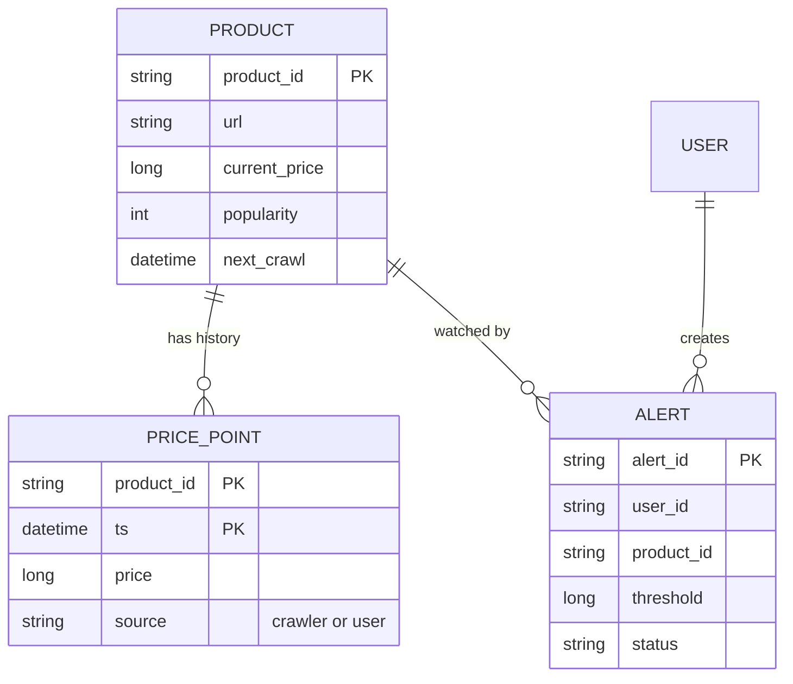
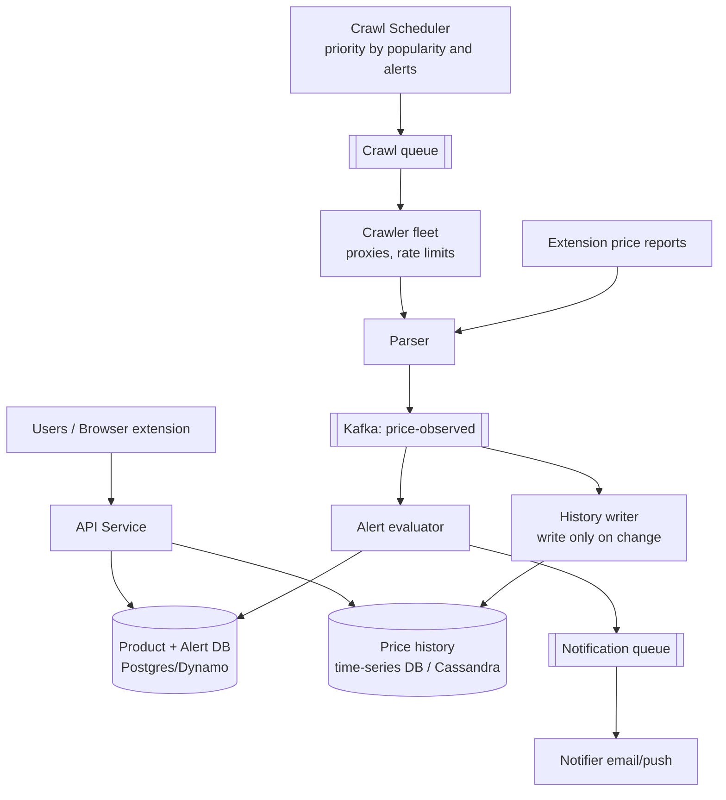
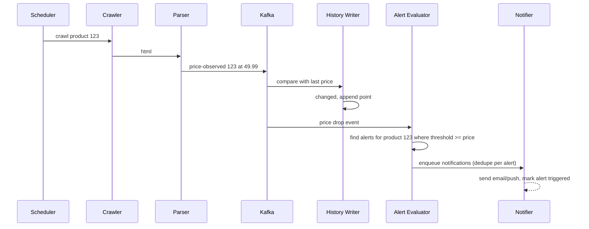

# Designing a Price Tracking Service (CamelCamelCamel)

> Interview-ready walkthrough: requirements → estimates → entities → API → HLD → deep dives (**getting price data: crawling vs user-submitted, price-history time series, detecting changes and alerting at scale, politeness and anti-bot, notification fan-out**) → trade-offs. The hard part is **continuously and cheaply monitoring millions of products and alerting the right users**.

---

## 0. Talk track

1. Clarify: track Amazon product prices, show history charts, users set price-drop alerts. 500M products, 1M users watching.
2. Key problem: **no official API**, so data acquisition is scraping + crowd sourcing.
3. HLD: tracker (crawler), price store (time series), alert evaluator, notifier.
4. Deep dives: data acquisition, history storage, alert matching, scale.

---

## 1. Problem

Show historical prices for products and **notify users** when a price crosses their threshold.

**What makes it hard**
- **Data acquisition** without an API at **500M products**.
- Prices change rarely (so most scrapes are wasted) but must be caught timely for popular products.
- Matching a price change to **many user alerts** efficiently.

---

## 2. Requirements

### Functional
- View **price history** for a product (chart).
- **Subscribe** to price-drop alerts (threshold or any drop).
- Receive **notifications** (email/push).

**Out of scope:** search UX, user auth, affiliate links, multi-retailer details.

### Non-functional
- **Scale**: 500M products, 1M active users.
- **Reasonable freshness**: popular products within minutes/hours, tail daily.
- **High availability**, **eventual consistency** fine.
- Alert delivery reliable; no spam (dedupe).

---

## 3. Estimation

| Quantity | Assumption | Result |
|---|---|---|
| Products | 500M | metadata 500M x 1 KB = **500 GB** |
| Price points | change events only (avg 10/yr/product) | 5B/yr x 50 B = **250 GB/yr** (tiny) |
| Scrapes | tiered: top 1M hourly, 50M daily, rest weekly | 1M x 24 + 50M + 450M/7 = **about 140M scrapes/day, about 1.6K/s** |
| Alerts | 1M users x 5 alerts | **5M alert rules** |
| Price changes/day | about 1-5% of scrapes | about 3M events/day, trivial |

Consequence: storage is small; **crawl scheduling** (who to refresh when) is the lever.

---

## 4. Entities



---

## 5. API

```http
GET  /products/{id}/prices?from=&to=&granularity=day    -> [{ts, price}]
POST /alerts        { product_id, threshold }            -> 201
DELETE /alerts/{id}
POST /products     { url }                               # user adds a product to track
```

---

## 6. Architecture



---

## 7. Flow



---

## 8. Deep dive 1: getting the data

| Approach | Verdict | Why |
|---|---|---|
| Official retailer API | Ideal but often unavailable/limited | Quotas, ToS |
| **Web crawling** (see Web Crawler doc) | Good | Needs proxy rotation, anti-bot handling, parsing breakage; legal/ToS risk |
| **Crowdsourcing**: browser extension reports prices users see | Great complement | Scales free with users, covers popular items; trust/validation required (outlier detection, multiple reports) |

Hybrid: user reports for popular products (high frequency), **targeted crawls** for products with active alerts, slow background crawl for the tail. Respect robots/ToS; throttle per domain; rotate IP pools.

## 9. Deep dive 2: crawl scheduling

Priority = f(popularity, number of active alerts, volatility, time since last crawl). A scheduler picks due products (priority queue / time-bucketed index) and feeds the crawl queue; adaptive intervals: back off for stable prices, speed up when changes are frequent. Products with **zero** watchers and low popularity are refreshed rarely.

**One-liner:** *Spend crawl budget where prices matter: popular or watched products.*

## 10. Deep dive 3: price history storage

Append only **on change** (or at most every N hours) to keep series small. Store `(product_id, ts) to price` in a **time-series store** or Cassandra/Dynamo (PK product_id, sort ts). Charts: query range, downsample (daily min/max) via precomputed rollups; cache popular product charts. Keep source and confidence flags.

## 11. Deep dive 4: alert matching

| Approach | Verdict |
|---|---|
| Scan all alerts on every price change | Bad |
| **Index alerts by `product_id`** sorted by threshold; on event query `threshold >= new_price AND status=active` | Great |
| Evaluate in Kafka consumer partitioned by product_id | Great (ordering per product) |

Notify **once** per alert crossing (mark triggered, optionally re-arm after the price rises above threshold). Idempotency key per `(alert, price_event)` so retries don't duplicate. Batch/digest for users with many alerts; throttle per user.

## 12. Deep dive 5: notifications

Queue to workers sending email/push via providers (SES/FCM/APNs) with retries and backoff; bounce handling; preference management. Same pattern as the Notification Service doc.

---

## 13. Failure handling

| Failure | Mitigation |
|---|---|
| Crawler blocked / parser breaks | Detect via drop in success rate, fall back to user reports, alert engineers |
| Bad price (outlier, error page) | Validate (range vs history, multiple sources) before accepting |
| Kafka lag | Alerts delayed, not lost; replay |
| Duplicate event processing | Idempotent history write (same ts/price), alert dedupe |
| Notification provider down | Retry queue, secondary provider |

---

## 14. Trade-offs

| Decision | Chosen | Alternative | Given up |
|---|---|---|---|
| Data source | Crawl + crowdsource | API only | Legal/ops risk, data quality work |
| Crawl policy | Adaptive priority | Uniform | Scheduler complexity |
| History | On-change points | Every scrape | Resolution of unchanged periods (implicit) |
| Alerts | Indexed by product | Full scan | Extra index |
| Consistency | Eventual | Strong | Late alerts by minutes |

---

## 15. Level expectations

- **Mid:** crawler, DB, alert scan, email.
- **Senior:** tiered crawl scheduling, time series store, Kafka pipeline, alert index, dedupe.
- **Staff+:** crowdsourcing validation, anti-bot economics, adaptive polling, legal/ToS, cost per scrape, multi-retailer scale.

## 16. Follow-ups

Multiple retailers, price prediction ("wait to buy"), coupon tracking, regional prices, variant/SKU handling.

## 17. Summary checklist

- [ ] Hybrid data: user reports plus targeted crawl
- [ ] Priority-based crawl scheduler
- [ ] Append history on change only, rollups for charts
- [ ] Alerts indexed by product and threshold
- [ ] Idempotent alert and notification pipeline
