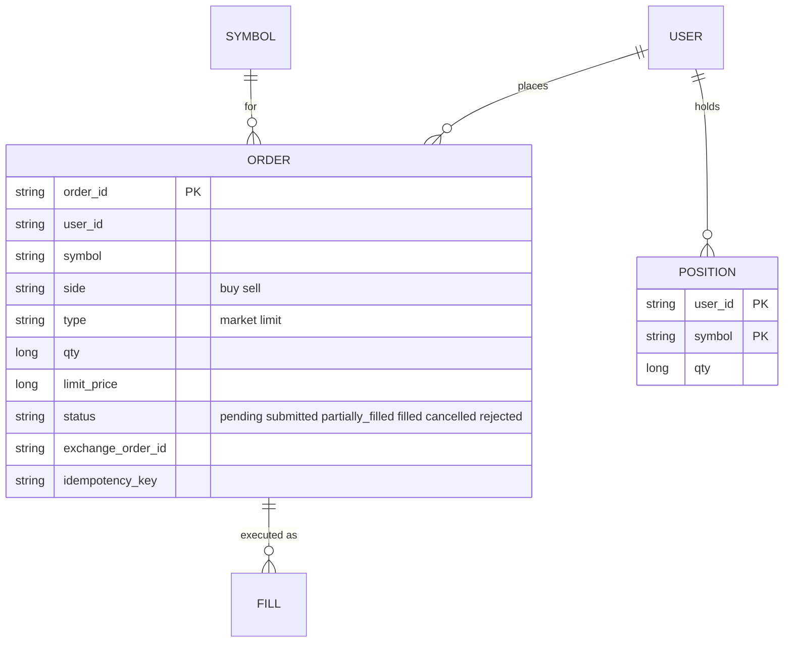
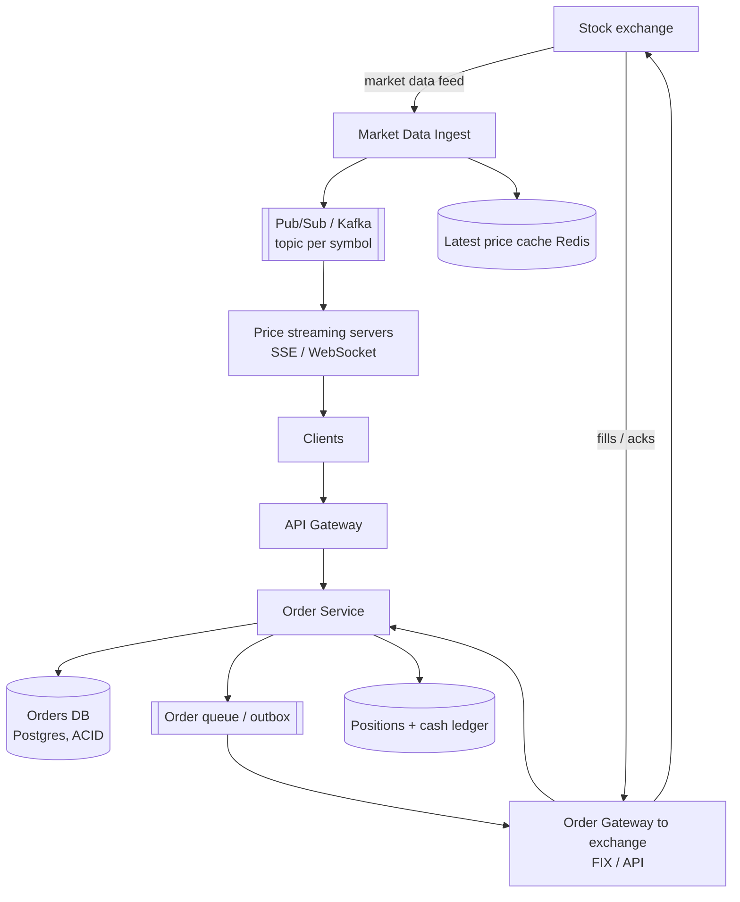
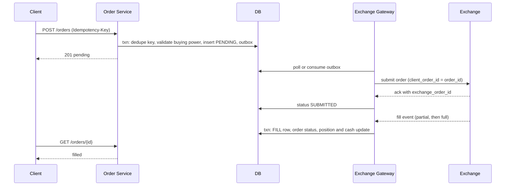

# Designing Robinhood (Stock Brokerage)

> Interview-ready walkthrough: requirements → estimates → entities → API → HLD → deep dives (**live price fan-out to millions, order management and exactly-once, exchange integration, consistency and the ledger, spikes**) → trade-offs. The hard parts are **streaming prices to many clients** and **correct, idempotent order lifecycle with an external exchange**.

---

## 0. Talk track

1. Clarify: view live stock prices, place/cancel market and limit orders, view orders/portfolio. Exchange integration assumed (brokerage only).
2. Split: **read path** (prices, 20M DAU) vs **write path** (orders, strongly consistent).
3. HLD: order service + DB, exchange gateway, price feed fan-out.
4. Deep dives: price streaming (SSE/WebSocket + pub/sub), order state machine, exchange async updates, spike handling.

---

## 1. Problem

A brokerage app that lets users **watch live quotes**, **trade** through an external exchange, and track positions.

**What makes it hard**
- **Price updates** for thousands of symbols to millions of watching users.
- **Orders must not be duplicated or lost**; exchange is asynchronous and external.
- Market-open **spikes** (100x).

---

## 2. Requirements

### Functional
- See **live prices** of stocks.
- Manage orders: **place, cancel** (market/limit), view status.

**Out of scope:** after-hours, ACH funding, options, advanced charts, ML.

### Non-functional
- **High consistency for orders** (users' money).
- **Scale**: 20M DAU, about 5 trades/day each, about 10K symbols.
- **Low latency** price display (under 200 ms), order submit under about 200 ms.
- **Fault tolerant**; handle exchange partial outages.

---

## 3. Estimation

| Quantity | Assumption | Result |
|---|---|---|
| Orders | 20M DAU x 5 | **100M/day, about 1.2K/s avg, about 10K+/s at open** |
| Symbols | about 10K, updates up to 10/s | **100K exchange ticks/s** inbound |
| Price subscribers | 20M DAU, each watching 5-20 symbols | **fan-out in the tens of millions of messages/s peak** |
| Order row | 1 KB | 100 GB/day |

Consequence: ingest of prices is modest; **fan-out** is the heavy part. Order QPS is modest but needs **ACID**.

---

## 4. Entities



---

## 5. API

```http
GET  /symbols/{sym}/price                       # snapshot (initial load)
SSE  /stream?symbols=AAPL,TSLA                  # live price updates (server push)
POST /orders  Idempotency-Key: <uuid>  { symbol, side, type, qty, limit_price }  -> 201 { order_id, status:"pending" }
DELETE /orders/{id}                              -> 202 cancel requested
GET  /orders?cursor=   GET /orders/{id}
```

User id from auth, never from the body.

---

## 6. Architecture



---

## 7. Order flow



---

## 8. Deep dive 1: live prices

| Approach | Verdict | Why |
|---|---|---|
| Client polls every second | Bad | 20M x 1/s = 20M req/s; stale |
| **Server push** (SSE/WebSocket) from price servers subscribed to a **pub/sub per symbol** | Great | Efficient; fan-out at the edge tier |
| Add **conflation** (send latest price at most every 200 ms) and coalesce per symbol | Great | Bounds outbound rate regardless of tick rate |

Each streaming server subscribes (once) to only symbols its connected clients watch, keeping a `symbol to set of connections` map. Clients subscribe/unsubscribe on screen change. Use a latest-price cache for initial render and reconnects. SSE is simpler than WebSocket since traffic is **one-way**.

**One-liner:** *Pub/sub per symbol, edge servers fan out to sockets, conflate ticks.*

## 9. Deep dive 2: order consistency

- **ACID DB** (Postgres), partition by `user_id`. Buying-power check and order insert in one transaction.
- **Idempotency key** per order prevents duplicates from retries.
- **State machine** with conditional transitions; persist before calling the exchange (outbox).
- Exchange `client_order_id = order_id` makes submissions idempotent at the exchange.
- Cancel is a request; terminal state arrives asynchronously.

## 10. Deep dive 3: asynchronous exchange updates

Exchange replies arrive via callbacks/streams: the **gateway** consumes, maps to internal orders, and applies **idempotent** updates (dedupe by exec id). If the gateway restarts it reconciles by querying open orders. Also run end-of-day **reconciliation** between exchange reports and our ledger.

## 11. Deep dive 4: spikes at market open

Queue between order service and exchange gateway to smooth bursts; autoscale stateless services; rate limits per user; shed non-critical load (charts) first; pre-warm caches; isolate price streaming from order path so one cannot starve the other.

---

## 12. Failure handling

| Failure | Mitigation |
|---|---|
| Streaming server dies | Client reconnects (SSE auto-reconnect), resubscribes, gets snapshot |
| Exchange link down | Orders stay PENDING in queue; user notified; no silent loss |
| Duplicate submission | Idempotency key and client_order_id |
| Order service crash mid-flow | Outbox + state machine resume |
| DB failover | Synchronous replica; strong consistency over availability |
| Position mismatch | Reconciliation and ledger audit |

---

## 13. Trade-offs

| Decision | Chosen | Alternative | Given up |
|---|---|---|---|
| Prices | Push + conflation | Poll | Connection management; exact tick-by-tick |
| Orders DB | Postgres ACID | NoSQL | Auto-scaling ease |
| Order submit | Async via outbox | Synchronous call | Immediate fill info |
| Transport | SSE | WebSocket | Bidirectional (not needed) |
| Consistency | Strong for orders, eventual for prices | All strong | Cost |

---

## 14. Level expectations

- **Mid:** order table, price service, cache, polling or WebSocket.
- **Senior:** push fan-out via pub/sub, idempotent order lifecycle, exchange integration, spike handling.
- **Staff+:** conflation, reconciliation/ledger, exchange failure modes, regulatory/audit trail, multi-region.

## 15. Follow-ups

Margin/risk checks, order types (stop), options, fractional shares, tax lots, market-data licensing costs.

## 16. Summary checklist

- [ ] SSE/WebSocket price streaming from per-symbol pub/sub, conflated
- [ ] ACID order DB, idempotency key, state machine
- [ ] Outbox to exchange gateway, `client_order_id`
- [ ] Idempotent fill processing and reconciliation
- [ ] Queue smoothing for open spikes
