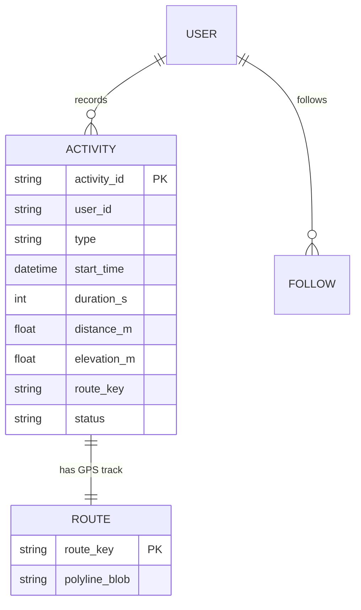
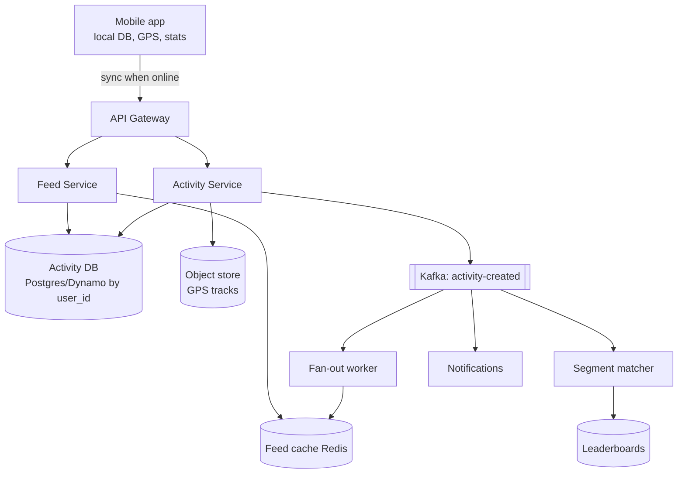
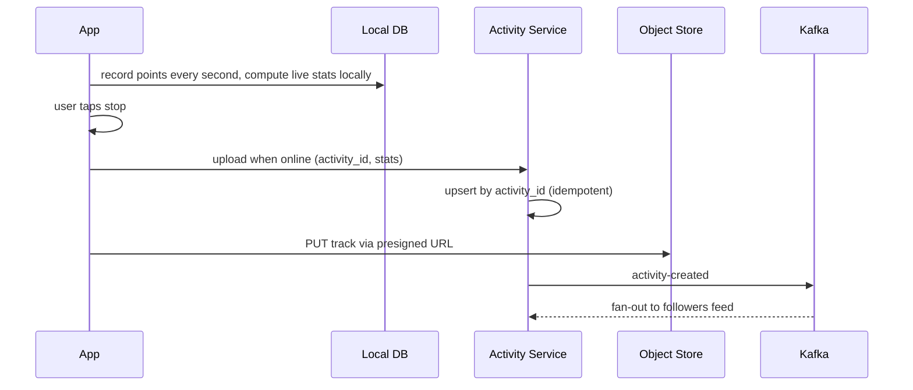

# Designing Strava (Fitness Activity Tracking)

> Interview-ready walkthrough: requirements → estimates → entities → API → HLD → deep dives (**offline-first recording, GPS ingest, activity feed and fan-out, segments/leaderboards, storage of time-series routes**) → trade-offs. The hard parts are **offline tolerance on the client**, **GPS data volume**, and **social feed + leaderboards**.

---

## 0. Talk track

1. Clarify: record activities (run/ride) with GPS, view live stats, upload, share with friends, view friends' activities. Out: routes/segments (may add), coaching.
2. Client-side first: **recording happens on device, offline**; server stores and shares.
3. HLD: upload service, activity DB, feed, notifications.
4. Deep dives: GPS storage, offline sync, feed scaling, leaderboards.

---

## 1. Problem

Athletes track activities (GPS route, pace, distance, elevation), upload them, and **share/compete** with friends.

**What makes it hard**
- GPS tracks are time-series blobs (thousands of points).
- Recording must work **offline**; sync later and exactly once.
- Social feed with fan-out; **segment leaderboards** need geospatial matching.

---

## 2. Requirements

### Functional
- Users **start, pause, stop** activities and see **live stats** (distance, time, pace, route).
- Users view **past activities** and details.
- Users **follow** friends and see their activities.

**Out of scope:** routes planning, premium features, clubs, kudos/comments (mention).

### Non-functional
- **Availability over consistency**; feed eventual.
- **Offline-first** client.
- Scale: **10M DAU**, 1 activity/day/active user.
- Low-latency feed and history.

---

## 3. Estimation

| Quantity | Assumption | Result |
|---|---|---|
| Activities | 10M/day | about 115/s avg |
| GPS points | 1 Hz, 1 hour: 3600 x 30 B | **about 100 KB per activity** |
| Daily GPS | 10M x 100 KB | **1 TB/day** |
| Metadata | 2 KB | 20 GB/day |
| Yearly | | about 365 TB of tracks: object storage |

Consequence: **tracks in blob/object store** (or columnar time-series), metadata in a DB. Write rate is low; payloads are big.

---

## 4. Entities



---

## 5. API

```http
POST /activities                        { activity_id (client UUID), type, start_time }        -> 201
PATCH /activities/{id}   { state:"paused|resumed|stopped", points:[{ts,lat,lng,alt}], stats }  # periodic batches (optional live)
POST /activities/{id}/route             # upload full GPS track (multipart/chunked presigned) at the end
GET  /activities/{id}                   -> details + route url
GET  /feed?cursor=                      -> friends' activities
```

Client-generated **activity id** makes uploads **idempotent** (retry after reconnect).

---

## 6. Architecture



---

## 7. Flow



---

## 8. Deep dive 1: offline-first recording

- All live metrics (distance, pace) are computed **on-device** (no network dependence; GPS + sensors continuously).
- Persist points to a **local database** every few seconds (crash-safe).
- Sync when connectivity returns; background upload with retry; **idempotent by client UUID**.
- For optional live sharing: periodically push batches over HTTP/WebSocket; server treats as best effort.
- Resolve conflicts: server is append-only for an activity; client wins for its own data.

**One-liner:** *The phone is the source of truth until sync; the server is idempotent.*

## 9. Deep dive 2: storing GPS data

| Approach | Verdict |
|---|---|
| One DB row per point | Bad: 36B points/day |
| **Blob per activity** (compressed polyline / protobuf delta-encoded) in object store | Great: 1 write, cheap, fast fetch |
| Time-series/geo DB for analytics | Good add-on for segments, heatmaps |

Downsample for map display (Douglas-Peucker) and keep raw for analysis; thumbnails/static map images pre-rendered.

## 10. Deep dive 3: feed

Same trade-off as news feed: friends typically few, so **fan-out on write** into per-user Redis feed lists; skip fan-out for accounts with huge followings (pull at read); keep **ids only** and hydrate. Pagination by cursor on `start_time`/id. Eventual consistency (seconds) is fine.

## 11. Deep dive 4: segments and leaderboards (extension)

Segment = predefined stretch of road. Match activities to segments by geohash/cell overlap, then verify by path distance; write efforts to a per-segment sorted set (`ZADD` by time). Do it **async** off the Kafka event.

## 12. Storage and scaling

Activity metadata sharded by `user_id`; tracks in S3 with lifecycle (infrequent access for old); CDN for static map images; read replicas for history.

---

## 13. Failure handling

| Failure | Mitigation |
|---|---|
| Phone offline or crash | Local persistence; resume recording; sync later |
| Duplicate uploads | Idempotent by `activity_id` |
| Upload partially complete | Chunked/resumable via presigned multipart |
| Fan-out lag | Eventual feed; metrics on lag |
| Service outage | Client retries with backoff; recording unaffected |

---

## 14. Trade-offs

| Decision | Chosen | Alternative | Given up |
|---|---|---|---|
| Source of truth during activity | Device | Server live | Real-time sharing precision |
| Track storage | Blob | Row per point | Point-level queries (use secondary index) |
| Feed | Push fan-out | Pull | Write amplification |
| Consistency | Eventual | Strong | Fresh feed |
| Compression | Polyline/delta | Raw | CPU, fidelity (keep raw offline) |

---

## 15. Level expectations

- **Mid:** upload activity, store in DB, friends feed.
- **Senior:** offline-first client, idempotent sync, blob storage for tracks, fan-out feed.
- **Staff+:** segment matching at scale, battery/sampling trade-offs, data lifecycle/cost, privacy zones.

## 16. Follow-ups

Live tracking (beacon), privacy zones, heatmaps, challenges, device integrations (Garmin), anti-cheat for segments.

## 17. Summary checklist

- [ ] On-device recording and local DB
- [ ] Client UUID for idempotent upload
- [ ] Object store for tracks, DB for metadata
- [ ] Kafka fan-out to feed cache; async leaderboards
- [ ] Lifecycle tiering of old tracks
