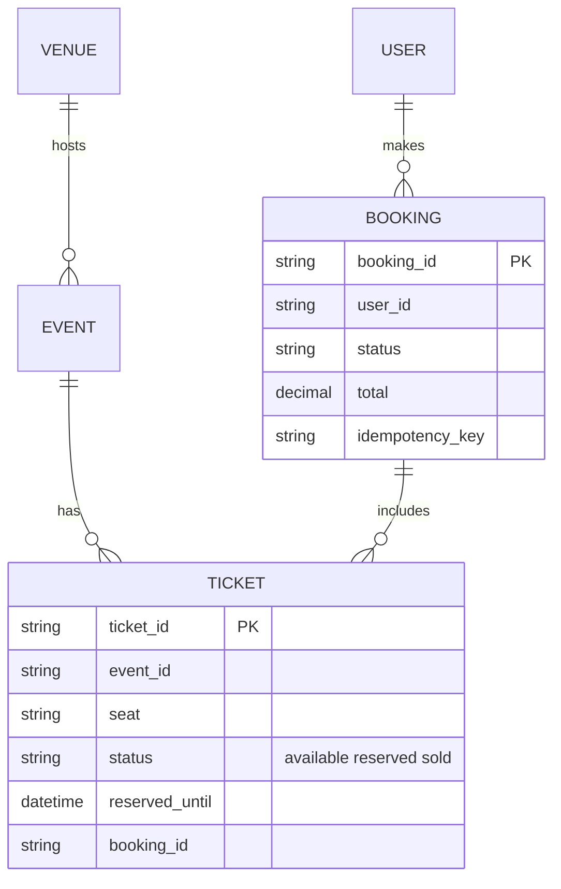
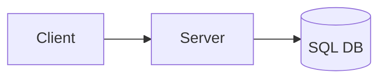
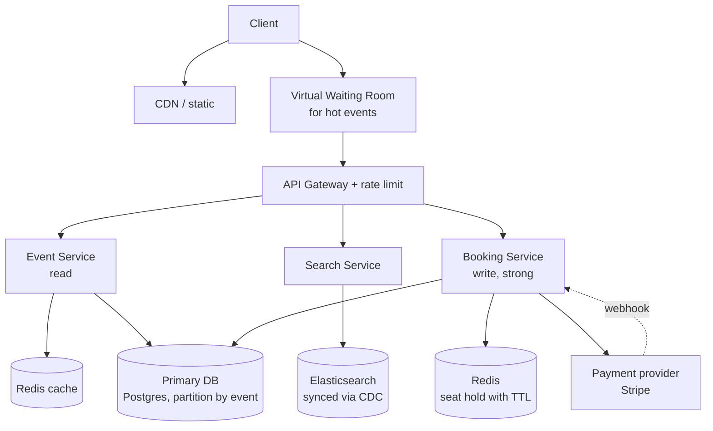
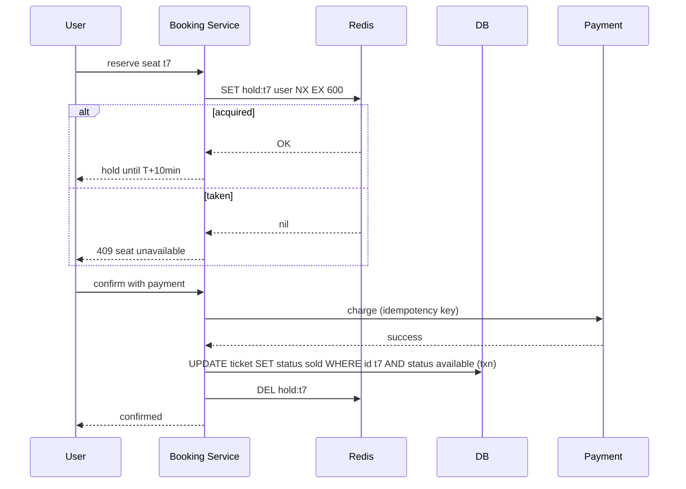

# Designing Ticketmaster (Ticket Booking)

> Interview-ready walkthrough: requirements → estimates → entities → API → HLD → deep dives (**no double-booking, seat reservation, flash-sale surge, virtual waiting room, search**) → trade-offs. The hard parts are **correctness under contention** and **burst traffic**.

> Think Ticketmaster / Eventbrite. Browsing and search are read-heavy and eventually consistent; **booking a seat is strongly consistent**.

---

## 0. Talk track

1. Clarify: view events, search, book tickets. Scale: 10M users per hot event.
2. Highlight the core tension: **consistency for booking vs availability for browsing**.
3. Entities and API.
4. HLD: Event service, Search, Booking service, payment.
5. Deep dives: **seat hold** (reserve before pay), distributed lock/TTL, waiting room, scaling reads, search.

---

## 1. Problem

Let users find events, view seat maps, **reserve** seats, pay, and receive tickets, while ensuring **a seat is sold only once** even when millions hit the same on-sale.

**What makes it hard**
- **No double-booking** under massive concurrency.
- **Hot events**: millions arrive at 10:00 for one stadium.
- **Hold-then-pay**: seats locked during checkout, released on abandonment.

---

## 2. Requirements

### Functional
- View events and details.
- Search events (name, artist, city, date).
- Book tickets (select seat, pay).

**Out of scope:** dynamic pricing, resale marketplace, admin tools, GDPR.

### Non-functional
- **Strong consistency for booking** (no double-sell); **availability for browse/search**.
- Read-heavy: **100:1** browse to book.
- Scale to **10M concurrent users for a popular event**.
- Search under 500 ms; low-latency browse.
- Fault tolerant; fair queueing for hot events.

---

## 3. Estimation

| Quantity | Assumption | Result |
|---|---|---|
| Users | 100M MAU | |
| Hot on-sale | 10M users, 50K seats | **200:1 contention** per seat |
| Browse QPS | 10M within minutes | hundreds of K req/s peak |
| Bookings/s | 50K seats over about 10 min | about 100/s sustained, spiky |
| Data | 1M events, 50K seats each | tens of GB: small. **Traffic, not data, is the problem** |

**Consequence:** a relational DB handles the data; the challenges are **surge control** and **seat contention**, not capacity.

---

## 4. Entities



---

## 5. API

```http
GET  /events/{id}                       -> event + seat availability
GET  /events/search?q=&city=&date=&cursor=
POST /bookings/reserve   { "event_id":"e1", "ticket_ids":["t7","t8"] }   -> 200 hold with expires_at | 409 seat taken
POST /bookings/confirm   { "booking_id":"b1", "payment_token":"..." }
    Idempotency-Key: <uuid>             -> 200 confirmed | 410 hold expired | 402 payment failed
```

Two-step reserve then confirm (like checkout) so payment is not done while holding a DB lock.

---

## 6. Architecture

### v1

Problem: reads and bookings compete; hot event overloads everything.

### Final design


---

## 7. Booking flow



---

## 8. Deep dive 1: preventing double-booking and holds

| Approach | Verdict | Why |
|---|---|---|
| Status column + cron to expire holds | Bad | Expiry is delayed; stale holds block seats |
| **DB row lock** (`SELECT FOR UPDATE`) / optimistic version CAS | Good | Correct; but holding txn open during payment hurts throughput |
| **Distributed lock with TTL** (Redis `SET NX EX`) | Great | Seat is held without long DB txn; auto-expires on abandon |

Pattern: Redis TTL holds guard the **checkout window**, and the **DB conditional update** (`WHERE status='available'`) is the final source-of-truth write. If Redis loses a hold, the DB check still prevents double-sell (**defense in depth**). If a hold expires mid-payment, return 410 and refund or void.

**One-liner:** *TTL hold in Redis for the UX window, atomic conditional update in the DB for truth.*

---

## 9. Deep dive 2: surge and fairness (virtual waiting room)

- Admit users at a rate the booking path can sustain (token bucket); others wait in a queue with an ordering token (signed, position-based).
- Waiting room state in Redis/edge; **long-poll or SSE** for position updates; admission via signed cookie.
- Bots: auth, CAPTCHA, per-account limits.
- Protect booking DB with **admission control**, not just autoscaling.

**One-liner:** *Meter admissions to what the booking path can take.*

---

## 10. Deep dive 3: scaling reads

- **Event pages** cached heavily at CDN/Redis; seat availability is **eventually consistent** (a seat map may be stale by seconds). A 409 at reserve time corrects it.
- Push live seat updates via **SSE/WebSocket** for the active event.
- **Read replicas**; partition by `event_id` (hot events isolated to their own shard).

---

## 11. Deep dive 4: search

Postgres `LIKE` is slow; add **Elasticsearch/OpenSearch** fed by **CDC** (Debezium) from the primary (eventually consistent; fine). Full-text, fuzzy, geo filters. Cache popular queries. Index only searchable fields.

---

## 12. Failure handling

| Failure | Mitigation |
|---|---|
| Redis down | Fall back to DB conditional update with short app-level hold rows; degrade to lower throughput |
| Payment succeeded but confirm failed | Idempotency key + webhook reconciliation; refund job |
| Booking service crash mid-flow | Hold expires by TTL; saga compensation |
| DB failover | Synchronous replica for booking DB; accept brief unavailability over inconsistency |
| ES lag | Stale search only |

---

## 13. Trade-offs

| Decision | Chosen | Alternative | Given up |
|---|---|---|---|
| Hold mechanism | Redis TTL + DB CAS | DB lock only | Added component for scale |
| Seat view | Eventually consistent | Strongly consistent | Occasional 409 |
| Surge | Waiting room | Autoscale only | Immediate access |
| Search | Elasticsearch | SQL | Dual-write/CDC complexity |
| Booking txn | Single-DB per event | Distributed txn | Cross-event atomicity (not needed) |

---

## 14. Level expectations

- **Mid:** reserve/confirm, DB uniqueness, caching browse.
- **Senior:** TTL holds, locking comparison, search index, read scaling, payment idempotency.
- **Staff+:** waiting room design, bot defense, failure reconciliation, hot-event partitioning, SLOs.

## 15. Follow-ups

Dynamic pricing, resale/transfer (ownership ledger), general admission, QR ticket anti-fraud (rotating barcodes), multi-region.

## 16. Summary checklist

- [ ] Reserve then confirm, 10 min TTL hold
- [ ] Redis NX EX plus DB conditional update
- [ ] Virtual waiting room and admission control
- [ ] CDN-cached reads, ES via CDC
- [ ] Idempotent payments and reconciliation
