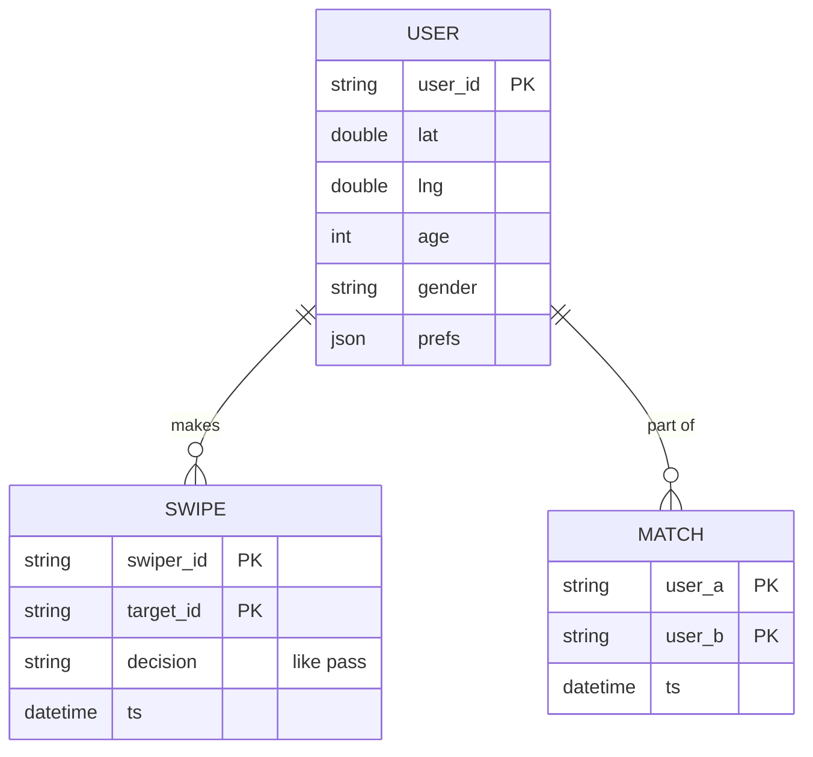
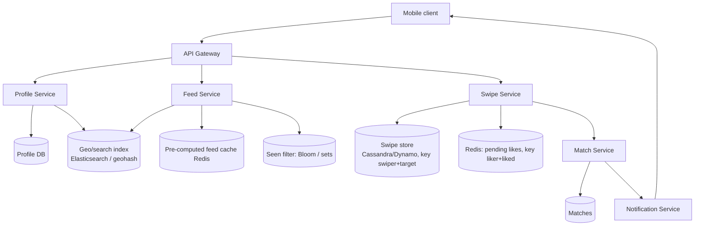
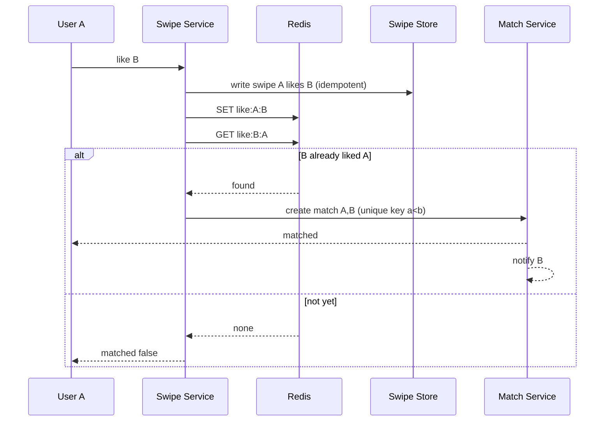

# Designing Tinder (Swipe-Based Matching)

> Interview-ready walkthrough: requirements → estimates → entities → API → HLD → deep dives (**profile feed generation by location/preferences, swipe write path, mutual-match detection and consistency, avoiding repeats, scale**) → trade-offs. The hard parts are **efficient candidate feeds** and **detecting a mutual match reliably under concurrent swipes**.

---

## 0. Talk track

1. Clarify: profile with preferences, view a **feed of candidates**, swipe right/left, **match** when both right, notify. Chat out of scope.
2. Highlight: swipes are **high-volume writes**; matches need consistency; feed is a **geo + preference** query.
3. Deep dives: feed generation, no repeats (seen set), swipe storage and match check, notifications.

---

## 1. Problem

Show users nearby profiles that fit their filters; record swipes; when two users swipe right on each other, create a **match** and notify both.

**What makes it hard**
- **Feed**: location + age/gender filters + not-yet-swiped, at low latency for 20M DAU.
- **Swipe volume**: about 2B/day.
- **Match race**: A and B swipe right at nearly the same time; neither check must miss the other.
- Avoid re-showing seen profiles.

---

## 2. Requirements

### Functional
- Create a profile with preferences (age range, distance, gender).
- View a **stack of profiles** matching preferences.
- **Swipe** like/pass on profiles.
- Get a **match** notification when mutual like.

**Out of scope:** chat, boosts/payments, photo verification, reporting.

### Non-functional
- **Consistent matching** (a mutual like must always produce a match, exactly one).
- **Low latency feed** (under 300 ms), instant swipe response.
- **Scalable**: 20M DAU, about 100 swipes/day, so **2B swipes/day**.
- **Availability** over strict feed freshness.

---

## 3. Estimation

| Quantity | Assumption | Result |
|---|---|---|
| Swipes | 20M x 100 | 2B/day, **about 23K/s avg, about 100K/s peak** |
| Swipe record | 40 B | 80 GB/day, about 30 TB/year |
| Profiles | 100M x 5 KB | 500 GB (photos in object store/CDN) |
| Feed requests | 1 per 10 swipes | about 2.3K/s |
| Right-swipe rate | about 5-30% | matches are rare events |

Consequence: swipes are **write-heavy and key-value shaped** (use a scalable store); feed reads are moderate but need a **geo index**.

---

## 4. Entities



---

## 5. API

```http
GET  /feed?lat=&lng=                    -> [ profile, ... ] (about 20, cursor-less, server tracks seen)
POST /swipe   { target_id, decision:"like|pass" }    -> 200 { matched: true|false }
GET  /matches?cursor=
PUT  /profile  { prefs, ... }
```

Swipe is **idempotent** on `(swiper_id, target_id)`.

---

## 6. Architecture



---

## 7. Swipe and match flow



---

## 8. Deep dive 1: generating the feed

| Approach | Verdict | Why |
|---|---|---|
| SQL with lat/lng bounding box + filters + `NOT IN swiped` | Bad | Slow at 100M users; huge NOT IN |
| **Geo/search index** (Elasticsearch geo_point + filters on age/gender) | Good | Efficient candidate retrieval |
| **Pre-computed feed cache** (batch generate candidate stacks per user, served from Redis; refresh when low) | Great | Fast; absorbs query cost; tolerate staleness (profiles change slowly) |

Ranking: simple score (distance, activity recency, attractiveness/Elo-like, mutual fit). Geo cells (geohash/H3) shard the index by city. Users move slowly, so location updates are infrequent and batch-indexed.

## 9. Deep dive 2: don't show repeats

- Store swiped ids per user; filter candidates via a **seen set**. For heavy swipers (100K+ ids) use a **Bloom filter** per user (small false positive = skip a profile, acceptable) cached in Redis.
- Alternatively keep a per-user "swiped ids" in the swipe store and filter in the feed service after candidate retrieval (over-fetch, then filter).
- Reset or expire history after N months to allow re-surfacing.

## 10. Deep dive 3: swipe storage and mutual match consistency

- **Store**: Cassandra/DynamoDB keyed by `(swiper_id, target_id)`: simple, high write throughput, idempotent upsert.
- **Match detection**, three options:

| Approach | Verdict | Why |
|---|---|---|
| Check DB on every like (read the reverse swipe) | Good | Simple; race: both write, both read before the other's write visible, then **missed match** |
| **Atomic in Redis**: store likes in a hash/set, `SADD`/Lua script that checks reverse and writes atomically | Great | Single-threaded atomicity per key; resolves the race |
| DB transaction with serializable isolation on the pair | Good | Correct, lower throughput |

Pair partitioning: route both directions of a pair to the **same shard** (`key = min(A,B):max(A,B)`) so the check-and-set is local. Match row uses a **unique key on the ordered pair** so duplicates are impossible.

**One-liner:** *Put both directions of a pair on one shard and check-and-set atomically.*

## 11. Deep dive 4: notifications

Match event to Kafka, push through APNs/FCM; if the other user is in the app, WebSocket push. Notification is best effort (the match is persisted; shown at next open).

## 12. Deep dive 5: scale

Swipe path stateless and sharded by pair key; feed cache regenerated in background; profile photos on CDN; rate limit swipes (anti-bot, free-tier daily cap) via Redis counters.

---

## 13. Failure handling

| Failure | Mitigation |
|---|---|
| Redis loss | Rebuild pending-like state from swipe store (recent window); reverse check falls back to DB |
| Duplicate swipe | Idempotent upsert |
| Missed match due to crash between steps | Write swipe first (durable), then check; reconcile job re-evaluates recent likes |
| Feed cache stale | Acceptable; refill on low watermark |
| Geo index lag | Acceptable |

---

## 14. Trade-offs

| Decision | Chosen | Alternative | Given up |
|---|---|---|---|
| Feed | Precomputed + geo index | On-demand query | Freshness, storage |
| Seen tracking | Bloom filter | Exact set | Rare skipped profile |
| Match check | Atomic Redis on pair shard | DB read-after-write | Extra store, rebuild logic |
| Swipe store | Wide-column | SQL | Ad hoc queries |
| Consistency | Strong for matches | Eventual | Latency/complexity |

---

## 15. Level expectations

- **Mid:** profile + swipe tables, geo query, match on reverse swipe.
- **Senior:** feed precompute, seen filtering, swipe write scalability, match race.
- **Staff+:** pair-sharded atomic matching, Bloom filters, ranking pipeline, anti-abuse, multi-region.

## 16. Follow-ups

Super-like, rewind, boosts, ranking by ML, chat post-match, safety/reporting.

## 17. Summary checklist

- [ ] 2B swipes/day, KV swipe store keyed by pair
- [ ] Precomputed geo-filtered feed cache
- [ ] Seen filter (Bloom) to avoid repeats
- [ ] Pair-local atomic check for mutual like, unique match key
- [ ] Async push notification
