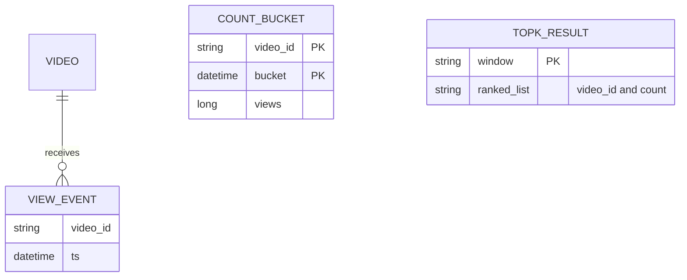
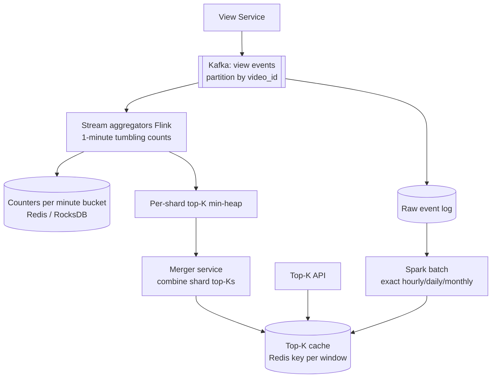
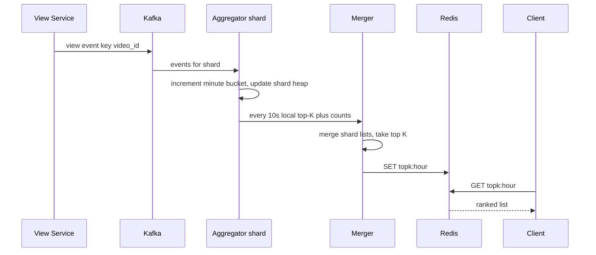

# Designing Top-K (YouTube Top Videos / Trending)

> Interview-ready walkthrough: requirements → estimates → entities → API → HLD → deep dives (**exact vs approximate counting, windowed aggregation, hot keys, merging shard top-Ks, serving**) → trade-offs. The hard part is **maintaining a top-K ranking over a firehose of events and sliding windows**.

---

## 0. Talk track

1. Clarify: top K videos by views for windows (hour, day, month, all-time), K up to 1000, low-latency reads.
2. Estimate: 70K view events/s; videos in the billions.
3. Naive (DB group by) to counters to stream aggregation.
4. Deep dives: pre-aggregation, sharded counters + heaps, Count-Min Sketch, time windows, hot partitions, read path.

---

## 1. Problem

Return the **K most viewed videos** for a given window. Views arrive as a stream; queries should return in milliseconds.

**What makes it hard**
- Enormous event rate and cardinality (billions of videos).
- **Time windows** slide; old events must expire.
- Skew: viral videos create hot keys.
- Accuracy vs cost trade-off.

---

## 2. Requirements

### Functional
- Query top K (up to 1000) videos for **all-time, last hour, day, month**.

**Out of scope:** per-category tops, personalization, UI.

### Non-functional
- Query latency **under 100 ms**.
- **Near real-time** (results within about 1 min; hourly window can lag a little).
- **Highly available**; eventual consistency acceptable.
- Scale: **70K views/s**, 1B videos, **approximate OK** for some windows (state this!).

---

## 3. Estimation

| Quantity | Assumption | Result |
|---|---|---|
| Views | 70K/s peak | **6B/day** |
| Event | about 50 B | 300 GB/day raw |
| Distinct videos | 1B, counter 16 B | **16 GB** counters: fits across a few nodes, even one big one |
| Top-K output | 1000 x 16 B | **16 KB** per window: trivial to cache |

**Consequences**
- The result is tiny and precomputable: **never compute top-K at query time**.
- Counters fit in memory when sharded; the pain is **write throughput** and **windowing**.

---

## 4. Entities



---

## 5. API

```http
GET /views/top?window=hour&k=100   -> [ { "video_id":"v9", "views":1200000 }, ... ]
```
Windows: `hour|day|month|all`.

---

## 6. Evolution of the design

| Step | Idea | Why it fails |
|---|---|---|
| 1 | `SELECT video_id, COUNT(*) ... GROUP BY ... ORDER BY LIMIT K` | Full scan per query |
| 2 | Per-video counters in a DB | Writes 70K/s on hot rows; top-K still needs a sort |
| 3 | **Stream pre-aggregation + per-shard top-K heaps + merge** | Good |
| 4 | Approximate counters (Count-Min Sketch) for huge key spaces | Memory bound, small error |

---

## 7. Architecture



---

## 8. Flow



---

## 9. Deep dive 1: partition by video so top-K merges are correct

Partition by `video_id` so **each video's count lives on exactly one shard**. Each shard keeps a **min-heap of size K**. The global top-K is then the top K of the union of shard top-Ks (**correct because any global top-K item must be in its own shard's top-K**). Merge cost: O(shards x K log K), tiny.

**One-liner:** *Shard by key, local top-K, merge K-lists.*

## 10. Deep dive 2: time windows

| Approach | Verdict |
|---|---|
| Store raw events, recount per query | Bad |
| **Bucketed counts** (1-min buckets) and sum last N buckets for the window | Great for hour; for day/month use **hourly/daily rollup buckets** |
| Sliding sketch with decay | Good for approximate trending |

Rollups: minute to hour to day. Expire old buckets (TTL). All-time window: running total counter. Hourly accuracy is the strictest; month can be recomputed in **batch** from the raw log (exact) and be hours stale.

## 11. Deep dive 3: counting at scale

- Exact counters in memory (16 GB total) are fine when sharded.
- If the key space were huge: **Count-Min Sketch** (fixed memory, overestimates only) plus a heap of candidates; or **Space-Saving / Misra-Gries** heavy hitters.
- **Hot keys**: a single viral video overloads its shard, so pre-aggregate in the View Service or Kafka consumer (batch 1 s, then add N), or salt the key and sum partials.

## 12. Deep dive 4: read path

Results are precomputed into Redis (`topk:{window}`), refreshed every 10-60 s; the API is a pure cache read, so latency is under 10 ms and the read side scales with replicas/CDN. Fallback to last good value on failure.

---

## 13. Failure handling

| Failure | Mitigation |
|---|---|
| Aggregator crash | Checkpoint + Kafka offset replay; counters rebuilt from log |
| Duplicate events | Idempotent via event id dedup if needed, else tolerate (approximate) |
| Kafka lag | Alert; results stale but available |
| Redis loss | Recompute from counters or batch; API serves stale snapshot |
| Late events | Watermarks; batch layer fixes hourly/daily |

---

## 14. Trade-offs

| Decision | Chosen | Alternative | Given up |
|---|---|---|---|
| Accuracy | Exact where small, sketch where huge | Always exact | Memory vs small error |
| Freshness | 10-60 s | Real time | Cost |
| Month window | Batch recompute | Streaming | Staleness (hours) |
| Merge | Shard top-K merge | Global heap | Small coordination step |
| Read | Precomputed cache | Compute on read | Storage trivial |

---

## 15. Level expectations

- **Mid:** counters + sort; knows scans fail; adds cache.
- **Senior:** Kafka partitioned aggregation, heap per shard, windowing with buckets, batch for long windows.
- **Staff+:** Count-Min / heavy hitters, hot-key mitigation, correctness of merge, cost/accuracy trade-offs.

## 16. Follow-ups

Top-K per category/region, trending (velocity not total), decayed scores, real-time (sub-second) boards.

## 17. Summary checklist

- [ ] Precompute, never query-time top-K
- [ ] Shard by video_id, local min-heap size K, merge
- [ ] 1-minute buckets rolled up to hour/day; batch for month
- [ ] Salting or pre-aggregation for hot videos
- [ ] Redis result cache, stale-safe
