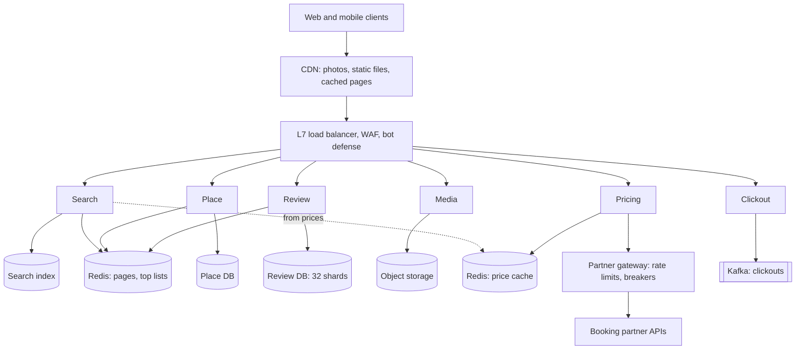
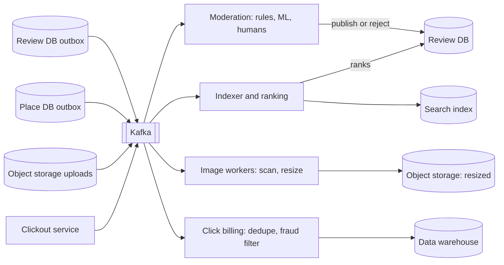
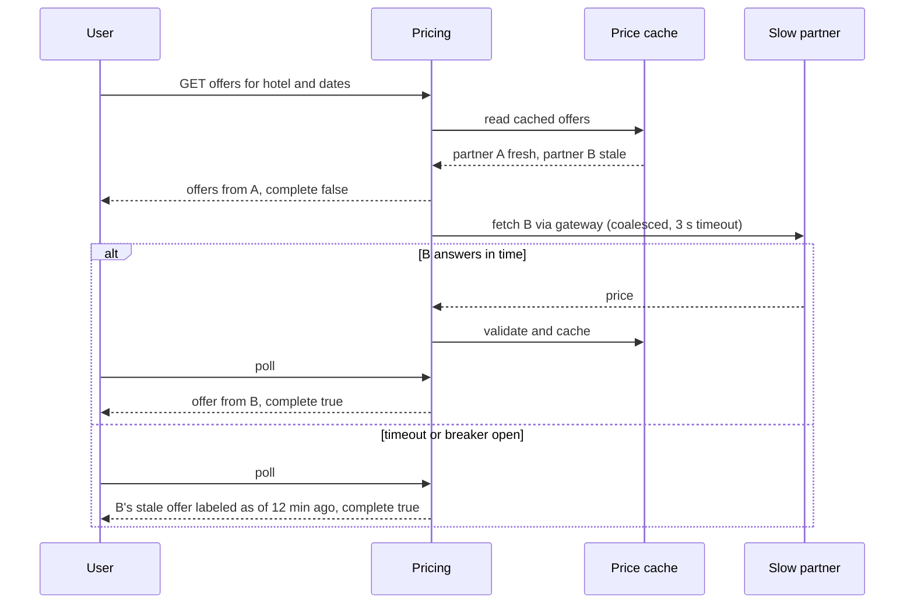

# Designing TripAdvisor (Concise)

> TripAdvisor is **three systems on one catalog of places**: (1) a read-heavy, search-engine-driven content site, (2) a review pipeline where nothing publishes until it's screened, and (3) live hotel price comparison that fans out to about 20 booking partners and earns money per click-out. Numbers marked *public* are TripAdvisor's; the rest are assumptions.

---

## 1. Requirements

**Functional (top 3)**
1. Users can **search and browse places** (hotels, restaurants, attractions) in a destination, ranked and filtered.
2. Users can **read reviews and photos, and write a review** with a rating and photos.
3. Users can **compare live hotel prices** from booking partners, then click through to book.

**Non-functional**

| Requirement | Target |
|---|---|
| Read latency | Place page p99 < 300 ms; search p99 < 500 ms |
| Price latency | First offers p95 < 1.5 s; every partner done or cut off by 5 s |
| Availability | Reads 99.95% (serve stale, never errors); review submit 99.9% |
| Consistency | Author sees their review at once (pending); others within 5 min of approval; each billable click counted once |
| Trust | Every review screened before it's published |

**Out of scope:** bookings and payments (partners do them), forums, trip planning, personalization, ads.

**Say this:** "Price comparison is the hardest part: about 20 partner calls per search, a 5-second budget, and rate limits we can't raise. I'll get browsing and reviews working first, then go deep on prices and review trust."

---

## 2. Estimation (only numbers that decide something)

Assume 40M daily users. *Public:* about 400M monthly visitors, 9M places, 1B+ reviews, 31M new reviews a year.

| Quantity | Math | Result | Decision |
|---|---|---|---|
| Page views | 40M × 10 | 15K/s peak | Mostly anonymous search-engine traffic → CDN caches pages; origin sees about 3K/s |
| Searches | 40M × 3 | 5K/s peak | A search index with a few replicas per region |
| Hotel price checks | 15% of users × 2 hotels | 700/s peak | × 20 partners = 14K partner calls/s → **price cache + request coalescing** |
| List-page prices | 5K/s × 30 hotels | 150K lookups/s | Can't be live → **cached "from" prices only** |
| Review writes | 31M a year (*public*) | about 1/s | Writes are trivial; **screening** is the hard part |
| Reviews stored | 1B × 1.5 KB | 1.5 TB | Fits one host, but a restore takes over the 1 h RTO → **32 shards by `place_id`** |
| Image egress | 400M views × 0.5 MB | 200 TB/day | **CDN is mandatory** |

**Read-heavy:** about 5,000 page views per review written.

---

## 3. Entities and APIs

**Entities:** User, Destination, Place, Review, Photo, PlaceStats (rating counts and rank), Partner, Offer, Clickout.

```http
GET  /v1/places?destination_id=…&type=hotel&sort=rank&checkin=…&checkout=…  → places + cached "from" price
GET  /v1/places/{id}/reviews?sort=recent&lang=en&cursor=…                    → page of reviews
POST /v1/photos/uploads                                                    → presigned upload URL
POST /v1/places/{id}/reviews          Idempotency-Key                      → 202 {review_id, status: pending}
GET  /v1/hotels/{id}/offers?checkin=…&checkout=…&adults=2                   → {search_id, offers, complete: false}
GET  /v1/hotel-searches/{search_id}/offers                                 → more offers; complete: true by 5 s
GET  /v1/clickouts?offer_id=…&search_id=…                                  → 302 to partner, after logging the click
```

- `202` means stored and pending moderation, not published.
- Prices arrive by **short polling**: a search lasts at most 5 s, and polling works through CDNs and mobile networks.
- The user always comes from the auth token, never the request body.

---

## 4. High-Level Design

**v1:** one app and one Postgres; SQL search; live partner calls when the page loads; reviews published instantly.
**It breaks on:** 14K partner calls/s, slow SQL search, fake reviews going live, and 200 TB/day of image egress.

**v2, one requirement at a time:**
1. **Browse:** CDN → Search service → Redis (top lists) → search index (filter by destination, sort by precomputed rank) → attach cached "from" prices.
2. **Reviews:** photos upload straight to object storage. `POST` saves the review as `pending` plus an outbox row in one transaction → Kafka → Moderation → publish transaction → events update the search index, caches and ranks.
3. **Prices:** Pricing returns cached offers at once and fetches missing or stale partners in the background through a Partner gateway (per-partner rate limit, timeout and circuit breaker). The client polls. **Click-out:** log to Kafka, then `302`.

**Request path:**



**Async pipelines:**



**Data**

| Store | Holds | Why |
|---|---|---|
| Postgres: Place DB | 9M places (about 45 GB), destination tree | Small and relational; replicas per region |
| Postgres: Review DB, 32 shards by `place_id` | Reviews, photos, `place_stats`, outbox | A place's reviews and stats share a shard → publish and stats update in **one local transaction** |
| Search index | Places: names, geo, destination path, filters, rank | Text + geo + facets + ranking |
| Redis | Pages, top lists, price cache (refresh after 5 min, drop after 20) | Hot reads and partner offers |
| Object storage + CDN | Photos, about 95 TB a year | Blobs never touch the database |
| Kafka → warehouse | Click-outs and review events | Durable, replayable, billable |

**Why Postgres, not Cassandra, for reviews:** writes are about 1/s, but reads need filters and sorts, a "one review per visit" rule, and an exact stats update in the same transaction.

**Cache:** the CDN holds anonymous pages (5 min, purged on change) and photos. Redis holds place summaries and first review pages (cache-aside, deleted on publish). The fan-out writes the price cache.

---

## 5. Deep Dives

### 5.1 Tests that matter
- The same review submitted twice with one `Idempotency-Key` → one review.
- The publish event delivered twice → stats go up once.
- A partner that never answers → `complete: true` at 5 s with everyone else's prices.
- Kafka down at click-out → the click is spooled to disk, the redirect still happens, and the click is billed once.
- Load: 700 price checks/s never pushes any partner over its rate limit.

### 5.2 Core flows

**Price fan-out (the hardest part)**



- A 5 s deadline, a 3 s timeout per partner, and no retries inside the deadline.
- **Coalescing:** one in-flight call per (hotel, dates, partner) through a Redis `SET NX` lock, so 50 viewers trigger one call.
- A **token bucket per partner** keeps us inside each contract. When it's empty, serve the cached offer.
- **Validate** currency, hotel mapping and price sanity before showing anything.
- Refresh the most-requested keys in the background, so list-page prices stay warm.

**Publishing a review exactly once**

```sql
UPDATE reviews SET status = 'published'
 WHERE review_id = $1 AND status = 'pending' AND version = $2;
-- only if 1 row changed: place_stats count + 1, sum + rating, and an outbox event, in the same transaction
```

- The `status` and `version` check makes a redelivered event harmless, so counts never double.
- The outbox removes the "wrote to the DB but not to Kafka" gap.
- **Moderation**, using TripAdvisor's published 2024 rates: about 88% auto-approved, 7% auto-rejected, and 5% sent to humans (about 4K a day). It **fails closed**: if the model is down, reviews wait.

**Ranking:** a Bayesian average, so one 5★ review can't beat thousands of 4.7s: `score = (C·m + rating_sum) / (C + review_count)`, plus a recency decay. Recomputed per destination every 15 minutes.

### 5.3 Edge cases
- **Retry after a timeout:** the `Idempotency-Key` returns the same review. A second review for the same visit gets `409`.
- **Review bombing:** a per-place velocity alarm holds new reviews for humans.
- **Stampede on a hot hotel and date:** refresh early, coalesce, and add jitter to TTLs.
- **Price changed before the click:** track each partner's price-mismatch rate and demote bad partners.
- **Click fraud:** dedupe by `click_id`, count one billable click per session, offer and 30 s, and filter bots before invoicing.

### 5.4 Cache
- Pages: 5 min plus purge. Reviews: deleted on publish. Top lists: 10 min. Prices: refresh after 5 min, drop after 20.
- If Redis is lost: the CDN serves stale pages, misses are coalesced and rate-limited, and the top destinations are warmed first.

### 5.5 CAP, per operation

| Operation | During a network partition |
|---|---|
| Browse, read reviews | Available from local replicas and caches, slightly stale |
| Submit a review | Needs the shard's primary. If it's unreachable, accept into a regional queue and apply later (the review is pending anyway) |
| Price comparison | Available: cached or partial offers, labeled "as of" |
| Click-out | The redirect always works; the record spools to disk if Kafka is down |

### 5.6 Trade-offs

| Choice | Instead of | What we gave up |
|---|---|---|
| Screen before publishing | Publish, then moderate | Minutes of delay |
| Cached prices on list pages | Live prices everywhere | Prices up to 20 min old (labeled) |
| Polling for prices | SSE or WebSocket | A few extra requests |
| One write region | Multi-region writes | Seconds of data loss if a region dies |
| Sharded Postgres | Cassandra | Resharding is manual work |

---

## 6. Bottlenecks and Failures

**10× traffic:**
1. **Partner rate limits break first,** and we can't buy more. Cache longer, keep list pages cache-only, and shed live fetches for bots and users without dates.
2. **Next, the CDN hit rate,** from crawler storms and cache-busting URLs. Normalize cache keys and give crawlers their own budget.
3. **Then the search index and database replicas:** add replicas.
4. Review writes stay trivial. The human moderation queue grows, so reviews wait longer.

| Failure | Impact | Response |
|---|---|---|
| Partner slow or down | Its prices are missing or stale | Circuit breaker; stale offers labeled |
| Pricing service down | No price box | Pages still show reviews and search |
| Review shard primary | Writes pause about 30 s | Promote the synchronous standby (no acknowledged data lost); queue writes meanwhile |
| Search index down | Filters degraded | Serve precomputed top lists from Redis |
| Redis lost | Slower pages | CDN serves stale; coalesce misses; warm top destinations |
| Moderation ML down | Reviews wait | Fail closed; humans continue |
| Region down | Reads move region | Promote a cross-region replica (seconds of data loss) |

**Also:** a WAF and bot defense against price scrapers and click bots, backups with tested restores, per-partner dashboards (QPS vs. limit, latency, timeouts, mismatch rate), and canary rollouts.

**Recap:** CDN-heavy reads over sharded Postgres and a search index; moderation gates publishing; cached, async partner fan-out. **Main bottleneck:** partner rate limits. **Main trade-off:** price freshness vs. partner quota.

---

## Appendix: Interview Delivery

- **Opening:** "TripAdvisor is three systems on one catalog: a read-heavy content site, a screened review pipeline, and live price comparison. Do we take bookings? How fresh must prices be? Do reviews publish instantly?"
- **Push back:** "Live prices on list pages would be 150K lookups a second. I'd propose cached 'from' prices with an 'as of' label."
- **Likely follow-ups:**
  - *10× traffic?* Partner quotas break first: cache longer, shed low-value fetches.
  - *A partner is down?* Circuit breaker and labeled stale offers; other partners are unaffected.
  - *Fake reviews?* Screen before publishing, ML plus a human queue, velocity alarms, re-moderation.
  - *Billing correctness?* Log before the redirect, dedupe by `click_id`, filter fraud before invoicing.
- **References:** TripAdvisor's 2025 Transparency Report (the moderation rates above); Dean and Barroso, "The Tail at Scale" (CACM, 2013): timeouts and hedged requests in fan-outs.
- **Questions for the team:** How do sponsored placements coexist with organic ranking? What's hardest in partner integrations today: latency, rate limits or price accuracy?
