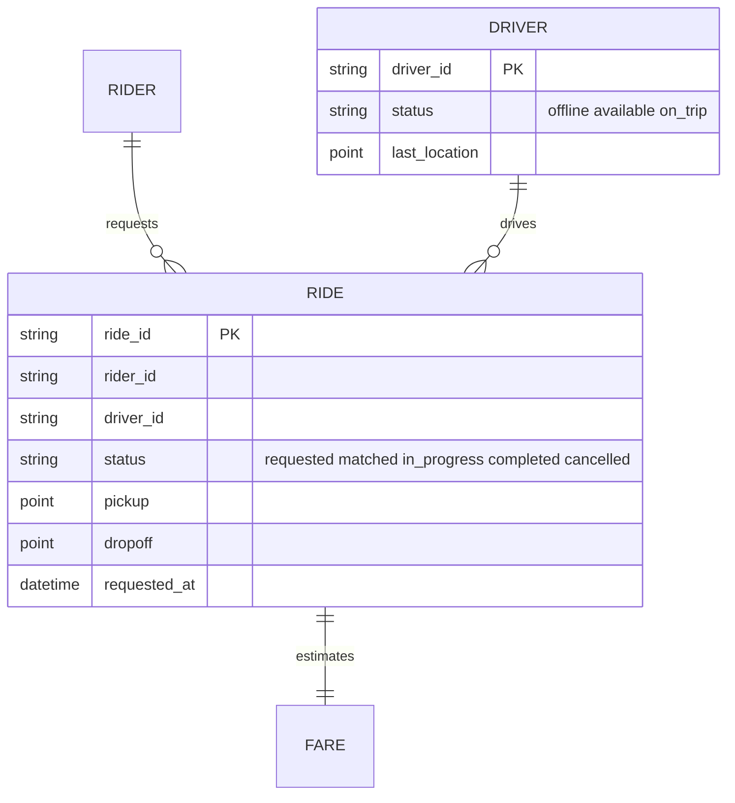
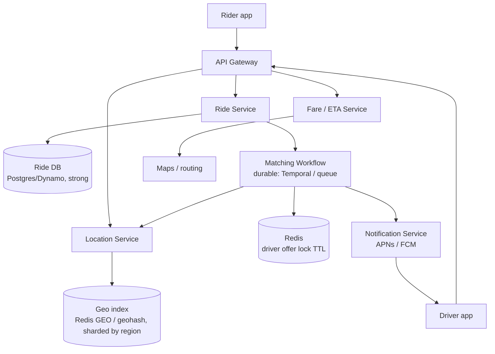
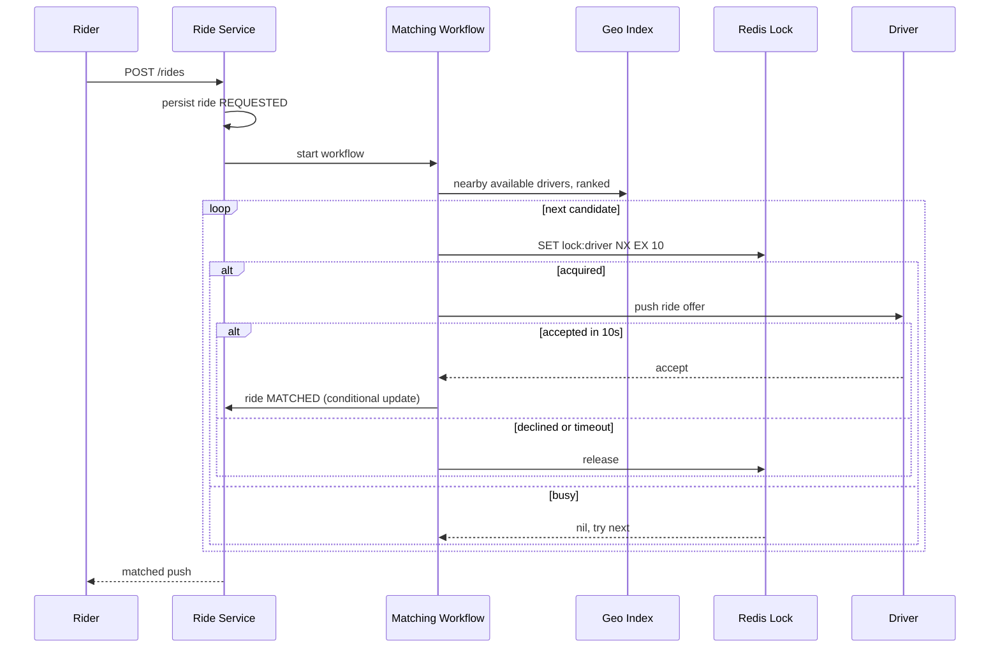

# Designing Uber (Ride Sharing)

> Interview-ready walkthrough: requirements → estimates → entities → API → HLD → deep dives (**location ingestion at scale, geo-indexing, driver matching without double-assign, consistency of ride state, surge**) → trade-offs. The hard parts are **write-heavy location updates** and **matching one driver to one rider exactly once**.

---

## 0. Talk track

1. Clarify: fare estimate, request ride, match driver, driver accept/decline, track. Out: payments, ratings.
2. Non-functional: strong consistency for **matching**, low latency, high throughput.
3. Entities and API.
4. HLD: ride service, location service, matching, notifications.
5. Deep dives: location updates (10M drivers), nearby search (geo index), matching with locks, reliability (durable workflow).

---

## 1. Problem

Riders request rides; the system matches the **best nearby available driver**, tracks the trip, and handles retries when a driver declines.

**What makes it hard**
- Millions of drivers send location every few seconds (**write-heavy**).
- "Nearby" search must be real-time over moving points.
- **Invariant:** a driver gets **one** ride at a time, and a ride gets one driver.
- Offers expire; drivers may ignore, so matching is a **long-running workflow**.

---

## 2. Requirements

### Functional
- Rider enters pickup/destination and gets a **fare estimate**.
- Rider requests a ride; system **matches a driver**.
- Driver accepts or declines; navigates to pickup and drop-off.

**Out of scope:** ratings, scheduled rides, ride categories, payments.

### Non-functional
- **Low latency matching** (under 1 min; ideally seconds).
- **Strong consistency** for assignment: no driver double-booked.
- **High throughput** at peak (events, rush hour): 100K requests.
- Resilient to node failures, retries.

---

## 3. Estimation

| Quantity | Assumption | Result |
|---|---|---|
| Drivers online | 10M, location every 5 s | **2M writes/s** |
| Ride requests | 20M/day, peak 10x | about 230/s avg, about 2.5K/s peak |
| Location payload | 100 B | 200 MB/s ingress |
| Geo index size | 10M x 100 B | **1 GB**: fits in memory |

**Consequences**
- 2M writes/s needs **in-memory geo store**, not a SQL row update per ping; shard by region.
- Ride requests are modest; the **location firehose** dominates.
- Reduce write rate: adaptive frequency (driver idle vs en-route), batching.

---

## 4. Entities



---

## 5. API

```http
POST /fare            { pickup, destination }                  -> { fare_id, estimate, eta }
POST /rides           { fare_id }                              -> 202 { ride_id, status: "requested" }
PATCH /rides/{id}     { "driver_response":"accept|decline" }   # driver side
POST /drivers/location { lat, lng }                            # every 5 s; driver id from JWT
GET  /rides/{id}                                               # status; or push via WebSocket/push notification
```

IDs come from auth tokens, never from the request body.

---

## 6. Architecture



---

## 7. Matching flow



---

## 8. Deep dive 1: location ingestion

| Approach | Verdict | Why |
|---|---|---|
| Write every ping to SQL | Bad | 2M writes/s kills the DB |
| **Batch + in-memory geo store** (Redis `GEOADD`, geohash/H3 cell index) | Great | Last-known location only: overwrite; TTL for dead drivers |
| Adaptive ping rate | Good add-on | Fewer writes when idle/stationary |

Drivers are **sharded by region/cell** so one node handles a city. A durable history stream (Kafka) is optional for analytics, off the hot path. Eventual consistency of location is fine (a few seconds).

**One-liner:** *Latest-location-wins in memory, shard by geography.*

---

## 9. Deep dive 2: finding nearby drivers

| Approach | Verdict | Why |
|---|---|---|
| Scan all drivers | Bad | O(N) |
| **Geohash/H3 grid cells**: look up the rider's cell plus neighbors | Great | O(drivers in neighborhood); expand ring if sparse |
| Quadtree | Good | Adapts to density; more complex to update at high write rates |

Rank by **ETA** (routing service), not straight-line distance (rivers, one-way). Take the top K, then offer sequentially.

---

## 10. Deep dive 3: no double-assignment

- **Offer lock** per driver (Redis `SET NX EX`) while an offer is outstanding; driver status flips to `offered`.
- Final commit with **conditional update** on the DB: `UPDATE ride SET driver_id=? WHERE ride_id=? AND status='requested'` and driver `available -> on_trip`. Loser retries the next candidate.
- Strong consistency on the **ride and driver state**, eventual on location.

**One-liner:** *TTL lock for the offer window, conditional write for the commit.*

---

## 11. Deep dive 4: durable matching workflow

Matching spans timers (10 s per offer), retries, and failures. Use a **workflow engine** (Temporal, or queue + delayed messages) that persists state so a crash resumes mid-match. Alternative: queue with per-ride delayed retries. Handle: no drivers (expand radius, notify), rider cancel (signal workflow), driver goes offline (release).

---

## 12. Surge and hot zones

At peaks, cell load spikes: shard by finer cells, queue ride requests per region, **admission control**, and surge pricing to rebalance supply and demand.

---

## 13. Failure handling

| Failure | Mitigation |
|---|---|
| Geo store node loss | Replicas; drivers repopulate within 5 s (self-healing via pings) |
| Matching worker crash | Workflow resumes; offers idempotent by `(ride_id, driver_id)` |
| Lost push notification | Driver polls/WebSocket fallback; offer TTL |
| Ride DB failover | Sync replication for ride table; conditional updates avoid double-match |
| Region outage | Regional isolation: other cities unaffected |

---

## 14. Trade-offs

| Decision | Chosen | Alternative | Given up |
|---|---|---|---|
| Location store | In-memory geo | SQL | Durability of history (stream it separately) |
| Match | Sequential offers | Broadcast to many | Speed vs driver fairness/double-accept races |
| Consistency | Strong on rides, eventual on location | All strong | Cost |
| Workflow | Temporal | Queue+cron | Extra platform dependency |
| Ranking | ETA | Distance | Routing-call cost |

---

## 15. Level expectations

- **Mid:** ride request/match flow, geo-search idea, DB for rides.
- **Senior:** geohash/H3, location write math, locking for exclusive offers, notifications.
- **Staff+:** durable workflows, regional sharding, surge/admission control, ETA-based ranking, failure drills.

## 16. Follow-ups

Ride pooling, scheduled rides, driver incentives, fraud (GPS spoofing), multi-city/multi-region, post-trip payments.

## 17. Summary checklist

- [ ] 2M location writes/s, so in-memory geo, sharded by cell
- [ ] ETA-ranked candidates, sequential offers
- [ ] TTL offer lock plus conditional DB commit
- [ ] Durable matching workflow, push with fallback
- [ ] Regional isolation, surge control
