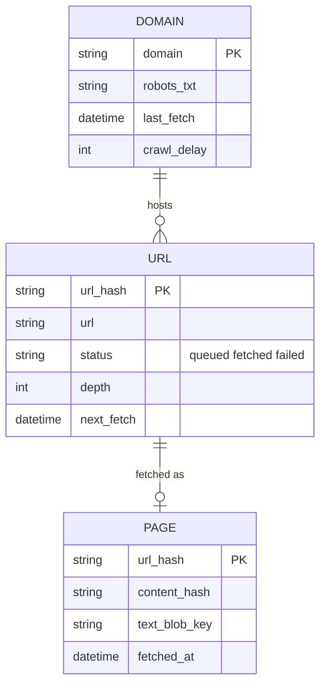
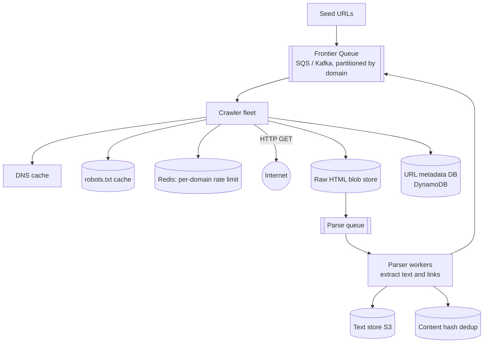
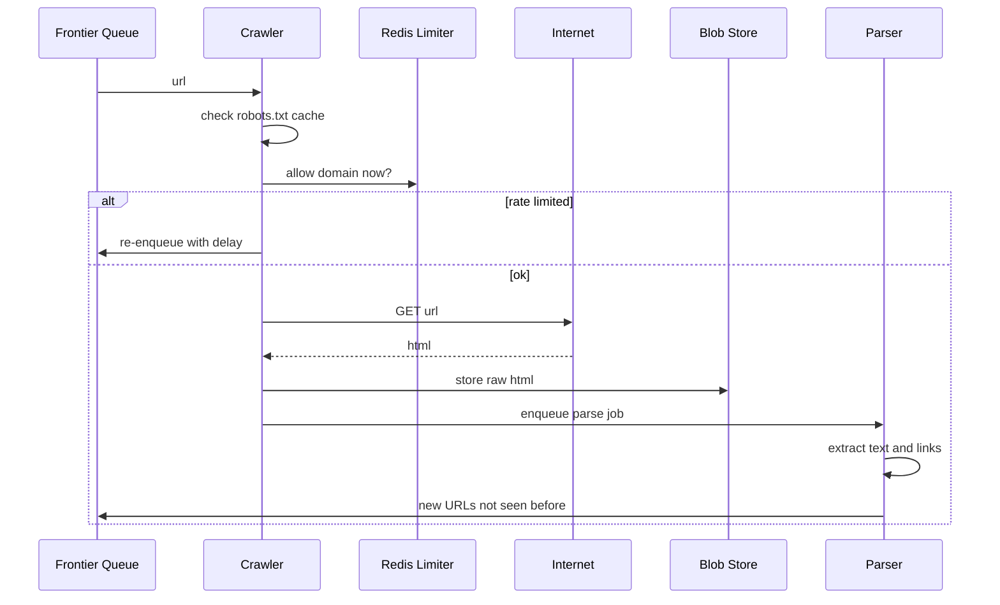

# Designing a Web Crawler

> Interview-ready walkthrough: requirements → estimates → entities → HLD → deep dives (**frontier and politeness, fault-tolerant pipeline, dedup, DNS, scale to billions of pages, traps**) → trade-offs. The hard parts are **throughput within politeness constraints** and **idempotent, resumable stages**.

---

## 0. Talk track

1. Clarify: crawl the web from seed URLs, extract text for LLM training, respect robots.txt. 10B pages in about 5 days.
2. Estimate: bandwidth bound; need hundreds of crawlers.
3. HLD: frontier queue, fetch, parse, store, extract links.
4. Deep dives: pipeline fault tolerance, politeness/rate limiting, scaling, duplicate detection, traps.

---

## 1. Problem

Starting from seed URLs, repeatedly **fetch pages, extract text and outgoing links, and enqueue new URLs**, at web scale.

**What makes it hard**
- **Scale**: 10B pages.
- **Politeness**: do not overload any host; follow `robots.txt`.
- **Failures**: sites slow/down; crawlers die; pipeline must resume.
- **Duplicates and traps**: same content many URLs, infinite URL spaces.

---

## 2. Requirements

### Functional
- Crawl from seed URLs.
- Extract and store text for downstream use.
- Discover and follow links.

**Out of scope:** JS-rendered pages (mention headless), media, indexing/search.

### Non-functional
- **Fault tolerant**; resume after failure.
- **Polite** (robots.txt, per-domain rate).
- **Efficient**: finish 10B pages within about 5 days.
- **Scalable**; extensible to other content types.

---

## 3. Estimation

| Quantity | Assumption | Result |
|---|---|---|
| Pages | 10B in 5 days | **about 23K pages/s** |
| Avg page | HTML only, about 100 KB | 23K/s x 100 KB = **about 2.3 GB/s** (about 18 Gbps) |
| Bandwidth per host | 10 Gbps NIC at 30% util, about 0.4 GB/s | **about 6 hosts** on bandwidth alone; DNS, TLS, parse CPU and politeness push this to **hundreds** of crawlers |
| Storage | 10B x 100 KB text | **about 1 PB**, in object store |
| URL metadata | 10B x 200 B | 2 TB |

**Consequence:** bandwidth is not the only limit. **Per-domain politeness (about 1 req/s/domain)** and DNS/connection overhead decide the crawler count.

---

## 4. Entities

---

## 5. Architecture

---

## 6. Flow

---

## 7. Deep dive 1: fault-tolerant pipeline

| Approach | Verdict | Why |
|---|---|---|
| Single crawl-and-parse process | Bad | Crash loses work; parse CPU blocks network |
| **Split stages with durable queues** (fetch, store raw, parse) | Great | Each stage retried independently; raw HTML saved first so parse can be replayed |

- Queue: **SQS** with visibility timeout (retry) and a **DLQ** after N failures; or Kafka.
- **Retry with exponential backoff and jitter**; track `retry_count` per URL; permanent errors (404, DNS failure) are not retried.
- Everything **idempotent** by `url_hash`.

**One-liner:** *Durable queue between stages; store raw first; retry with backoff; DLQ the poison.*

## 8. Deep dive 2: politeness

- Fetch and cache **robots.txt** per domain (TTL about 24 h); honor `Crawl-delay` and disallow rules.
- **Per-domain rate limiter** (Redis token bucket, key = domain). If denied, re-enqueue with delay.
- Partition the frontier **by domain** so one worker owns a domain's politeness state locally, avoiding a distributed limiter for the hot path.
- Priority: score by importance/freshness (PageRank, change rate) so queue ordering is not FIFO only.
- Identify the crawler (User-Agent) and offer contact.

## 9. Deep dive 3: scaling to 10B pages

- Horizontal crawlers behind queues; autoscale on queue depth.
- **DNS** is a bottleneck: local resolver cache, batched prefetch, own recursive resolver.
- Reuse connections (HTTP keep-alive), compress (gzip), async I/O (many concurrent fetches per host).
- **Geo-distribute** crawlers near target sites.
- Sharded metadata (DynamoDB, key=`url_hash`) and bulk writes.

## 10. Deep dive 4: duplicates and traps

| Problem | Technique |
|---|---|
| Seen URL | Normalize URL; `url_hash` PK in DB + **Bloom filter** front check |
| Same content, different URL | Content hash (SHA-256); near-dup via SimHash/MinHash |
| Crawler traps (calendars, session ids, infinite depth) | **Max depth**, max pages per domain, URL pattern heuristics, strip tracking params |
| Redirect loops | Hop limit |

## 11. JavaScript-heavy pages

Detect via thin HTML; send to **headless browser pool** (Playwright) at much higher cost; keep it a separate, rate-limited queue.

---

## 12. Failure handling

| Failure | Mitigation |
|---|---|
| Crawler crash mid-fetch | Message becomes visible again; idempotent redo |
| Site slow/timeouts | Timeouts, backoff, circuit-break the domain for a while |
| Blocking by site | Respect robots; reduce rate; rotate egress IPs only within policy |
| Queue/DB down | Replicated managed services; buffer locally |
| Bad content (huge/binary) | Size caps, content-type filter |

---

## 13. Trade-offs

| Decision | Chosen | Alternative | Given up |
|---|---|---|---|
| Queue | SQS/Kafka by domain | In-memory | Operational cost, but durable |
| Dedup | Bloom + DB | DB only | False positives (tiny) |
| Politeness | Domain-partitioned frontier | Global limiter | Skew for huge domains |
| Parse | Separate stage | Inline | Extra storage hop |
| JS rendering | Selective | Always | Coverage vs cost |

---

## 14. Level expectations

- **Mid:** frontier, fetch, parse loop; robots.txt; basic dedup.
- **Senior:** staged durable queues, retry/DLQ, per-domain rate limiting, DNS and bandwidth math.
- **Staff+:** frontier prioritization/freshness, trap defense, near-dup detection, cost, geo-distribution.

## 15. Follow-ups

Recrawl scheduling, freshness scoring, sitemap ingestion, link graph for PageRank, indexing pipeline.

## 16. Summary checklist

- [ ] 23K pages/s, hundreds of crawlers
- [ ] Domain-partitioned frontier, Redis limiter, robots.txt cache
- [ ] Raw HTML first, separate parser stage, DLQ
- [ ] URL and content-hash dedup (Bloom filter)
- [ ] Depth limits for traps, DNS cache
