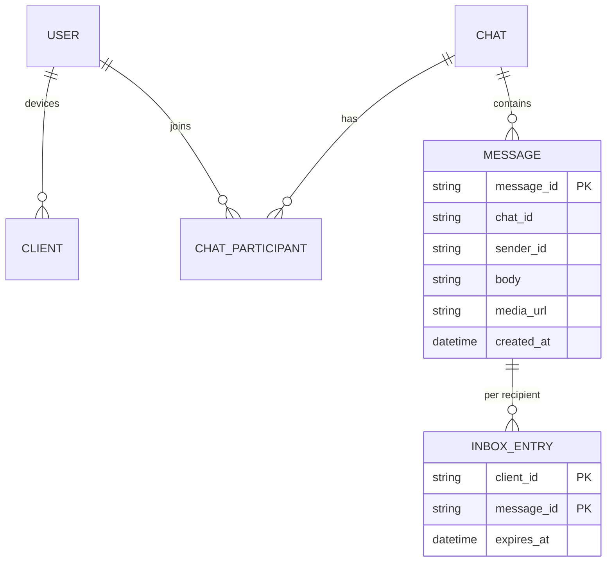
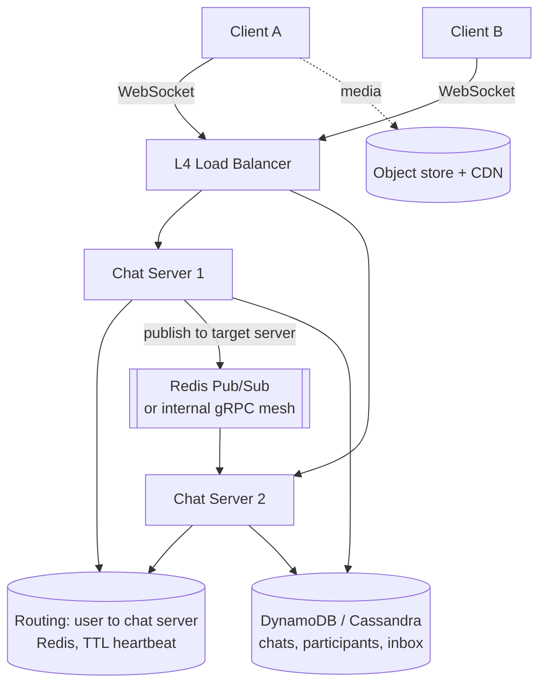
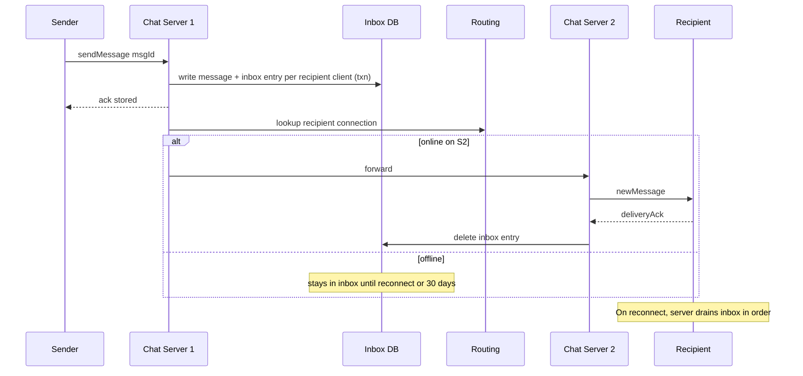

# Designing WhatsApp (1:1 and Group Messaging)

> Interview-ready walkthrough: requirements → estimates → entities → API → HLD → deep dives (**persistent connections, delivery guarantees, offline inbox, groups, multi-device, scale to billions**) → trade-offs. Contrast with the *Slack* doc here: WhatsApp is **store-and-forward** with a **transient inbox**, not durable channel history.

---

## 0. Talk track

1. Clarify: 1:1 and group chat (up to 100), delivery receipts, **offline delivery**, media. Out: calls, stories.
2. Scale: 1B users, 200M+ concurrent connections.
3. HLD: WebSocket chat servers, routing, inbox.
4. Deep dives: routing across chat servers, delivery semantics, groups, multi-device, media.

---

## 1. Problem

Send messages in real time between users, store them **until delivered**, and handle users who are offline or have multiple devices.

**What makes it hard**
- **Hundreds of millions of persistent connections.**
- Message must reach the recipient **exactly once** from the UI's view, even across reconnects.
- Offline recipients: queue, then deliver on return.
- Groups and multiple devices multiply deliveries.

---

## 2. Requirements

### Functional
- Group chats (up to 100 participants).
- Send/receive messages (1:1 and group).
- **Receive messages sent while offline** (retained up to 30 days).
- Send media (images, video).

**Out of scope:** voice/video calls, E2EE protocol details, status, payments.

### Non-functional
- Latency under 500 ms for online delivery.
- **Deliver at least once**, dedupe at client (message id).
- **Billions of users**, high throughput.
- Minimize server-side retention (messages deleted after delivery, privacy).
- Fault tolerant.

---

## 3. Estimation

| Quantity | Assumption | Result |
|---|---|---|
| Users | 1B, 500M DAU, 200M concurrent | **200M WebSockets** |
| Messages/day | 100B | **about 1.2M msgs/s avg, 3M peak** |
| Conns per server | about 1-2M (tuned; or 100K conservative) | **100-2000 chat servers** |
| Inbox storage | undelivered only, 30-day cap | a small fraction of total |
| Media | 10% of messages, 200 KB avg | about 60 GB/s at peak: **object store + CDN**, never through chat servers |

---

## 4. Entities



---

## 5. API (WebSocket messages)

```jsonc
// send
{ "type":"sendMessage", "chatId":"c1", "msgId":"uuid", "body":"hi", "attachments":["m1"] }
// server -> sender
{ "type":"ack", "msgId":"uuid", "status":"stored" }
// server -> recipient
{ "type":"newMessage", "chatId":"c1", "msgId":"uuid", "sender":"u1", "body":"hi" }
// recipient -> server
{ "type":"deliveryAck", "msgId":"uuid" }          // then server deletes from inbox
{ "type":"createChat", "participants":["u2","u3"] }
{ "type":"modifyParticipants", "chatId":"c1", "add":["u4"] }
```

Media: upload via presigned URL to blob store, send the attachment id in the message.

---

## 6. Architecture



---

## 7. Delivery flow



---

## 8. Deep dive 1: routing between chat servers

| Approach | Verdict | Why |
|---|---|---|
| Consistent-hash users to servers | Good | No lookup table, but rebalancing disconnects users, and servers aren't the natural unit of connection |
| **Routing table** (`user -> server`, in Redis, TTL refreshed by heartbeat) plus **pub/sub per server** | Great | Any server can look up the target; stale on crash, so TTL |
| Redis Pub/Sub topic per user | OK | Simple; connections to pub/sub scale poorly at 200M |

Server-to-server direct (gRPC) after table lookup keeps the pub/sub shallow. If the target is missing, the message stays in the inbox (store-and-forward makes routing failures harmless).

---

## 9. Deep dive 2: delivery guarantees

- **At-least-once**: persist **before** ack; resend until `deliveryAck`.
- **Client dedupes** on `msgId`, so UI is exactly-once.
- **Ordering** within a chat: per-chat sequence numbers (server-assigned) or sender timestamps plus client ordering; strict global order not required.
- Inbox entries have TTL (30 days). After the ack, **delete** (minimal retention).

**One-liner:** *Persist, ack, push, delete on client ack. Duplicates are fine, losses are not.*

---

## 10. Deep dive 3: groups and multi-device

- **Groups (<=100)**: sender's server writes one inbox entry **per recipient client** (fan-out on write is fine at this size). `ChatParticipant` table keyed by chat to list members; a GSI by user to list chats.
- **Multi-device**: each device has a `clientId`; messages deliver to **every** device inbox of each participant. Cap devices (e.g. 3-4) to bound fan-out.
- Large channels would instead need a pull/seq model (see Slack doc).

---

## 11. Deep dive 4: scaling connections

- Tuned L4 LBs (long-lived TCP), `epoll`-based servers (Erlang/Netty), 1M+ connections per host.
- **Graceful draining** on deploy, with jittered reconnects to avoid thundering herd.
- Heartbeats refresh routing TTL; missed heartbeat marks the user offline.
- Shard inbox DB by `clientId`.

---

## 12. Media

Presigned upload to object store, **encrypt client-side**, send only the URL/key and size/hash. Thumbnails generated async. CDN for downloads. Retention: delete after the retention window.

---

## 13. Failure handling

| Failure | Mitigation |
|---|---|
| Chat server crash | Clients reconnect (backoff + jitter); inbox holds undelivered |
| Routing entry stale | Forward fails, message stays in inbox; client pulls on reconnect |
| Duplicate delivery | `msgId` dedupe |
| DB shard down | Replicated (quorum writes); failover; sender sees retry |
| Mass reconnect storm | Connection rate limiting, staged drains |

---

## 14. Trade-offs

| Decision | Chosen | Alternative | Given up |
|---|---|---|---|
| Storage | Transient inbox | Permanent history | Server-side search/backfill (client holds history) |
| Routing | Table + direct forward | Pure pub/sub | Table upkeep |
| Group fan-out | Write per client | Pull | Storage for 100-member groups, fine at that size |
| Delivery | At-least-once + dedupe | Exactly-once | Client logic |
| DB | Dynamo/Cassandra | SQL | Joins; fits key-value access |

---

## 15. Level expectations

- **Mid:** WebSocket, store and forward, DB.
- **Senior:** routing across servers, ack semantics, offline inbox, groups, multi-device.
- **Staff+:** connection scaling and drain, ordering, E2EE implications, cost, reconnect storms.

## 16. Follow-ups

E2EE (Signal protocol, key distribution), presence/typing, read receipts, message edit/delete, status, large communities.

## 17. Summary checklist

- [ ] WebSocket per device, L4 LB
- [ ] Routing table in Redis with heartbeat TTL
- [ ] Inbox per client, delete on ack, 30-day TTL
- [ ] Persist before ack, client dedupe
- [ ] Group fan-out on write, device cap
