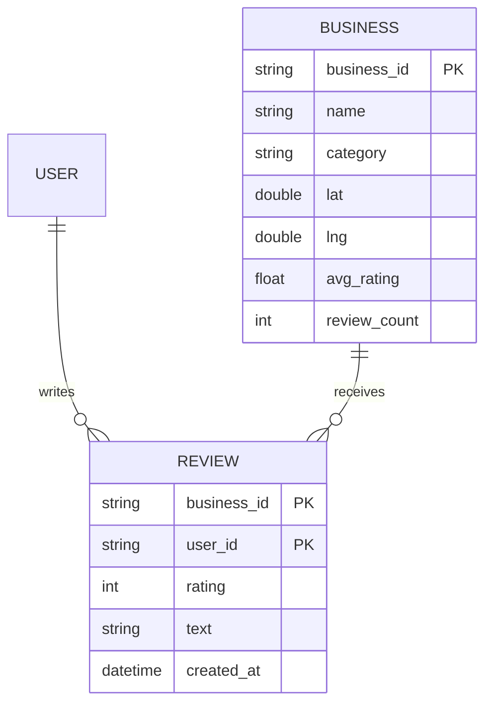
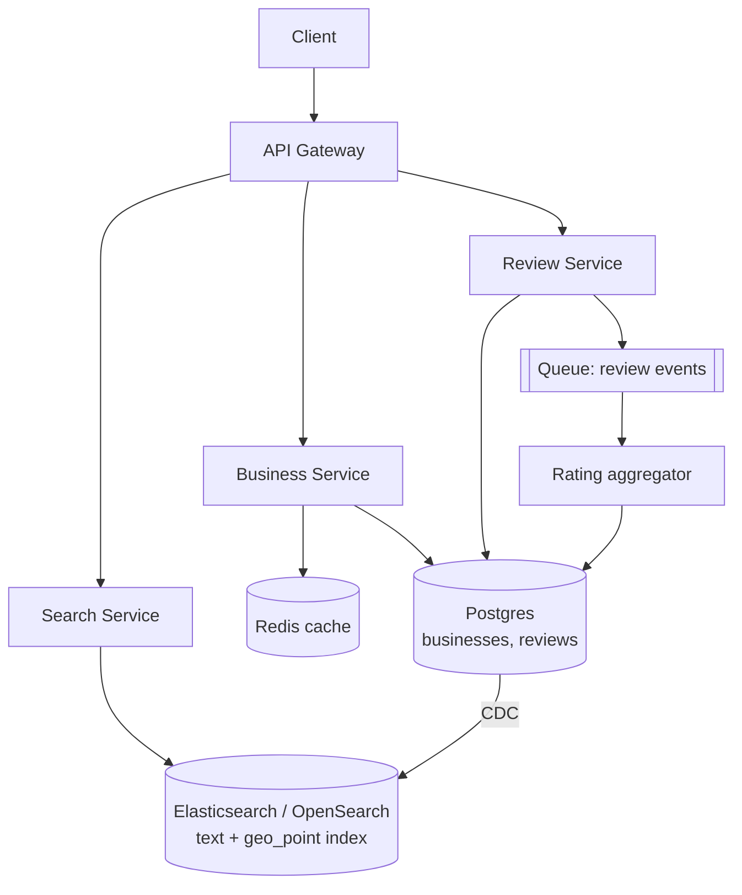
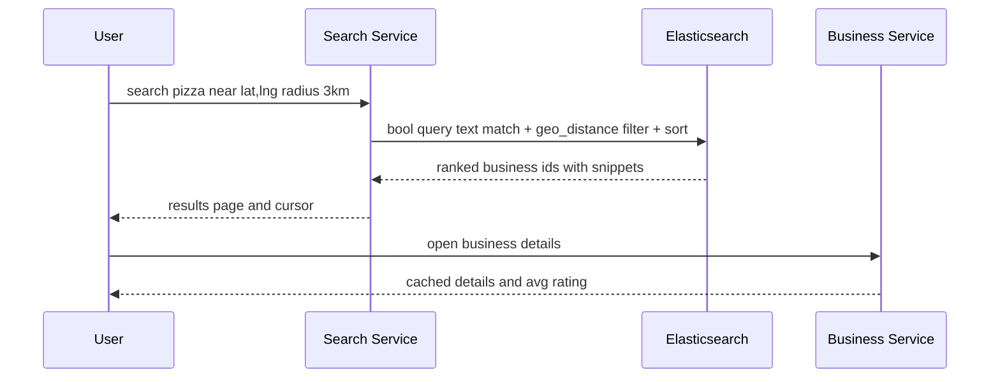

# Designing Yelp (Business Search and Reviews)

> Interview-ready walkthrough: requirements → estimates → entities → API → HLD → deep dives (**geospatial search, text + location query, rating aggregation, one review per user, read-heavy scaling**) → trade-offs. The hard parts are **location-based search** and **keeping average ratings fresh cheaply**.

---

## 0. Talk track

1. Clarify: search businesses (name/category/location), view business details, post reviews with rating, one review per user per business.
2. Insight: **read-heavy (100:1)**, search is the core; ratings consistency is relaxed.
3. HLD: business service, review service, search service with geo index.
4. Deep dives: geo search, rating aggregates, uniqueness constraint, search index sync.

---

## 1. Problem

Users find nearby businesses, read details and reviews, and leave **star ratings + text**.

**What makes it hard**
- Combine **text relevance + geo-radius + filters** at low latency.
- Average rating must update when reviews change, without scanning all reviews.
- Constraint: **one review per user per business**.

---

## 2. Requirements

### Functional
- Search businesses by name, location, and category.
- View business details (info, reviews, photos).
- Leave reviews (1-5 stars + text).

**Out of scope:** adding businesses, photos pipeline, recommendations, check-ins, friends.

### Non-functional
- **Low latency search** (under 500 ms), **high availability**, **eventual consistency** acceptable for ratings.
- **Read-heavy** (about 100:1).
- Scale: **100M DAU, 10M businesses**.

---

## 3. Estimation

| Quantity | Assumption | Result |
|---|---|---|
| Searches | 100M DAU x 5 | 500M/day, **about 6K/s avg, about 20K/s peak** |
| Reviews | 1M/day | about 12/s |
| Business row | 2 KB | 10M x 2 KB = **20 GB** |
| Reviews | 500M x 1 KB | **500 GB** |
| Search index | geo + text for 10M docs | tens of GB: fits a small ES cluster |

Consequence: data is small; **query shape** (geo + text) and read QPS drive the design.

---

## 4. Entities



`(business_id, user_id)` as a **unique key** enforces one review per user.

---

## 5. API

```http
GET  /businesses?q=pizza&lat=37.77&lng=-122.41&radius=3km&category=&min_rating=&cursor=
GET  /businesses/{id}                    -> details + avg_rating
GET  /businesses/{id}/reviews?cursor=
POST /businesses/{id}/reviews  { rating: 5, text: "..." }    -> 201 | 409 already reviewed
```

---

## 6. Architecture



---

## 7. Flow: search



---

## 8. Deep dive 1: geo + text search

| Approach | Verdict | Why |
|---|---|---|
| SQL with `lat/lng BETWEEN` bounding box + `LIKE` | Bad at scale | Poor index use for 2D range plus text |
| Postgres PostGIS GIST + full-text | Good | Works at moderate scale, one system |
| **Elasticsearch** with `geo_point` and text analyzers | Great | Inverted index for text, BKD/geohash for geo; combined filter + relevance |
| Geohash/quadtree own index | Good | More control; more to build |

Geo-index options: **geohash prefix** (lookup neighbors to avoid edge cases), **quadtree**, **S2/H3 cells**. Because businesses are **relatively static**, the index can be updated infrequently (batch/CDC). For dense areas (NYC) cells subdivide; for sparse, expand radius.

**One-liner:** *Static points + text: put them in a search engine with a geo index; update via CDC.*

## 9. Deep dive 2: ratings aggregation

| Approach | Verdict |
|---|---|
| `AVG()` over reviews each view | Bad: scans |
| **Incremental update**: `new_avg = (old_avg * n + r) / (n + 1)` in the same transaction as the review insert | Good: exact, but hot row for viral businesses |
| **Async aggregation** (queue) every few seconds/batch | Great for hot businesses: eventually consistent, no write contention |

Store `avg_rating` and `review_count` on the business row; handle **edits/deletes** by adjusting the delta. Occasionally reconcile from reviews. Ratings in ES may lag (ok) and are used for sorting.

## 10. Deep dive 3: one review per user

Unique constraint on `(business_id, user_id)`; 409 on duplicate. Alternative: allow editing (upsert) and update aggregate by delta.

## 11. Deep dive 4: scaling reads

- **Cache** business details and popular queries (short TTL); CDN for photos.
- Read replicas for Postgres; ES shards by geo region or hash, replicas for QPS.
- Partition reviews by `business_id`; page with cursor `(created_at, id)`.
- Hot businesses: cache reviews first page; coalesce requests.

---

## 12. Failure handling

| Failure | Mitigation |
|---|---|
| ES down | Replicas; degrade to Postgres basic search or cached results |
| Index lag | Acceptable; reindex via CDC replay |
| Review write to DB fails | Client retry; unique key makes duplicates safe |
| Aggregator crash | Queue redelivery; idempotent by review_id; periodic recompute |
| Cache stampede | TTL jitter, singleflight |

---

## 13. Trade-offs

| Decision | Chosen | Alternative | Given up |
|---|---|---|---|
| Search | Elasticsearch | Postgres only | Operating two stores, eventual index |
| Rating update | Async aggregate | Synchronous | Slight staleness |
| Geo index | geo_point/geohash | Custom quadtree | Control |
| Store | Postgres | NoSQL | Constraint support is a win; scale fits |
| Consistency | Eventual for ratings | Strong | Fresh numbers |

---

## 14. Level expectations

- **Mid:** tables, SQL search idea, review uniqueness.
- **Senior:** geo indexing choice, ES, caching, rating aggregation.
- **Staff+:** CDC sync, hot business handling, density-adaptive indexing, ranking relevance, fraud/spam reviews.

## 15. Follow-ups

Review spam/fraud detection, photos pipeline, personalization, business owner replies, map view clustering.

## 16. Summary checklist

- [ ] 100:1 reads; small data (500 GB), Postgres + replicas
- [ ] ES geo + text for search, CDC sync
- [ ] Unique (business_id, user_id)
- [ ] Incremental/async rating aggregates
- [ ] Caching and cursor pagination
