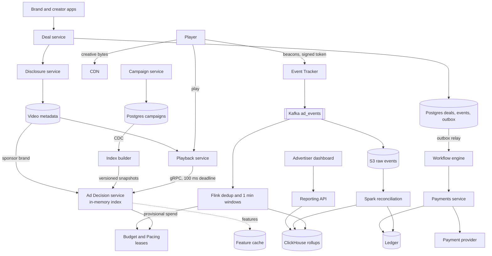
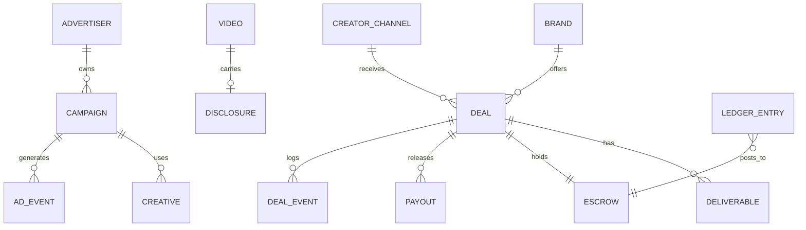
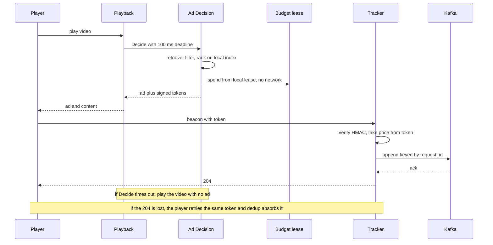
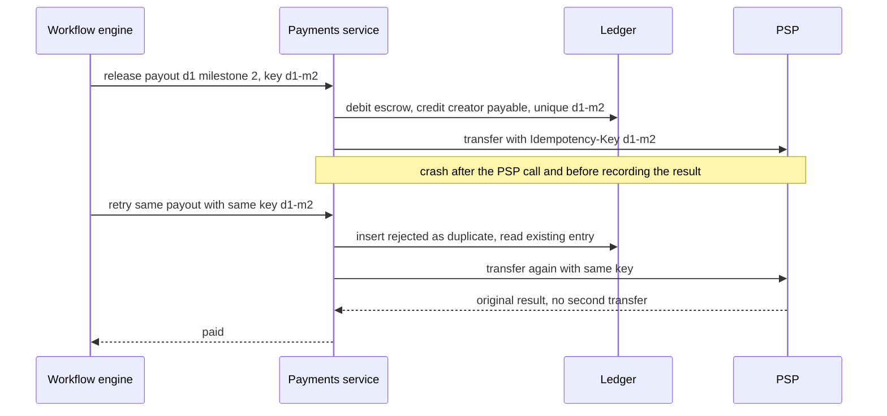
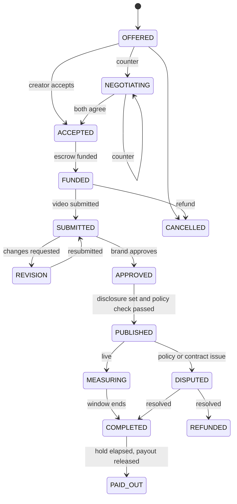

# Designing YouTube Sponsored Ads

> Follows the six-step delivery framework: requirements, core entities and API, [optional] data flow, high-level design (built one requirement at a time, v1 then iterate), then deep dives driven by the non-functional requirements. Every number is an assumption and each one ends in a design decision.

> The key observation: "sponsored ads" is **two different systems** under one name. Platform-managed ads are a huge, latency-critical, write-heavy pipeline. Creator-embedded sponsorships are a tiny, money-moving workflow. Seeing that early, then sharing only what is truly common (measurement, ledger, policy), is the core of this design.

| Framework step | Time | Section |
|---|---|---|
| Functional (top 3) and non-functional (top 3-5, quantified) requirements | ~5 min | 1 |
| Estimation, only where it changes a decision | as needed | 2 |
| Core entities, then API per functional requirement | ~7 min | 3 |
| [Optional] data flow and high-level design, one requirement at a time | ~15 min | 4 |
| Deep dives driven by the non-functional requirements | ~15 min | 5 |
| Bottlenecks, failures, wrap-up | ~5-7 min | 6 |

---

## 1. Clarify the Requirements

### Opening (30 seconds)

"Sponsored content on YouTube has two forms. **Platform-managed ads**: an advertiser buys placements (pre-roll, mid-roll, skippable, bumper), and the platform picks, serves, measures, and bills. **Creator-embedded sponsorships**: a brand pays a creator to feature it inside the video itself, so the platform cannot serve it. It can only broker the deal, hold the money, enforce disclosure, report performance, and pay the creator. Let me confirm scope and scale before I draw anything."

**Clarifying questions I would ask** (assumed answers in parentheses):
1. Do we cover both halves or only platform ads? (Both, ads first.)
2. What scale? (~5B views/day, details in Section 2.)
3. What happens if the ad system is slow or down? (Video must still play.)
4. How fresh must advertiser reports be? (A few minutes.)
5. Do we design auction and ranking ML? (No, black box.)
6. Is the payout path regulated for disclosure? (Yes, "Includes paid promotion" is mandatory.)

### Functional Requirements (top 3)

1. **Advertisers create campaigns and viewers see a relevant ad** in each eligible slot when a video plays.
2. **Advertisers see how their ads performed** (impressions, views, clicks, spend) at hourly or finer granularity, and are **billed accurately**.
3. **A brand can sponsor a creator**: offer, negotiate, fund escrow, review the video, and the creator gets paid. Sponsored videos always carry a **disclosure label**, and the brand and creator can see **performance**.

### Non-Functional Requirements (quantified)

| # | Requirement | Target |
|---|---|---|
| 1 | **Latency**: ad decision | p99 < 100 ms at ~120K/s peak. If late or down, **fail open**: the video plays without an ad |
| 2 | **Durability and accuracy**: billable events | No lost events, no double-counted events. Billing is reconciled |
| 3 | **Consistency**: money and deals | Exactly-once, strongly consistent, full audit trail. No double payout, no payout from unfunded escrow |
| 4 | **Consistency**: budgets | Spend within budget, small bounded overage acceptable |
| 5 | **Freshness**: reporting | Within a few minutes (eventual) |
| 6 | **Compliance and security** | Disclosure is never missing. Forged beacons rejected. Card data never on our servers |
| 7 | **Availability** | Ad path 99.99% by degrading to no ad. Deal path 99.9%, correctness over uptime |

### Scope

- **In scope:** the six items above across both halves.
- **Out of scope:** auction and ranking ML internals, creative upload and transcoding, Shorts and live formats, tax and legal contracts, brand-lift and cross-device attribution, fraud *detection models* (we do design **dedup and validity rules**).
- **What shapes the architecture most:** (a) sub-100 ms decisions at 120K/s, (b) never losing or double-counting $28M/day of billable events, (c) exactly-once money movement.

> **Say this out loud:** "Decision latency and billing accuracy are the hard parts of platform ads. Consistency and auditability are the hard parts of embedded sponsorships. I'll design the ad path first because it is hardest at this scale, then the deal workflow, then what they share. I'd like to hear if you want me to flip that order."

---

## 2. Estimation & Scale (Read vs. Write Heavy)

I will only keep numbers that decide something.

### Traffic

| Quantity | Calculation | Result | Design consequence |
|---|---|---|---|
| Ad-eligible views | 5B views x 50% monetized | 2.5B/day | |
| Ad decisions | 2.5B x 1.4 slots | 3.5B/day | |
| Decision QPS | 3.5B / 86,400 = 40K/s, peak x3 | **~120K/s** | Cannot hit a database per request, so the index lives in memory on each server |
| Impressions | 3.5B x 80% fill | 2.8B/day | |
| Tracking events | 2.8B x ~5 (impression, 25/50/75/complete, skip, click) | 14B/day, 160K/s avg, **~500K/s peak** | Far above one database, so Kafka buffers and Flink pre-aggregates |
| Spend | 2.8B impressions x $10 CPM | **~$28M/day** | 0.1% error is $28K/day, so billing comes from a reconciled batch, not the stream |
| Deals | ~1M active, ~30K state changes/day, ~50K payouts/day | **under 1 write/s** | One Postgres primary is plenty. Optimize for correctness, not throughput |

### Storage and Bandwidth

| Quantity | Calculation | Result | Design consequence |
|---|---|---|---|
| Raw events | 14B x 200 B | ~3 TB/day, **~1 PB/year** | Not OLTP. Parquet on S3, rollups in a columnar store |
| Ingress | 500K/s x 200 B | ~100 MB/s | Easy for Kafka. The limit is consumer parallelism and hot keys (~500 partitions) |
| Ad index | 10M active ads x ~1 KB | **~10 GB** | Fits in RAM on one node, so replicate to every server instead of sharding |
| Decision CPU | 120K/s x ~20 ms | ~2,400 busy cores, ~5K at 50% utilization | Stateless, scale horizontally per region |

### Read vs. Write Heavy

- **Ads:** write-heavy on events (500K/s) and read-heavy on campaign data (read 120K/s, changed thousands per minute). The ratio says **replicate reads to where they are used** (index) and **buffer and pre-aggregate writes** (Kafka, Flink).
- **Reports:** a handful of advertisers query. Reads are tiny versus writes, but skewed to the open hour, so a short TTL result cache is enough.
- **Deals:** negligible volume. Hot-key risk is nil, contention is per deal, so optimistic locking.
- **Skew:** a top advertiser's campaign can take thousands of decisions/s (budget hot key), and a live event can spike one campaign (Flink hot key). Both are handled in Section 5.

---

## 3. Core Entities & APIs

### 3.1 Core Entities (first draft)

- **Advertiser / Brand:** who pays. A brand can also be an advertiser.
- **Campaign, Ad Group, Creative:** what the advertiser buys (budget, bid, targeting, asset).
- **Ad Request, Impression, Event:** what happens when an ad is decided and shown.
- **Ledger Entry:** immutable, double-entry record of money moving.
- **Creator Channel, Video:** the host of a sponsorship.
- **Deal, Deliverable, Escrow, Payout:** the sponsorship workflow and its money.
- **Disclosure:** the "paid promotion" label attached to a video.

Fields and relationships are fleshed out in 4.3.

### 3.2 APIs

REST is the default. gRPC for the internal decision call (latency-sensitive, service to service). The current user always comes from the auth token, never the body.

**Requirement 1: campaigns and ad decisions**

```http
POST /v1/campaigns                       Idempotency-Key: <uuid>
{ "daily_budget_micros": 5000000000, "bid_cpm_micros": 9000000,
  "targeting": { "geo": ["US"], "topics": ["gaming"] }, "format": "skippable_instream" }
-> 201 { "campaign_id": "c_9", "status": "pending_review" }

rpc Decide(DecisionRequest{request_id, video_id, slot, viewer_ctx}) returns DecisionResponse
   (Playback service only, deadline 100 ms)
-> { ad{creative_url, vast_tag}, tracking{impression, q25, q50, q75, complete, click} }   // signed URLs
-> empty (no ad, play the content)
```

Success for `Decide` means "advisory". An empty response or a timeout means **play the video**.

**Requirement 2: tracking, reporting, billing**

```http
GET  https://t.yt/e?tok=<signed token>&ev=q25                                     -> 204   (beacon)
GET  /v1/reports?campaign_id=c_9&from=...&to=...&granularity=hour&metrics=impressions,views,spend&cursor=...
GET  /v1/invoices/{month}
```

A beacon's **204 means "accepted into the durable log"**, not "billed". Reports are paginated and carry a `data_as_of` timestamp.

**Requirement 3: deals, disclosure, performance**

```http
POST /v1/deals                                    Idempotency-Key: <uuid>
{ "creator_channel_id": "ch7", "fee_micros": 20000000000,
  "bonus": { "per_1k_validated_views_micros": 500000, "cap_micros": 5000000000 } }
-> 201 { "deal_id": "d1", "state": "OFFERED", "version": 1 }

POST /v1/deals/{id}/counter   { "expected_version": 1, "terms": {...} }   -> 200 | 409
POST /v1/deals/{id}/accept    { "expected_version": 2 }                   -> 200
POST /v1/deals/{id}/fund                                                  -> 202
POST /v1/deals/{id}/deliverables/{did}/submit  { "video_id": "v88", "sponsor_segments": [...] }
POST /v1/deals/{id}/deliverables/{did}/approve { "expected_version": 5 }
POST /v1/videos/{id}/publish                                              -> 200 | 422 disclosure_required
GET  /v1/deals/{id}/performance
GET  /s/{code}                                                            -> 302 (tracked link)
```

- `expected_version` is optimistic concurrency: two simultaneous edits give one **409**, not a silent overwrite.
- Every money-touching call takes an `Idempotency-Key`, scoped per `(caller, deal, operation)`, stored with the result for 24 hours.
- `fund` returns **202**: accepted for processing. The state becomes FUNDED only after the ledger write commits.
- Authorization: a brand can act only on its own deals, a creator only on deals naming its channel.

---

## 4. High-Level Design

### Data flow

**Platform-managed ads**
1. Viewer presses play. Playback asks Ad Decision for an ad.
2. Ad Decision picks one and returns it with signed tracking URLs.
3. The player shows the ad and fires beacons.
4. The Tracker records beacons. They are aggregated into metrics and later into billable spend.
5. Advertisers query reports. Finance bills from reconciled numbers.

**Creator-embedded sponsorships**
1. Brand makes an offer. Creator accepts or counters. 2. Brand funds escrow. 3. Creator submits, brand approves. 4. Platform publishes with a disclosure label. 5. After a measurement window and hold, the creator is paid from escrow.

### v1 and its flaws

**v1:** one Postgres. Playback queries campaigns for each play, the player posts beacons into an `events` table, reports use `GROUP BY`, and deals are a `status` column with an inline payment call.

| Flaw | Why it breaks | Fixed in |
|---|---|---|
| Campaign query per play | 120K/s, and playback latency becomes database latency | 4.A |
| Events into Postgres | 500K/s and ~1 PB/yr | 4.B |
| Inline payment call | Crash between DB write and PSP call means a lost or duplicate payout | 4.C |

### 4.A Requirement 1: Viewers see a relevant ad

**My first idea** is to query Postgres per request. Pro: trivial. Con: that is the 120K/s database problem above. **Next idea:** cache campaigns in Redis. Pro: no database. Con: still a network hop per request, and targeting is an intersection across geo, topic, language, and format, which does not map to key lookups. **Chosen:** campaigns change thousands of times a minute but are read 120K/s, so **replicate the data to where it is read**.

An **index builder** consumes change-data-capture (CDC) from the campaign database, compiles active campaigns into an inverted index (targeting attribute to campaign ids), and ships **versioned snapshots plus deltas** to each Ad Decision server, which swaps them in atomically. Candidate retrieval becomes a local memory lookup.

- **Staleness:** seconds. Fine for a pause, not for a policy takedown, so a small **kill-list** is polled each second and checked after ranking.
- **Bad snapshot risk:** rolled out in stages with automatic rollback on fill-rate or latency regression.
- **Server-side selection** so a tampered client cannot choose its own ad.
- **Fail open** (video plays with no ad) and **prefetch** the next mid-roll pod so the 100 ms budget is invisible.

### 4.B Requirement 2: Advertiser reports and billing

**First idea:** Kafka, then a Spark batch every N minutes into ClickHouse. Pro: accurate, simple. Con: stale for pacing and launch-day dashboards. **Iteration:** Kafka, then **Flink** (dedup, validity, 1-minute event-time windows) writing **idempotent upserts** to ClickHouse for *provisional* numbers, with raw events archived to S3 and a **batch reconciliation** job that recomputes from the raw log and writes the **ledger**. Stream is the fast layer, batch is the correct layer. **Billing comes from batch**, because $28M/day is too much to trust a streaming approximation.

### 4.C Requirement 3: Sponsor a creator

**First idea:** a `status` column plus an inline PSP call. Con: a crash after the PSP call and before the DB write leaves the two disagreeing, and a retry can pay twice. **Iteration:** an explicit **state machine** in Postgres (each transition is one transaction checking `expected_version`, appending to an immutable `deal_events` table). That still leaves a dual-write gap for side effects, so use a **transactional outbox** relayed to a **workflow engine** that runs idempotent activities and owns the long waits (approval SLA, measurement window, 30-day payout hold). Money lives in an **append-only double-entry ledger**.

**Disclosure** is part of the `publish` transaction. **Embedded measurement** uses several signals keyed by `deal_id`: validated views (same invalid-traffic pipeline), segment retention from creator-declared `sponsor_segments`, tracked links (`/s/{code}` returns 302 and logs a click), and promo codes (self-reported, delayed). Embedded metrics land in the same ClickHouse model so a brand sees paid and embedded performance in one report.

**One cross-path rule:** when brand A sponsors a video, Ad Decision must not serve competitors on it. The disclosure service writes sponsor brand and category into video metadata, which ad servers already read. It is a **read-only coupling**: the ad path never calls the deal database at request time.

### Architecture (v2)



Solid arrows are synchronous. Everything through Kafka, the outbox, and the workflow engine is asynchronous. **Invite input here:** "Does this split between the ad path and the deal path match how you think about it?"

### 4.1 Clients

- **Player** (web, mobile, TV, embedded) calls Playback over HTTPS and fires beacons over HTTP GET. **Brand and creator apps** use the REST API.
- **DNS geo routing and anycast** send each viewer to the nearest region, which keeps the 100 ms budget regional. **CDN** serves creative bytes, never our servers.
- Beacons are fire-and-forget with retry (same token, backoff plus jitter). No persistent connections needed.

### 4.2 App Servers

- **Load balancing:** L7 for public REST (auth, path routing, rate limits). L4 or client-side balancing for the internal gRPC decision call to avoid a proxy hop in a 100 ms budget.
- **Service boundaries:** Ad Decision, Event Tracker, Budget, and Reporting are separate because they scale on different axes (CPU, ingest, tiny state, query). The Deal, Payments, and Disclosure services are low volume and can start as one deployable. We do not need many microservices.
- **Stateless request serving:** Ad Decision holds only a replaceable snapshot, so any node can die. The unavoidable state is the **budget lease** (recovery: unspent slice is lost, bounded) and the workflow state (durable in the engine).
- **Queues and workers** are used only where justified: Kafka for events (500K/s), outbox plus workflow engine for deals (crash-safe side effects).

### 4.3 Database

| Data | Store | Why |
|---|---|---|
| Campaigns, creatives | Postgres | Relational, transactional edits, low volume. Source of truth for the index |
| Ad index | In-memory snapshot per server | 120K QPS under 100 ms rules out network calls |
| Budget counters and leases | Sharded key-value (Redis cluster or Spanner-style) | Very hot, tiny |
| Event log | Kafka keyed by `request_id` | Durable buffer, replay, many consumers, even load |
| Raw events | S3 Parquet by `dt/hour` | ~1 PB/yr, cheap, immutable source of truth |
| Rollups | ClickHouse `ReplacingMergeTree(version)`, ORDER BY `(campaign_id, minute)` | Fast range scans, idempotent overwrite by batch |
| Ledger | Postgres (or Spanner), append-only | Strong consistency, auditability |
| Deals, escrow, payouts | Postgres, single primary with sync replica | Under 1 write/s, transactional |

```text
campaigns(campaign_id PK, advertiser_id, status, daily_budget_micros, bid_cpm_micros, targeting JSONB, version)
ledger_entries(entry_id PK, account_id, direction, amount_micros, currency, source, source_id, created_at)   UNIQUE(source, source_id)
click_agg_minute(campaign_id, minute, impressions, views, clicks, invalid, spend_micros, version)           ORDER BY (campaign_id, minute)
deals(deal_id PK, brand_id, creator_channel_id, state, terms JSONB, fee_micros, version)
deal_events(event_id PK, deal_id, type, actor, payload, ts)                                                 append-only
escrow(deal_id PK, funded_micros, released_micros, status)
payouts(payout_id PK, deal_id, milestone, amount_micros, idempotency_key UNIQUE, status, psp_ref)
disclosures(video_id PK, brand_id, deal_id, type, set_at)
outbox(id PK, deal_id, topic, payload, published_at NULL)
```



- **Modeled around queries:** rollups sort by `(campaign_id, minute)` for the report range scan. ClickHouse is sharded by `advertiser_id` so "all my campaigns" is node-local.
- **Immutable and append-only:** `ledger_entries` and `deal_events` are never updated. Corrections are new reversing entries. Money is an integer in micros plus a currency, never a float.
- **Schema evolution:** events carry `schema_version`, only additive changes, readers tolerate unknown fields, migrations are expand then contract.
- **Source of truth:** campaigns for the index (derived), S3 raw events for metrics, the ledger for money.

### 4.4 Cache

| What | Key | Working set | Pattern | Why |
|---|---|---|---|---|
| Ad index | targeting attribute | ~10 GB per server | Replicated snapshot, push-based | Reads are 120K/s, writes thousands/min |
| Viewer features | `viewer_id` | hot subset | Local LRU, then Redis, cache-aside | Avoids feature store at 120K/s |
| Report results | `(query, range)` | small | Cache-aside, TTL by window openness | Dashboard refresh storms |
| Video sponsor metadata | `video_id` | hot videos | Write-through on publish, 60 s TTL | Label must propagate quickly |

---

## 5. Deep Dives

### 5.1 Test Cases

| Test | Inputs | Expected | Invariant |
|---|---|---|---|
| Ad deadline | Slow Ad Decision (>100 ms) | Playback starts video with no ad | Playback never waits on ads |
| Tampered beacon | Modify price in token | Rejected, no event | Price comes from the signed token |
| Replayed beacon | Same token 3x | One event counted | Dedup on `(request_id, event_type)` |
| Late event | Event 10 min after window | Counted after batch reconcile | Batch is source of truth |
| Budget overspend | 5K servers burn leases at once | Overage under slices x servers | Bounded overspend |
| Concurrent deal edit | Approve and resubmit simultaneously | One 200, one 409 | Brand pays for what it approved |
| Payout crash retry | Kill Payments after PSP call | One transfer, ledger has one entry | Exactly-once payout |
| Publish without label | Paid deal, no disclosure row | 422, video stays unlisted | Disclosure never missing |
| Duplicate funding | Same `Idempotency-Key` twice | Same response, one ledger entry | Idempotent money |
| Ledger balance | Random deal sequence | Debits equal credits | Double-entry integrity |

**Load tests (pass criteria):** 150K decisions/s with p99 < 100 ms and fill-rate regression < 1%. 600K events/s sustained with Kafka lag under 30 s and zero loss (count raw vs. S3). Kill a Flink task and an Ad Decision pod during the run: no billing divergence after reconcile. A report query p99 under 1 s for 7-day hourly.

### 5.2 Core Component Breakdown & Data Flow

#### Critical write: a beacon

1. Player fires `GET t.yt/e?tok=...&ev=q25`.
2. **Tracker** (stateless) verifies the HMAC and expiry, takes the **price from the token** (never the query), applies a cheap `(request_id, event_type)` replay check, and appends to Kafka. It returns **204 only after the Kafka ack**.
3. **Kafka**: partition key `hash(request_id)` gives even spread and keeps all events of one ad request together, which dedup needs. Replication factor 3, `acks=all`, `min.insync.replicas=2`, 7-day retention. ~500 partitions.
4. **Flink**: dedups in keyed state, applies validity rules, then aggregates in **two stages** to survive hot campaigns: partial `(campaign_id#salt, minute)` then merge `(campaign_id, minute)`. Writes idempotent upserts to ClickHouse.
5. **Batch** reconciles from S3 and writes ledger entries keyed by billing window.

Ordering scope is per `request_id`. Cross-request order does not matter because windows are keyed by **event time**. Replay is safe because upserts are versioned. Backpressure: Kafka absorbs bursts, consumers lag, an alert fires on lag but nothing is lost.

#### Critical read: an ad decision

| Step | p99 budget |
|---|---|
| Playback to Ad Decision (same region) | 5 ms |
| Viewer feature lookup (local, then Redis) | 10 ms |
| Candidate retrieval from in-memory index | 15 ms |
| Filtering (frequency caps, brand safety, competitor separation) | 10 ms |
| Ranking and auction | 25 ms |
| Budget check (local lease) | 5 ms |
| Mint tracking tokens (HMAC) | 2 ms |
| Slack for tail | ~28 ms |

- **Candidate cap:** a few hundred candidates by targeting match plus a cheap pre-score, so only the shortlist hits the expensive model.
- **Feature timeout:** fall back to **contextual-only** targeting (video topic, geo). Worse revenue, still correct.
- **Tail latency:** Playback sends a **deadline**, Ad Decision uses a **hedged request** to another replica after p95 and cancels the loser.
- **Overload:** shed in stages: skip the expensive model and rank by static score, then return no ad.



#### Sharding and partitioning

- **Kafka** by `request_id` (even). **Flink** keys by `campaign_id` plus salt for hot campaigns, identified from recent spend. The salted partial aggregates are tiny (one row per salt per minute), so the merge stage is cheap.
- **ClickHouse** shards by `advertiser_id`. Rebalancing is a copy-then-switch of whole advertisers. Cross-advertiser queries are internal analytics only and go through a distributed table.
- **Deals** do not shard. One primary and a sync replica handle <1 write/s, so no cross-partition transactions exist.

#### Queue and worker model

- **Producer handoff:** Tracker to Kafka (ack before 204). Deal service to workflow engine via the **outbox**: state change and outbox row commit together, a relay publishes and marks `published_at`, closing the database-to-queue **dual-write gap**.
- **Consumers:** Flink is partition-parallel with checkpointed offsets. Workflow activities are idempotent, retried with backoff and jitter, and poison messages go to a dead-letter queue with an alert.

#### Critical write: a payout



Safe because of: the **ledger unique key** (internal idempotency), the **PSP idempotency key** (external idempotency), **daily reconciliation** of our ledger against PSP statements, **escrow as a ledger account** (a payout cannot exceed funded money), a **30-day hold** for chargebacks and invalid-traffic review (a clawback is a negative entry, not an edit), and bonuses computed only from **validated** views finalized at the end of the hold.

#### Deal state machine



### 5.3 Edge Cases

| Edge case | Mechanism |
|---|---|
| **Forged or inflated beacon** | Token is `HMAC(request_id, ad_id, campaign_id, price_micros, slot, expiry)`. Price taken from the token. Short expiry (about 2 h) as the revocation trade-off, stateless so no storage at 160K/s |
| **Duplicate beacon retry** | Dedup key `(request_id, event_type)` at Tracker, Flink, and the ledger `UNIQUE(source, source_id)` per billing window |
| **Same viewer sees same ad twice** | Two different `request_id`s, so two valid impressions. Deduping by `(user_id, ad_id)` would undercount |
| **Late or out-of-order events** | Event-time windows with allowed lateness, batch at T+3 days is final, corrections are reversing entries |
| **Hot campaign spike** | Salted two-stage aggregation in Flink, `request_id` Kafka key |
| **Hot budget key** | Leases (below) instead of one central counter |
| **Poison beacon** | Dead-letter topic plus alert, never blocks the partition |
| **Ambiguous PSP timeout** | Retry with same idempotency key, reconcile daily |
| **Concurrent deal edits** | `expected_version`, 409, re-read |
| **Re-upload after approval** | New content hash resets the deliverable to SUBMITTED, so a brand never pays for something different from what it approved |
| **Video removed after payout** | Clawback as a negative ledger entry |
| **Publish without disclosure** | Disclosure row written in the `publish` transaction. Missing row gives 422 and video stays unlisted |
| **Metadata store unreachable** | Do not publish. An unpublished video is better than an unlabeled one |
| **Off-platform sponsor deals** | A detector (transcript, description, links to known brands, user reports) flags likely undisclosed sponsorships for review |

#### Budget leases (the hot-key invariant)

One central decrement per decision makes a hot key and puts counter availability on the ad path. Splitting into N slices drains unevenly. **Instead:** the Budget service owns authoritative remaining budget and hands each Ad Decision server a **lease** (about 1% of what is left, or 30 s of expected spend). The server spends locally with zero network calls and renews at about 80% used. Overspend is bounded by `(servers holding leases) x (slice size)`, and slices shrink as remaining budget approaches zero. A **pacing controller** runs each minute, compares Flink spend to an ideal curve, and sets a per-campaign throttle probability. If the Budget service is unreachable, a server spends its lease and then **stops serving that campaign**: under-delivery beats overspend.

### 5.4 Cache

| Cache | Invalidation | TTL and eviction | Staleness tolerated |
|---|---|---|---|
| Ad index | Versioned snapshot plus delta, kill-list polled each 1 s | Replaced atomically | Seconds for pauses, near-zero for takedowns via kill-list |
| Viewer features | None, TTL only | 5 min TTL, LRU | Minutes |
| Report results | Closed windows immutable, open hour short TTL | Hours (closed) or 30 s (open), LRU | Matches "a few minutes" freshness |
| Sponsor metadata | Write-through on publish | 60 s TTL | Seconds |

- **Stampede:** single-flight per `(query, range)` for dashboards, jitter TTLs on feature cache.
- **Negative caching:** "no features for viewer" cached briefly so anonymous viewers do not hammer Redis.
- **Cold start or cache loss:** an Ad Decision node loads the last snapshot from disk and object storage before joining the load balancer, so it never starts cold. Redis feature loss triggers the contextual-only fallback (a circuit breaker caps the miss traffic) and controlled warming. ClickHouse rollups reduce report cost, so a lost result cache is bounded by single-flight.
- **Pre-aggregation is also a cache:** minute, hour, and day rollup tables (materialized views). Pick by range: up to 6 h use minutes, up to 7 days hours, else days. Trade storage for query speed.

### 5.5 CAP Theorem

Per operation during a network partition (consistency means linearizable, availability means a non-error response from every non-failing node):

| Operation | Choice | Behavior |
|---|---|---|
| Ad decision | Available | Uses local index and lease, stale index acceptable |
| Budget renewal | Consistent | No lease, no spend for that campaign |
| Event ingestion | Available | Accept and dedup later with idempotent keys |
| Deals, escrow, payouts, disclosure writes | Consistent | Minority partition rejects writes. At under 1 write/s the cost is tiny |
| Reports | Available | Serve stale with `data_as_of` |

**Latency versus consistency in normal operation:** a sync replica for the ledger adds a few ms per write, which is irrelevant at 1 write/s but would be unacceptable on the ad path. That asymmetry is why one design does not apply to both halves.

### 5.6 Trade-offs

| Decision | Chosen | Alternative | Rationale | Downside |
|---|---|---|---|---|
| Campaign reads | In-memory replicated index | Redis, DB per request | 120K/s under 100 ms | Seconds of staleness, snapshot rollout risk |
| Ad failure behavior | Fail open | Fail closed | Revenue loss is better than outage | Lost revenue during incidents |
| Stream versus batch | Flink provisional, batch for billing | Stream only, batch only | Dashboards fresh, money correct | Two code paths to keep consistent |
| Budget | Local leases | Central counter, slices | No hot key, no network | Bounded overspend, under-delivery on failure |
| Kafka key | `request_id` | `campaign_id` | Even load, dedup locality | Needs salted two-stage aggregation |
| Tracking token | Stateless HMAC | Stored token ids | No store at 160K/s | No single-token revoke |
| Deal money | Outbox plus workflow plus ledger | Inline PSP call | Crash-safe, auditable | More moving parts |
| Ledger | Append-only | Mutable balance | Auditability, easy reversal | Balance is derived, needs indexes |
| Disclosure | Block publish | Warn only | Regulatory risk | Delays creators if metadata is down |

Revisit the lease approach if regions multiply (two-level lease region then server) or if exact billing must be real time (then streaming exactly-once into the ledger would need to be proven).

---

## 6. Bottlenecks & Fault Tolerance

### 6.1 10x Traffic Spike (~1.2M decisions/s, ~5M events/s)

**Burst versus sustained:** a short burst (a live event) is absorbed by shedding and Kafka buffering. Sustained 10x needs capacity.

Bottlenecks in order:
1. **Ad Decision CPU.** Add capacity and regions, prune candidates harder, quantize the model. Until capacity arrives: shed to a cheaper ranker, then to no ad. Horizontal scaling is right (stateless). Vertical scaling only for the index memory.
2. **Index memory per node.** Shard the index by format or vertical and route by shard.
3. **Feature store QPS.** More local caching, push precomputed features to servers.
4. **Kafka and Flink parallelism.** Add partitions (to ~5K) and tasks. Kafka absorbs bursts, so consumers lag but nothing is lost. Pacing reads slightly staler spend and the lease bound absorbs it.
5. **ClickHouse insert rate.** Pre-aggregate more in Flink, batch inserts.
6. **Budget service hot campaigns.** Larger leases for the biggest campaigns, two-level lease (region then server).

Admission control and backpressure: Playback deadline, bounded queues in front of the ranker, per-device and per-IP rate limits on beacons, reject-or-drop order is no ad first, then lower-value formats. The Deal Service does not scale with views, so it is **not on this list**.

### 6.2 Fault Tolerance & Component Failures

**Single points of failure to remove:** index builder (run two, serve the last good snapshot), Budget service (replicated shards, fencing tokens on leases), deal Postgres (sync replica, fenced promotion), workflow engine (durable history).

| Component | User impact | Detection | Fallback and recovery | Remaining risk |
|---|---|---|---|---|
| DNS, CDN, LB | Region slow | Health checks, synthetic probes | Redundant endpoints, failover to another region | DNS caching delays failover |
| Ad Decision node or slow call | Fewer ads | Latency SLO alerts | Hedged requests, deadline, fail open | Lost revenue |
| Index builder lag | Recently paused ads still served | Snapshot age alert | Last good snapshot, kill-list | Stale for non-urgent changes |
| Redis (features) | Less relevant ads | Error rate | Contextual fallback, circuit breaker, controlled warming | Lower revenue |
| Budget service | Campaigns stop when leases run out | Lease renewal failure | Stop rather than overspend | Under-delivery |
| Tracker | Lost beacons until retry | 5xx rate | Client retry with backoff and jitter, never ack before Kafka | Closed tab means a lost event, accepted |
| Kafka broker | Delayed dashboards | Consumer lag, ISR shrink | Replication, idempotent producers, DLQ | Lag, no loss with `acks=all` |
| Flink | Stale provisional numbers | Checkpoint age, lag | Restart from checkpoint, replay, idempotent sinks, batch corrects billing | Dashboard staleness |
| ClickHouse | Stale or failed reports | Replica health | Replicas, rebuild from S3 | Rebuild time |
| Deals and ledger Postgres | Deals and payouts pause | Replication lag, failover | Sync replica, fenced promotion, PITR backups, restore drills | Replication is **not** a backup |
| Workflow engine | Delayed payouts | Stuck workflow count | Durable history, idempotent activities, resume | Delay only |
| Payment provider | Payout delays | Error rate | Timeouts, retries with exponential backoff and jitter, circuit breaker, daily reconciliation | Money delayed, never lost |
| S3 | Reconcile paused | Request errors | Retries, multi-AZ by default | Billing run delayed |

**Regions:** ad path runs active-active per region with a regional index. Deals run in one primary region with a cross-region async replica. Stated RPO/RTO: ad events RPO ~0 (Kafka replicated) and RTO minutes by traffic shift. Deals/ledger RPO under 1 min (sync replica in-region, async cross-region) and RTO under 30 min. **Backups** (PITR, daily full) are separate from replication, and restore is drilled quarterly.

**Security and abuse:** per-transition role checks, mTLS for internal APIs, rate limits per device and IP on beacons and tracked links, server-side resolution of tracked-link targets (no open redirect), invalid events marked and excluded but never deleted, pseudonymized viewer ids with retention limits, card data never touches us (PSP tokens only), PII not logged.

**Observability:** `request_id` travels from Playback into the token and every event, so one impression is traceable decision to invoice. `deal_id` plus idempotency key trace every deal step. Alerts on fill-rate drop, snapshot age, Kafka lag, **stream-versus-batch spend divergence**, ledger imbalance, and PSP mismatch. On-call debugging: dashboard, then trace by `request_id` or `deal_id`, then the raw event in S3.

**Rollout:** canary by region, ranking models in **shadow mode** first, feature flags, index snapshots and pacing configs auto-roll back on regression, additive schema changes, rollbacks by flag or previous snapshot.

**Recap:** two systems share measurement, ledger, and policy but little else. The main bottleneck is Ad Decision CPU then Kafka and Flink parallelism. The most important remaining trade-off is **provisional stream numbers versus authoritative batch numbers**, which is paid for with a second code path but protects $28M a day.

---

## Appendix: Interview Delivery

### Whiteboard Talking Track

- **Opening (30 s):** restate the two-halves insight, ask the six clarifying questions in Section 1.
- **Scoping:** "I'll design the ad path first, then deals, then the pieces they share."
- **v1 to v2 narrative:** one Postgres, then name three flaws (120K/s per-play query, events into OLTP, inline payment call), then fix each in turn.
- **Invite input:** (1) after the architecture diagram, ask if the split matches their mental model. (2) before deep dives, ask which area they want deeper (latency, billing, or payouts). (3) Pushback point: "Flink checkpointing every minute is not required for correctness here, since windows are one minute wide and Kafka retains 7 days. Replay plus idempotent upserts recovers at most a minute. Do you see a case I'm missing?"
- **Likely follow-ups:**
  - *10x traffic?* Ad Decision CPU first, shed to a cheaper ranker, then no ad.
  - *Redis down?* Contextual-only targeting, circuit breaker.
  - *Budget service down?* Stop serving once leases run out. Under-deliver rather than overspend.
  - *Kafka and Flink "exactly-once", so why batch?* That covers records inside the streaming system, not client retries, sink bugs, or late events. Idempotent keys at every layer plus batch as source of truth.
  - *PSP times out ambiguously?* Retry with the same idempotency key, reconcile daily.

### Real-World References

- *Ad Click Prediction: a View from the Trenches* (McMahan et al., Google, KDD 2013): production ad ranking and serving trade-offs.
- *Budget Pacing for Targeted Online Advertisements at LinkedIn* (KDD 2014): basis for the pacing controller idea.
- *F1: A Distributed SQL Database That Scales* (Google, VLDB 2013): strongly consistent database built for the ads backend, supporting strong consistency for money data.
- The 2017 advertiser pullback over ads next to unsuitable content on YouTube: the lesson applied is making brand suitability a versioned, auditable part of the decision path.
- IAB VAST (ad response format) and MRC viewability guidance inform what a billable view is. Treat exact thresholds as configuration.
- **Past-project pattern to relate:** any "dual write to DB and external system" bug fixed with an outbox plus idempotency key.

### Questions for the Team (final 5 min)

1. How do you reconcile streaming and batch numbers today, and how often do they diverge?
2. What has been the hardest incident involving budget pacing or index rollout?
3. How do you balance on-call load between the ad serving path and the payments path?

### Level Calibration

- **Mid-level:** campaign store, ad service, event queue, OLAP for reports, deal table with a payment step. Recognize events cannot go straight into OLTP. Handle the deal as a stateful workflow.
- **Senior:** names the two-halves insight, contrasts batch and stream, justifies the in-memory index and fail-open, uses idempotency keys and a ledger, and explains crash recovery mid-payout.
- **Staff+:** quantifies the lease overspend bound and what the business absorbs, raises provisional versus authoritative numbers, ledger and PSP reconciliation, per-region budgets, safe rollout of snapshots and models, the disclosure regulatory angle including off-platform deals, and treats competitor separation as a deliberate read-only coupling.
- **This answer targets Senior with Staff+ depth** on budget leases, billing reconciliation, and disclosure.

### Common Patterns to Reuse

- **Scaling reads:** replicated in-memory index, cache-aside features, rollup tables, result cache.
- **Scaling writes:** Kafka buffer, two-stage salted aggregation, batched ClickHouse inserts, partition by `request_id`.
- **Realtime updates:** not needed for the ad path. Dashboards poll with a short TTL.
- **Contention:** optimistic concurrency with `expected_version`, one budget owner with leases.
- **Long-running work:** workflow engine with timers (approval SLA, measurement window, 30-day hold), idempotent activities.
- **Large blobs:** creatives served from CDN, never from our servers.
- **Multi-step workflows:** outbox, idempotency keys, daily reconciliation as the backstop.

### Concept Checklist

- **Distributed systems:** sync (decision) versus async (events), batch versus stream, availability for ads versus consistency for money, idempotency under at-least-once delivery.
- **Data and storage:** store by access pattern, query-driven rollups, partition by `request_id` and `advertiser_id`, schema evolution.
- **Scale and performance:** in-memory index, hedged requests, hot-key mitigation, where the bottleneck moves next.
- **Reliability and operations:** fail open, replicas versus backups, SPOFs identified, shadow and canary rollout, stream-versus-batch divergence alert.
