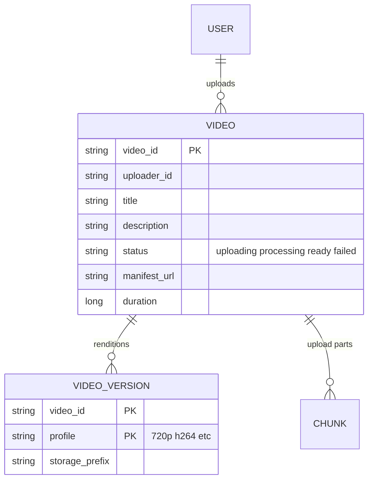
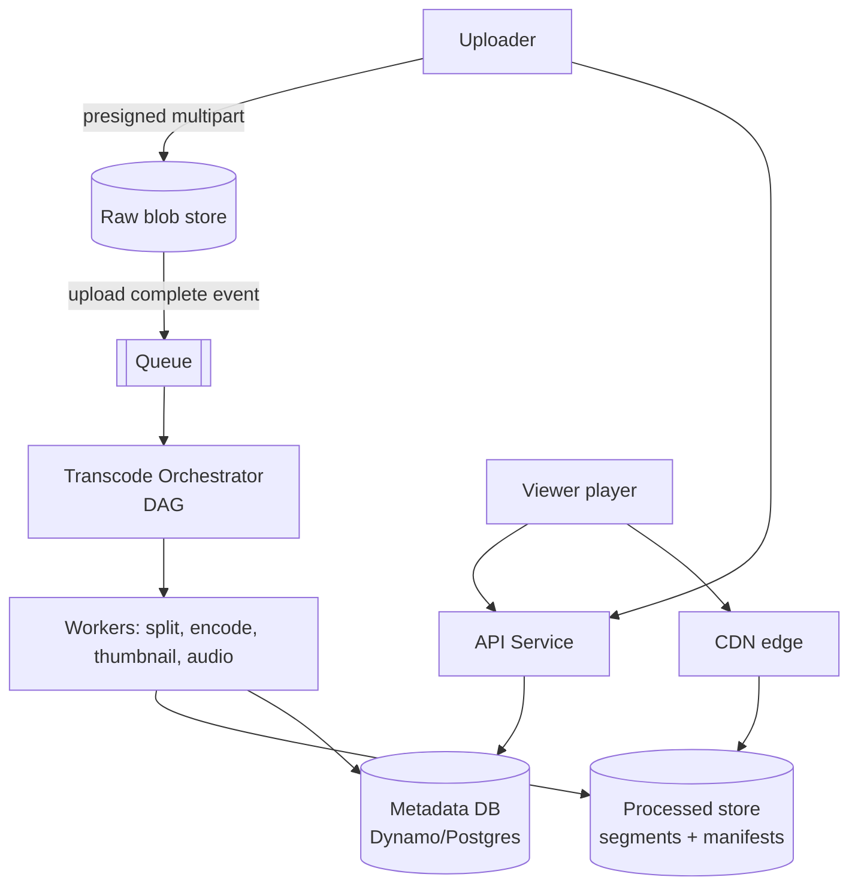
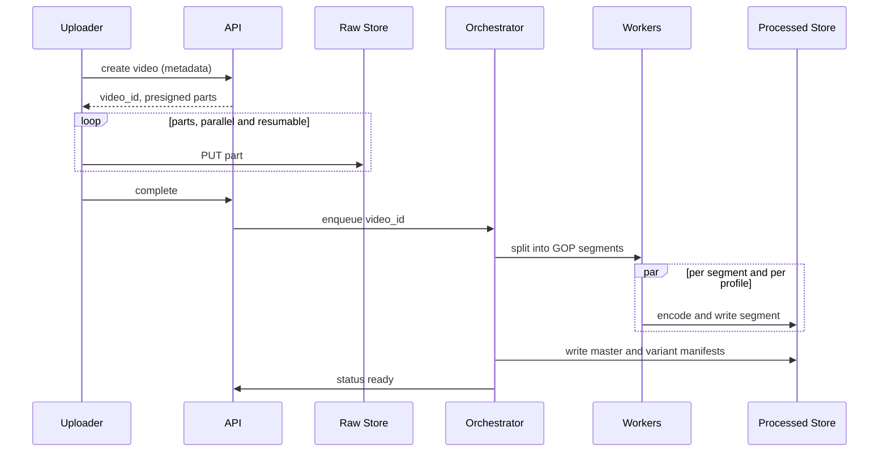

# Designing YouTube (Video Upload and Streaming)

> Interview-ready walkthrough: requirements → estimates → entities → API → HLD → deep dives (**resumable large uploads, transcoding pipeline, adaptive bitrate streaming, CDN, metadata scale**) → trade-offs. The hard parts are the **upload/transcode pipeline** and **global video delivery**.

---

## 0. Talk track

1. Clarify: upload, watch (stream), search out of scope. 1M-ish uploads/day, 100M+ views.
2. Insight: video is **big and immutable**; metadata is small; delivery is bandwidth-dominated.
3. HLD: upload to blob store, async transcode DAG, store segments, serve via CDN + manifest.
4. Deep dives: chunked upload, parallel transcoding, ABR (HLS/DASH), CDN and hot content, failures.

---

## 1. Problem

Users upload videos; others stream them with **minimal buffering** on any device and network.

**What makes it hard**
- Raw uploads are GBs; need resumable transfer.
- Each video must be **transcoded into many resolutions/codecs**.
- Delivery: PBs per day; must go through **CDN**, adapt to bandwidth.
- Highly available: viewing > consistency.

---

## 2. Requirements

### Functional
- Upload videos.
- Watch (stream) videos.

**Out of scope:** search, recommendations, comments/likes, subscriptions, live streaming, DRM.

### Non-functional
- **High availability** (eventual consistency OK).
- Support **large videos** (up to 256 GB), resumable.
- **Low-latency playback**, minimal buffering, adaptive to network.
- Scale: **1M videos uploaded/day, 100M DAU**.

---

## 3. Estimation

| Quantity | Assumption | Result |
|---|---|---|
| Uploads | 1M/day, 500 MB avg | **500 TB/day raw** |
| Transcoded copies | about 6 renditions totaling about 3x raw | **about 1.5 PB/day** stored |
| Views | 100M DAU x 5 videos x 50 MB | **25 PB/day egress** |
| Peak egress | | **about 1 Tbps+**, CDN essential |
| Metadata | 1M/day x 1 KB | 1 GB/day (tiny) |

**Consequences**
- Blobs go to object storage; **never through app servers**.
- 25 PB/day egress is impossible from one origin, so a **CDN/ISP caches** are the delivery tier.
- Storage cost drives tiering (hot recent, cold old), and codec efficiency.

---

## 4. Entities



---

## 5. API

```http
POST /videos            { title, description, size, content_type } -> { video_id, upload_id, presigned part urls }
PUT  <presigned url>    # client uploads chunk directly to S3 multipart
POST /videos/{id}/complete {parts:[etag...]}                       -> 202 processing
GET  /videos/{id}                                                  -> metadata + manifest_url (HLS/DASH)
GET  <CDN>/{id}/master.m3u8  and segments  *.ts / *.m4s            # player streams
```

---

## 6. Architecture



---

## 7. Upload and process flow



---

## 8. Deep dive 1: large uploads

Presigned **multipart upload** straight to object storage: parallel parts, per-part retry, resumable via `ListParts`; server tracks `status` (see Dropbox doc). Cleanup incomplete uploads by lifecycle policy.

## 9. Deep dive 2: transcoding

- Split the raw file into **GOP-aligned segments** (e.g. 2-10 s), and run encode jobs **in parallel** per segment per profile (240p to 4K, H.264/VP9/AV1), plus audio, thumbnails, captions.
- Orchestrate as a **DAG** (Temporal / Step Functions / queue + workers); idempotent tasks keyed by `(video_id, segment, profile)`.
- Fault tolerance: retry failed segments only; poison inputs go to a dead-letter queue and mark the video `failed`.
- Cost: spot instances, hardware encoders; skip high-res for low-view videos; **encode lazily** for the long tail.

**One-liner:** *Segment, fan out encodes, stitch with a manifest.*

## 10. Deep dive 3: adaptive streaming

- **HLS/DASH**: each rendition cut into short segments; a **manifest** lists them. The player measures throughput and **switches bitrate per segment**.
- Segments are static immutable files, so **perfectly cacheable** on a CDN (long TTL, content-addressed paths).
- Start with a lower rendition for fast start; seek by jumping to the segment index.

## 11. Deep dive 4: CDN and hot content

| Approach | Verdict |
|---|---|
| Serve from origin | Bad: cannot sustain egress |
| **CDN edge caching** with tiered origins (edge, regional, origin shield) | Great |
| **Pre-position** popular and new viral videos to edges / ISP caches (Open Connect style) | Great for the head |

Long-tail videos are fetched on demand and may be evicted; viral spikes are protected by the origin shield (request coalescing).

## 12. Metadata scale

Small data; shard by `video_id` (Dynamo/Cassandra) or Postgres + replicas + cache. View counts are separate (sharded counters, async aggregation) and out of scope.

---

## 13. Failure handling

| Failure | Mitigation |
|---|---|
| Upload interruption | Multipart resume |
| Encode worker dies | Task retry; idempotent output paths |
| Queue backlog | Autoscale workers, priority for new/popular |
| CDN POP down | Anycast/DNS reroute, multi-CDN |
| Origin down | Edge serves cached; replicas across regions |
| Corrupt file | Validate on probe (ffprobe), reject early |

---

## 14. Trade-offs

| Decision | Chosen | Alternative | Given up |
|---|---|---|---|
| Transcode | Parallel segments | Whole-file | Orchestration complexity |
| Storage | Many renditions | On-the-fly transcode | Storage cost vs CPU/latency |
| Delivery | CDN + ABR | Progressive download | Segment/manifest overhead |
| Encode all profiles | Lazy for tail | Eager | First-view latency |
| Consistency | Eventual | Strong | Video appears slightly later |

---

## 15. Level expectations

- **Mid:** blob store, metadata, CDN idea.
- **Senior:** multipart upload, async DAG, HLS/DASH, segment parallelism.
- **Staff+:** egress math, ISP caching, codec/cost strategy, lazy encoding, failure and capacity planning.

## 16. Follow-ups

Live streaming (RTMP ingest, low-latency HLS), DRM, recommendations, view counting, content moderation, thumbnails/previews.

## 17. Summary checklist

- [ ] Presigned multipart direct upload
- [ ] Segmented parallel transcode DAG
- [ ] HLS/DASH manifests, ABR
- [ ] CDN with origin shield, pre-position hot
- [ ] Small sharded metadata DB
